

How to read it: a parallelogram is a raw material (a bestia drops it, or a player gathers or mines it), a
box is something a recipe makes, and an arrow carries the amount that goes in. The rules behind the chains are
on the [crafting chains](/docs/mechanics/items-crafting/crafting-chains/) page.

## Furnace

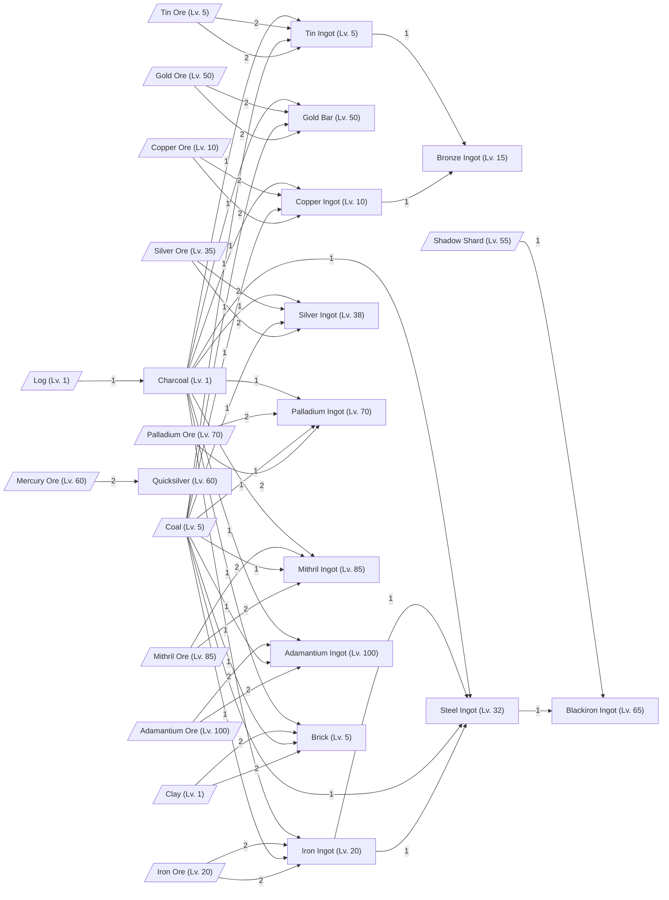

| Recipe | Needs | Makes | Skill | Success | Seconds | Known from the start |
| --- | --- | --- | --- | --- | --- | --- |
| `ADAMANTIUM_INGOT` | 2 x Adamantium Ore (Lv. 100), 1 x Coal (Lv. 5) | 1 x Adamantium Ingot (Lv. 100) | ore refinement 3 | -60% | 24.0 | yes |
| `ADAMANTIUM_INGOT_CHARCOAL` | 2 x Adamantium Ore (Lv. 100), 1 x Charcoal (Lv. 1) | 1 x Adamantium Ingot (Lv. 100) | ore refinement 3 | -70% | 24.0 | yes |
| `BLACKIRON_INGOT` | 1 x Steel Ingot (Lv. 32), 1 x Shadow Shard (Lv. 55) | 1 x Blackiron Ingot (Lv. 65) | ore refinement 3 | -25% | 18.0 | yes |
| `BRICK` | 2 x Clay (Lv. 1), 1 x Coal (Lv. 5) | 2 x Brick (Lv. 5) | ore refinement 1 | 60% | 8.0 | yes |
| `BRICK_CHARCOAL` | 2 x Clay (Lv. 1), 1 x Charcoal (Lv. 1) | 2 x Brick (Lv. 5) | ore refinement 1 | 50% | 8.0 | yes |
| `BRONZE_INGOT` | 1 x Copper Ingot (Lv. 10), 1 x Tin Ingot (Lv. 5) | 1 x Bronze Ingot (Lv. 15) | ore refinement 1 | 25% | 12.0 | yes |
| `CHARCOAL` | 1 x Log (Lv. 1) | 3 x Charcoal (Lv. 1) | ore refinement 1 | 100% | 10.0 | yes |
| `COPPER_INGOT` | 2 x Copper Ore (Lv. 10), 1 x Coal (Lv. 5) | 1 x Copper Ingot (Lv. 10) | ore refinement 1 | 30% | 10.0 | yes |
| `COPPER_INGOT_CHARCOAL` | 2 x Copper Ore (Lv. 10), 1 x Charcoal (Lv. 1) | 1 x Copper Ingot (Lv. 10) | ore refinement 1 | 20% | 10.0 | yes |
| `GOLD_BAR` | 2 x Gold Ore (Lv. 50), 1 x Coal (Lv. 5) | 1 x Gold Bar (Lv. 50) | ore refinement 1 | -10% | 14.0 | yes |
| `GOLD_BAR_CHARCOAL` | 2 x Gold Ore (Lv. 50), 1 x Charcoal (Lv. 1) | 1 x Gold Bar (Lv. 50) | ore refinement 1 | -20% | 14.0 | yes |
| `IRON_INGOT` | 2 x Iron Ore (Lv. 20), 1 x Coal (Lv. 5) | 1 x Iron Ingot (Lv. 20) | ore refinement 1 | 20% | 10.0 | yes |
| `IRON_INGOT_CHARCOAL` | 2 x Iron Ore (Lv. 20), 1 x Charcoal (Lv. 1) | 1 x Iron Ingot (Lv. 20) | ore refinement 1 | 10% | 10.0 | yes |
| `MITHRIL_INGOT` | 2 x Mithril Ore (Lv. 85), 1 x Coal (Lv. 5) | 1 x Mithril Ingot (Lv. 85) | ore refinement 3 | -45% | 20.0 | yes |
| `MITHRIL_INGOT_CHARCOAL` | 2 x Mithril Ore (Lv. 85), 1 x Charcoal (Lv. 1) | 1 x Mithril Ingot (Lv. 85) | ore refinement 3 | -55% | 20.0 | yes |
| `PALLADIUM_INGOT` | 2 x Palladium Ore (Lv. 70), 1 x Coal (Lv. 5) | 1 x Palladium Ingot (Lv. 70) | ore refinement 3 | -30% | 18.0 | yes |
| `PALLADIUM_INGOT_CHARCOAL` | 2 x Palladium Ore (Lv. 70), 1 x Charcoal (Lv. 1) | 1 x Palladium Ingot (Lv. 70) | ore refinement 3 | -40% | 18.0 | yes |
| `QUICKSILVER` | 2 x Mercury Ore (Lv. 60) | 1 x Quicksilver (Lv. 60) | ore refinement 3 | -20% | 16.0 | yes |
| `SILVER_INGOT` | 2 x Silver Ore (Lv. 35), 1 x Coal (Lv. 5) | 1 x Silver Ingot (Lv. 38) | ore refinement 2 | 5% | 14.0 | yes |
| `SILVER_INGOT_CHARCOAL` | 2 x Silver Ore (Lv. 35), 1 x Charcoal (Lv. 1) | 1 x Silver Ingot (Lv. 38) | ore refinement 2 | -5% | 14.0 | yes |
| `STEEL_INGOT` | 1 x Iron Ingot (Lv. 20), 1 x Coal (Lv. 5) | 1 x Steel Ingot (Lv. 32) | ore refinement 2 | 8% | 14.0 | yes |
| `STEEL_INGOT_CHARCOAL` | 1 x Iron Ingot (Lv. 20), 1 x Charcoal (Lv. 1) | 1 x Steel Ingot (Lv. 32) | ore refinement 2 | -2% | 14.0 | yes |
| `TIN_INGOT` | 2 x Tin Ore (Lv. 5), 1 x Coal (Lv. 5) | 1 x Tin Ingot (Lv. 5) | ore refinement 1 | 30% | 10.0 | yes |
| `TIN_INGOT_CHARCOAL` | 2 x Tin Ore (Lv. 5), 1 x Charcoal (Lv. 1) | 1 x Tin Ingot (Lv. 5) | ore refinement 1 | 20% | 10.0 | yes |

## Forge

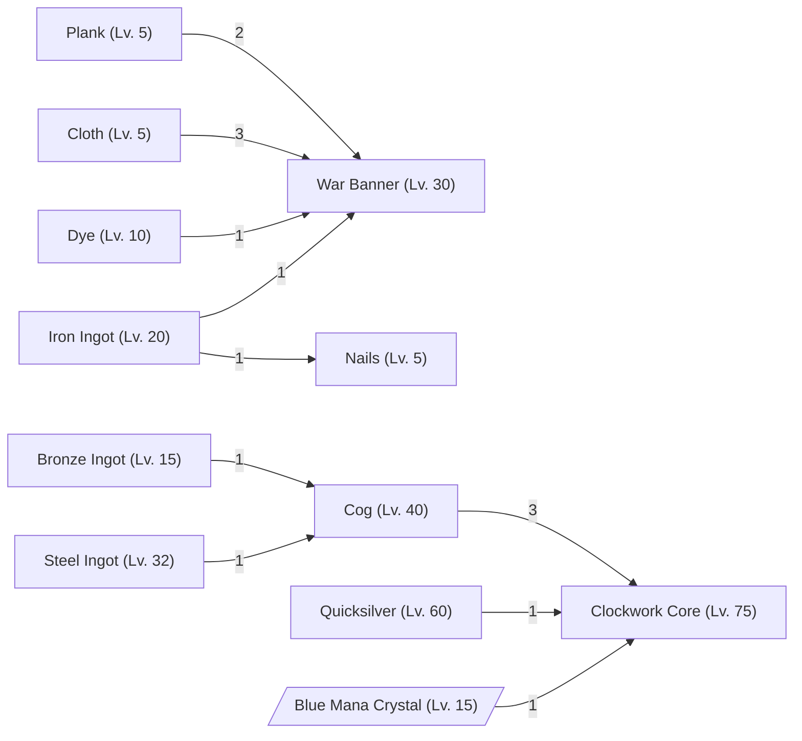

| Recipe | Needs | Makes | Skill | Success | Seconds | Known from the start |
| --- | --- | --- | --- | --- | --- | --- |
| `AEGIS_OF_THE_UNBROKEN` | 5 x Mithril Ingot (Lv. 85), 2 x Leather (Lv. 5), 2 x Nails (Lv. 5) | 1 x Aegis of the Unbroken (Lv. 65) | forge armor 10 | -40% | 11290.8 | discover |
| `ALCHEMISTS_LANCET` | 2 x Steel Ingot (Lv. 32), 1 x Flint (Lv. 1), 2 x Venom Sac (Lv. 15) | 1 x Alchemist's Lancet (Lv. 31) | forge weapon 4 | 51% | 1555.2 | discover |
| `ALEMBIC_MACE` | 3 x Iron Ingot (Lv. 20), 2 x Loose Stone (Lv. 1), 1 x Cloth (Lv. 5) | 1 x Alembic Mace (Lv. 48) | forge weapon 5 | 30% | 3000.0 | discover |
| `ANVILHEART` | 3 x Adamantium Ingot (Lv. 100), 2 x Cut Stone (Lv. 10), 1 x Obsidian (Lv. 50) | 1 x Anvilheart (Lv. 79) | forge weapon 10 | -39% | 11059.2 | discover |
| `ARMING_SWORD` | 3 x Steel Ingot (Lv. 32), 1 x Flint (Lv. 1) | 1 x Arming Sword (Lv. 20) | forge weapon 2 | 75% | 480.0 | discover |
| `ARTIFICERS_BRASS_HARNESS` | 5 x Blackiron Ingot (Lv. 65), 1 x Leather (Lv. 5), 1 x Nails (Lv. 5), 1 x Cog (Lv. 40), 1 x Bone Shard (Lv. 5) | 1 x Artificer's Brass Harness (Lv. 70) | forge armor 8 | -3% | 6220.8 | discover |
| `ASSASSINS_DAGGER` | 2 x Steel Ingot (Lv. 32), 1 x Flint (Lv. 1), 2 x Void Essence (Lv. 30) | 1 x Assassin's Dagger (Lv. 37) | forge weapon 5 | 36% | 2539.2 | discover |
| `BANDED_PLATE` | 5 x Iron Ingot (Lv. 20), 4 x Leather (Lv. 5), 4 x Nails (Lv. 5), 1 x Stick (Lv. 1), 1 x Reed Stalk (Lv. 1) | 1 x Banded Plate (Lv. 40) | forge armor 4 | 45% | 1920.0 | discover |
| `BAND_OF_A_THOUSAND_BARGAINS` | 2 x Mithril Ingot (Lv. 85), 1 x Mana Essence (Lv. 5) | 1 x Band of a Thousand Bargains (Lv. 87) | forge armor 9 | -30% | 9720.0 | discover |
| `BARDICHE` | 4 x Iron Ingot (Lv. 20), 3 x Stick (Lv. 1), 1 x Flint (Lv. 1), 1 x Clay (Lv. 1), 1 x Lamp Oil (Lv. 5) | 1 x Bardiche (Lv. 22) | forge weapon 3 | 72% | 580.8 | discover |
| `BARDS_CHARM_BRACELET` | 1 x Silver Ingot (Lv. 38), 1 x Mana Essence (Lv. 5) | 1 x Bard's Charm Bracelet (Lv. 49) | forge armor 5 | 30% | 3000.0 | discover |
| `BASCINET` | 2 x Steel Ingot (Lv. 32), 2 x Leather (Lv. 5), 2 x Nails (Lv. 5), 1 x Lamp Oil (Lv. 5), 1 x Mana Essence (Lv. 5) | 1 x Bascinet (Lv. 51) | forge armor 6 | 27% | 3244.8 | discover |
| `BASTION_OF_THE_FIRST_WALL` | 4 x Adamantium Ingot (Lv. 100), 2 x Leather (Lv. 5), 2 x Nails (Lv. 5), 1 x Stick (Lv. 1) | 1 x Bastion of the First Wall (Lv. 85) | forge armor 10 | -37% | 10830.0 | discover |
| `BASTION_PLATE` | 5 x Palladium Ingot (Lv. 70), 2 x Leather (Lv. 5), 2 x Nails (Lv. 5), 1 x Salt (Lv. 1), 1 x Coal (Lv. 5) | 1 x Bastion Plate (Lv. 68) | forge armor 8 | -3% | 6220.8 | discover |
| `BEARDED_AXE` | 2 x Bronze Ingot (Lv. 15), 1 x Stick (Lv. 1), 1 x Flint (Lv. 1), 1 x Feather (Lv. 1), 1 x Salt (Lv. 1) | 1 x Bearded Axe (Lv. 12) | forge weapon 2 | 87% | 172.8 | discover |
| `BEARDED_GREATAXE` | 4 x Steel Ingot (Lv. 32), 2 x Stick (Lv. 1), 1 x Flint (Lv. 1), 1 x Horn (Lv. 10), 1 x Lamp Oil (Lv. 5) | 1 x Bearded Greataxe (Lv. 43) | forge weapon 5 | 39% | 2323.2 | discover |
| `BEC_DE_CORBIN` | 4 x Palladium Ingot (Lv. 70), 3 x Stick (Lv. 1), 1 x Flint (Lv. 1), 1 x Nails (Lv. 5) | 1 x Bec de Corbin (Lv. 58) | forge weapon 7 | 12% | 4612.8 | discover |
| `BILLHOOK` | 3 x Bronze Ingot (Lv. 15), 6 x Stick (Lv. 1), 2 x Flint (Lv. 1), 1 x Resin (Lv. 1), 1 x Coal (Lv. 5) | 1 x Billhook (Lv. 14) | forge weapon 2 | 84% | 235.2 | discover |
| `BLACKIRON_CLEAVER` | 2 x Blackiron Ingot (Lv. 65), 1 x Stick (Lv. 1), 1 x Flint (Lv. 1), 1 x Coal (Lv. 5) | 1 x Blackiron Cleaver (Lv. 72) | forge weapon 8 | -6% | 6571.2 | discover |
| `BLACKIRON_FULLPLATE` | 5 x Blackiron Ingot (Lv. 65), 2 x Leather (Lv. 5), 2 x Nails (Lv. 5), 1 x Bone Shard (Lv. 5), 1 x Lamp Oil (Lv. 5) | 1 x Blackiron Fullplate (Lv. 77) | forge armor 8 | -15% | 7680.0 | discover |
| `BOAR_SPEAR` | 2 x Steel Ingot (Lv. 32), 2 x Stick (Lv. 1), 1 x Sharp Fang (Lv. 5), 1 x Lamp Oil (Lv. 5), 1 x Mana Essence (Lv. 5) | 1 x Boar Spear (Lv. 24) | forge weapon 3 | 66% | 811.2 | discover |
| `BOOTS_OF_THE_SEVEN_LEAGUES` | 2 x Dragon Scale (Lv. 75), 1 x Leather (Lv. 5), 2 x Storm Feather (Lv. 65) | 1 x Boots of the Seven Leagues (Lv. 88) | forge armor 9 | -30% | 9720.0 | discover |
| `BRASS_CONDUIT_STAFF` | 3 x Steel Ingot (Lv. 32), 2 x Stick (Lv. 1), 2 x Clockwork Core (Lv. 75) | 1 x Brass Conduit Staff (Lv. 40) | forge weapon 5 | 42% | 2116.8 | discover |
| `BRASS_GAUNTLET` | 2 x Steel Ingot (Lv. 32), 2 x Leather (Lv. 5), 2 x Cog (Lv. 40) | 1 x Brass Gauntlet (Lv. 50) | forge weapon 6 | 27% | 3244.8 | discover |
| `BROADSWORD` | 2 x Iron Ingot (Lv. 20), 2 x Flint (Lv. 1), 1 x Clay (Lv. 1), 1 x Coal (Lv. 5) | 1 x Broadsword (Lv. 28) | forge weapon 3 | 63% | 940.8 | discover |
| `BROAD_AXE` | 3 x Iron Ingot (Lv. 20), 1 x Stick (Lv. 1), 1 x Flint (Lv. 1) | 1 x Broad Axe (Lv. 20) | forge weapon 2 | 75% | 480.0 | discover |
| `BRONZE_HEADED_MAUL` | 3 x Bronze Ingot (Lv. 15), 4 x Cut Stone (Lv. 10), 1 x Clay (Lv. 1) | 1 x Bronze-Headed Maul (Lv. 45) | forge weapon 5 | 36% | 2539.2 | discover |
| `BRONZE_HEATER` | 3 x Bronze Ingot (Lv. 15), 1 x Leather (Lv. 5), 1 x Nails (Lv. 5), 1 x Lamp Oil (Lv. 5), 1 x Mana Essence (Lv. 5) | 1 x Bronze Heater (Lv. 26) | forge armor 3 | 66% | 811.2 | discover |
| `BRONZE_SALLET` | 2 x Bronze Ingot (Lv. 15), 1 x Leather (Lv. 5), 1 x Nails (Lv. 5), 1 x Salt (Lv. 1), 1 x Coal (Lv. 5) | 1 x Bronze Sallet (Lv. 20) | forge armor 2 | 75% | 480.0 | discover |
| `BRONZE_STILETTO` | 2 x Bronze Ingot (Lv. 15), 1 x Flint (Lv. 1), 1 x Clay (Lv. 1), 1 x Lamp Oil (Lv. 5) | 1 x Bronze Stiletto (Lv. 26) | forge weapon 3 | 60% | 1080.0 | discover |
| `BULWARK_PAVISE` | 4 x Palladium Ingot (Lv. 70), 2 x Leather (Lv. 5), 2 x Nails (Lv. 5), 1 x Cloth (Lv. 5), 1 x Reed Stalk (Lv. 1) | 1 x Bulwark Pavise (Lv. 59) | forge armor 6 | 15% | 4320.0 | discover |
| `CATHEDRAL_TOWER_SHIELD` | 4 x Mithril Ingot (Lv. 85), 2 x Leather (Lv. 5), 2 x Nails (Lv. 5), 2 x Sun Herb (Lv. 80) | 1 x Cathedral Tower Shield (Lv. 76) | forge armor 8 | -12% | 7300.8 | discover |
| `CAVALRY_LANCE` | 3 x Steel Ingot (Lv. 32), 2 x Stick (Lv. 1), 1 x Sharp Fang (Lv. 5), 1 x Cloth (Lv. 5), 1 x Rope (Lv. 3) | 1 x Cavalry Lance (Lv. 33) | forge weapon 4 | 54% | 1387.2 | discover |
| `CENSER_FLAIL` | 3 x Iron Ingot (Lv. 20), 4 x Loose Stone (Lv. 1), 1 x Lamp Oil (Lv. 5) | 1 x Censer Flail (Lv. 41) | forge weapon 5 | 42% | 2116.8 | discover |
| `CHAIN_WHIP` | 2 x Steel Ingot (Lv. 32), 2 x Rope (Lv. 3), 1 x Lamp Oil (Lv. 5) | 1 x Chain Whip (Lv. 35) | forge weapon 4 | 51% | 1555.2 | discover |
| `CIRCLET_OF_CLARITY` | 2 x Blackiron Ingot (Lv. 65), 2 x Mana Ink (Lv. 35) | 1 x Circlet of Clarity (Lv. 51) | forge armor 6 | 24% | 3499.2 | discover |
| `CLAYMORE` | 4 x Steel Ingot (Lv. 32), 1 x Flint (Lv. 1), 1 x Leather (Lv. 5), 2 x Obsidian (Lv. 50) | 1 x Claymore (Lv. 38) | forge weapon 4 | 48% | 1732.8 | discover |
| `CLOCKWORK_ARBALEST` | 4 x Adamantium Ingot (Lv. 100), 2 x Nails (Lv. 5), 1 x Rope (Lv. 3), 1 x Cog (Lv. 40), 1 x Lamp Oil (Lv. 5) | 1 x Clockwork Arbalest (Lv. 80) | forge weapon 10 | -37% | 10830.0 | discover |
| `CLOCKWORK_CORE` | 3 x Cog (Lv. 40), 1 x Quicksilver (Lv. 60), 1 x Blue Mana Crystal (Lv. 15) | 1 x Clockwork Core (Lv. 75) | forge weapon 5 | 40% | 30.0 | yes |
| `COG_BRONZE` | 1 x Bronze Ingot (Lv. 15) | 2 x Cog (Lv. 40) | forge weapon 2 | 80% | 8.0 | yes |
| `COG_STEEL` | 1 x Steel Ingot (Lv. 32) | 2 x Cog (Lv. 40) | forge weapon 2 | 80% | 8.0 | yes |
| `COMBAT_KNIFE` | 2 x Bronze Ingot (Lv. 15), 1 x Flint (Lv. 1), 1 x Salt (Lv. 1) | 1 x Combat Knife (Lv. 18) | forge weapon 2 | 78% | 388.8 | discover |
| `COPPER_BAND` | 2 x Copper Ingot (Lv. 10), 1 x Lamp Oil (Lv. 5) | 1 x Copper Band (Lv. 8) | forge armor 1 | 90% | 76.8 | discover |
| `COURIERS_BOOTS` | 2 x Dragon Scale (Lv. 75), 1 x Leather (Lv. 5), 1 x Reed Stalk (Lv. 1) | 1 x Courier's Boots (Lv. 69) | forge armor 7 | 0% | 5880.0 | discover |
| `CRESCENT_AXE` | 3 x Blackiron Ingot (Lv. 65), 1 x Stick (Lv. 1), 1 x Flint (Lv. 1), 1 x Bone Shard (Lv. 5) | 1 x Crescent Axe (Lv. 52) | forge weapon 6 | 24% | 3499.2 | discover |
| `CRESTED_WARHELM` | 3 x Mithril Ingot (Lv. 85), 2 x Leather (Lv. 5), 2 x Nails (Lv. 5), 1 x Bone Shard (Lv. 5), 1 x Salt (Lv. 1) | 1 x Crested Warhelm (Lv. 74) | forge armor 8 | -12% | 7300.8 | discover |
| `CROWN_OF_THE_ECLIPSE` | 2 x Adamantium Ingot (Lv. 100), 2 x Void Essence (Lv. 30) | 1 x Crown of the Eclipse (Lv. 81) | forge armor 10 | -31% | 9937.2 | discover |
| `DAGGER` | 2 x Bronze Ingot (Lv. 15), 2 x Flint (Lv. 1), 1 x Bone Shard (Lv. 5), 1 x Reed Stalk (Lv. 1) | 1 x Dagger (Lv. 10) | forge weapon 1 | 90% | 120.0 | discover |
| `DARTS` | 2 x Bronze Ingot (Lv. 15), 2 x Feather (Lv. 1), 1 x Salt (Lv. 1) | 1 x Darts (Lv. 14) | forge weapon 2 | 84% | 235.2 | discover |
| `DAWNBRINGER` | 3 x Mithril Ingot (Lv. 85), 2 x Loose Stone (Lv. 1), 1 x Ember Core (Lv. 45) | 1 x Dawnbringer (Lv. 82) | forge weapon 10 | -37% | 10830.0 | discover |
| `DEEPDELVERS_BOOTS` | 3 x Dragon Scale (Lv. 75), 1 x Leather (Lv. 5), 1 x Nails (Lv. 5), 1 x Lodestone (Lv. 45) | 1 x Deepdelver's Boots (Lv. 75) | forge armor 8 | -9% | 6931.2 | discover |
| `DEEPFORGED_HAUBERK` | 5 x Adamantium Ingot (Lv. 100), 1 x Leather (Lv. 5), 1 x Nails (Lv. 5), 2 x Obsidian (Lv. 50) | 1 x Deepforged Hauberk (Lv. 77) | forge armor 10 | -33% | 10156.8 | discover |
| `DOUBLE_BITTED_AXE` | 4 x Steel Ingot (Lv. 32), 2 x Stick (Lv. 1), 1 x Flint (Lv. 1) | 1 x Double-Bitted Axe (Lv. 35) | forge weapon 4 | 51% | 1555.2 | discover |
| `DUELISTS_PARRYING_BUCKLER` | 3 x Steel Ingot (Lv. 32), 1 x Leather (Lv. 5), 1 x Cloth (Lv. 5) | 1 x Duelist's Parrying Buckler (Lv. 47) | forge armor 5 | 30% | 3000.0 | discover |
| `DUSKFORGED_FALCHION` | 2 x Palladium Ingot (Lv. 70), 1 x Flint (Lv. 1), 2 x Ectoplasm (Lv. 25) | 1 x Duskforged Falchion (Lv. 67) | forge weapon 7 | 0% | 5880.0 | discover |
| `EARRING_OF_THE_DANCING_BLADE` | 1 x Palladium Ingot (Lv. 70) | 1 x Earring of the Dancing Blade (Lv. 55) | forge armor 6 | 18% | 4036.8 | discover |
| `EARTHSHAKER_MAUL` | 4 x Palladium Ingot (Lv. 70), 2 x Cut Stone (Lv. 10), 2 x Obsidian (Lv. 50) | 1 x Earthshaker Maul (Lv. 61) | forge weapon 7 | 9% | 4915.2 | discover |
| `EMERALD_RING_OF_GROWTH` | 1 x Palladium Ingot (Lv. 70), 1 x Cut Emerald (Lv. 40) | 1 x Emerald Ring of Growth (Lv. 65) | forge armor 7 | 6% | 5227.2 | discover |
| `EVERFLAME_LANTERN` | 3 x Blackiron Ingot (Lv. 65), 1 x Lamp Oil (Lv. 5), 1 x Glass (Lv. 8), 1 x Lens (Lv. 30) | 1 x Everflame Lantern (Lv. 59) | forge armor 6 | 15% | 4320.0 | discover |
| `EXECUTIONERS_SWORD` | 3 x Steel Ingot (Lv. 32), 1 x Flint (Lv. 1), 1 x Leather (Lv. 5), 1 x Cloth (Lv. 5), 1 x Salt (Lv. 1) | 1 x Executioner's Sword (Lv. 42) | forge weapon 5 | 36% | 2539.2 | discover |
| `FLAMBERGE` | 4 x Iron Ingot (Lv. 20), 1 x Flint (Lv. 1), 1 x Leather (Lv. 5), 2 x Ember Core (Lv. 45) | 1 x Flamberge (Lv. 30) | forge weapon 3 | 60% | 1080.0 | discover |
| `FLANGED_MACE` | 3 x Iron Ingot (Lv. 20), 2 x Loose Stone (Lv. 1) | 1 x Flanged Mace (Lv. 12) | forge weapon 2 | 87% | 172.8 | discover |
| `FORGEMASTERS_LABRYS` | 4 x Mithril Ingot (Lv. 85), 2 x Stick (Lv. 1), 1 x Flint (Lv. 1), 1 x Ember Core (Lv. 45) | 1 x Forgemaster's Labrys (Lv. 73) | forge weapon 8 | -9% | 6931.2 | discover |
| `FORGE_HAMMER` | 4 x Steel Ingot (Lv. 32), 2 x Cut Stone (Lv. 10), 2 x Ember Core (Lv. 45) | 1 x Forge Hammer (Lv. 36) | forge weapon 4 | 48% | 1732.8 | discover |
| `GARNET_RING` | 1 x Gold Bar (Lv. 50), 1 x Cut Garnet (Lv. 30) | 1 x Garnet Ring (Lv. 39) | forge armor 5 | 39% | 2323.2 | discover |
| `GEARLOCK_SHIELD` | 4 x Palladium Ingot (Lv. 70), 1 x Leather (Lv. 5), 1 x Nails (Lv. 5), 1 x Clockwork Core (Lv. 75), 1 x Lamp Oil (Lv. 5) | 1 x Gearlock Shield (Lv. 71) | forge armor 8 | -3% | 6220.8 | discover |
| `GEARWORK_DIRK` | 3 x Blackiron Ingot (Lv. 65), 1 x Flint (Lv. 1), 2 x Cog (Lv. 40) | 1 x Gearwork Dirk (Lv. 54) | forge weapon 6 | 21% | 3763.2 | discover |
| `GEARWORK_SIEGE_CROSSBOW` | 4 x Mithril Ingot (Lv. 85), 2 x Nails (Lv. 5), 1 x Rope (Lv. 3), 2 x Clockwork Core (Lv. 75) | 1 x Gearwork Siege Crossbow (Lv. 72) | forge weapon 8 | -6% | 6571.2 | discover |
| `GEARWRIGHTS_HELM` | 2 x Palladium Ingot (Lv. 70), 1 x Leather (Lv. 5), 1 x Nails (Lv. 5), 2 x Clockwork Core (Lv. 75) | 1 x Gearwright's Helm (Lv. 68) | forge armor 7 | 0% | 5880.0 | discover |
| `GIANT_HUNTERS_SLING` | 3 x Dragon Scale (Lv. 75), 2 x Rope (Lv. 3), 2 x Medicinal Herb (Lv. 20) | 1 x Giant-Hunter's Sling (Lv. 62) | forge weapon 7 | 9% | 4915.2 | discover |
| `GILDED_TONGUE` | 3 x Adamantium Ingot (Lv. 100), 1 x Flint (Lv. 1) | 1 x Gilded Tongue (Lv. 73) | forge weapon 10 | -31% | 9937.2 | discover |
| `GLADIUS` | 3 x Iron Ingot (Lv. 20), 2 x Flint (Lv. 1), 1 x Lamp Oil (Lv. 5) | 1 x Gladius (Lv. 12) | forge weapon 2 | 87% | 172.8 | discover |
| `GLAIVE` | 3 x Steel Ingot (Lv. 32), 3 x Stick (Lv. 1), 1 x Flint (Lv. 1), 1 x Horn (Lv. 10), 1 x Reed Stalk (Lv. 1) | 1 x Glaive (Lv. 36) | forge weapon 4 | 48% | 1732.8 | discover |
| `GLOWCAP_LANTERN` | 2 x Steel Ingot (Lv. 32), 3 x Lamp Oil (Lv. 5), 1 x Glass (Lv. 8) | 1 x Glowcap Lantern (Lv. 50) | forge armor 5 | 30% | 3000.0 | discover |
| `GREATAXE` | 3 x Steel Ingot (Lv. 32), 2 x Stick (Lv. 1), 1 x Flint (Lv. 1), 1 x Salt (Lv. 1), 1 x Coal (Lv. 5) | 1 x Greataxe (Lv. 20) | forge weapon 2 | 75% | 480.0 | discover |
| `GREAT_HELM` | 2 x Iron Ingot (Lv. 20), 2 x Leather (Lv. 5), 2 x Nails (Lv. 5), 1 x Clay (Lv. 1), 1 x Coal (Lv. 5) | 1 x Great Helm (Lv. 40) | forge armor 4 | 45% | 1920.0 | discover |
| `GREAT_KNIFE` | 2 x Steel Ingot (Lv. 32), 2 x Flint (Lv. 1), 1 x Bone Shard (Lv. 5) | 1 x Great Knife (Lv. 26) | forge weapon 3 | 66% | 811.2 | discover |
| `GUISARME` | 4 x Iron Ingot (Lv. 20), 6 x Stick (Lv. 1), 2 x Flint (Lv. 1), 1 x Nails (Lv. 5), 1 x Coal (Lv. 5) | 1 x Guisarme (Lv. 30) | forge weapon 3 | 60% | 1080.0 | discover |
| `HAND_AXE` | 2 x Copper Ingot (Lv. 10), 2 x Stick (Lv. 1), 2 x Flint (Lv. 1), 1 x Lamp Oil (Lv. 5), 1 x Mana Essence (Lv. 5) | 1 x Hand Axe (Lv. 5) | forge weapon 1 | 90% | 30.0 | discover |
| `HIDE_OF_THE_NIGHTSTALKER` | 4 x Dragon Scale (Lv. 75), 1 x Leather (Lv. 5), 2 x Shadow Shard (Lv. 55) | 1 x Hide of the Nightstalker (Lv. 62) | forge armor 10 | -34% | 10378.8 | discover |
| `HOODED_LANTERN` | 2 x Steel Ingot (Lv. 32), 1 x Lamp Oil (Lv. 5), 1 x Glass (Lv. 8), 2 x Lens (Lv. 30) | 1 x Hooded Lantern (Lv. 30) | forge armor 3 | 60% | 1080.0 | discover |
| `HOOD_OF_THE_SILENT_HUNT` | 2 x Dragon Scale (Lv. 75), 1 x Leather (Lv. 5), 2 x Ectoplasm (Lv. 25) | 1 x Hood of the Silent Hunt (Lv. 71) | forge armor 8 | -6% | 6571.2 | discover |
| `HORNED_HELM` | 3 x Palladium Ingot (Lv. 70), 1 x Leather (Lv. 5), 1 x Nails (Lv. 5) | 1 x Horned Helm (Lv. 57) | forge armor 6 | 18% | 4036.8 | discover |
| `HUNTING_PARTISAN` | 3 x Palladium Ingot (Lv. 70), 2 x Stick (Lv. 1), 1 x Sharp Fang (Lv. 5), 2 x Medicinal Herb (Lv. 20) | 1 x Hunting Partisan (Lv. 67) | forge weapon 7 | 0% | 5880.0 | discover |
| `IRONBARK_REAVER` | 3 x Blackiron Ingot (Lv. 65), 2 x Stick (Lv. 1), 1 x Flint (Lv. 1), 1 x Bone Shard (Lv. 5), 1 x Lamp Oil (Lv. 5) | 1 x Ironbark Reaver (Lv. 66) | forge weapon 7 | 3% | 5548.8 | discover |
| `IRONSHOD_GREAVES` | 3 x Steel Ingot (Lv. 32), 2 x Leather (Lv. 5), 2 x Nails (Lv. 5), 1 x Bone Shard (Lv. 5), 1 x Coal (Lv. 5) | 1 x Ironshod Greaves (Lv. 30) | forge armor 3 | 60% | 1080.0 | discover |
| `IRON_CLAW` | 2 x Iron Ingot (Lv. 20), 4 x Leather (Lv. 5), 1 x Cloth (Lv. 5), 1 x Salt (Lv. 1) | 1 x Iron Claw (Lv. 31) | forge weapon 4 | 54% | 1387.2 | discover |
| `IRON_CUIRASS` | 4 x Iron Ingot (Lv. 20), 2 x Coal (Lv. 5), 1 x Armor Blueprint (Lv. 15) | 1 x Iron Cuirass (Lv. 25) | forge armor 1 | 35% | 20.0 | yes |
| `IRON_FACE_GUARD` | 1 x Iron Ingot (Lv. 20), 1 x Coal (Lv. 5) | 1 x Iron Face-Guard (Lv. 57) | forge armor 6 | 18% | 4036.8 | discover |
| `IRON_PAVISE` | 3 x Iron Ingot (Lv. 20), 2 x Leather (Lv. 5), 2 x Nails (Lv. 5), 1 x Cloth (Lv. 5), 1 x Salt (Lv. 1) | 1 x Iron Pavise (Lv. 30) | forge armor 3 | 60% | 1080.0 | discover |
| `IRON_PLATE_COAT` | 5 x Iron Ingot (Lv. 20), 2 x Leather (Lv. 5), 2 x Nails (Lv. 5), 1 x Lamp Oil (Lv. 5) | 1 x Iron Plate Coat (Lv. 20) | forge armor 2 | 75% | 480.0 | discover |
| `IRON_RING` | 2 x Iron Ingot (Lv. 20), 1 x Lamp Oil (Lv. 5) | 1 x Iron Ring (Lv. 16) | forge armor 2 | 81% | 307.2 | discover |
| `IRON_SHOD_QUARTERSTAFF` | 4 x Iron Ingot (Lv. 20), 2 x Stick (Lv. 1) | 1 x Iron-Shod Quarterstaff (Lv. 24) | forge weapon 3 | 69% | 691.2 | discover |
| `IRON_SWORD` | 3 x Iron Ingot (Lv. 20), 2 x Coal (Lv. 5), 1 x Weapon Blueprint (Lv. 15) | 1 x Iron Sword (Lv. 20) | forge weapon 1 | 35% | 20.0 | yes |
| `KETTLE_HAT` | 2 x Steel Ingot (Lv. 32), 1 x Leather (Lv. 5), 1 x Nails (Lv. 5), 1 x Coal (Lv. 5), 1 x Mana Essence (Lv. 5) | 1 x Kettle Hat (Lv. 36) | forge armor 4 | 51% | 1555.2 | discover |
| `KNIFE` | 2 x Copper Ingot (Lv. 10), 2 x Flint (Lv. 1), 1 x Coal (Lv. 5) | 1 x Knife (Lv. 4) | forge weapon 1 | 90% | 19.2 | discover |
| `KNIGHTS_WARCLOAK` | 4 x Mithril Ingot (Lv. 85), 2 x Leather (Lv. 5), 2 x Nails (Lv. 5), 2 x Ectoplasm (Lv. 25) | 1 x Knight's Warcloak (Lv. 70) | forge armor 8 | -6% | 6571.2 | discover |
| `KNUCKLEDUSTER` | 3 x Bronze Ingot (Lv. 15), 2 x Leather (Lv. 5), 1 x Salt (Lv. 1), 1 x Mana Essence (Lv. 5) | 1 x Knuckleduster (Lv. 18) | forge weapon 2 | 78% | 388.8 | discover |
| `LAMELLAR_COAT` | 5 x Steel Ingot (Lv. 32), 1 x Leather (Lv. 5), 1 x Nails (Lv. 5), 1 x Lamp Oil (Lv. 5) | 1 x Lamellar Coat (Lv. 46) | forge armor 5 | 36% | 2539.2 | discover |
| `LANTERN_OF_THE_LOST_SAINT` | 2 x Mithril Ingot (Lv. 85), 2 x Lamp Oil (Lv. 5), 2 x Glass (Lv. 8), 2 x Lens (Lv. 30) | 1 x Lantern of the Lost Saint (Lv. 81) | forge armor 9 | -30% | 9720.0 | discover |
| `LEY_IRON_SCEPTER` | 3 x Iron Ingot (Lv. 20), 1 x Stick (Lv. 1), 3 x Mana Dust (Lv. 15) | 1 x Ley-Iron Scepter (Lv. 68) | forge weapon 8 | -3% | 6220.8 | discover |
| `LODESTAR_PIKE` | 3 x Mithril Ingot (Lv. 85), 2 x Stick (Lv. 1), 1 x Sharp Fang (Lv. 5), 2 x Cut Diamond (Lv. 100) | 1 x Lodestar Pike (Lv. 72) | forge weapon 10 | -33% | 10156.8 | discover |
| `LUCERNE_HAMMER` | 3 x Steel Ingot (Lv. 32), 6 x Stick (Lv. 1), 2 x Flint (Lv. 1), 1 x Resin (Lv. 1), 1 x Soft Fur (Lv. 3) | 1 x Lucerne Hammer (Lv. 45) | forge weapon 5 | 36% | 2539.2 | discover |
| `MAIL_CAPE` | 4 x Iron Ingot (Lv. 20), 2 x Leather (Lv. 5), 2 x Nails (Lv. 5), 1 x Resin (Lv. 1), 1 x Lamp Oil (Lv. 5) | 1 x Mail Cape (Lv. 50) | forge armor 5 | 30% | 3000.0 | discover |
| `MASK_OF_THE_HOLLOW_CHOIR` | 1 x Adamantium Ingot (Lv. 100), 2 x Shadow Shard (Lv. 55) | 1 x Mask of the Hollow Choir (Lv. 82) | forge armor 10 | -33% | 10156.8 | discover |
| `MERCHANTS_SABRE` | 2 x Steel Ingot (Lv. 32), 2 x Flint (Lv. 1), 1 x Mana Essence (Lv. 5) | 1 x Merchant's Sabre (Lv. 31) | forge weapon 4 | 56% | 1228.8 | discover |
| `MERCHANTS_SIGNET` | 1 x Copper Ingot (Lv. 10), 1 x Coal (Lv. 5) | 1 x Merchant's Signet (Lv. 29) | forge armor 3 | 60% | 1080.0 | discover |
| `MINERS_CARBIDE_LAMP` | 2 x Iron Ingot (Lv. 20), 1 x Lamp Oil (Lv. 5), 1 x Glass (Lv. 8), 2 x Obsidian (Lv. 50) | 1 x Miner's Carbide Lamp (Lv. 40) | forge armor 4 | 45% | 1920.0 | discover |
| `MINERS_LAMP_HELM` | 3 x Steel Ingot (Lv. 32), 1 x Leather (Lv. 5), 1 x Nails (Lv. 5), 2 x Obsidian (Lv. 50) | 1 x Miner's Lamp Helm (Lv. 28) | forge armor 3 | 63% | 940.8 | discover |
| `MIRRORED_BUCKLER` | 4 x Blackiron Ingot (Lv. 65), 1 x Leather (Lv. 5), 2 x Cog (Lv. 40) | 1 x Mirrored Buckler (Lv. 66) | forge armor 7 | 3% | 5548.8 | discover |
| `MONKS_IRON_BANDS` | 2 x Iron Ingot (Lv. 20), 2 x Leather (Lv. 5), 1 x Bone Shard (Lv. 5), 1 x Salt (Lv. 1) | 1 x Monk's Iron Bands (Lv. 56) | forge weapon 6 | 15% | 4320.0 | discover |
| `MOON_AXE` | 3 x Palladium Ingot (Lv. 70), 2 x Stick (Lv. 1), 1 x Flint (Lv. 1), 1 x Frost Crystal (Lv. 40), 1 x Mana Essence (Lv. 5) | 1 x Moon Axe (Lv. 57) | forge weapon 6 | 15% | 4320.0 | discover |
| `MORNING_STAR` | 2 x Steel Ingot (Lv. 32), 2 x Loose Stone (Lv. 1), 2 x Star Core (Lv. 80) | 1 x Morning Star (Lv. 27) | forge weapon 3 | 63% | 940.8 | discover |
| `NAILS` | 1 x Iron Ingot (Lv. 20) | 20 x Nails (Lv. 5) | forge weapon 1 | 100% | 6.0 | yes |
| `NASAL_HELM` | 3 x Steel Ingot (Lv. 32), 3 x Leather (Lv. 5), 2 x Nails (Lv. 5), 1 x Horn (Lv. 10) | 1 x Nasal Helm (Lv. 24) | forge armor 3 | 69% | 691.2 | discover |
| `NIGHTGLASS_KRIS` | 2 x Blackiron Ingot (Lv. 65), 1 x Flint (Lv. 1), 2 x Shadow Shard (Lv. 55) | 1 x Nightglass Kris (Lv. 61) | forge weapon 7 | 3% | 5548.8 | discover |
| `OATHKEEPER` | 3 x Mithril Ingot (Lv. 85), 1 x Flint (Lv. 1), 1 x Leather (Lv. 5), 2 x Holy Water (Lv. 5) | 1 x Oathkeeper (Lv. 79) | forge weapon 10 | -39% | 11059.2 | discover |
| `ONYX_RING` | 1 x Mithril Ingot (Lv. 85), 1 x Cut Onyx (Lv. 65) | 1 x Onyx Ring (Lv. 70) | forge armor 8 | -6% | 6571.2 | discover |
| `OREBREAKER_MACE` | 2 x Palladium Ingot (Lv. 70), 2 x Loose Stone (Lv. 1), 2 x Obsidian (Lv. 50) | 1 x Orebreaker Mace (Lv. 58) | forge weapon 6 | 15% | 4320.0 | discover |
| `PICKHEAD_MACE` | 2 x Iron Ingot (Lv. 20), 4 x Loose Stone (Lv. 1), 2 x Obsidian (Lv. 50) | 1 x Pickhead Mace (Lv. 33) | forge weapon 4 | 54% | 1387.2 | discover |
| `PICK_HAMMER` | 3 x Blackiron Ingot (Lv. 65), 2 x Cut Stone (Lv. 10), 2 x Obsidian (Lv. 50) | 1 x Pick-Hammer (Lv. 51) | forge weapon 6 | 24% | 3499.2 | discover |
| `PILGRIMS_AMULET` | 1 x Mithril Ingot (Lv. 85), 1 x Holy Water (Lv. 5) | 1 x Pilgrim's Amulet (Lv. 73) | forge armor 8 | -12% | 7300.8 | discover |
| `PLATED_GREAVES` | 2 x Iron Ingot (Lv. 20), 2 x Leather (Lv. 5), 2 x Nails (Lv. 5), 1 x Reed Stalk (Lv. 1), 1 x Mana Essence (Lv. 5) | 1 x Plated Greaves (Lv. 44) | forge armor 5 | 39% | 2323.2 | discover |
| `PROSPECTORS_PIKE` | 2 x Palladium Ingot (Lv. 70), 2 x Stick (Lv. 1), 1 x Sharp Fang (Lv. 5), 1 x Salt (Lv. 1), 1 x Mana Essence (Lv. 5) | 1 x Prospector's Pike (Lv. 56) | forge weapon 6 | 18% | 4036.8 | discover |
| `QUARRY_BREAKER` | 4 x Steel Ingot (Lv. 32), 2 x Stick (Lv. 1), 1 x Flint (Lv. 1), 1 x Obsidian (Lv. 50), 1 x Bone Shard (Lv. 5) | 1 x Quarry Breaker (Lv. 51) | forge weapon 6 | 27% | 3244.8 | discover |
| `RANGERS_THUMB_RING` | 2 x Silver Ingot (Lv. 38), 1 x Glowcap (Lv. 45) | 1 x Ranger's Thumb Ring (Lv. 21) | forge armor 3 | 66% | 811.2 | discover |
| `RAPIER` | 3 x Blackiron Ingot (Lv. 65), 1 x Flint (Lv. 1) | 1 x Rapier (Lv. 49) | forge weapon 6 | 21% | 3763.2 | discover |
| `REPAIR_EQUIPMENT` | 1 x Iron Ingot (Lv. 20), 1 x Coal (Lv. 5) | repair | equipment repair 1 | 80% | 6.0 | discover |
| `RING_MAIL` | 5 x Iron Ingot (Lv. 20), 1 x Leather (Lv. 5), 1 x Nails (Lv. 5) | 1 x Ring Mail (Lv. 14) | forge armor 2 | 84% | 235.2 | discover |
| `RING_OF_THE_HOLLOW_KING` | 1 x Mithril Ingot (Lv. 85), 2 x Shadow Shard (Lv. 55) | 1 x Ring of the Hollow King (Lv. 77) | forge armor 10 | -39% | 11059.2 | discover |
| `RING_OF_WARDING` | 1 x Palladium Ingot (Lv. 70), 2 x Mana Ink (Lv. 35) | 1 x Ring of Warding (Lv. 58) | forge armor 6 | 15% | 4320.0 | discover |
| `RUBY_SIGNET` | 1 x Palladium Ingot (Lv. 70), 1 x Cut Ruby (Lv. 60) | 1 x Ruby Signet (Lv. 70) | forge armor 8 | -3% | 6220.8 | discover |
| `RUNEBLADE` | 4 x Palladium Ingot (Lv. 70), 1 x Flint (Lv. 1), 1 x Leather (Lv. 5), 1 x Mana Ink (Lv. 35) | 1 x Runeblade (Lv. 60) | forge weapon 7 | 12% | 4612.8 | discover |
| `RUNED_TOMAHAWK` | 2 x Palladium Ingot (Lv. 70), 1 x Stick (Lv. 1), 1 x Flint (Lv. 1), 2 x Pure Mana Essence (Lv. 30) | 1 x Runed Tomahawk (Lv. 61) | forge weapon 7 | 9% | 4915.2 | discover |
| `RUNED_WARD` | 4 x Palladium Ingot (Lv. 70), 1 x Leather (Lv. 5), 1 x Nails (Lv. 5), 2 x Mana Ink (Lv. 35) | 1 x Runed Ward (Lv. 58) | forge armor 6 | 15% | 4320.0 | discover |
| `SABATONS_OF_THE_BULWARK` | 3 x Palladium Ingot (Lv. 70), 2 x Leather (Lv. 5), 2 x Nails (Lv. 5), 1 x Salt (Lv. 1), 1 x Lamp Oil (Lv. 5) | 1 x Sabatons of the Bulwark (Lv. 65) | forge armor 7 | 6% | 5227.2 | discover |
| `SAPPHIRE_PENDANT` | 2 x Gold Bar (Lv. 50), 1 x Cut Sapphire (Lv. 45), 1 x Mana Essence (Lv. 5) | 1 x Sapphire Pendant (Lv. 43) | forge armor 5 | 33% | 2764.8 | discover |
| `SCALE_VEST` | 5 x Steel Ingot (Lv. 32), 1 x Leather (Lv. 5), 1 x Nails (Lv. 5) | 1 x Scale Vest (Lv. 30) | forge armor 3 | 60% | 1080.0 | discover |
| `SERPENT_CHAIN_WHIP` | 3 x Blackiron Ingot (Lv. 65), 2 x Rope (Lv. 3), 1 x Venom Sac (Lv. 15) | 1 x Serpent-Chain Whip (Lv. 60) | forge weapon 7 | 6% | 5227.2 | discover |
| `SHEPHERD_KINGS_SLING` | 2 x Dragon Scale (Lv. 75), 2 x Rope (Lv. 3), 1 x Reed Stalk (Lv. 1) | 1 x Shepherd King's Sling (Lv. 76) | forge weapon 9 | -30% | 9720.0 | discover |
| `SHORT_SPEAR` | 2 x Bronze Ingot (Lv. 15), 2 x Stick (Lv. 1), 1 x Sharp Fang (Lv. 5), 1 x Feather (Lv. 1), 1 x Mana Essence (Lv. 5) | 1 x Short Spear (Lv. 18) | forge weapon 2 | 78% | 388.8 | discover |
| `SHORT_SWORD` | 2 x Bronze Ingot (Lv. 15), 2 x Flint (Lv. 1), 1 x Mana Essence (Lv. 5) | 1 x Short Sword (Lv. 6) | forge weapon 1 | 90% | 43.2 | discover |
| `SIGIL_OF_REDEMPTION` | 1 x Mithril Ingot (Lv. 85) | 1 x Sigil of Redemption (Lv. 73) | forge armor 8 | -4% | 6394.8 | discover |
| `SILVER_DIADEM` | 3 x Silver Ingot (Lv. 38), 1 x Coal (Lv. 5) | 1 x Silver Diadem (Lv. 64) | forge armor 7 | 3% | 5548.8 | discover |
| `SILVER_HARP` | 3 x Silver Ingot (Lv. 38), 1 x Rope (Lv. 3), 1 x Plank (Lv. 5), 1 x Salt (Lv. 1) | 1 x Silver Harp (Lv. 57) | forge weapon 6 | 15% | 4320.0 | discover |
| `SILVER_HOLY_SYMBOL` | 1 x Silver Ingot (Lv. 38), 2 x Holy Water (Lv. 5) | 1 x Silver Holy Symbol (Lv. 35) | forge armor 4 | 48% | 1732.8 | discover |
| `SKYRENDER_HALBERD` | 3 x Mithril Ingot (Lv. 85), 6 x Stick (Lv. 1), 2 x Flint (Lv. 1), 1 x Storm Feather (Lv. 65), 1 x Bone Shard (Lv. 5) | 1 x Skyrender Halberd (Lv. 75) | forge weapon 10 | -51% | 12979.2 | discover |
| `SLEDGEHAMMER` | 4 x Steel Ingot (Lv. 32), 4 x Cut Stone (Lv. 10), 1 x Lamp Oil (Lv. 5) | 1 x Sledgehammer (Lv. 22) | forge weapon 3 | 72% | 580.8 | discover |
| `SMITHS_HAUBERK` | 5 x Steel Ingot (Lv. 32), 1 x Leather (Lv. 5), 1 x Nails (Lv. 5), 1 x Clay (Lv. 1), 1 x Coal (Lv. 5) | 1 x Smith's Hauberk (Lv. 36) | forge armor 4 | 48% | 1732.8 | discover |
| `SMITHS_HEWING_AXE` | 2 x Iron Ingot (Lv. 20), 1 x Stick (Lv. 1), 1 x Flint (Lv. 1), 1 x Lamp Oil (Lv. 5), 1 x Mana Essence (Lv. 5) | 1 x Smith's Hewing Axe (Lv. 35) | forge weapon 4 | 51% | 1555.2 | discover |
| `SPIKED_KNUCKLES` | 3 x Steel Ingot (Lv. 32), 2 x Leather (Lv. 5) | 1 x Spiked Knuckles (Lv. 26) | forge weapon 3 | 66% | 811.2 | discover |
| `SPLINT_MAIL` | 5 x Iron Ingot (Lv. 20), 2 x Leather (Lv. 5), 3 x Nails (Lv. 5), 1 x Coal (Lv. 5) | 1 x Splint Mail (Lv. 30) | forge armor 3 | 60% | 1080.0 | discover |
| `STAR_DARTS` | 2 x Steel Ingot (Lv. 32), 1 x Feather (Lv. 1), 2 x Cut Diamond (Lv. 100) | 1 x Star Darts (Lv. 42) | forge weapon 5 | 42% | 2116.8 | discover |
| `STEEL_ARBALEST` | 4 x Steel Ingot (Lv. 32), 2 x Nails (Lv. 5), 1 x Rope (Lv. 3), 1 x Cloth (Lv. 5), 1 x Lamp Oil (Lv. 5) | 1 x Steel Arbalest (Lv. 39) | forge weapon 4 | 45% | 1920.0 | discover |
| `STEEL_BREASTPLATE` | 4 x Steel Ingot (Lv. 32), 2 x Leather (Lv. 5), 2 x Nails (Lv. 5), 1 x Feather (Lv. 1), 1 x Mana Essence (Lv. 5) | 1 x Steel Breastplate (Lv. 49) | forge armor 5 | 30% | 3000.0 | discover |
| `STEEL_CHAKRAM` | 2 x Steel Ingot (Lv. 32), 1 x Feather (Lv. 1), 1 x Lamp Oil (Lv. 5), 1 x Mana Essence (Lv. 5) | 1 x Steel Chakram (Lv. 58) | forge weapon 6 | 18% | 4036.8 | discover |
| `STEEL_GREATBLADE` | 3 x Steel Ingot (Lv. 32), 1 x Flint (Lv. 1), 1 x Leather (Lv. 5), 1 x Resin (Lv. 1), 1 x Mana Essence (Lv. 5) | 1 x Steel Greatblade (Lv. 53) | forge weapon 6 | 24% | 3499.2 | discover |
| `STEEL_HALBERD` | 3 x Steel Ingot (Lv. 32), 3 x Stick (Lv. 1), 1 x Flint (Lv. 1), 1 x Rope (Lv. 3), 1 x Lamp Oil (Lv. 5) | 1 x Steel Halberd (Lv. 68) | forge weapon 7 | 0% | 5880.0 | discover |
| `STEEL_KITE_SHIELD` | 4 x Steel Ingot (Lv. 32), 1 x Leather (Lv. 5), 1 x Nails (Lv. 5), 1 x Lamp Oil (Lv. 5), 1 x Mana Essence (Lv. 5) | 1 x Steel Kite Shield (Lv. 48) | forge armor 5 | 33% | 2764.8 | discover |
| `STEEL_LONGSWORD` | 2 x Steel Ingot (Lv. 32), 1 x Flint (Lv. 1), 1 x Salt (Lv. 1), 1 x Lamp Oil (Lv. 5) | 1 x Steel Longsword (Lv. 39) | forge weapon 4 | 45% | 1920.0 | discover |
| `STEEL_ROD` | 3 x Iron Ingot (Lv. 20), 1 x Plank (Lv. 5), 1 x Cloth (Lv. 5) | 1 x Steel Rod (Lv. 60) | forge weapon 4 | 45% | 20.0 | discover |
| `STEEL_WAR_AXE` | 2 x Steel Ingot (Lv. 32), 2 x Stick (Lv. 1), 2 x Flint (Lv. 1), 1 x Feather (Lv. 1), 1 x Lamp Oil (Lv. 5) | 1 x Steel War Axe (Lv. 42) | forge weapon 5 | 36% | 2539.2 | discover |
| `SUNDERER` | 3 x Mithril Ingot (Lv. 85), 1 x Flint (Lv. 1), 1 x Leather (Lv. 5), 1 x Ember Core (Lv. 45), 1 x Mana Essence (Lv. 5) | 1 x Sunderer (Lv. 74) | forge weapon 8 | -12% | 7300.8 | discover |
| `SURVEYORS_BACKSWORD` | 2 x Steel Ingot (Lv. 32), 1 x Flint (Lv. 1), 1 x Lamp Oil (Lv. 5), 1 x Mana Essence (Lv. 5) | 1 x Surveyor's Backsword (Lv. 42) | forge weapon 5 | 33% | 2764.8 | discover |
| `TEMPLARS_PLATE` | 5 x Palladium Ingot (Lv. 70), 2 x Leather (Lv. 5), 2 x Nails (Lv. 5), 2 x Sun Herb (Lv. 80) | 1 x Templar's Plate (Lv. 58) | forge armor 6 | 15% | 4320.0 | discover |
| `TEMPLARS_WARHAMMER` | 3 x Palladium Ingot (Lv. 70), 4 x Cut Stone (Lv. 10), 2 x Sun Herb (Lv. 80) | 1 x Templar's Warhammer (Lv. 71) | forge weapon 8 | -6% | 6571.2 | discover |
| `THROWING_AXE` | 2 x Steel Ingot (Lv. 32), 3 x Feather (Lv. 1), 1 x Cloth (Lv. 5) | 1 x Throwing Axe (Lv. 22) | forge weapon 3 | 72% | 580.8 | discover |
| `THROWING_KNIFE` | 3 x Iron Ingot (Lv. 20), 1 x Feather (Lv. 1), 1 x Clay (Lv. 1), 1 x Lamp Oil (Lv. 5) | 1 x Throwing Knife (Lv. 8) | forge weapon 1 | 90% | 76.8 | discover |
| `TIGERCLAW_KATAR` | 2 x Iron Ingot (Lv. 20), 2 x Leather (Lv. 5), 1 x Lamp Oil (Lv. 5), 1 x Mana Essence (Lv. 5) | 1 x Tigerclaw Katar (Lv. 35) | forge weapon 5 | 39% | 2323.2 | discover |
| `TIGERS_EYE_RING` | 1 x Silver Ingot (Lv. 38), 1 x Cut Tiger's Eye (Lv. 37) | 1 x Tiger's-Eye Ring (Lv. 37) | forge armor 4 | 45% | 1920.0 | discover |
| `TINKERS_SPARK_ROD` | 2 x Steel Ingot (Lv. 32), 1 x Stick (Lv. 1), 1 x Mana Dust (Lv. 15), 2 x Mana Ink (Lv. 35) | 1 x Tinker's Spark Rod (Lv. 40) | forge weapon 5 | 42% | 2116.8 | discover |
| `TIN_LANTERN` | 2 x Tin Ingot (Lv. 5), 4 x Lamp Oil (Lv. 5), 2 x Glass (Lv. 8) | 1 x Tin Lantern (Lv. 10) | forge armor 1 | 90% | 120.0 | discover |
| `TIN_WHISTLE` | 4 x Tin Ingot (Lv. 5), 1 x Rope (Lv. 3), 1 x Plank (Lv. 5), 1 x Lamp Oil (Lv. 5) | 1 x Tin Whistle (Lv. 4) | forge weapon 1 | 90% | 19.2 | discover |
| `TONGUE_OF_THE_TEMPEST` | 2 x Dragon Scale (Lv. 75), 4 x Rope (Lv. 3), 2 x Storm Feather (Lv. 65) | 1 x Tongue of the Tempest (Lv. 80) | forge weapon 10 | -33% | 10156.8 | discover |
| `TRAILWARDEN_LEATHERS` | 5 x Dragon Scale (Lv. 75), 1 x Leather (Lv. 5), 1 x Mana Dust (Lv. 15) | 1 x Trailwarden Leathers (Lv. 63) | forge armor 7 | 6% | 5227.2 | discover |
| `TREADS_OF_THE_LAST_STAND` | 2 x Mithril Ingot (Lv. 85), 2 x Leather (Lv. 5), 2 x Nails (Lv. 5), 1 x Salt (Lv. 1), 1 x Lamp Oil (Lv. 5) | 1 x Treads of the Last Stand (Lv. 84) | forge armor 10 | -31% | 9937.2 | discover |
| `TRIDENT` | 2 x Steel Ingot (Lv. 32), 2 x Stick (Lv. 1), 1 x Sharp Fang (Lv. 5), 1 x Feather (Lv. 1), 1 x Bone Shard (Lv. 5) | 1 x Trident (Lv. 40) | forge weapon 5 | 42% | 2116.8 | discover |
| `TWO_HANDED_SWORD` | 3 x Bronze Ingot (Lv. 15), 1 x Flint (Lv. 1), 1 x Leather (Lv. 5), 1 x Mana Essence (Lv. 5) | 1 x Two-Handed Sword (Lv. 14) | forge weapon 2 | 84% | 235.2 | discover |
| `VEINSPLITTER` | 4 x Adamantium Ingot (Lv. 100), 2 x Stick (Lv. 1), 1 x Flint (Lv. 1), 1 x Clay (Lv. 1) | 1 x Veinsplitter (Lv. 86) | forge weapon 10 | -34% | 10378.8 | discover |
| `VISORED_BARBUTE` | 3 x Palladium Ingot (Lv. 70), 2 x Leather (Lv. 5), 2 x Nails (Lv. 5), 2 x Cut Stone (Lv. 10) | 1 x Visored Barbute (Lv. 63) | forge armor 7 | 6% | 5227.2 | discover |
| `VOULGE` | 4 x Blackiron Ingot (Lv. 65), 3 x Stick (Lv. 1), 1 x Flint (Lv. 1), 1 x Cloth (Lv. 5) | 1 x Voulge (Lv. 53) | forge weapon 6 | 24% | 3499.2 | discover |
| `WARDENS_HOLY_MACE` | 2 x Palladium Ingot (Lv. 70), 2 x Loose Stone (Lv. 1), 2 x Mana Ink (Lv. 35) | 1 x Warden's Holy Mace (Lv. 67) | forge weapon 8 | -3% | 6220.8 | discover |
| `WARDENS_PARTISAN` | 3 x Mithril Ingot (Lv. 85), 3 x Stick (Lv. 1), 1 x Flint (Lv. 1), 1 x Mana Essence (Lv. 5) | 1 x Warden's Partisan (Lv. 74) | forge weapon 8 | -12% | 7300.8 | discover |
| `WARDENS_SCALE_VEST` | 4 x Blackiron Ingot (Lv. 65), 1 x Leather (Lv. 5), 1 x Nails (Lv. 5), 2 x Mana Ink (Lv. 35) | 1 x Warden's Scale Vest (Lv. 54) | forge armor 6 | 21% | 3763.2 | discover |
| `WARHELM_OF_THE_IRON_TIDE` | 2 x Adamantium Ingot (Lv. 100), 2 x Leather (Lv. 5), 2 x Nails (Lv. 5), 2 x Coral (Lv. 45) | 1 x Warhelm of the Iron Tide (Lv. 84) | forge armor 10 | -36% | 10603.2 | discover |
| `WAR_BANNER` | 2 x Plank (Lv. 5), 3 x Cloth (Lv. 5), 1 x Dye (Lv. 10), 1 x Iron Ingot (Lv. 20) | 1 x War Banner (Lv. 30) | forge weapon 3 | 60% | 30.0 | discover |
| `WAR_MAUL` | 4 x Iron Ingot (Lv. 20), 4 x Cut Stone (Lv. 10) | 1 x War Maul (Lv. 30) | forge weapon 3 | 60% | 1080.0 | discover |
| `WHISPER_OF_THE_VEIL` | 2 x Mithril Ingot (Lv. 85), 1 x Flint (Lv. 1), 2 x Shadow Shard (Lv. 55) | 1 x Whisper of the Veil (Lv. 52) | forge weapon 10 | -36% | 10603.2 | discover |
| `WINDLASS_ARBALEST` | 3 x Palladium Ingot (Lv. 70), 2 x Nails (Lv. 5), 1 x Rope (Lv. 3), 2 x Storm Feather (Lv. 65) | 1 x Windlass Arbalest (Lv. 62) | forge weapon 7 | 9% | 4915.2 | discover |
| `WINGED_SPEAR` | 2 x Steel Ingot (Lv. 32), 2 x Stick (Lv. 1), 1 x Sharp Fang (Lv. 5), 1 x Reed Stalk (Lv. 1), 1 x Mana Essence (Lv. 5) | 1 x Winged Spear (Lv. 47) | forge weapon 5 | 30% | 3000.0 | discover |
| `WOODCUTTERS_GREATAXE` | 3 x Steel Ingot (Lv. 32), 2 x Stick (Lv. 1), 1 x Flint (Lv. 1), 2 x Medicinal Herb (Lv. 20) | 1 x Woodcutter's Greataxe (Lv. 28) | forge weapon 3 | 63% | 940.8 | discover |
| `WOODSPLITTER` | 3 x Bronze Ingot (Lv. 15), 2 x Stick (Lv. 1), 1 x Flint (Lv. 1), 2 x Medicinal Herb (Lv. 20) | 1 x Woodsplitter (Lv. 12) | forge weapon 2 | 87% | 172.8 | discover |
| `WOODWARDS_AXE` | 2 x Iron Ingot (Lv. 20), 1 x Stick (Lv. 1), 1 x Flint (Lv. 1), 2 x Mana Dust (Lv. 15) | 1 x Woodward's Axe (Lv. 27) | forge weapon 3 | 63% | 940.8 | discover |
| `ZWEIHANDER` | 4 x Steel Ingot (Lv. 32), 1 x Flint (Lv. 1), 1 x Leather (Lv. 5), 1 x Salt (Lv. 1) | 1 x Zweihander (Lv. 22) | forge weapon 3 | 72% | 580.8 | discover |

## Workbench

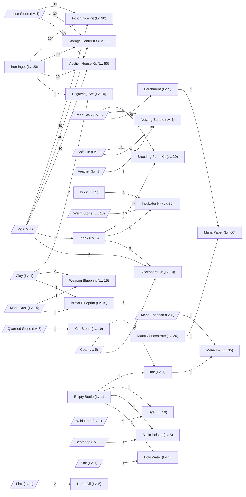

| Recipe | Needs | Makes | Skill | Success | Seconds | Known from the start |
| --- | --- | --- | --- | --- | --- | --- |
| `ACOLYTES_CASSOCK` | 4 x Cloth (Lv. 5), 1 x Stick (Lv. 1), 1 x Soft Fur (Lv. 3) | 1 x Acolyte's Cassock (Lv. 22) | forge armor 3 | 72% | 580.8 | discover |
| `ALCHEMISTS_PHYLACTERY` | 1 x Lens (Lv. 30), 1 x Bone Shard (Lv. 5) | 1 x Alchemist's Phylactery (Lv. 30) | forge armor 4 | 56% | 1228.8 | discover |
| `ANNOTATED_BESTIARY` | 4 x Mana Paper (Lv. 60), 2 x Parchment (Lv. 5), 1 x Mana Ink (Lv. 35) | 1 x Annotated Bestiary (Lv. 50) | forge weapon 6 | 27% | 3244.8 | discover |
| `APPRENTICES_WAND` | 3 x Yew Billet (Lv. 20), 3 x Stick (Lv. 1), 2 x Mana Dust (Lv. 15) | 1 x Apprentice's Wand (Lv. 18) | forge weapon 2 | 78% | 388.8 | discover |
| `ARBALEST` | 4 x Plank (Lv. 5), 2 x Nails (Lv. 5), 1 x Rope (Lv. 3), 1 x Stick (Lv. 1) | 1 x Arbalest (Lv. 32) | forge weapon 4 | 56% | 1228.8 | discover |
| `ARMOR_BLUEPRINT` | 3 x Clay (Lv. 1), 1 x Mana Dust (Lv. 15) | 1 x Armor Blueprint (Lv. 15) | carpentry 2 | 55% | 10.0 | discover |
| `ASH_ROD` | 3 x Plank (Lv. 5), 1 x Cloth (Lv. 5), 1 x Iron Ingot (Lv. 20) | 1 x Ash Rod (Lv. 40) | carpentry 4 | 50% | 14.0 | discover |
| `ASSASSINS_COWL` | 2 x Fine Leather (Lv. 35), 1 x Leather (Lv. 5), 2 x Ectoplasm (Lv. 25) | 1 x Assassin's Cowl (Lv. 49) | forge armor 6 | 27% | 3244.8 | discover |
| `ASSASSINS_VEIL` | 1 x Silk Cloth (Lv. 35), 2 x Ectoplasm (Lv. 25) | 1 x Assassin's Veil (Lv. 43) | forge armor 5 | 36% | 2539.2 | discover |
| `ATLAS_OF_LEY_LINES` | 3 x Fine Leather (Lv. 35), 2 x Parchment (Lv. 5), 3 x Mana Ink (Lv. 35) | 1 x Atlas of Ley Lines (Lv. 56) | forge weapon 7 | 12% | 4612.8 | discover |
| `AUCTION_HOUSE_KIT` | 80 x Log (Lv. 1), 60 x Loose Stone (Lv. 1), 20 x Iron Ingot (Lv. 20) | 1 x Auction House Kit (Lv. 50) | carpentry 5 | 100% | 90.0 | yes |
| `BAGPIPES` | 3 x Fine Leather (Lv. 35), 1 x Rope (Lv. 3), 1 x Plank (Lv. 5), 1 x Salt (Lv. 1), 1 x Coal (Lv. 5) | 1 x Bagpipes (Lv. 33) | forge weapon 4 | 54% | 1387.2 | discover |
| `BALEARIC_SLING` | 2 x Drake Hide (Lv. 55), 2 x Rope (Lv. 3) | 1 x Balearic Sling (Lv. 43) | forge weapon 5 | 36% | 2539.2 | discover |
| `BAMBOO_ROD` | 2 x Plank (Lv. 5), 1 x Cloth (Lv. 5) | 1 x Bamboo Rod (Lv. 20) | carpentry 2 | 60% | 10.0 | discover |
| `BANDANA` | 2 x Cloth (Lv. 5), 1 x Leather (Lv. 5), 1 x Nails (Lv. 5), 1 x Coal (Lv. 5) | 1 x Bandana (Lv. 16) | forge armor 2 | 78% | 388.8 | discover |
| `BARBED_LASH` | 2 x Drake Hide (Lv. 55), 2 x Rope (Lv. 3), 2 x Venom Sac (Lv. 15) | 1 x Barbed Lash (Lv. 51) | forge weapon 6 | 24% | 3499.2 | discover |
| `BASIC_POISON` | 1 x Deathcap (Lv. 15), 1 x Empty Bottle (Lv. 1) | 1 x Basic Poison (Lv. 5) | basic skill 1 | 90% | 6.0 | yes |
| `BESTIA_CENTER_KIT` | 40 x Log (Lv. 1), 30 x Loose Stone (Lv. 1), 10 x Iron Ingot (Lv. 20) | 1 x Storage Center Kit (Lv. 30) | carpentry 3 | 100% | 60.0 | yes |
| `BIRCH_WAND` | 2 x Yew Billet (Lv. 20), 2 x Stick (Lv. 1), 2 x Mana Dust (Lv. 15), 1 x Mana Essence (Lv. 5) | 1 x Birch Wand (Lv. 10) | forge weapon 1 | 90% | 120.0 | discover |
| `BLACKBOARD_KIT` | 4 x Log (Lv. 1), 8 x Plank (Lv. 5), 2 x Coal (Lv. 5) | 1 x Blackboard Kit (Lv. 10) | carpentry 2 | 100% | 30.0 | yes |
| `BOILED_LEATHER_CUIRASS` | 5 x Fine Leather (Lv. 35), 1 x Leather (Lv. 5), 1 x Lamp Oil (Lv. 5), 1 x Mana Essence (Lv. 5) | 1 x Boiled Leather Cuirass (Lv. 32) | forge armor 4 | 56% | 1228.8 | discover |
| `BOLAS` | 2 x Fine Leather (Lv. 35), 1 x Feather (Lv. 1), 1 x Salt (Lv. 1) | 1 x Bolas (Lv. 28) | forge weapon 3 | 63% | 940.8 | discover |
| `BONE_CHARM` | 2 x Bone Shard (Lv. 5), 1 x Mana Essence (Lv. 5) | 1 x Bone Charm (Lv. 13) | forge armor 2 | 84% | 235.2 | discover |
| `BONE_WAND` | 3 x Bone Shard (Lv. 5), 1 x Stick (Lv. 1), 1 x Mana Dust (Lv. 15), 1 x Mana Essence (Lv. 5) | 1 x Bone Wand (Lv. 25) | forge weapon 3 | 66% | 811.2 | discover |
| `BOOK_OF_PSALMS` | 5 x Parchment (Lv. 5), 1 x Mana Ink (Lv. 35), 2 x Sun Herb (Lv. 80) | 1 x Book of Psalms (Lv. 35) | forge weapon 4 | 51% | 1555.2 | discover |
| `BRAIDED_SLING` | 4 x Leather (Lv. 5), 4 x Rope (Lv. 3), 1 x Lamp Oil (Lv. 5) | 1 x Braided Sling (Lv. 14) | forge weapon 2 | 84% | 235.2 | discover |
| `BRAIDED_WHIP` | 2 x Leather (Lv. 5), 2 x Rope (Lv. 3), 1 x Salt (Lv. 1), 1 x Coal (Lv. 5) | 1 x Braided Whip (Lv. 12) | forge weapon 2 | 87% | 172.8 | discover |
| `BRAWLERS_BRACER` | 1 x Fine Leather (Lv. 35) | 1 x Brawler's Bracer (Lv. 23) | forge armor 3 | 69% | 691.2 | discover |
| `BREEDING_FARM_KIT` | 12 x Plank (Lv. 5), 6 x Reed Stalk (Lv. 1), 4 x Soft Fur (Lv. 3) | 1 x Breeding Farm Kit (Lv. 20) | carpentry 2 | 100% | 12.0 | yes |
| `BULLWHIP` | 3 x Fine Leather (Lv. 35), 2 x Rope (Lv. 3), 1 x Cloth (Lv. 5) | 1 x Bullwhip (Lv. 28) | forge weapon 3 | 63% | 940.8 | discover |
| `CARAVAN_GUARD_CROSSBOW` | 4 x Ironwood (Lv. 45), 2 x Nails (Lv. 5), 1 x Rope (Lv. 3), 1 x Bone Shard (Lv. 5), 1 x Coal (Lv. 5) | 1 x Caravan Guard Crossbow (Lv. 46) | forge weapon 5 | 33% | 2764.8 | discover |
| `CAUSTIC_FLASK` | 2 x Glass (Lv. 8), 1 x Feather (Lv. 1), 2 x Basic Poison (Lv. 5) | 1 x Caustic Flask (Lv. 48) | forge weapon 5 | 33% | 2764.8 | discover |
| `CESTUS` | 3 x Hardened Leather (Lv. 22), 2 x Leather (Lv. 5), 1 x Horn (Lv. 10) | 1 x Cestus (Lv. 10) | forge weapon 1 | 90% | 120.0 | discover |
| `CLOTH_FACE_MASK` | 1 x Cloth (Lv. 5), 1 x Mana Essence (Lv. 5) | 1 x Cloth Face Mask (Lv. 18) | forge armor 2 | 78% | 388.8 | discover |
| `CODEX_OF_UNWRITTEN_PAGES` | 3 x Mana Paper (Lv. 60), 2 x Parchment (Lv. 5), 1 x Mana Ink (Lv. 35), 1 x Coal (Lv. 5) | 1 x Codex of Unwritten Pages (Lv. 74) | forge weapon 10 | -36% | 10603.2 | discover |
| `COMPOSITE_LONGBOW` | 3 x Yew Billet (Lv. 20), 2 x Rope (Lv. 3), 3 x Feather (Lv. 1), 1 x Soft Fur (Lv. 3) | 1 x Composite Longbow (Lv. 48) | forge weapon 6 | 27% | 3244.8 | discover |
| `CORAL_WAND` | 3 x Coral (Lv. 45), 1 x Stick (Lv. 1), 1 x Mana Dust (Lv. 15), 1 x Salt (Lv. 1) | 1 x Coral Wand (Lv. 47) | forge weapon 5 | 30% | 3000.0 | discover |
| `CRACKED_MONOCLE` | 1 x Glass (Lv. 8) | 1 x Cracked Monocle (Lv. 4) | forge armor 1 | 90% | 120.0 | discover |
| `CRYSTAL_TIPPED_WAND` | 3 x Cut Amethyst (Lv. 20), 1 x Stick (Lv. 1), 1 x Mana Dust (Lv. 15) | 1 x Crystal-Tipped Wand (Lv. 33) | forge weapon 4 | 54% | 1387.2 | discover |
| `CUDGEL` | 2 x Plank (Lv. 5), 4 x Loose Stone (Lv. 1) | 1 x Cudgel (Lv. 5) | forge weapon 1 | 90% | 30.0 | discover |
| `CUT_RUNE_SLOT` | 1 x Engraving Set (Lv. 10), 2 x Mana Dust (Lv. 15) | add slot | item customization 1 | 25% | 12.0 | discover |
| `CUT_STONE` | 1 x Quarried Stone (Lv. 5) | 1 x Cut Stone (Lv. 10) | basic skill 1 | 100% | 6.0 | yes |
| `DYE` | 2 x Wild Herb (Lv. 1), 1 x Empty Bottle (Lv. 1) | 1 x Dye (Lv. 10) | basic skill 1 | 100% | 6.0 | yes |
| `ELMWOOD_WARBOW` | 3 x Yew Billet (Lv. 20), 1 x Rope (Lv. 3), 1 x Feather (Lv. 1), 2 x Medicinal Herb (Lv. 20) | 1 x Elmwood Warbow (Lv. 60) | forge weapon 7 | 12% | 4612.8 | discover |
| `EMBROIDERED_MAGISTER_ROBE` | 5 x Shadowsilk (Lv. 60), 2 x Mana Ink (Lv. 35) | 1 x Embroidered Magister Robe (Lv. 40) | forge armor 5 | 30% | 3000.0 | discover |
| `ENGRAVING_SET` | 1 x Iron Ingot (Lv. 20), 2 x Clay (Lv. 1) | 1 x Engraving Set (Lv. 10) | carpentry 1 | 60% | 8.0 | yes |
| `EYE_OF_THE_ORACLE` | 2 x Cut Diamond (Lv. 100) | 1 x Eye of the Oracle (Lv. 78) | forge armor 10 | -33% | 10156.8 | discover |
| `FEATHERED_TRICORN` | 2 x Fine Leather (Lv. 35), 1 x Leather (Lv. 5), 1 x Clay (Lv. 1), 1 x Salt (Lv. 1) | 1 x Feathered Tricorn (Lv. 31) | forge armor 4 | 56% | 1228.8 | discover |
| `FELT_HOOD` | 2 x Cloth (Lv. 5), 1 x Coal (Lv. 5), 1 x Mana Essence (Lv. 5) | 1 x Felt Hood (Lv. 6) | forge armor 1 | 90% | 43.2 | discover |
| `FELT_SLIPPERS` | 2 x Cloth (Lv. 5), 1 x Bone Shard (Lv. 5) | 1 x Felt Slippers (Lv. 16) | forge armor 2 | 81% | 307.2 | discover |
| `FIDDLE` | 3 x Ironwood (Lv. 45), 2 x Rope (Lv. 3), 1 x Plank (Lv. 5), 1 x Lamp Oil (Lv. 5) | 1 x Fiddle (Lv. 41) | forge weapon 5 | 42% | 2116.8 | discover |
| `FIELD_HERBARIUM` | 3 x Fine Leather (Lv. 35), 2 x Parchment (Lv. 5), 1 x Mana Ink (Lv. 35), 2 x Medicinal Herb (Lv. 20) | 1 x Field Herbarium (Lv. 28) | forge weapon 3 | 63% | 940.8 | discover |
| `FIGHTERS_FOOT_WRAPS` | 2 x Shadowsilk (Lv. 60), 1 x Leather (Lv. 5), 1 x Mana Essence (Lv. 5) | 1 x Fighter's Foot Wraps (Lv. 57) | forge armor 6 | 18% | 4036.8 | discover |
| `FIRE_FLASK` | 2 x Lens (Lv. 30), 1 x Feather (Lv. 1), 2 x Ember Core (Lv. 45) | 1 x Fire Flask (Lv. 66) | forge weapon 7 | 6% | 5227.2 | discover |
| `FIRE_HARDENED_SPEAR` | 3 x Yew Billet (Lv. 20), 2 x Stick (Lv. 1), 1 x Sharp Fang (Lv. 5), 1 x Ember Core (Lv. 45), 1 x Salt (Lv. 1) | 1 x Fire-Hardened Spear (Lv. 10) | forge weapon 1 | 90% | 120.0 | discover |
| `FISTS_OF_THE_MOUNTAIN_KING` | 2 x Wyrm Bone (Lv. 75), 2 x Leather (Lv. 5), 1 x Lodestone (Lv. 45) | 1 x Fists of the Mountain King (Lv. 81) | forge weapon 10 | -33% | 10156.8 | discover |
| `FORESTERS_WEATHERCLOAK` | 3 x Drake Hide (Lv. 55), 1 x Leather (Lv. 5), 1 x Nails (Lv. 5), 2 x Cut Stone (Lv. 10) | 1 x Forester's Weathercloak (Lv. 59) | forge armor 6 | 15% | 4320.0 | discover |
| `FORGE_SOLED_BOOTS` | 3 x Fine Leather (Lv. 35), 1 x Leather (Lv. 5), 1 x Nails (Lv. 5), 2 x Ember Core (Lv. 45) | 1 x Forge-Soled Boots (Lv. 60) | forge armor 7 | 12% | 4612.8 | discover |
| `FORKED_SLINGSHOT` | 3 x Yew Billet (Lv. 20), 4 x Rope (Lv. 3), 1 x Cloth (Lv. 5), 1 x Mana Essence (Lv. 5) | 1 x Forked Slingshot (Lv. 38) | forge weapon 4 | 48% | 1732.8 | discover |
| `FUR_LINED_MANTLE` | 4 x Fine Leather (Lv. 35), 1 x Leather (Lv. 5), 1 x Nails (Lv. 5), 1 x Lamp Oil (Lv. 5) | 1 x Fur-Lined Mantle (Lv. 29) | forge armor 3 | 60% | 1080.0 | discover |
| `GRIMOIRE_OF_ASH` | 4 x Fine Leather (Lv. 35), 2 x Parchment (Lv. 5), 1 x Mana Ink (Lv. 35) | 1 x Grimoire of Ash (Lv. 43) | forge weapon 5 | 39% | 2323.2 | discover |
| `HAND_DRUM` | 3 x Hardened Leather (Lv. 22), 2 x Rope (Lv. 3), 2 x Plank (Lv. 5), 1 x Resin (Lv. 1), 1 x Lamp Oil (Lv. 5) | 1 x Hand Drum (Lv. 18) | forge weapon 2 | 78% | 388.8 | discover |
| `HAND_WRAPS` | 3 x Cloth (Lv. 5), 2 x Leather (Lv. 5), 1 x Mana Essence (Lv. 5) | 1 x Hand Wraps (Lv. 4) | forge weapon 1 | 90% | 19.2 | discover |
| `HEARTWOOD_CLEAVER` | 2 x Heartwood (Lv. 80), 1 x Stick (Lv. 1), 1 x Flint (Lv. 1), 2 x Medicinal Herb (Lv. 20) | 1 x Heartwood Cleaver (Lv. 86) | forge weapon 10 | -34% | 10378.8 | discover |
| `HEART_OF_THE_BEHEMOTH` | 1 x Cut Diamond (Lv. 100), 1 x Cloth (Lv. 5) | 1 x Heart of the Behemoth (Lv. 77) | forge armor 10 | -36% | 10603.2 | discover |
| `HERALDS_TABARD` | 3 x Silk Cloth (Lv. 35), 2 x Leather (Lv. 5), 1 x Nails (Lv. 5), 1 x Salt (Lv. 1) | 1 x Herald's Tabard (Lv. 41) | forge armor 5 | 42% | 2116.8 | discover |
| `HERBALISTS_SMOCK` | 4 x Silk Cloth (Lv. 35), 2 x Medicinal Herb (Lv. 20) | 1 x Herbalist's Smock (Lv. 36) | forge armor 4 | 48% | 1732.8 | discover |
| `HIDE_SLING` | 2 x Leather (Lv. 5), 2 x Rope (Lv. 3), 1 x Salt (Lv. 1), 1 x Mana Essence (Lv. 5) | 1 x Hide Sling (Lv. 22) | forge weapon 3 | 72% | 580.8 | discover |
| `HIDE_TARGE` | 5 x Leather (Lv. 5), 1 x Lamp Oil (Lv. 5), 1 x Mana Essence (Lv. 5) | 1 x Hide Targe (Lv. 20) | forge armor 2 | 75% | 480.0 | discover |
| `HIDE_VEST` | 5 x Hardened Leather (Lv. 22), 2 x Leather (Lv. 5), 1 x Cloth (Lv. 5), 1 x Mana Essence (Lv. 5) | 1 x Hide Vest (Lv. 16) | forge armor 2 | 81% | 307.2 | discover |
| `HOBNAILED_BOOTS` | 3 x Leather (Lv. 5), 1 x Nails (Lv. 5), 1 x Bone Shard (Lv. 5), 1 x Coal (Lv. 5) | 1 x Hobnailed Boots (Lv. 22) | forge armor 3 | 72% | 580.8 | discover |
| `HOLY_WATER` | 1 x Empty Bottle (Lv. 1), 1 x Salt (Lv. 1) | 1 x Holy Water (Lv. 5) | basic skill 1 | 90% | 8.0 | yes |
| `HORN_BOW` | 3 x Horn (Lv. 10), 2 x Rope (Lv. 3), 3 x Feather (Lv. 1), 1 x Mana Essence (Lv. 5) | 1 x Horn Bow (Lv. 43) | forge weapon 5 | 39% | 2323.2 | discover |
| `HUNTERS_GHILLIE` | 4 x Cloth (Lv. 5), 2 x Leather (Lv. 5), 2 x Medicinal Herb (Lv. 20) | 1 x Hunter's Ghillie (Lv. 35) | forge armor 4 | 48% | 1732.8 | discover |
| `HUNTERS_LEATHERS` | 4 x Fine Leather (Lv. 35), 1 x Leather (Lv. 5), 2 x Medicinal Herb (Lv. 20) | 1 x Hunter's Leathers (Lv. 22) | forge armor 3 | 69% | 691.2 | discover |
| `HUNTING_CROSSBOW` | 4 x Yew Billet (Lv. 20), 2 x Nails (Lv. 5), 1 x Rope (Lv. 3), 1 x Thornvine (Lv. 20), 1 x Cloth (Lv. 5) | 1 x Hunting Crossbow (Lv. 16) | forge weapon 2 | 81% | 307.2 | discover |
| `HURDY_GURDY_OF_HOURS` | 4 x Heartwood (Lv. 80), 1 x Rope (Lv. 3), 1 x Plank (Lv. 5), 2 x Clockwork Core (Lv. 75) | 1 x Hurdy-Gurdy of Hours (Lv. 71) | forge weapon 8 | -3% | 6220.8 | discover |
| `HYMNAL` | 5 x Parchment (Lv. 5), 1 x Mana Ink (Lv. 35), 2 x Silver Ingot (Lv. 38) | 1 x Hymnal (Lv. 20) | forge weapon 2 | 75% | 480.0 | discover |
| `INCUBATOR_KIT` | 6 x Plank (Lv. 5), 4 x Brick (Lv. 5), 4 x Warm Stone (Lv. 18) | 1 x Incubator Kit (Lv. 30) | carpentry 3 | 100% | 15.0 | yes |
| `INK` | 1 x Coal (Lv. 5), 1 x Empty Bottle (Lv. 1) | 1 x Ink (Lv. 1) | basic skill 1 | 100% | 5.0 | yes |
| `IRONWOOD_BO` | 4 x Ironwood (Lv. 45), 2 x Stick (Lv. 1), 2 x Medicinal Herb (Lv. 20) | 1 x Ironwood Bo (Lv. 48) | forge weapon 5 | 30% | 3000.0 | discover |
| `JADE_EARRING` | 2 x Lodestone (Lv. 45), 1 x Cut Jade (Lv. 33) | 1 x Jade Earring (Lv. 33) | forge armor 4 | 54% | 1387.2 | discover |
| `JEWELLERS_LOUPE` | 2 x Lens (Lv. 30), 1 x Lamp Oil (Lv. 5) | 1 x Jeweller's Loupe (Lv. 24) | forge armor 4 | 56% | 1228.8 | discover |
| `LAMP_OIL` | 2 x Flax (Lv. 1) | 1 x Lamp Oil (Lv. 5) | basic skill 1 | 100% | 5.0 | yes |
| `LEADED_SLING` | 3 x Fine Leather (Lv. 35), 2 x Rope (Lv. 3), 1 x Lamp Oil (Lv. 5) | 1 x Leaded Sling (Lv. 30) | forge weapon 3 | 60% | 1080.0 | discover |
| `LEATHER_CAP` | 3 x Hardened Leather (Lv. 22), 1 x Leather (Lv. 5) | 1 x Leather Cap (Lv. 10) | forge armor 1 | 90% | 120.0 | discover |
| `LEATHER_EYEPATCH` | 1 x Hardened Leather (Lv. 22), 1 x Bone Shard (Lv. 5) | 1 x Leather Eyepatch (Lv. 11) | forge armor 2 | 84% | 235.2 | discover |
| `LITURGY_OF_THE_LANTERN` | 4 x Mana Paper (Lv. 60), 2 x Parchment (Lv. 5), 1 x Mana Ink (Lv. 35), 2 x Silver Ingot (Lv. 38) | 1 x Liturgy of the Lantern (Lv. 70) | forge weapon 8 | -6% | 6571.2 | discover |
| `LONGBOW` | 3 x Yew Billet (Lv. 20), 1 x Rope (Lv. 3), 1 x Feather (Lv. 1), 1 x Bone Shard (Lv. 5), 1 x Salt (Lv. 1) | 1 x Longbow (Lv. 28) | forge weapon 3 | 63% | 940.8 | discover |
| `LYRE_OF_THE_LAST_VERSE` | 3 x Heartwood (Lv. 80), 2 x Rope (Lv. 3), 2 x Plank (Lv. 5), 1 x Soft Fur (Lv. 3) | 1 x Lyre of the Last Verse (Lv. 84) | forge weapon 10 | -34% | 10378.8 | discover |
| `MALLET` | 3 x Plank (Lv. 5), 4 x Cut Stone (Lv. 10), 1 x Lamp Oil (Lv. 5) | 1 x Mallet (Lv. 6) | forge weapon 1 | 90% | 43.2 | discover |
| `MANA_INK` | 1 x Ink (Lv. 1), 1 x Mana Essence (Lv. 5) | 1 x Mana Ink (Lv. 35) | basic skill 1 | 90% | 6.0 | yes |
| `MANA_PAPER` | 1 x Parchment (Lv. 5), 1 x Mana Concentrate (Lv. 20) | 1 x Mana Paper (Lv. 60) | basic skill 1 | 70% | 12.0 | yes |
| `MANTLE_OF_EMBERS` | 4 x Silk Cloth (Lv. 35), 2 x Ember Core (Lv. 45) | 1 x Mantle of Embers (Lv. 53) | forge armor 6 | 21% | 3763.2 | discover |
| `MANTLE_OF_THE_STARLIT_CHOIR` | 4 x Starweave (Lv. 80), 2 x Cut Diamond (Lv. 100) | 1 x Mantle of the Starlit Choir (Lv. 58) | forge armor 10 | -37% | 10830.0 | discover |
| `MASQUERADE_HALF_MASK` | 1 x Silk Cloth (Lv. 35), 1 x Salt (Lv. 1) | 1 x Masquerade Half-Mask (Lv. 38) | forge armor 4 | 45% | 1920.0 | discover |
| `MINERS_LODESTONE` | 1 x Lodestone (Lv. 45), 2 x Star Core (Lv. 80) | 1 x Miner's Lodestone (Lv. 50) | forge armor 6 | 27% | 3244.8 | discover |
| `MINSTRELS_DOUBLET` | 4 x Fine Leather (Lv. 35), 1 x Leather (Lv. 5), 1 x Horn (Lv. 10) | 1 x Minstrel's Doublet (Lv. 38) | forge armor 4 | 45% | 1920.0 | discover |
| `NESTING_BUNDLE` | 1 x Reed Stalk (Lv. 1), 1 x Soft Fur (Lv. 3), 1 x Feather (Lv. 1) | 1 x Nesting Bundle (Lv. 1) | carpentry 1 | 90% | 4.0 | yes |
| `OBSIDIAN_WAND` | 3 x Obsidian (Lv. 50), 1 x Stick (Lv. 1), 1 x Mana Dust (Lv. 15), 1 x Lamp Oil (Lv. 5) | 1 x Obsidian Wand (Lv. 57) | forge weapon 6 | 15% | 4320.0 | discover |
| `OILSKIN_CAPE` | 4 x Silk Cloth (Lv. 35), 1 x Leather (Lv. 5) | 1 x Oilskin Cape (Lv. 25) | forge armor 3 | 66% | 811.2 | discover |
| `OPAL_OF_THE_TIDES` | 1 x Star Core (Lv. 80), 1 x Cut Opal (Lv. 66) | 1 x Opal of the Tides (Lv. 66) | forge armor 7 | 3% | 5548.8 | discover |
| `OWL_EYE_LENSES` | 2 x Lens (Lv. 30), 1 x Leather (Lv. 5) | 1 x Owl-Eye Lenses (Lv. 55) | forge armor 7 | 9% | 4915.2 | discover |
| `PADDED_GAMBESON` | 4 x Cloth (Lv. 5), 1 x Leather (Lv. 5) | 1 x Padded Gambeson (Lv. 8) | forge armor 1 | 90% | 76.8 | discover |
| `PARCHMENT` | 2 x Reed Stalk (Lv. 1) | 1 x Parchment (Lv. 5) | basic skill 1 | 100% | 4.0 | yes |
| `PERFORMERS_HALF_CAPE` | 4 x Shadowsilk (Lv. 60), 1 x Leather (Lv. 5) | 1 x Performer's Half-Cape (Lv. 46) | forge armor 5 | 33% | 2764.8 | discover |
| `PHILOSOPHERS_ORB` | 3 x Star Core (Lv. 80), 1 x Feather (Lv. 1) | 1 x Philosopher's Orb (Lv. 86) | forge weapon 10 | -33% | 10156.8 | discover |
| `PILGRIMS_SHAWL` | 3 x Cloth (Lv. 5), 2 x Sun Herb (Lv. 80) | 1 x Pilgrim's Shawl (Lv. 22) | forge armor 3 | 72% | 580.8 | discover |
| `PILGRIMS_SLIPPERS` | 2 x Silk Cloth (Lv. 35), 2 x Silver Ingot (Lv. 38) | 1 x Pilgrim's Slippers (Lv. 35) | forge armor 4 | 51% | 1555.2 | discover |
| `PILGRIMS_STAFF` | 3 x Plank (Lv. 5), 4 x Stick (Lv. 1), 2 x Sun Herb (Lv. 80) | 1 x Pilgrim's Staff (Lv. 31) | forge weapon 4 | 56% | 1228.8 | discover |
| `PLAGUE_BEAK_MASK` | 1 x Fine Leather (Lv. 35), 2 x Venom Sac (Lv. 15) | 1 x Plague Beak Mask (Lv. 32) | forge armor 4 | 54% | 1387.2 | discover |
| `PLAIN_ROBE` | 4 x Cloth (Lv. 5), 1 x Mana Essence (Lv. 5) | 1 x Plain Robe (Lv. 6) | forge armor 1 | 90% | 43.2 | discover |
| `PLANK` | 1 x Log (Lv. 1) | 2 x Plank (Lv. 5) | basic skill 1 | 100% | 4.0 | yes |
| `PLUMED_BARDS_CAP` | 2 x Drake Hide (Lv. 55), 1 x Leather (Lv. 5), 1 x Cloth (Lv. 5) | 1 x Plumed Bard's Cap (Lv. 59) | forge armor 7 | 12% | 4612.8 | discover |
| `POST_OFFICE_KIT` | 40 x Log (Lv. 1), 30 x Loose Stone (Lv. 1), 10 x Iron Ingot (Lv. 20) | 1 x Post Office Kit (Lv. 30) | carpentry 3 | 100% | 60.0 | yes |
| `PRIESTS_MITRE` | 3 x Shadowsilk (Lv. 60), 1 x Leather (Lv. 5), 1 x Nails (Lv. 5), 1 x Silver Ingot (Lv. 38) | 1 x Priest's Mitre (Lv. 44) | forge armor 5 | 33% | 2764.8 | discover |
| `PRIMER` | 6 x Parchment (Lv. 5), 1 x Mana Ink (Lv. 35) | 1 x Primer (Lv. 6) | forge weapon 1 | 90% | 43.2 | discover |
| `PRIMER_OF_SPARKS` | 5 x Parchment (Lv. 5), 3 x Mana Ink (Lv. 35) | 1 x Primer of Sparks (Lv. 14) | forge weapon 2 | 84% | 235.2 | discover |
| `PUGILISTS_WRAP_VEST` | 4 x Shadowsilk (Lv. 60), 1 x Leather (Lv. 5), 1 x Coal (Lv. 5) | 1 x Pugilist's Wrap-Vest (Lv. 55) | forge armor 6 | 21% | 3763.2 | discover |
| `QUARTERSTAFF` | 4 x Yew Billet (Lv. 20), 2 x Stick (Lv. 1) | 1 x Quarterstaff (Lv. 10) | forge weapon 1 | 90% | 120.0 | discover |
| `RABBITS_FOOT_CHARM` | 1 x Hardened Leather (Lv. 22), 1 x Reed Stalk (Lv. 1) | 1 x Rabbit's-Foot Charm (Lv. 16) | forge armor 2 | 78% | 388.8 | discover |
| `RANGERS_HOOD` | 2 x Hardened Leather (Lv. 22), 1 x Leather (Lv. 5), 1 x Medicinal Herb (Lv. 20), 1 x Clay (Lv. 1) | 1 x Ranger's Hood (Lv. 36) | forge armor 5 | 42% | 2116.8 | discover |
| `RANGERS_MOCCASINS` | 2 x Hardened Leather (Lv. 22), 1 x Leather (Lv. 5), 2 x Medicinal Herb (Lv. 20) | 1 x Ranger's Moccasins (Lv. 23) | forge armor 3 | 69% | 691.2 | discover |
| `RECURVE_BOW` | 4 x Ironwood (Lv. 45), 1 x Rope (Lv. 3), 1 x Feather (Lv. 1), 1 x Clay (Lv. 1) | 1 x Recurve Bow (Lv. 35) | forge weapon 4 | 51% | 1555.2 | discover |
| `REED_FLUTE` | 4 x Medicinal Herb (Lv. 20), 1 x Rope (Lv. 3), 1 x Plank (Lv. 5) | 1 x Reed Flute (Lv. 10) | forge weapon 1 | 90% | 120.0 | discover |
| `REPEATING_CROSSBOW` | 3 x Yew Billet (Lv. 20), 2 x Nails (Lv. 5), 1 x Rope (Lv. 3), 2 x Clockwork Core (Lv. 75) | 1 x Repeating Crossbow (Lv. 54) | forge weapon 6 | 21% | 3763.2 | discover |
| `RIBBON_OF_THE_MASQUE` | 3 x Starweave (Lv. 80), 2 x Rope (Lv. 3) | 1 x Ribbon of the Masque (Lv. 70) | forge weapon 8 | -6% | 6571.2 | discover |
| `RIVETED_BOOTS` | 2 x Fine Leather (Lv. 35), 1 x Leather (Lv. 5), 1 x Nails (Lv. 5), 1 x Reed Stalk (Lv. 1), 1 x Mana Essence (Lv. 5) | 1 x Riveted Boots (Lv. 34) | forge armor 4 | 54% | 1387.2 | discover |
| `ROBE_OF_THE_ASHEN_CIRCLE` | 5 x Starweave (Lv. 80), 1 x Mana Dust (Lv. 15) | 1 x Robe of the Ashen Circle (Lv. 70) | forge armor 8 | -6% | 6571.2 | discover |
| `ROPE_LASH` | 4 x Rope (Lv. 3), 1 x Lamp Oil (Lv. 5) | 1 x Rope Lash (Lv. 5) | forge weapon 1 | 90% | 30.0 | discover |
| `ROPE_SANDALS` | 2 x Rope (Lv. 3), 1 x Lamp Oil (Lv. 5) | 1 x Rope Sandals (Lv. 6) | forge armor 1 | 90% | 43.2 | discover |
| `ROUND_SHIELD` | 4 x Yew Billet (Lv. 20), 1 x Leather (Lv. 5), 1 x Nails (Lv. 5) | 1 x Round Shield (Lv. 18) | forge armor 2 | 78% | 388.8 | discover |
| `RUNESTONE_AMULET` | 2 x Obsidian (Lv. 50) | 1 x Runestone Amulet (Lv. 64) | forge armor 7 | 9% | 4915.2 | discover |
| `SAGES_ROOTSTAFF` | 3 x Yew Billet (Lv. 20), 4 x Stick (Lv. 1), 1 x Mana Essence (Lv. 5), 1 x Reed Stalk (Lv. 1) | 1 x Sage's Rootstaff (Lv. 55) | forge weapon 6 | 18% | 4036.8 | discover |
| `SCHOLARS_CAP` | 2 x Cloth (Lv. 5), 1 x Bone Shard (Lv. 5), 1 x Coal (Lv. 5) | 1 x Scholar's Cap (Lv. 35) | forge armor 4 | 51% | 1555.2 | discover |
| `SCHOLARS_HABIT` | 5 x Silk Cloth (Lv. 35), 1 x Mana Essence (Lv. 5) | 1 x Scholar's Habit (Lv. 27) | forge armor 3 | 60% | 1080.0 | discover |
| `SCHOLARS_MANTLET` | 3 x Silk Cloth (Lv. 35), 1 x Salt (Lv. 1), 1 x Mana Essence (Lv. 5) | 1 x Scholar's Mantlet (Lv. 33) | forge armor 4 | 54% | 1387.2 | discover |
| `SHADOWSILK_CAPE` | 3 x Shadowsilk (Lv. 60), 1 x Leather (Lv. 5), 2 x Shadow Shard (Lv. 55) | 1 x Shadowsilk Cape (Lv. 63) | forge armor 7 | 6% | 5227.2 | discover |
| `SHADOWWEAVE_JERKIN` | 4 x Drake Hide (Lv. 55), 1 x Leather (Lv. 5), 2 x Shadow Shard (Lv. 55) | 1 x Shadowweave Jerkin (Lv. 42) | forge armor 5 | 33% | 2764.8 | discover |
| `SHEPHERDS_SLING` | 2 x Leather (Lv. 5), 2 x Rope (Lv. 3), 1 x Coal (Lv. 5), 1 x Lamp Oil (Lv. 5) | 1 x Shepherd's Sling (Lv. 6) | forge weapon 1 | 90% | 43.2 | discover |
| `SHORT_BOW` | 4 x Plank (Lv. 5), 1 x Rope (Lv. 3), 1 x Feather (Lv. 1), 1 x Leather (Lv. 5), 1 x Salt (Lv. 1) | 1 x Short Bow (Lv. 6) | forge weapon 1 | 90% | 43.2 | discover |
| `SHROUD_OF_THE_QUIET_GRAVE` | 4 x Starweave (Lv. 80), 1 x Ectoplasm (Lv. 25) | 1 x Shroud of the Quiet Grave (Lv. 69) | forge armor 8 | -3% | 6220.8 | discover |
| `SILENT_STEP_BOOTS` | 2 x Fine Leather (Lv. 35), 1 x Leather (Lv. 5), 2 x Void Essence (Lv. 30) | 1 x Silent-Step Boots (Lv. 36) | forge armor 4 | 45% | 1920.0 | discover |
| `SILKEN_SCOURGE` | 3 x Silk Cloth (Lv. 35), 2 x Rope (Lv. 3), 1 x Cloth (Lv. 5) | 1 x Silken Scourge (Lv. 41) | forge weapon 5 | 39% | 2323.2 | discover |
| `SILKWEAVE_VESTMENT` | 4 x Shadowsilk (Lv. 60), 1 x Lamp Oil (Lv. 5) | 1 x Silkweave Vestment (Lv. 60) | forge armor 7 | 12% | 4612.8 | discover |
| `SILK_SLING` | 2 x Silk Cloth (Lv. 35), 2 x Rope (Lv. 3), 1 x Lamp Oil (Lv. 5), 1 x Mana Essence (Lv. 5) | 1 x Silk Sling (Lv. 53) | forge weapon 6 | 24% | 3499.2 | discover |
| `SMOKED_GOGGLES` | 1 x Lens (Lv. 30) | 1 x Smoked Goggles (Lv. 22) | forge armor 3 | 69% | 691.2 | discover |
| `SOFT_LEATHER_BOOTS` | 2 x Hardened Leather (Lv. 22), 1 x Leather (Lv. 5), 1 x Lamp Oil (Lv. 5) | 1 x Soft Leather Boots (Lv. 14) | forge armor 2 | 84% | 235.2 | discover |
| `SONGSTRING_BOW` | 3 x Heartwood (Lv. 80), 2 x Rope (Lv. 3), 2 x Feather (Lv. 1), 1 x Salt (Lv. 1) | 1 x Songstring Bow (Lv. 69) | forge weapon 8 | -3% | 6220.8 | discover |
| `SPIKED_CLUB` | 2 x Yew Billet (Lv. 20), 2 x Loose Stone (Lv. 1) | 1 x Spiked Club (Lv. 18) | forge weapon 2 | 78% | 388.8 | discover |
| `SPYGLASS_MONOCLE` | 2 x Glass (Lv. 8), 1 x Mana Essence (Lv. 5) | 1 x Spyglass Monocle (Lv. 46) | forge armor 6 | 27% | 3244.8 | discover |
| `STAFF_OF_MENDING_LIGHT` | 4 x Heartwood (Lv. 80), 2 x Stick (Lv. 1), 1 x Sun Herb (Lv. 80) | 1 x Staff of Mending Light (Lv. 68) | forge weapon 7 | 0% | 5880.0 | discover |
| `STAFF_OF_THE_SEVENTH_EMBER` | 3 x Heartwood (Lv. 80), 4 x Stick (Lv. 1), 2 x Ember Core (Lv. 45) | 1 x Staff of the Seventh Ember (Lv. 82) | forge weapon 10 | -37% | 10830.0 | discover |
| `STARFALL_WAND` | 5 x Cut Diamond (Lv. 100), 1 x Stick (Lv. 1), 1 x Mana Dust (Lv. 15) | 1 x Starfall Wand (Lv. 75) | forge weapon 10 | -48% | 12484.8 | discover |
| `STARWALKER_SLIPPERS` | 3 x Starweave (Lv. 80), 2 x Star Core (Lv. 80) | 1 x Starwalker Slippers (Lv. 66) | forge armor 7 | 3% | 5548.8 | discover |
| `STIRRUP_CROSSBOW` | 3 x Plank (Lv. 5), 2 x Nails (Lv. 5), 1 x Rope (Lv. 3), 1 x Salt (Lv. 1), 1 x Coal (Lv. 5) | 1 x Stirrup Crossbow (Lv. 24) | forge weapon 3 | 69% | 691.2 | discover |
| `STONEFIST_GAUNTLET` | 5 x Obsidian (Lv. 50), 2 x Leather (Lv. 5) | 1 x Stonefist Gauntlet (Lv. 69) | forge weapon 8 | -3% | 6220.8 | discover |
| `STONE_MAUL` | 5 x Cut Stone (Lv. 10), 2 x Lodestone (Lv. 45) | 1 x Stone Maul (Lv. 14) | forge weapon 2 | 84% | 235.2 | discover |
| `STORMCORD_SLING` | 3 x Shadowsilk (Lv. 60), 2 x Rope (Lv. 3), 1 x Storm Feather (Lv. 65) | 1 x Stormcord Sling (Lv. 74) | forge weapon 8 | -9% | 6931.2 | discover |
| `STRAW_HAT` | 2 x Reed Stalk (Lv. 1), 1 x Mana Essence (Lv. 5) | 1 x Straw Hat (Lv. 10) | forge armor 1 | 90% | 120.0 | discover |
| `STRIDERS_BOOTS` | 3 x Drake Hide (Lv. 55), 1 x Leather (Lv. 5), 1 x Nails (Lv. 5), 1 x Lamp Oil (Lv. 5) | 1 x Strider's Boots (Lv. 51) | forge armor 6 | 27% | 3244.8 | discover |
| `STUDDED_BRIGANDINE` | 4 x Hardened Leather (Lv. 22), 1 x Leather (Lv. 5), 1 x Nails (Lv. 5), 1 x Bone Shard (Lv. 5), 1 x Reed Stalk (Lv. 1) | 1 x Studded Brigandine (Lv. 22) | forge armor 3 | 72% | 580.8 | discover |
| `STUDDED_BUCKLER` | 3 x Fine Leather (Lv. 35), 1 x Leather (Lv. 5), 1 x Bone Shard (Lv. 5), 1 x Nails (Lv. 5) | 1 x Studded Buckler (Lv. 33) | forge armor 4 | 54% | 1387.2 | discover |
| `THORNVINE_WHIP` | 3 x Thornvine (Lv. 20), 2 x Rope (Lv. 3), 2 x Medicinal Herb (Lv. 20) | 1 x Thornvine Whip (Lv. 19) | forge weapon 2 | 75% | 480.0 | discover |
| `TRAVELLERS_CLOAK` | 3 x Cloth (Lv. 5), 1 x Salt (Lv. 1) | 1 x Traveller's Cloak (Lv. 10) | forge armor 1 | 90% | 120.0 | discover |
| `TRAVELLERS_MANDOLIN` | 4 x Plank (Lv. 5), 1 x Rope (Lv. 3), 1 x Coal (Lv. 5), 1 x Lamp Oil (Lv. 5) | 1 x Traveller's Mandolin (Lv. 24) | forge weapon 3 | 66% | 811.2 | discover |
| `TROUBADOURS_BUCKLED_SHOES` | 3 x Drake Hide (Lv. 55), 1 x Leather (Lv. 5) | 1 x Troubadour's Buckled Shoes (Lv. 49) | forge armor 5 | 30% | 3000.0 | discover |
| `TWIG_WAND` | 2 x Plank (Lv. 5), 2 x Stick (Lv. 1), 2 x Mana Dust (Lv. 15), 1 x Coal (Lv. 5) | 1 x Twig Wand (Lv. 4) | forge weapon 1 | 90% | 19.2 | discover |
| `VESTMENTS_OF_THE_DAWN` | 4 x Shadowsilk (Lv. 60), 1 x Leather (Lv. 5), 1 x Nails (Lv. 5), 1 x Ember Core (Lv. 45), 1 x Mana Essence (Lv. 5) | 1 x Vestments of the Dawn (Lv. 58) | forge armor 7 | 12% | 4612.8 | discover |
| `WALKING_STICK` | 3 x Plank (Lv. 5), 4 x Stick (Lv. 1), 1 x Bone Shard (Lv. 5), 1 x Lamp Oil (Lv. 5) | 1 x Walking Stick (Lv. 4) | forge weapon 1 | 90% | 19.2 | discover |
| `WARBAND_DRUM` | 4 x Drake Hide (Lv. 55), 1 x Rope (Lv. 3), 1 x Plank (Lv. 5) | 1 x Warband Drum (Lv. 49) | forge weapon 5 | 30% | 3000.0 | discover |
| `WEAPON_BLUEPRINT` | 2 x Clay (Lv. 1), 1 x Mana Dust (Lv. 15) | 1 x Weapon Blueprint (Lv. 15) | carpentry 2 | 55% | 10.0 | discover |
| `WEIGHTED_JAVELIN` | 2 x Yew Billet (Lv. 20), 2 x Feather (Lv. 1), 1 x Salt (Lv. 1), 1 x Mana Essence (Lv. 5) | 1 x Weighted Javelin (Lv. 34) | forge weapon 4 | 54% | 1387.2 | discover |
| `WICKER_BUCKLER` | 4 x Reed Stalk (Lv. 1), 1 x Leather (Lv. 5), 1 x Coal (Lv. 5) | 1 x Wicker Buckler (Lv. 8) | forge armor 1 | 90% | 76.8 | discover |
| `WILLOW_STAFF` | 3 x Yew Billet (Lv. 20), 4 x Stick (Lv. 1), 1 x Coal (Lv. 5) | 1 x Willow Staff (Lv. 16) | forge weapon 2 | 81% | 307.2 | discover |
| `WINDRUNNERS_LONGBOW` | 4 x Heartwood (Lv. 80), 1 x Rope (Lv. 3), 1 x Feather (Lv. 1), 2 x Storm Feather (Lv. 65) | 1 x Windrunner's Longbow (Lv. 72) | forge weapon 10 | -36% | 10603.2 | discover |
| `WINGS_OF_THE_WANDERING_WIND` | 4 x Starweave (Lv. 80), 2 x Leather (Lv. 5), 1 x Storm Feather (Lv. 65) | 1 x Wings of the Wandering Wind (Lv. 67) | forge armor 10 | -33% | 10156.8 | discover |
| `WIZARDS_CONE_HAT` | 2 x Silk Cloth (Lv. 35), 1 x Lamp Oil (Lv. 5) | 1 x Wizard's Cone Hat (Lv. 24) | forge armor 3 | 63% | 940.8 | discover |
| `WOLF_TOOTH_NECKLACE` | 1 x Drake Hide (Lv. 55), 1 x Lamp Oil (Lv. 5) | 1 x Wolf-Tooth Necklace (Lv. 53) | forge armor 6 | 24% | 3499.2 | discover |
| `WOODEN_CROSSBOW` | 3 x Yew Billet (Lv. 20), 2 x Nails (Lv. 5), 1 x Rope (Lv. 3), 2 x Medicinal Herb (Lv. 20) | 1 x Wooden Crossbow (Lv. 8) | forge weapon 1 | 90% | 76.8 | discover |
| `WOODEN_SPEAR` | 2 x Plank (Lv. 5), 4 x Stick (Lv. 1), 2 x Sharp Fang (Lv. 5), 1 x Thornvine (Lv. 20), 1 x Feather (Lv. 1) | 1 x Wooden Spear (Lv. 4) | forge weapon 1 | 90% | 19.2 | discover |
| `WOOL_MANTLE` | 3 x Cloth (Lv. 5), 1 x Leather (Lv. 5), 1 x Horn (Lv. 10), 1 x Stick (Lv. 1) | 1 x Wool Mantle (Lv. 16) | forge armor 2 | 81% | 307.2 | discover |
| `WOVEN_ROBE` | 4 x Cloth (Lv. 5), 1 x Clay (Lv. 1), 1 x Lamp Oil (Lv. 5) | 1 x Woven Robe (Lv. 14) | forge armor 2 | 84% | 235.2 | discover |
| `WYRMBONE_GREATSWORD` | 6 x Wyrm Bone (Lv. 75), 1 x Flint (Lv. 1), 1 x Leather (Lv. 5) | 1 x Wyrmbone Greatsword (Lv. 68) | forge weapon 7 | 0% | 5880.0 | discover |
| `YEW_SHORTBOW` | 4 x Yew Billet (Lv. 20), 1 x Rope (Lv. 3), 1 x Feather (Lv. 1), 1 x Cloth (Lv. 5) | 1 x Yew Shortbow (Lv. 12) | forge weapon 2 | 87% | 172.8 | discover |

## Tanning Rack

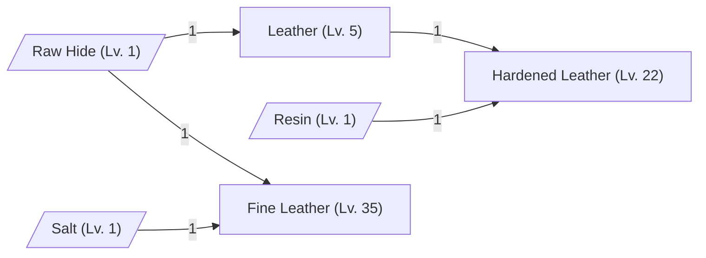

| Recipe | Needs | Makes | Skill | Success | Seconds | Known from the start |
| --- | --- | --- | --- | --- | --- | --- |
| `FINE_LEATHER` | 1 x Raw Hide (Lv. 1), 1 x Salt (Lv. 1) | 1 x Fine Leather (Lv. 35) | basic skill 1 | 90% | 10.0 | yes |
| `HARDENED_LEATHER` | 1 x Leather (Lv. 5), 1 x Resin (Lv. 1) | 1 x Hardened Leather (Lv. 22) | basic skill 1 | 90% | 8.0 | yes |
| `LEATHER` | 1 x Raw Hide (Lv. 1) | 1 x Leather (Lv. 5) | basic skill 1 | 100% | 6.0 | yes |

## Loom

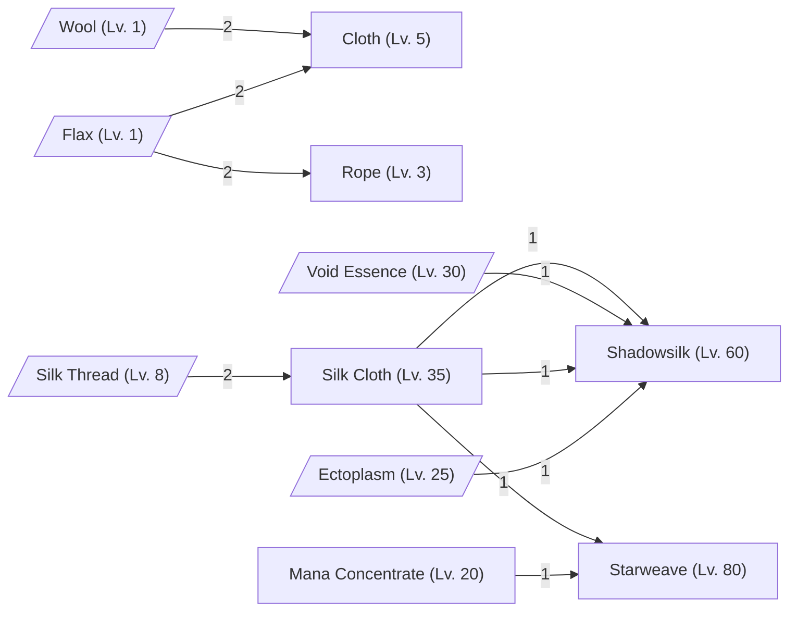

| Recipe | Needs | Makes | Skill | Success | Seconds | Known from the start |
| --- | --- | --- | --- | --- | --- | --- |
| `CLOTH_FROM_FLAX` | 2 x Flax (Lv. 1) | 1 x Cloth (Lv. 5) | basic skill 1 | 100% | 5.0 | yes |
| `CLOTH_FROM_WOOL` | 2 x Wool (Lv. 1) | 1 x Cloth (Lv. 5) | basic skill 1 | 100% | 5.0 | yes |
| `ROPE` | 2 x Flax (Lv. 1) | 1 x Rope (Lv. 3) | basic skill 1 | 100% | 4.0 | yes |
| `SHADOWSILK` | 1 x Silk Cloth (Lv. 35), 1 x Void Essence (Lv. 30) | 1 x Shadowsilk (Lv. 60) | basic skill 1 | 80% | 12.0 | yes |
| `SHADOWSILK_FROM_ECTOPLASM` | 1 x Silk Cloth (Lv. 35), 1 x Ectoplasm (Lv. 25) | 1 x Shadowsilk (Lv. 60) | basic skill 1 | 80% | 12.0 | yes |
| `SILK_CLOTH` | 2 x Silk Thread (Lv. 8) | 1 x Silk Cloth (Lv. 35) | basic skill 1 | 90% | 8.0 | yes |
| `STARWEAVE` | 1 x Silk Cloth (Lv. 35), 1 x Mana Concentrate (Lv. 20) | 1 x Starweave (Lv. 80) | basic skill 1 | 70% | 16.0 | yes |

## Glass Furnace

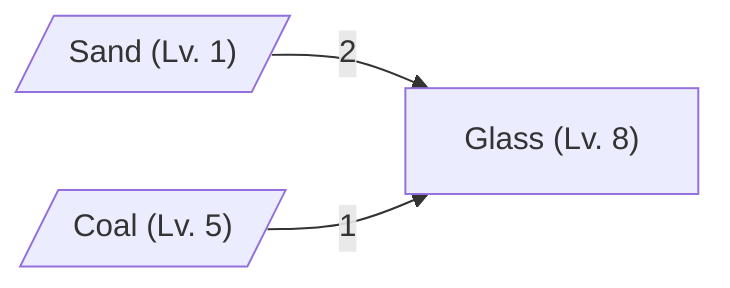

| Recipe | Needs | Makes | Skill | Success | Seconds | Known from the start |
| --- | --- | --- | --- | --- | --- | --- |
| `GLASS` | 2 x Sand (Lv. 1), 1 x Coal (Lv. 5) | 1 x Glass (Lv. 8) | basic skill 1 | 100% | 8.0 | yes |

## Glassblowing Bench

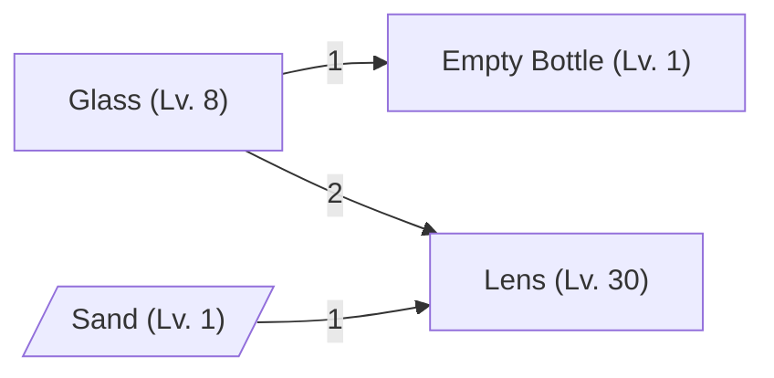

| Recipe | Needs | Makes | Skill | Success | Seconds | Known from the start |
| --- | --- | --- | --- | --- | --- | --- |
| `EMPTY_BOTTLE` | 1 x Glass (Lv. 8) | 2 x Empty Bottle (Lv. 1) | basic skill 1 | 100% | 5.0 | yes |
| `LENS` | 2 x Glass (Lv. 8), 1 x Sand (Lv. 1) | 1 x Lens (Lv. 30) | basic skill 1 | 90% | 10.0 | yes |

## Alchemy Laboratory

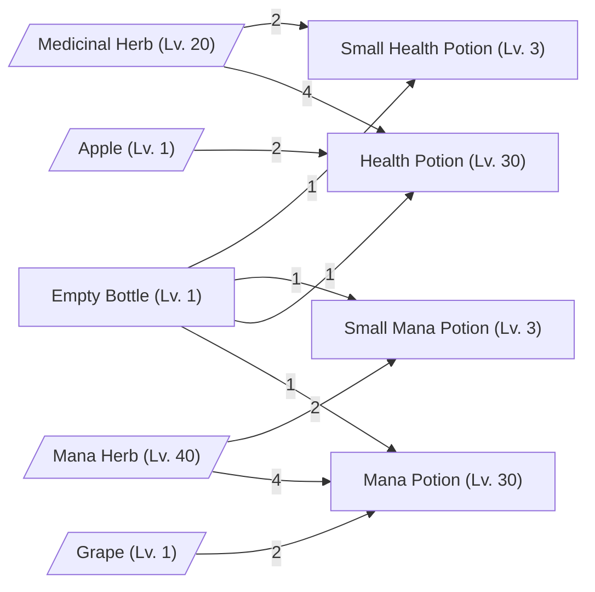

| Recipe | Needs | Makes | Skill | Success | Seconds | Known from the start |
| --- | --- | --- | --- | --- | --- | --- |
| `HEALTH_POTION` | 4 x Medicinal Herb (Lv. 20), 2 x Apple (Lv. 1), 1 x Empty Bottle (Lv. 1) | 1 x Health Potion (Lv. 30) | alchemy 3 | 70% | 15.0 | discover |
| `MANA_POTION` | 4 x Mana Herb (Lv. 40), 2 x Grape (Lv. 1), 1 x Empty Bottle (Lv. 1) | 1 x Mana Potion (Lv. 30) | alchemy 3 | 70% | 15.0 | discover |
| `SMALL_HEALTH_POTION` | 2 x Medicinal Herb (Lv. 20), 1 x Empty Bottle (Lv. 1) | 1 x Small Health Potion (Lv. 3) | alchemy 1 | 90% | 8.0 | discover |
| `SMALL_MANA_POTION` | 2 x Mana Herb (Lv. 40), 1 x Empty Bottle (Lv. 1) | 1 x Small Mana Potion (Lv. 3) | alchemy 1 | 90% | 8.0 | discover |

## Campfire

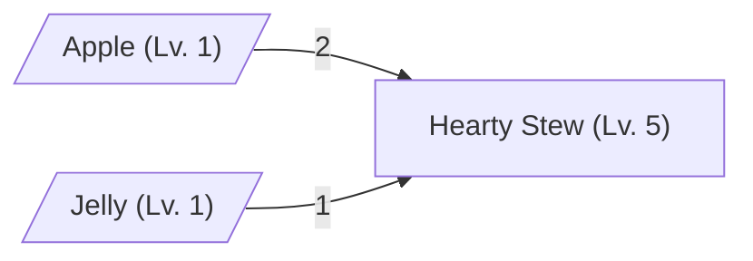

| Recipe | Needs | Makes | Skill | Success | Seconds | Known from the start |
| --- | --- | --- | --- | --- | --- | --- |
| `HEARTY_STEW` | 2 x Apple (Lv. 1), 1 x Jelly (Lv. 1) | 1 x Hearty Stew (Lv. 5) | cooking 1 | 50% | 6.0 | yes |

## Carving Table

| Recipe | Needs | Makes | Skill | Success | Seconds | Known from the start |
| --- | --- | --- | --- | --- | --- | --- |
| `ETCH_AMETHYST` | 1 x Cut Amethyst (Lv. 20) | etch essence | runic etching 1 | 50% | 1.2 · L² | discover |
| `ETCH_DIAMOND` | 1 x Cut Diamond (Lv. 100) | etch essence | runic etching 1 | 50% | 1.2 · L² | discover |
| `ETCH_EMERALD` | 1 x Cut Emerald (Lv. 40) | etch essence | runic etching 1 | 50% | 1.2 · L² | discover |
| `ETCH_PYRELITH` | 1 x Cut Pyrelith (Lv. 80) | etch essence | runic etching 1 | 50% | 1.2 · L² | discover |
| `ETCH_RUBY` | 1 x Cut Ruby (Lv. 60) | etch essence | runic etching 1 | 50% | 1.2 · L² | discover |

## Gem Cut Station

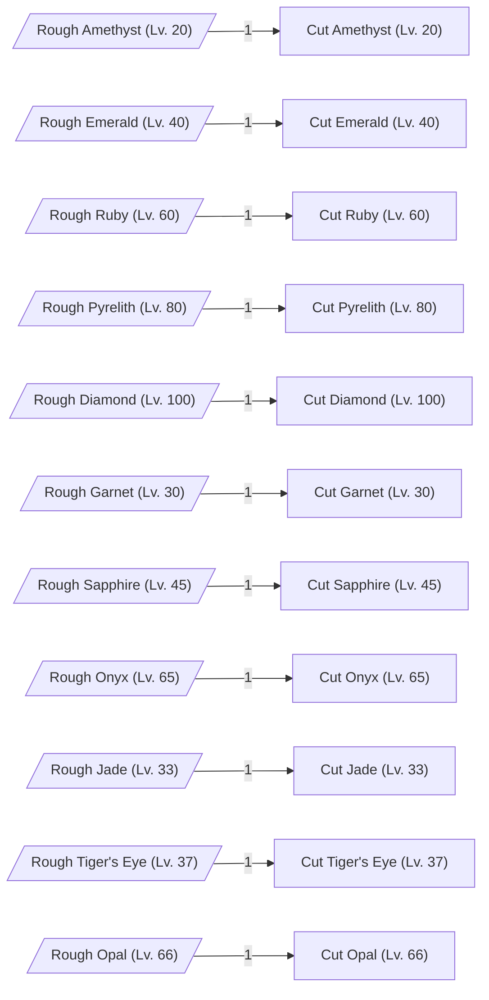

| Recipe | Needs | Makes | Skill | Success | Seconds | Known from the start |
| --- | --- | --- | --- | --- | --- | --- |
| `CUT_AMETHYST` | 1 x Rough Amethyst (Lv. 20) | 1 x Cut Amethyst (Lv. 20) | gem cutting 1 | 90% | 10.0 | yes |
| `CUT_DIAMOND` | 1 x Rough Diamond (Lv. 100) | 1 x Cut Diamond (Lv. 100) | gem cutting 5 | 40% | 50.0 | yes |
| `CUT_EMERALD` | 1 x Rough Emerald (Lv. 40) | 1 x Cut Emerald (Lv. 40) | gem cutting 2 | 75% | 20.0 | yes |
| `CUT_GARNET` | 1 x Rough Garnet (Lv. 30) | 1 x Cut Garnet (Lv. 30) | gem cutting 1 | 90% | 15.0 | yes |
| `CUT_JADE` | 1 x Rough Jade (Lv. 33) | 1 x Cut Jade (Lv. 33) | gem cutting 2 | 75% | 20.0 | yes |
| `CUT_ONYX` | 1 x Rough Onyx (Lv. 65) | 1 x Cut Onyx (Lv. 65) | gem cutting 3 | 60% | 35.0 | yes |
| `CUT_OPAL` | 1 x Rough Opal (Lv. 66) | 1 x Cut Opal (Lv. 66) | gem cutting 3 | 60% | 35.0 | yes |
| `CUT_PYRELITH` | 1 x Rough Pyrelith (Lv. 80) | 1 x Cut Pyrelith (Lv. 80) | gem cutting 4 | 50% | 40.0 | yes |
| `CUT_RUBY` | 1 x Rough Ruby (Lv. 60) | 1 x Cut Ruby (Lv. 60) | gem cutting 3 | 60% | 30.0 | yes |
| `CUT_SAPPHIRE` | 1 x Rough Sapphire (Lv. 45) | 1 x Cut Sapphire (Lv. 45) | gem cutting 2 | 75% | 25.0 | yes |
| `CUT_TIGERS_EYE` | 1 x Rough Tiger's Eye (Lv. 37) | 1 x Cut Tiger's Eye (Lv. 37) | gem cutting 2 | 70% | 22.0 | yes |

## Mint

| Recipe | Needs | Makes | Skill | Success | Seconds | Known from the start |
| --- | --- | --- | --- | --- | --- | --- |
| `GOLD_COIN` | 1 x Gold Bar (Lv. 50) | 10000 x Gold Coin (Lv. 1) | minting 1 | 100% | 20.0 | yes |

## Transmutation Workbench

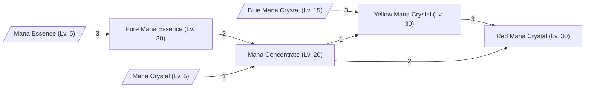

| Recipe | Needs | Makes | Skill | Success | Seconds | Known from the start |
| --- | --- | --- | --- | --- | --- | --- |
| `MANA_CONCENTRATE` | 2 x Pure Mana Essence (Lv. 30), 1 x Mana Crystal (Lv. 5) | 1 x Mana Concentrate (Lv. 20) | transmutation 3 | 70% | 20.0 | discover |
| `PURE_MANA_ESSENCE` | 3 x Mana Essence (Lv. 5) | 1 x Pure Mana Essence (Lv. 30) | transmutation 1 | 80% | 15.0 | discover |
| `RED_MANA_CRYSTAL` | 3 x Yellow Mana Crystal (Lv. 30), 2 x Mana Concentrate (Lv. 20) | 1 x Red Mana Crystal (Lv. 30) | transmutation 7 | 50% | 30.0 | discover |
| `YELLOW_MANA_CRYSTAL` | 3 x Blue Mana Crystal (Lv. 15), 1 x Mana Concentrate (Lv. 20) | 1 x Yellow Mana Crystal (Lv. 30) | transmutation 5 | 60% | 25.0 | discover |

## By hand

```mermaid
graph LR
    workbench_kit["Workbench Kit (Lv. 1)"]
    log[/"Log (Lv. 1)"/]
    log -->|4| workbench_kit
    stick[/"Stick (Lv. 1)"/]
    stick -->|4| workbench_kit
    furnace_kit["Furnace Kit (Lv. 1)"]
    loose_stone[/"Loose Stone (Lv. 1)"/]
    loose_stone -->|12| furnace_kit
    log -->|2| furnace_kit
    forge_kit["Forge Kit (Lv. 1)"]
    loose_stone -->|10| forge_kit
    iron_ingot["Iron Ingot (Lv. 20)"]
    iron_ingot -->|2| forge_kit
    log -->|2| forge_kit
    campfire_kit["Campfire Kit (Lv. 1)"]
    stick -->|4| campfire_kit
    loose_stone -->|3| campfire_kit
    resin[/"Resin (Lv. 1)"/]
    resin -->|1| campfire_kit
    chest_kit["Chest Kit (Lv. 1)"]
    log -->|3| chest_kit
    iron_ingot -->|1| chest_kit
    mining_shaft_kit["Mining Shaft Kit (Lv. 1)"]
    log -->|8| mining_shaft_kit
    iron_ingot -->|2| mining_shaft_kit
    arrow["Arrow (Lv. 1)"]
    reed_stalk[/"Reed Stalk (Lv. 1)"/]
    reed_stalk -->|2| arrow
    feather[/"Feather (Lv. 1)"/]
    feather -->|1| arrow
    tanning_rack_kit["Tanning Rack Kit (Lv. 1)"]
    plank["Plank (Lv. 5)"]
    plank -->|6| tanning_rack_kit
    rope["Rope (Lv. 3)"]
    rope -->|4| tanning_rack_kit
    salt[/"Salt (Lv. 1)"/]
    salt -->|2| tanning_rack_kit
    loom_kit["Loom Kit (Lv. 1)"]
    plank -->|8| loom_kit
    rope -->|4| loom_kit
    nails["Nails (Lv. 5)"]
    nails -->|10| loom_kit
    glass_furnace_kit["Glass Furnace Kit (Lv. 1)"]
    brick["Brick (Lv. 5)"]
    brick -->|12| glass_furnace_kit
    iron_ingot -->|2| glass_furnace_kit
    clay[/"Clay (Lv. 1)"/]
    clay -->|4| glass_furnace_kit
    glassblowing_bench_kit["Glassblowing Bench Kit (Lv. 1)"]
    plank -->|6| glassblowing_bench_kit
    iron_ingot -->|2| glassblowing_bench_kit
    brick -->|2| glassblowing_bench_kit
    alchemy_laboratory_kit["Alchemy Laboratory Kit (Lv. 1)"]
    plank -->|6| alchemy_laboratory_kit
    glass["Glass (Lv. 8)"]
    glass -->|4| alchemy_laboratory_kit
    empty_bottle["Empty Bottle (Lv. 1)"]
    empty_bottle -->|4| alchemy_laboratory_kit
    iron_ingot -->|1| alchemy_laboratory_kit
    gem_cut_station_kit["Gem Cut Station Kit (Lv. 1)"]
    plank -->|8| gem_cut_station_kit
    iron_ingot -->|2| gem_cut_station_kit
    sand[/"Sand (Lv. 1)"/]
    sand -->|4| gem_cut_station_kit
    transmutation_workbench_kit["Transmutation Workbench Kit (Lv. 1)"]
    cut_stone["Cut Stone (Lv. 10)"]
    cut_stone -->|8| transmutation_workbench_kit
    copper_ingot["Copper Ingot (Lv. 10)"]
    copper_ingot -->|4| transmutation_workbench_kit
    mana_crystal[/"Mana Crystal (Lv. 5)"/]
    mana_crystal -->|2| transmutation_workbench_kit
    steel_arrow["steel arrow (Lv. 30)"]
    arrow -->|20| steel_arrow
    steel_ingot["Steel Ingot (Lv. 32)"]
    steel_ingot -->|1| steel_arrow
    sharp_arrow["sharp arrow (Lv. 10)"]
    arrow -->|20| sharp_arrow
    sharp_fang[/"Sharp Fang (Lv. 5)"/]
    sharp_fang -->|1| sharp_arrow
    fire_arrow["fire arrow (Lv. 45)"]
    arrow -->|20| fire_arrow
    ember_core[/"Ember Core (Lv. 45)"/]
    ember_core -->|1| fire_arrow
    crystal_arrow["crystal arrow (Lv. 40)"]
    arrow -->|20| crystal_arrow
    frost_crystal[/"Frost Crystal (Lv. 40)"/]
    frost_crystal -->|1| crystal_arrow
    wind_arrow["wind arrow (Lv. 65)"]
    arrow -->|20| wind_arrow
    storm_feather[/"Storm Feather (Lv. 65)"/]
    storm_feather -->|1| wind_arrow
    stone_arrow["stone arrow (Lv. 40)"]
    arrow -->|20| stone_arrow
    earth_crystal[/"earth crystal (Lv. 40)"/]
    earth_crystal -->|1| stone_arrow
    silver_arrow["silver arrow (Lv. 38)"]
    arrow -->|20| silver_arrow
    silver_ingot["Silver Ingot (Lv. 38)"]
    silver_ingot -->|1| silver_arrow
    shadow_arrow["shadow arrow (Lv. 55)"]
    arrow -->|20| shadow_arrow
    shadow_shard[/"Shadow Shard (Lv. 55)"/]
    shadow_shard -->|1| shadow_arrow
    poison_arrow["poison arrow (Lv. 15)"]
    arrow -->|20| poison_arrow
    venom_sac[/"Venom Sac (Lv. 15)"/]
    venom_sac -->|1| poison_arrow
    stun_arrow["stun arrow (Lv. 45)"]
    arrow -->|20| stun_arrow
    lodestone[/"Lodestone (Lv. 45)"/]
    lodestone -->|1| stun_arrow
    carving_table_kit["Carving Table Kit (Lv. 1)"]
    plank -->|8| carving_table_kit
    iron_ingot -->|2| carving_table_kit
    glass -->|1| carving_table_kit
    mint_kit["Mint Kit (Lv. 1)"]
    cut_stone -->|6| mint_kit
    plank -->|4| mint_kit
    iron_ingot -->|2| mint_kit
    bronze_ingot["Bronze Ingot (Lv. 15)"]
    bronze_ingot -->|2| mint_kit
```

| Recipe | Needs | Makes | Skill | Success | Seconds | Known from the start |
| --- | --- | --- | --- | --- | --- | --- |
| `ALCHEMY_LABORATORY_KIT` | 6 x Plank (Lv. 5), 4 x Glass (Lv. 8), 4 x Empty Bottle (Lv. 1), 1 x Iron Ingot (Lv. 20) | 1 x Alchemy Laboratory Kit (Lv. 1) | carpentry 2 | 100% | 20.0 | yes |
| `ARROW` | 2 x Reed Stalk (Lv. 1), 1 x Feather (Lv. 1) | 20 x Arrow (Lv. 1) | arrow crafting 1 | 100% | 5.0 | yes |
| `CAMPFIRE_KIT` | 4 x Stick (Lv. 1), 3 x Loose Stone (Lv. 1), 1 x Resin (Lv. 1) | 1 x Campfire Kit (Lv. 1) | cooking 1 | 100% | 5.0 | yes |
| `CARVING_TABLE_KIT` | 8 x Plank (Lv. 5), 2 x Iron Ingot (Lv. 20), 1 x Glass (Lv. 8) | 1 x Carving Table Kit (Lv. 1) | runic etching 1 | 100% | 20.0 | yes |
| `CHEST_KIT` | 3 x Log (Lv. 1), 1 x Iron Ingot (Lv. 20) | 1 x Chest Kit (Lv. 1) | carpentry 1 | 100% | 10.0 | yes |
| `CRYSTAL_ARROW` | 20 x Arrow (Lv. 1), 1 x Frost Crystal (Lv. 40) | 20 x crystal arrow (Lv. 40) | arrow crafting 3 | 100% | 6.0 | yes |
| `FIRE_ARROW` | 20 x Arrow (Lv. 1), 1 x Ember Core (Lv. 45) | 20 x fire arrow (Lv. 45) | arrow crafting 3 | 100% | 6.0 | yes |
| `FORGE_KIT` | 10 x Loose Stone (Lv. 1), 2 x Iron Ingot (Lv. 20), 2 x Log (Lv. 1) | 1 x Forge Kit (Lv. 1) | carpentry 1 | 100% | 10.0 | yes |
| `FURNACE_KIT` | 12 x Loose Stone (Lv. 1), 2 x Log (Lv. 1) | 1 x Furnace Kit (Lv. 1) | carpentry 1 | 100% | 10.0 | yes |
| `GEM_CUT_STATION_KIT` | 8 x Plank (Lv. 5), 2 x Iron Ingot (Lv. 20), 4 x Sand (Lv. 1) | 1 x Gem Cut Station Kit (Lv. 1) | gem cutting 1 | 100% | 20.0 | yes |
| `GLASSBLOWING_BENCH_KIT` | 6 x Plank (Lv. 5), 2 x Iron Ingot (Lv. 20), 2 x Brick (Lv. 5) | 1 x Glassblowing Bench Kit (Lv. 1) | carpentry 2 | 100% | 15.0 | yes |
| `GLASS_FURNACE_KIT` | 12 x Brick (Lv. 5), 2 x Iron Ingot (Lv. 20), 4 x Clay (Lv. 1) | 1 x Glass Furnace Kit (Lv. 1) | carpentry 2 | 100% | 20.0 | yes |
| `LOOM_KIT` | 8 x Plank (Lv. 5), 4 x Rope (Lv. 3), 10 x Nails (Lv. 5) | 1 x Loom Kit (Lv. 1) | carpentry 2 | 100% | 15.0 | yes |
| `MINING_SHAFT_KIT` | 8 x Log (Lv. 1), 2 x Iron Ingot (Lv. 20) | 1 x Mining Shaft Kit (Lv. 1) | carpentry 1 | 100% | 20.0 | yes |
| `MINT_KIT` | 6 x Cut Stone (Lv. 10), 4 x Plank (Lv. 5), 2 x Iron Ingot (Lv. 20), 2 x Bronze Ingot (Lv. 15) | 1 x Mint Kit (Lv. 1) | minting 1 | 100% | 20.0 | yes |
| `PICKAXE` | 2 x Iron Ingot (Lv. 20), 1 x Log (Lv. 1) | 1 x Pickaxe (Lv. 10) | mining 1 | 100% | 10.0 | yes |
| `POISON_ARROW` | 20 x Arrow (Lv. 1), 1 x Venom Sac (Lv. 15) | 20 x poison arrow (Lv. 15) | arrow crafting 4 | 100% | 6.0 | yes |
| `SHADOW_ARROW` | 20 x Arrow (Lv. 1), 1 x Shadow Shard (Lv. 55) | 20 x shadow arrow (Lv. 55) | arrow crafting 4 | 100% | 6.0 | yes |
| `SHARP_ARROW` | 20 x Arrow (Lv. 1), 1 x Sharp Fang (Lv. 5) | 20 x sharp arrow (Lv. 10) | arrow crafting 2 | 100% | 6.0 | yes |
| `SHOVEL` | 2 x Stick (Lv. 1), 1 x Log (Lv. 1) | 1 x Shovel (Lv. 1) | basic skill 1 | 80% | 8.0 | yes |
| `SILVER_ARROW` | 20 x Arrow (Lv. 1), 1 x Silver Ingot (Lv. 38) | 20 x silver arrow (Lv. 38) | arrow crafting 4 | 100% | 6.0 | yes |
| `STEEL_ARROW` | 20 x Arrow (Lv. 1), 1 x Steel Ingot (Lv. 32) | 20 x steel arrow (Lv. 30) | arrow crafting 2 | 100% | 6.0 | yes |
| `STONE_ARROW` | 20 x Arrow (Lv. 1), 1 x earth crystal (Lv. 40) | 20 x stone arrow (Lv. 40) | arrow crafting 3 | 100% | 6.0 | yes |
| `STONE_HATCHET` | 2 x Loose Stone (Lv. 1), 1 x Stick (Lv. 1) | 1 x Stone Hatchet (Lv. 1) | basic skill 1 | 80% | 5.0 | yes |
| `STONE_KNIFE` | 1 x Flint (Lv. 1), 1 x Stick (Lv. 1) | 1 x Stone Knife (Lv. 1) | basic skill 1 | 80% | 4.0 | yes |
| `STUN_ARROW` | 20 x Arrow (Lv. 1), 1 x Lodestone (Lv. 45) | 20 x stun arrow (Lv. 45) | arrow crafting 5 | 100% | 6.0 | yes |
| `TANNING_RACK_KIT` | 6 x Plank (Lv. 5), 4 x Rope (Lv. 3), 2 x Salt (Lv. 1) | 1 x Tanning Rack Kit (Lv. 1) | carpentry 2 | 100% | 12.0 | yes |
| `TORCH` | 1 x Stick (Lv. 1), 1 x Resin (Lv. 1) | 1 x Torch (Lv. 1) | basic skill 1 | 90% | 3.0 | yes |
| `TRANSMUTATION_WORKBENCH_KIT` | 8 x Cut Stone (Lv. 10), 4 x Copper Ingot (Lv. 10), 2 x Mana Crystal (Lv. 5) | 1 x Transmutation Workbench Kit (Lv. 1) | carpentry 3 | 100% | 20.0 | yes |
| `UPGRADE_EQUIPMENT` | 2 x Iron Ingot (Lv. 20), 1 x Mana Dust (Lv. 15) | upgrade | upgrade equipment 1 | 30% | 8.0 | discover |
| `WILLOW_ROD` | 2 x Stick (Lv. 1), 1 x Resin (Lv. 1) | 1 x Willow Rod (Lv. 1) | basic skill 1 | 80% | 4.0 | yes |
| `WIND_ARROW` | 20 x Arrow (Lv. 1), 1 x Storm Feather (Lv. 65) | 20 x wind arrow (Lv. 65) | arrow crafting 3 | 100% | 6.0 | yes |
| `WORKBENCH_KIT` | 4 x Log (Lv. 1), 4 x Stick (Lv. 1) | 1 x Workbench Kit (Lv. 1) | basic skill 1 | 100% | 10.0 | yes |

## Raw materials

Items some recipe takes and no recipe makes. "In the world" is a search of the mob drop tables, props, fishing
and the ore a pick breaks out for the item, so a `no` is a material nobody can obtain yet.

| Material | Level | Carries craft-axes | In the world |
| --- | --- | --- | --- |
| Adamantium Ore | 100 | no | mining |
| Apple | 1 | yes | mobs |
| Blue Mana Crystal | 15 | yes | mobs |
| Bone Shard | 5 | yes | mobs, props |
| Clay | 1 | yes | mobs |
| Coal | 5 | yes | mobs |
| Copper Ore | 10 | no | mining |
| Coral | 45 | yes | fishing |
| Deathcap | 15 | yes | mobs |
| Dragon Scale | 75 | yes | mobs |
| Drake Hide | 55 | yes | mobs |
| earth crystal | 40 | yes | mobs |
| Ectoplasm | 25 | yes | mobs |
| Ember Core | 45 | yes | mobs |
| Feather | 1 | yes | mobs |
| Flax | 1 | no | mobs |
| Flint | 1 | yes | props |
| Frost Crystal | 40 | yes | mobs |
| Glowcap | 45 | yes | mobs |
| Gold Ore | 50 | no | mobs, mining |
| Grape | 1 | yes | mobs |
| Heartwood | 80 | yes | mobs |
| Horn | 10 | yes | mobs |
| Iron Ore | 20 | no | mobs, mining |
| Ironwood | 45 | yes | mobs |
| Jelly | 1 | yes | mobs |
| Lodestone | 45 | yes | mining |
| Log | 1 | no | mobs, props |
| Loose Stone | 1 | yes | props |
| Mana Crystal | 5 | yes | mobs, props |
| Mana Dust | 15 | yes | mobs |
| Mana Essence | 5 | yes | mobs |
| Mana Herb | 40 | yes | props |
| Medicinal Herb | 20 | yes | props |
| Mercury Ore | 60 | no | mining |
| Mithril Ore | 85 | no | mining |
| Obsidian | 50 | yes | mining |
| Palladium Ore | 70 | no | mining |
| Quarried Stone | 5 | yes | mobs, props |
| Raw Hide | 1 | no | mobs |
| Reed Stalk | 1 | yes | mobs, props |
| Resin | 1 | yes | props |
| Rough Amethyst | 20 | no | props, mining |
| Rough Diamond | 100 | no | mining |
| Rough Emerald | 40 | no | fishing, mining |
| Rough Garnet | 30 | no | mining |
| Rough Jade | 33 | no | mining |
| Rough Onyx | 65 | no | mining |
| Rough Opal | 66 | no | mining |
| Rough Pyrelith | 80 | no | mining |
| Rough Ruby | 60 | no | fishing, mining |
| Rough Sapphire | 45 | no | mining |
| Rough Tiger's Eye | 37 | no | mining |
| Salt | 1 | yes | mobs |
| Sand | 1 | no | props, mining |
| Shadow Shard | 55 | yes | mobs |
| Sharp Fang | 5 | yes | mobs |
| Silk Thread | 8 | no | mobs |
| Silver Ore | 35 | no | mining |
| Soft Fur | 3 | yes | mobs |
| Star Core | 80 | yes | mobs |
| Stick | 1 | yes | props |
| Storm Feather | 65 | yes | mobs |
| Sun Herb | 80 | yes | props |
| Thornvine | 20 | yes | mobs |
| Tin Ore | 5 | no | mining |
| Venom Sac | 15 | yes | mobs |
| Void Essence | 30 | yes | mobs |
| Warm Stone | 18 | yes | mobs |
| Wild Herb | 1 | no | mobs, props |
| Wool | 1 | no | mobs |
| Wyrm Bone | 75 | yes | mobs |
| Yew Billet | 20 | yes | mobs |
