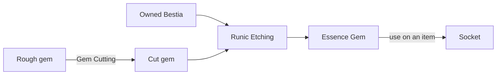

# Bestia Essences

An **essence** is the power of one Bestia, bound into a cut gem. Put into a socket of a weapon, an armor piece, an
accessory or a tool, it gives the item a special effect. It works like a card in Ragnarok Online: every species has
its own essence, and the essence always goes into the same kind of equipment.

Three professions work together:

- A **Miner** cuts the gem with [Gem Cutting](/docs/mechanics/master/survival-tree/#skill-gem-cutting).
- An **Artificer** binds the Bestia into it with [Runic Etching](/docs/mechanics/master/craftsman-tree/#skill-runic-etching).
- **Anyone** puts the finished Essence Gem into a socket.

Sockets come from the forge or from [Item Customization](/docs/mechanics/items-crafting/items/#item-customization), see
[Sockets and Essences](/docs/mechanics/items-crafting/crafting/#sockets-and-essences).

# Getting an Essence

## Runic Etching

The only source of an essence is a Bestia that a master owns. There is no essence drop from wild Bestias.

Every etching starts with a Bestia [locked into a Carving Table](#locking-a-bestia-into-the-table). An Artificer at
that table picks a cut gem and one of the locked Bestias, and casts Runic Etching. The success chance is the one in
the [skill table](/docs/mechanics/master/craftsman-tree/#skill-runic-etching).

The etching takes the [craft duration](/docs/mechanics/items-crafting/crafting/#craft-duration) of the Bestia's level,
`1.2 · L²` seconds: under a minute for a Lv 6 boar, about 34 minutes at Lv 41, two hours at Lv 81 and four hours for
a Lv 110 boss. Master Craftsman shortens it like any craft. Once it starts, it runs on its own. The Artificer may
leave, and the success chance is fixed at the start.

- **Success:** the Bestia is gone. The **Essence Gem** of that species goes to the Bestia's owner by post.
- **Failure:** the gem shatters. The owner gets a letter. The Bestia stays locked in and can try again with a new
  gem.

<figure class="figure d-block my-4">
  
  <figcaption class="figure-caption">Runes etched into a blade</figcaption>
</figure>

So a Bestia is only used up when it really becomes an essence. The price of bad luck is the gem.

The Artificer can call their etching off at any time. The cut gem then comes back to them by post.

## Locking a Bestia into the Table

A Bestia that waits for hours cannot stand next to the table. So its owner locks it into the table first. This is the
same for an Artificer's own Bestia and for anyone else's.

1. The owner clicks the Carving Table and opens the tab **Lock in a Bestia**. Any master can do this; it needs no
   skill.
2. They pick one of their Bestias: one that is called out, or one from their storage. A called-out Bestia leaves the
   world like one that goes into storage, and drops what it carries in a bundle. Taking one from storage follows the
   rule for opening the storage: the owner needs the
   [Bestia Ledger](/docs/mechanics/bestias/bestia-storage/#the-bestia-ledger), and it does not work during a fight.
3. Any Artificer at that table now sees the Bestia in their etching list, with the owner's name. The chance and the
   time are the Artificer's own.

A locked Bestia takes no storage slot, and it cannot be summoned, swapped or traded. The owner takes it back from the
same tab. It then goes into their storage, which needs a free slot there. Taking it back calls off an etching that
is running, and the cut gem goes back to the Artificer by post. If the table is knocked down, every locked Bestia goes
back to its owner's storage, and every gem back to its Artificer.

Hiring an Artificer needs no special window. The two agree on the fee, and the fee and the cut gem change hands in an
ordinary [trade](/docs/mechanics/towns-trade/economy-trade/). The owner locks the Bestia into the Artificer's table.

| Result  | Owner gets                          | Artificer gets               |
| ------- | ----------------------------------- | ---------------------------- |
| Success | The Essence Gem, by post            | The fee, from the trade      |
| Failure | A letter; the Bestia stays locked in | The fee, from the trade      |

The fee is paid in the trade, before the etching, so the two have to trust each other, as with any service.

## Gem Tiers

The **species** decides what an essence does. The **gem** decides how strong it is. Nothing else counts: not the
Bestia's IVs, and not its exact level. There is no roll. Two Ruby essences of the same species are always equal.

A Bestia can fill a gem only when it has reached the gem's level. A stronger Bestia may still go into a cheaper gem,
and then gives that gem's tier.

| Gem      | The Bestia must be at least | Points | The item must be at least |
| -------- | --------------------------: | -----: | ------------------------: |
| Amethyst |                        Lv 1 |      3 |                 any level |
| Emerald  |                       Lv 21 |      5 |                      Lv 1 |
| Ruby     |                       Lv 41 |      8 |                     Lv 21 |
| Pyrelith |                       Lv 61 |     11 |                     Lv 41 |
| Diamond  |                       Lv 81 |     15 |                     Lv 61 |

**Points** are the strength of the essence. They use the same unit as [forged stats](/docs/mechanics/items-crafting/crafting/#item-level-of-a-forged-copy):
one point is worth one attribute point. Each effect below says what one point buys.

The last column is the lowest [item level](/docs/mechanics/items-crafting/crafting/#item-level-of-a-forged-copy) that takes
the essence. A Diamond essence cannot go into a starter shirt.

## Worked Example

A Burrow Boar is caught in the wild at Lv 6. It is a BEAST and a brute, so its essence is **Bane (Beast)** for a
weapon: `+3%` damage against Beasts per point.

| The boar is        | Gems it can fill     | Essence              | Fits a weapon of at least |
| ------------------ | -------------------- | -------------------- | ------------------------- |
| Lv 6, just caught  | Amethyst             | +9% damage vs Beasts | any level                 |
| raised to Lv 25    | Emerald or Amethyst  | +15%                 | Lv 1                      |
| raised to Lv 45    | Ruby or lower        | +24%                 | Lv 21                     |
| raised to Lv 81    | Diamond or lower     | +45%                 | Lv 61                     |

A Lv 45 boar etched into an Amethyst still gives the Amethyst essence: `+9%`. The gem sets the tier. The level only
opens the better gems.

So it pays to raise a Bestia before it becomes an essence. A species that is born at a high level reaches the top
gems sooner, but even a field critter can become a Diamond essence.

## Where the Gems Come From

**Amethyst lies on the ground.** Small clusters of amethyst sit on the surface, often in the mountains (alpine land and
steep, high ground) and now and then anywhere else. Anyone can pick one up and gets a
. A new player can etch an essence without ever mining.

**Every other gem comes from the rock.** Emerald, ruby, pyrelith and diamond are mined, see
[Mining](/docs/mechanics/master/survival-tree/#skill-mining). A Rough Gemstone from a Bestia's digging or from a
[treasure cache](/docs/mechanics/world/treasure-caches/) may be any of the five.

Only these five gems hold an essence. Garnet, sapphire, onyx, jade, tiger's eye and opal are jewellery stones.

# Slot Groups

Every species belongs to exactly one slot group. Its Essence Gem only fits a socket of an item in that group.

| Group     | Items                                          |
| --------- | ---------------------------------------------- |
| Weapon    | Weapons in the right hand                      |
| Shield    | Shields in the left hand                       |
| Armor     | Body armor                                     |
| Garment   | Capes and cloaks                               |
| Footgear  | Shoes and boots                                |
| Headgear  | Upper and middle head                          |
| Accessory | Accessories and light sources                  |
| Tool      | Pickaxe, hatchet, shovel and fishing rod       |

# Effects

An essence has one effect from its group's list. The species data names the effect and its target: which kind,
which element, which status. The Ruby column shows what 8 points buy.

| Group     | Effect                                                                   | Per point                  | At Ruby (8 points)        |
| --------- | ------------------------------------------------------------------------ | -------------------------- | ------------------------- |
| Weapon    | **Bane:** damage against one kind                                        | +3%                        | +24%                      |
| Weapon    | **Element Hunter:** damage against one element                           | +3%                        | +24%                      |
| Weapon    | **Rider:** chance on hit to inflict a status                             | +1%, Stun or Frozen +0.7%  | 8%, Stun or Frozen 5%     |
| Weapon    | **Precision:** HIT and CRIT                                              | +1 HIT, +⅓ CRIT            | +8 HIT, +2 CRIT           |
| Weapon    | **Leech:** a share of the damage dealt comes back as HP                  | +0.4%                      | 3%                        |
| Weapon    | **Giant Slayer:** damage against bosses                                  | +2%                        | +16%                      |
| Shield    | **Ward:** damage taken from one kind                                     | −3%                        | −24%                      |
| Shield    | **Arrow Ward:** damage taken from ranged attacks                         | −1%                        | −8%                       |
| Shield    | **Steadfast:** cannot be knocked back (3 points), the rest is VIT        | +1 VIT                     | no knockback, +5 VIT      |
| Armor     | **Element Skin:** resistance against one element                         | +3%                        | +24%                      |
| Armor     | **Element Body:** the wearer takes the species' element (3 points), the rest is max HP | +1% max HP | element level 1, +5% max HP |
| Armor     | **Hardy:** max HP                                                        | +1%                        | +8%                       |
| Armor     | **Coated:** this item cannot be stripped (2 points), the rest is DEF     | +1% DEF                    | cannot be stripped, +6%   |
| Garment   | **Mist Veil:** magic damage taken                                        | −1%                        | −8%                       |
| Garment   | **Element Veil:** resistance against one element                         | +3%                        | +24%                      |
| Garment   | **Whisper:** FLEE                                                        | +1                         | +8                        |
| Footgear  | **Swift:** move speed, at most +10%                                      | +1%                        | +8%                       |
| Footgear  | **Long Stride:** stamina recovery                                        | +5%                        | +40%                      |
| Footgear  | **Deep Pools:** max HP and max mana                                      | +0.5% each                 | +4% each                  |
| Headgear  | **Clear Mind:** resistance against one status, immunity at Diamond       | +4%                        | +32%                      |
| Headgear  | **Focus:** cast time                                                     | −1%                        | −8%                       |
| Headgear  | **Wisdom:** mana recovery                                                | +5%                        | +40%                      |
| Accessory | **Attribute Pair:** the two main attributes of the species' role         | +1, split                  | +4 / +4                   |
| Accessory | **Quick Hands:** attack speed                                            | +1%                        | +8%                       |
| Accessory | **Learned Trick:** one utility attack of the species as a skill          | the whole essence          | attack level up to 60     |
| Accessory | **Quiet Step:** wild Bestias notice the wearer later                     | −2% notice range           | −16%                      |
| Accessory | **Tamer:** [catch chance](/docs/mechanics/bestias/bestia/#catching-bestias) | +1 per 2 points          | +4                        |
| Accessory | **Reflex:** when struck, chance to cast one self-buff                    | +1%                        | 8%                        |

Some notes:

- **Element Body** turns the wearer into the species' element at level 1, like the element cards of Ragnarok Online.
  It changes what every attack element does to the wearer, see
  [element](/docs/mechanics/bestias/bestia-design/#7-element-size-and-defences). A better gem adds max HP, not a higher
  element level: a high element level would make the wearer almost immune to whole schools of magic.
- **Learned Trick** gives the wearer one utility attack from the species' learnset at skill level 1, for as long as
  they wear it. It costs mana and has its cooldown like any other cast, and the skills window lists it under
  **Temporary**, for a master and for a Bestia that wears it. The gem caps the attack level the same way as
  [Spell Inscription](/docs/mechanics/master/scholar-tree/#skill-spell-inscription): 20, 40, 60, 80 and any. An attack
  above the cap is not granted, so a Lanternwisp's Shadow Cloak, learned at level 26, needs at least an Emerald.
- **Reflex** casts the buff named in the species' row on the wearer when a blow or spell lands on them: free, at skill
  level 1, and only when the gem's cap covers the buff's attack level, as for a Learned Trick.
- **Clear Mind** at Diamond makes the wearer immune to that one status.
- **Attribute Pair** splits the points over the two attributes the role leans on most: a brute gives STR and VIT, a
  caster INT and WIL.

## Tool Essences

Six species give a tool essence. A tool essence makes work go better, not fights. It fits only the tool it names,
except Tough Grip, which fits every tool.

| Effect            | Tool        | Per point                                            | At Ruby (8 points) |
| ----------------- | ----------- | ---------------------------------------------------- | ------------------ |
| **Mining Speed**  | Pickaxe     | −3% time per swing                                   | −24%               |
| **Rich Seam**     | Pickaxe     | +1% chance of a second piece, never for gold         | +8%                |
| **Felling Speed** | Hatchet     | +3% felling damage, so a tree falls sooner           | +24%               |
| **Digging Speed** | Shovel      | −3% time per metre                                   | −24%               |
| **Faster Bite**   | Fishing rod | −3% waiting time for a bite                          | −24%               |
| **Tough Grip**    | Any tool    | −3% wear                                             | −24%               |

Rich Seam adds to the Miner's [Rich Veins](/docs/mechanics/master/survival-tree/#skill-rich-veins) and keeps its rule:
gold never drops twice, because the world's coin supply is sized by its gold.

Tools roll sockets at the forge like any other item, see [Sockets and Rolls](/docs/mechanics/items-crafting/equipment-design/#sockets-and-rolls),
and [Item Customization](/docs/mechanics/items-crafting/items/#item-customization) can cut more.

## Drawbacks

Some essences carry a drawback, like the darker cards of Ragnarok Online. Such an essence gets **one and a half
times** the points for its effect. A Ruby essence with a drawback brings 12 points.

| Drawback   | What it costs the wearer |
| ---------- | ------------------------ |
| Slow       | −10% move speed          |
| Soft       | −10% DEF                 |
| Clumsy     | −10 HIT                  |
| Drained    | −10% max mana            |

The drawback is part of the species, like the effect. It does not grow with the gem.

# Putting an Essence into a Socket

Use the Essence Gem on an item in the bag. It needs a free socket, the right [slot group](#slot-groups) and an item
level high enough for the [gem tier](#gem-tiers). The game asks once more before it binds, because the step cannot be
undone.

- **An essence is permanent.** It cannot be taken out again.
- **It does not change the item level.** The socket already raised it.
- **A broken item keeps its essences.** It cannot be worn until it is [repaired](/docs/mechanics/items-crafting/items/#damaging-of-items).
- **A destroyed item loses them.** A failed refine or a failed socket cut can destroy an item, and its essences go with
  it.
- **An essence is not an [enchantment](/docs/mechanics/items-crafting/items/#enchantments).** Dispel cannot touch it.

A tamed Bestia wears equipment too, so its gear can carry essences in the same way.

## Stacking

Two essences with the same kind of bonus add up. Bonuses of different kinds multiply. Two Bane (Beast) essences at
Ruby give `+48%` against Beasts. A Bane (Undead) essence and the Priest's
[Demon Bane](/docs/mechanics/master/scholar-tree/#skill-demon-bane) are different kinds of bonus, so they multiply.
This is the same rule Ragnarok Online uses for its cards.

# Finding an Essence

An Essence Gem is fully described by its **species** and its **gem**. The tooltip says both, plus the effect:
`Burrow Boar · Bane (Beast) · Ruby`. The [auction house](/docs/mechanics/towns-trade/economy-trade/#auction-house) can filter essences
by species or by effect, and by gem.

# Boss Essences

A boss gives a hand-made essence, like the MVP cards of Ragnarok Online. Each one does something no normal essence can
do: turn magic away, strike every foe around the target, save a Bestia from death.

A boss is [caught](/docs/mechanics/bestias/bestia/#catching-a-boss) with a trap like any Bestia, world bosses
included, but its chance is only 3% of the normal one: about 3% with the best trap, a master who has trained for
it, and a group that brings the boss down to its last HP without killing it. After every failed try the boss is wary
of traps for 30 seconds.

Boss essences follow their own rules:

- **The numbers are fixed.** They do not grow with the gem.
- **The gem follows the boss level.** A boss up to Lv 60 fills a Ruby, up to Lv 80 a Pyrelith, and above that a
  Diamond.
- **The item must be at least the boss level − 20.** The Golden Scarab (Lv 48) needs an item of Lv 28 or more. The
  game refuses to place it in a weaker item, so a boss essence never sits in an item where it would be wasted.
- **Each boss essence counts once.** Two Royal Jelly essences give `+25%` max HP, not `+50%`.
- **An autocast uses a real attack.** Sulphur Breath, Howl of Garm and Fresh Vent cast Miasma, Frost Nova and Burning
  Ground, attacks Bestias already learn. They are cast for free at skill level 1, like a
  [Reflex](#effects).



# The Essence of Every Species

Each normal species has one essence, set in `data/bestias.yaml`. The list follows the [Bestia List](/docs/mechanics/bestias/bestia-list/).


