The small intro game tells players how they became a Bestia Master: They came into direct contact with an ephemeral mana crystal that changed their nature through magic and connected them to the mana flows of the universe. They are therefore receptive to the influence of mana and are able to communicate with the beings that emerge from this mythical energy: **the Bestia**.

The attachment to mana also explains why Bestia masters were able to survive the destruction of their world relatively unscathed and to pass on to the next incarnation of the world.

# Master Skills

The bestia master can learn a set of skills. These skills are freely chosen by the player and determine the job or profession of the master.

Some of these account skills can be used by every Bestia in possession of the master, or at least have a passive effect on them. Others can only be used actively by the master itself.



- The possible rank counts of a skill should be: **1, 3, 5 and 10**
- Budget skills per **branch**, not per tree. A branch is a chain of 3-6 dependent skills that a player buys as a unit, and holds **15-45 ranks** - that is what one career can realistically finish.
- Reaching the capstone of a single branch must cost **no more than 60 skill points**, so a career can finish one branch and still dabble in a second.
- A **base tree** holds **10-25 ranks**. It teaches the basics and gates its sub-trees.
- A **sub-tree** carries **2-6 branches**. Crafting and gathering sub-trees sit at the low end, fighting sub-trees at the high end. The Wizard is the widest of them all because it repeats the same branch shape once per element - that is width, not depth, and it costs a player nothing to ignore three quarters of it.
- There should be some meaningful dependency of the skills forming a tree
- In each profession tree there should form 2-3 sub-trees which create a meaningful hierarchy
- There should be some kind of three tiers inside a tree to lead from low and basic skills to the much more powerful ones



Especially crafting skills should be, when possible, require some sort of minigame or meaningful player interaction. Their outcome should also be dependent on the status values of a player, on the skill level but also on environmental aspects. An example teleport could go as follows:

> After the master Saferu has selected a few of his and friendly Bestia he prepares to teleport to a fairly distant location. While he is very skilled and has a maxed teleport skill, on the target location there is a manastorm causing some interference. Upon teleportation the group is set of course and spawns almost a kilometer off from their target in a very hostile environment.

Ultimately, it remains important to leave the outcome of skills open in some way. However, the result should remain understandable and influenceable by the player.

# Skill Progression

Every master starts out limited to the **Novice** skill tree - a small set of basics that teaches the player how to get around and how to deal with others. Once **5 skill points are invested into Basic Skill** all remaining skill trees unlock and the master can start to specialize.

The Novice tree then closes behind the player: as soon as the first skill point is spent outside of it, no further novice skills can be learned. Everything learned up to that point is kept. It depends on the player how much of the Novice tree he wants to finish before branching out.

On each level up the master gains 1 skillpoint to put into the skills rank. This is permanent and means a player can spend about 100 points for improving the ranks of his skills.



The skilltrees are designed as such that to reach the highest professions in each tree the player needs to spend about **60 points**.

The player can decide to have a mediocre profession in each tree, or to max out one and take maybe half of the
meaningful professions of another tree. The skilltree is a hierarchical dependency of skills.

# Professions

Skill points spent in a sub-tree (Blacksmith, Sage, Wizard, ...) do more than unlock its skills. They also make the
master a member of that **profession**, and the profession decides which weapons and armor the master can use.

- A sub-tree counts as a profession from its **first skill point**. One point in Knight is enough to pick up a sword.
- A master has **at most two professions**: the two sub-trees with the most points. A master with 8 points in Sage, 8
  in Knight and 2 in Forester is a **Sage / Knight**.
- The master may use every weapon type that one of the two professions allows, and the heavier of their two armor
  types.
- Points in a base tree (Novice, Craftsman, Survival, Scholar, Warrior) belong to no profession.
- Holding a weapon in each hand needs the Assassin skill [Dual Wield](#skill-dual-wield). No profession allows it on
  its own.



## Changing Professions

The two professions follow the skill points. A third sub-tree replaces one of the current two only when it has **more**
points than it. On a tie the master keeps the profession they already have, so two equal sub-trees never decide the
gear by chance.

When a profession is lost, everything it allowed and nothing else allows goes back to the bag. Nothing is destroyed,
and the master can wear it again as soon as the profession comes back.

## Base Equipment

Every master can use these, with or without a profession:

- Cloth armor
- Slings
- Tools: pickaxe, hatchet, fishing rod
- The novice equipment below

## Novice Equipment

Every new master starts with a novice set. It is weak, but it ignores professions: every master can use it at any
level. A Novice can try out each way of fighting before spending a point outside the Novice tree, and a master who
just left it is never unarmed while their first profession opens.

| Item          | Weapon or armor type | Slot                   |
| ------------- | -------------------- | ---------------------- |
| Novice Knife  | Dagger               | Right hand             |
| Novice Sword  | Sword                | Right hand             |
| Novice Bow    | Bow                  | Right hand, two-handed |
| Novice Rod    | Wand                 | Right hand             |
| Novice Shield | Light shield         | Left hand              |
| Novice Helmet | -                    | Head                   |
| Novice Shirt  | Cloth                | Armor                  |
| Novice Boots  | Light                | Footgear               |

The [Novice Bow](/docs/mechanics/ranged-combat/#novice-bow) comes with 100 arrows. The novice health and mana potions
are not equipment and stay for Novices only.

## Equipment per Profession

Armor is limited by its heaviest type. A master who may wear Medium armor may also wear Light and Cloth. Shields carry
an armor type as well and follow the same rule, see [Armor Type](/docs/mechanics/items/#armor-type). The weapon types
are listed in [Weapon Type](/docs/mechanics/items/#weapon-type).

| Profession                | Tree      | Armor  | Weapon Types                                                   |
| ------------------------- | --------- | ------ | -------------------------------------------------------------- |
| [Blacksmith](#blacksmith) | Craftsman | Medium | Mace, Hammer, Axe, Greataxe                                    |
| [Alchemist](#alchemist)   | Craftsman | Light  | Dagger, Mace, Thrown                                           |
| [Artificer](#artificer)   | Craftsman | Medium | Dagger, Wand, Staff, Crossbow                                  |
| [Forester](#forester)     | Survival  | Medium | Axe, Greataxe, Spear, Bow                                      |
| [Prospector](#prospector) | Survival  | Medium | Sword, Spear, Crossbow                                         |
| [Miner](#miner)           | Survival  | Medium | Mace, Hammer, Greataxe                                         |
| [Trader](#trader)         | Scholar   | Light  | Sword, Crossbow                                                |
| [Sage](#sage)             | Scholar   | Cloth  | Wand, Staff, Tome                                              |
| Priest                    | Scholar   | Medium | Mace, Staff, Tome                                              |
| [Wizard](#wizard)         | Warrior   | Cloth  | Wand, Staff, Tome                                              |
| [Assassin](#assassin)     | Warrior   | Light  | Dagger, Fist, Sword, Thrown                                    |
| [Knight](#knight)         | Warrior   | Heavy  | Sword, Greatsword, Axe, Greataxe, Mace, Hammer, Spear, Polearm |
| Brawler (parked)          | Warrior   | Light  | Fist, Staff                                                    |
| Hunter (parked)           | Warrior   | Light  | Spear, Bow, Crossbow, Thrown                                   |
| Bard (parked)             | Warrior   | Light  | Sword, Bow, Instrument                                         |
| Dancer (parked)           | Warrior   | Light  | Whip, Bow, Thrown                                              |

Heavy armor comes from the Knight alone, so a master who wants plate gives one of their two professions to it. Every
fighting profession owns at least one weapon type few others share - the Knight's greatsword and polearm, the
Assassin's fist weapons, the Dancer's whip, the Bard's instrument, the casters' tome - while every crafting and
gathering profession can still defend itself.

Bestias are not affected by professions. A bestia wears what its species allows, see
[Designing a Bestia](/docs/mechanics/bestia-design/#10-equipment).

# Mana Circles

Almost every master skill that can fail rolls against a success chance: forging a blade, cutting a rune slot, binding an
enchantment, transmuting matter, inscribing a spell. Skill rank, status values and equipment all feed that roll, and a
lone master eventually hits the ceiling of what those three can buy.

A **Mana Circle** is how a group pushes past it. It is a placeable prop - a ring of
[Mana Concentrate](/docs/mechanics/item-list/#mana-concentrate) laid into the ground - that anyone standing inside
contributes to, whatever their profession. The rite is started by the master who owns the skill; everyone else is simply
present, and presence is the whole contribution.

```text
Circle Bonus = 5 × Participants × ManaFactor   [Participants ≤ 6, caster included]
```

`ManaFactor` comes from the local [mana concentration](/docs/mechanics/environment/#mana-concentration): `0.5` in a
drained region, `1.0` in an ordinary one, `1.5` where mana runs thick. A full circle of six in a mana-rich place is
therefore worth `+45%` on the roll - as much as most governing skills grant at max rank - while the same six people
standing on drained ground get `+15%` and would have been better off scouting a different site first.

Three rules keep it from becoming a formality:

- The **mana cost of the rite is split evenly** across every participant, so a circle makes expensive rites affordable as
  well as more likely to land. A participant who cannot pay their share drops out and the circle recalculates.
- Every participant is **locked out of contributing again for 5 minutes**, and cannot act while the rite runs. Standing
  in someone's circle is a real cost, not a favor that takes a second.
- A circle only helps a **success roll**. It does nothing for damage, healing, movement or anything else a skill does.



# Skill Trees

The following trees exist, they are organized in subtrees. These form the skill trees of a master. After a level up one skill point can be spend to increase a single level of a skill.



## Novice Tree

In order to learn how to interact with other players you need to invest your first skill points in this skill tree. It is expected that every user learns at least **Basic Skill Lv. 5**, since this is the threshold which unlocks all the other skill trees.



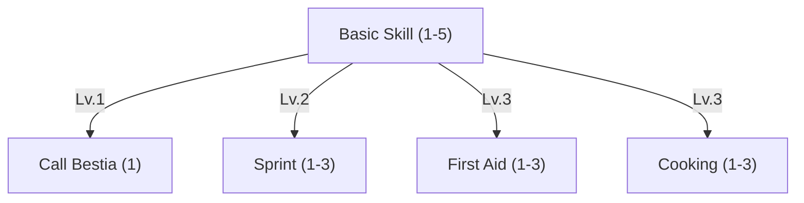

<br>

Allows to trade with other players.
Allows to chat with other players via public and whisper chat.
Allows to use trade posts.
Allows sitting to double HP & Mana recovery.
Allows to create parties and invite players into them. Joining a party needs no rank. Unlocks all the other skill trees.




Every Bestia the master owns that is out in the world, and not in storage, appears next to the master when the channel
ends. Taking damage breaks the channel. A Bestia that is fighting does not answer, so the skill cannot
pull one out of a lost fight.





Costs stamina instead of mana. Ends early when the master attacks or casts a skill.

| Lv. | Movement Speed | Stamina Cost |
| --- | -------------- | ------------ |
| 1   | +30%           | 20           |
| 2   | +40%           | 20           |
| 3   | +50%           | 20           |





Requires a cooking place. Lv 1 allows you to place a campfire which counts as cooking place.

The three ranks only govern how well the Master handles a cooking place. What a Master can actually cook grows through
**recipes**, discovered the same way a Craftsman discovers a blueprint - by experimenting with ingredients. A Lv. 1 cook
with a long recipe book outperforms a Lv. 3 cook who never left the campfire.

| Lv. | Cooking Time Reduction | Success Chance | Stamina Cost |
| --- | ---------------------- | -------------- | ------------ |
| 1   | 0%                     | +0%            | 5            |
| 2   | 20%                    | +20%           | 8            |
| 3   | 40%                    | +40%           | 11           |





Channels for 10s. A target can only receive a single First Aid every 60 secs. It heals the smaller of the two amounts, so the flat value caps it.

| Lv. | Max HP Healed (% based) | Max HP Healed (flat) | Mana |
| --- | ----------------------- | -------------------- | ---- |
| 1   | +30%                    | +100 HP              | 12   |
| 2   | +60%                    | +200 HP              | 16   |
| 3   | +100%                   | +350 HP              | 20   |



## Craftsman Tree

The workbenches, forges and cauldrons of the tradesfolk turn raw ambition into things a player can actually use. Every blade, trinket and bottled miracle a master ever relies on started out as somebody's Craftsman skill paying off.

Crafting always runs in two phases: a Craftsman first **discovers a blueprint** by experimenting with raw materials, then **produces** that item from it as often as they like. The skills below govern how reliably a Craftsman discovers, produces and refines within their trade — see [Item Crafting](/docs/mechanics/items/#item-crafting) for the full system.



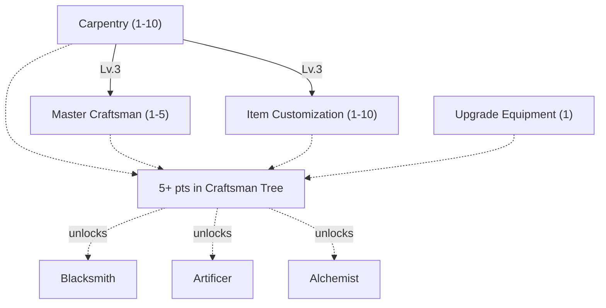

<br>


Lv. 1 allows you to build a [workbench](/docs/mechanics/item-list/#workbench), which you can use for crafting. The time it needs to craft an item depends on the item level you want to craft.

Carpentry also makes the kits for the buildings in the wild: the Observation Outpost, the Mining Shaft and the
Lumberjack Cabin. To build one, the master needs level 1 of the skill that uses it.

| Lv. | Success Chance | Max Item Level |
| --- | -------------- | -------------- |
| 1   | +5%            | 10             |
| 2   | +10%           | 20             |
| 3   | +15%           | 30             |
| 4   | +20%           | 40             |
| 5   | +25%           | 50             |
| 6   | +30%           | 60             |
| 7   | +35%           | 70             |
| 8   | +40%           | 80             |
| 9   | +45%           | 90             |
| 10  | +50%           | 100+           |

This bonus is added on top of the item-level base chance and the crafter's DEX/WIL — see
[Construction Crafting Success Chance](/docs/mechanics/items/#construction-crafting-success-chance) for the full formula.





| Lv. | Construction Time Reduction | Success Chance |
| --- | --------------------------- | -------------- |
| 1   | 10%                         | +2%            |
| 2   | 20%                         | +4%            |
| 3   | 30%                         | +6%            |
| 4   | 40%                         | +8%            |
| 5   | 50%                         | +10%           |

This bonus is added on top of the item-level base chance and the crafter's DEX/WIL — see
[Construction Crafting Success Chance](/docs/mechanics/items/#construction-crafting-success-chance) for the full formula.





Allows you to perform upgrades of armor and weapons. There is a chance this fails and potentially destroys your equipment.

See [Weapon Refinement](/docs/mechanics/items/#weapon-refinement) and [Armor Refinement](/docs/mechanics/items/#armor-refinement) for the upgrade chances and effects.





Requires an [Engraving Set](/docs/mechanics/item-list/#engraving-set) which will be consumed in the process. You can choose how many slots you want to put into an item. But every slot makes it harder to succeed. Every extra slot above 1 reduces the success chance by 40%.

The Success Chance below is added on top of a **base chance that drops as the item's own level rises**. See [Item Customization](/docs/mechanics/items/#item-customization) for the full formula and worked examples.

| Lv. | Success Chance | Destroy Chance On Failure | Max Slots |
| --- | -------------- | ------------------------- | --------- |
| 1   | +10%           | 30%                       | 1         |
| 2   | +20%           | 28%                       | 1         |
| 3   | +30%           | 26%                       | 1         |
| 4   | +40%           | 24%                       | 2         |
| 5   | +50%           | 22%                       | 2         |
| 6   | +60%           | 20%                       | 2         |
| 7   | +70%           | 18%                       | 3         |
| 8   | +80%           | 16%                       | 3         |
| 9   | +90%           | 14%                       | 3         |
| 10  | +100%          | 12%                       | 3         |



### Blacksmith

Steel remembers who beat it into shape. Blacksmiths turn raw ore into the finest weaponry and armor, which protects its wearer even in the midst of the harshest environments and hottest battles.



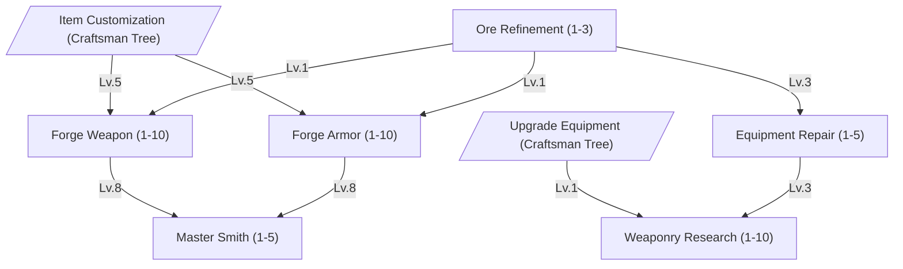

<br>


Lv. 1 allows you to place a [Furnace](/docs/mechanics/item-list/#furnace). Every batch burns fuel:
[Coal](/docs/mechanics/item-list/#coal). A failed smelt loses both the ore and the fuel.

| Lv. | Ore Refinement Success |
| --- | ---------------------- |
| 1   | +30%                   |
| 2   | +60%                   |
| 3   | +90%                   |

There is **no ore level cap** - the bonus is added on top of an ore-level base chance that starts at `30%` for
[Tin](/docs/mechanics/item-list/#tin-ore) and [Copper](/docs/mechanics/item-list/#copper-ore) and keeps falling by 1%
per ore level above 10, plus the smith's STR and WIL. Even a maxed smith loses roughly every second batch of
[Adamantium Ore](/docs/mechanics/item-list/#adamantium-ore). See
[Ore Refinement Success Chance](/docs/mechanics/items/#ore-refinement-success-chance) for the full formula and
[Refining](/docs/mechanics/natural-resources/#refining) for the level of every ore.





Lv. 1 allows you to place a Forge.

| Lv. | Success Chance | Reliable Item Level |
| --- | -------------- | ------------------- |
| 1   | +5%            | 10                  |
| 2   | +10%           | 20                  |
| 3   | +15%           | 30                  |
| 4   | +20%           | 40                  |
| 5   | +25%           | 50                  |
| 6   | +30%           | 60                  |
| 7   | +35%           | 70                  |
| 8   | +40%           | 80                  |
| 9   | +45%           | 90                  |
| 10  | +50%           | 100+                |

There is **no hard cap**. A blueprint above the reliable item level can still be attempted - every item level above it
costs another `5%` success chance. A Lv. 5 smith reaching for a level 80 weapon is working at a deep penalty, not
against a locked door. See [Item Crafting](/docs/mechanics/items/#item-crafting) for the full roll.

The reliable item level also caps the random stats a forged copy can roll, see [The Cap](/docs/mechanics/items/#the-cap).





Lv. 1 allows you to place a Forge.

| Lv. | Success Chance | Reliable Item Level |
| --- | -------------- | ------------------- |
| 1   | +5%            | 10                  |
| 2   | +10%           | 20                  |
| 3   | +15%           | 30                  |
| 4   | +20%           | 40                  |
| 5   | +25%           | 50                  |
| 6   | +30%           | 60                  |
| 7   | +35%           | 70                  |
| 8   | +40%           | 80                  |
| 9   | +45%           | 90                  |
| 10  | +50%           | 100+                |

Same rule as [Forge Weapon](#skill-forge-weapon): no hard cap, but every item level above the reliable one costs another
`5%` success chance. The reliable item level caps random stats the same way.





| Lv. | Upgrade Success | Forging Success |
| --- | --------------- | --------------- |
| 1   | +4%             | +1%             |
| 2   | +8%             | +2%             |
| 3   | +12%            | +3%             |
| 4   | +16%            | +4%             |
| 5   | +20%            | +5%             |
| 6   | +24%            | +6%             |
| 7   | +28%            | +7%             |
| 8   | +32%            | +8%             |
| 9   | +36%            | +9%             |
| 10  | +40%            | +10%            |





Restores the [durability](/docs/mechanics/items/#damaging-of-items) of weapons and armor alike. Those are the only
things in the world that wear out and can be repaired. A [light source](/docs/mechanics/environment/#light-sources) burns
down as well, but burnt time is gone: no repair gives it back.

| Lv. | Max Item Level |
| --- | -------------- |
| 1   | 20             |
| 2   | 40             |
| 3   | 60             |
| 4   | 80             |
| 5   | 100+           |





| Lv. | Forging Chance | Upgrade Chance |
| --- | -------------- | -------------- |
| 1   | +5%            | +5%            |
| 2   | +10%           | +10%           |
| 3   | +15%           | +15%           |
| 4   | +20%           | +20%           |
| 5   | +25%           | +25%           |



### Artificer

Where Blacksmiths hammer steel, Artificers coax it into remembering spells. This path inscribes magic onto items, binds it to triggers, and crystallizes raw mana into shards other professions can build on.



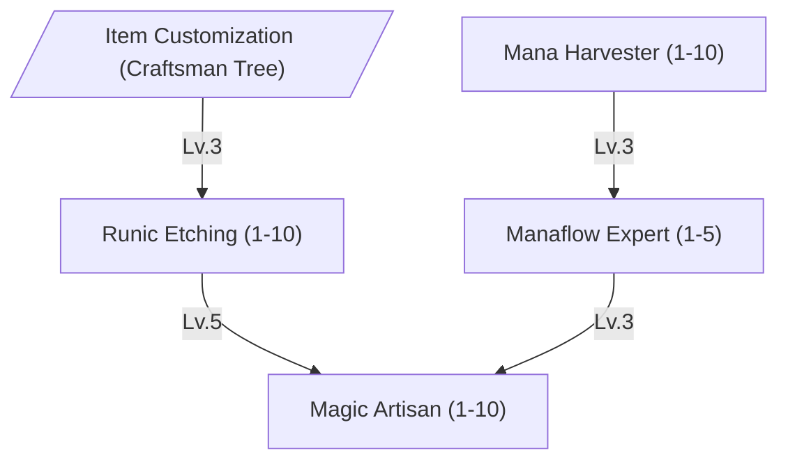

<br>


Level 1 enables you to place a Mana Harvester.

| Lv. | Harvesting Time Reduction | Crystal Yield | Total Active Harvesters |
| --- | ------------------------- | ------------- | ----------------------- |
| 1   | 5%                        | +3%           | 1                       |
| 2   | 10%                       | +6%           | 1                       |
| 3   | 15%                       | +9%           | 1                       |
| 4   | 20%                       | +12%          | 2                       |
| 5   | 25%                       | +15%          | 2                       |
| 6   | 30%                       | +18%          | 2                       |
| 7   | 35%                       | +21%          | 3                       |
| 8   | 40%                       | +24%          | 3                       |
| 9   | 45%                       | +27%          | 3                       |
| 10  | 50%                       | +30%          | 4                       |




Level 1 enables you to place a Crystal Lathe. The cast only places the lathe or opens its recipes. The refining itself
takes the [craft duration](/docs/mechanics/items/#craft-duration) of the crystal's item level.

| Lv. | Success Chance | Max Crystal Level |
| --- | -------------- | ----------------- |
| 1   | +4%            | 20                |
| 2   | +8%            | 40                |
| 3   | +12%           | 60                |
| 4   | +16%           | 80                |
| 5   | +20%           | 100+              |

A crystal above your max crystal level cannot be refined.





Level 1 allows you to place a Carving Table. The Bestia to convert must stand next to the table. The cast only places
the table or opens its recipes. The etching itself takes the [craft duration](/docs/mechanics/items/#craft-duration) of
the Bestia's level.

| Lv. | Success Chance | Reliable Bestia Level |
| --- | -------------- | --------------------- |
| 1   | +5%            | 10                    |
| 2   | +10%           | 20                    |
| 3   | +15%           | 30                    |
| 4   | +20%           | 40                    |
| 5   | +25%           | 50                    |
| 6   | +30%           | 60                    |
| 7   | +35%           | 70                    |
| 8   | +40%           | 80                    |
| 9   | +45%           | 90                    |
| 10  | +50%           | 100+                  |

Same rule as [Forge Weapon](#skill-forge-weapon): no hard cap, but every Bestia level above the reliable one costs another
`5%` success chance.





Level 1 allows you to place an Enchantment Altar. Every binding needs refined mana crystals. The cast only places the
altar or opens its recipes. The binding itself takes the [craft duration](/docs/mechanics/items/#craft-duration) of the
item level.

| Lv. | Enchantment Chance | Destroy Chance on Failed Bind |
| --- | ------------------ | ----------------------------- |
| 1   | +4%                | 40%                           |
| 2   | +8%                | 37%                           |
| 3   | +12%               | 34%                           |
| 4   | +16%               | 31%                           |
| 5   | +20%               | 28%                           |
| 6   | +24%               | 25%                           |
| 7   | +28%               | 22%                           |
| 8   | +32%               | 19%                           |
| 9   | +36%               | 16%                           |
| 10  | +40%               | 13%                           |



### Alchemist

Equal parts kitchen and laboratory. Alchemists turn raw ingredients - mundane or mana-soaked - into tonics and reagents nobody else can make. Some carry the first bandages they ever learned to wrap as a Novice all the way into a healer's toolkit.



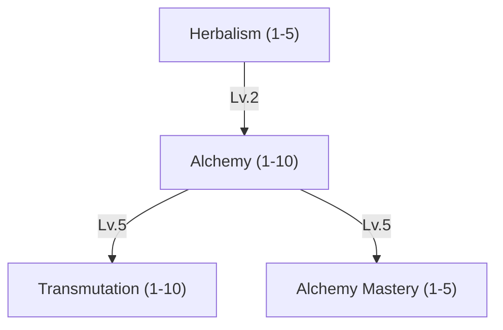

<br>


| Lv. | Max Herb Level |
| --- | -------------- |
| 1   | 20             |
| 2   | 40             |
| 3   | 60             |
| 4   | 80             |
| 5   | 100+           |

The herb level is the herb's [item level](/docs/mechanics/items/#item-level). A herb above your max level cannot be
gathered.





Lv. 1 allows you to place an Alchemy Laboratory. Higher levels let you reliably discover and craft stronger potions
and elixirs.

| Lv. | Success Chance | Reliable Item Level |
| --- | -------------- | ------------------- |
| 1   | +5%            | 10                  |
| 2   | +10%           | 20                  |
| 3   | +15%           | 30                  |
| 4   | +20%           | 40                  |
| 5   | +25%           | 50                  |
| 6   | +30%           | 60                  |
| 7   | +35%           | 70                  |
| 8   | +40%           | 80                  |
| 9   | +45%           | 90                  |
| 10  | +50%           | 100+                |

Same rule as [Forge Weapon](#skill-forge-weapon): no hard cap, but every item level above the reliable one costs another
`5%` success chance. The cast only places the laboratory or opens its recipes. The brew itself takes the
[craft duration](/docs/mechanics/items/#craft-duration) of the potion's item level.





Lv. 1 allows you to place a Transmutation Workbench. Higher levels unlock transmuting higher-grade infused resources.

| Lv. | Success Chance | Reliable Item Level |
| --- | -------------- | ------------------- |
| 1   | +5%            | 10                  |
| 2   | +10%           | 20                  |
| 3   | +15%           | 30                  |
| 4   | +20%           | 40                  |
| 5   | +25%           | 50                  |
| 6   | +30%           | 60                  |
| 7   | +35%           | 70                  |
| 8   | +40%           | 80                  |
| 9   | +45%           | 90                  |
| 10  | +50%           | 100+                |

Same rule as [Alchemy](#skill-alchemy): no hard cap, but every item level above the reliable one costs another `5%`
success chance. The transmutation itself takes the [craft duration](/docs/mechanics/items/#craft-duration) of the
resource's item level.





| Lv. | Success Chance | Crafting Speed |
| --- | -------------- | -------------- |
| 1   | +5%            | +10%           |
| 2   | +10%           | +20%           |
| 3   | +15%           | +30%           |
| 4   | +20%           | +40%           |
| 5   | +25%           | +50%           |



## Survival Tree

Skills which allow the player to keep exploring the world and stay active longer far away from settlements are placed in this skill tree. Foresters live off the land, Prospectors chart what nobody has mapped yet and found towns on it, and Miners dig for what the land is hiding.

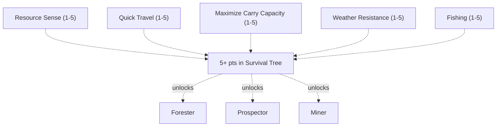

<br>


| Lv. | Movement Speed |
| --- | -------------- |
| 1   | +3%            |
| 2   | +6%            |
| 3   | +9%            |
| 4   | +12%           |
| 5   | +15%           |





Raises the [weight limit](/docs/mechanics/items/#weight-limit) of the Master and of every Bestia under their command by
the same amount. It sits in the trunk because every gathering profession - Forester, Prospector and Miner alike - lives
off what it can carry home.

| Lv. | Weight Limit (Master and Bestia) |
| --- | -------------------------------- |
| 1   | +15%                             |
| 2   | +30%                             |
| 3   | +45%                             |
| 4   | +60%                             |
| 5   | +75%                             |





| Lv. | Temperature Tolerance |
| --- | --------------------- |
| 1   | ±3 °C                 |
| 2   | ±6 °C                 |
| 3   | ±9 °C                 |
| 4   | ±12 °C                |
| 5   | ±15 °C                |





Each cast points to the nearest resources of every kind within the detection distance. The accuracy decides how close
the shown direction and distance are to the truth.

| Lv. | Detection Distance | Detection Accuracy |
| --- | ------------------ | ------------------ |
| 1   | 1km                | +10%               |
| 2   | 2km                | +20%               |
| 3   | 3km                | +30%               |
| 4   | 4km                | +40%               |
| 5   | 5km                | +50%               |





Anyone with a [fishing rod](/docs/mechanics/items/#weapon-type) can fish, but an untrained angler only catches fish and
loot up to level 10. Each rank raises the level of what a master can pull out of seas and lakes.

| Lv. | Max Fish Level |
| --- | -------------- |
| 1   | 20             |
| 2   | 40             |
| 3   | 60             |
| 4   | 80             |
| 5   | 100+           |



### Forester

At home wherever the trees outnumber the people. Foresters live off the land - felling timber, landing the catch of the day, and striking up a bond with Bestia most masters would call unapproachable. The ones who stay at it long enough stop merely catching Bestia and start shaping the bloodlines they come from.



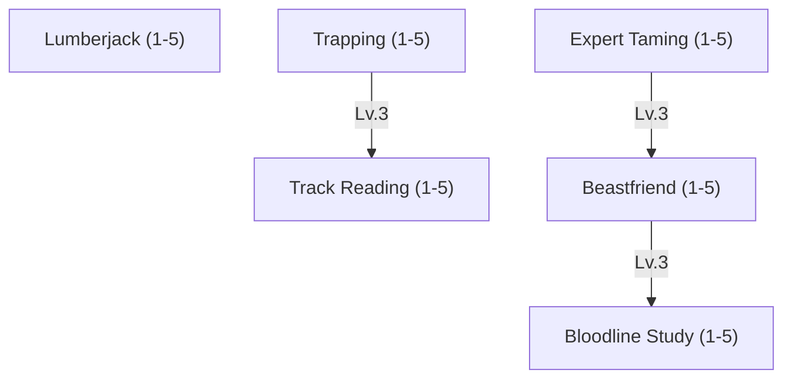

<br>


Level 1 lets you build a Lumberjack Cabin from a kit. Bestias can work the cabin while you are away.

| Lv. | Gathering Time Reduction | Resource Drop Chance |
| --- | ------------------------ | -------------------- |
| 1   | 10%                      | +20%                 |
| 2   | 20%                      | +40%                 |
| 3   | 30%                      | +60%                 |
| 4   | 40%                      | +80%                 |
| 5   | 50%                      | +100%                |





Raises the catch chance of every [Bestia trap](/docs/mechanics/bestia/#catching-bestias) the master throws. Anyone can
throw a Bestia trap; this skill only makes it hold better. The traps themselves are made with
[Carpentry](#skill-carpentry).

| Lv. | Catch Chance |
| --- | ------------ |
| 1   | +6%          |
| 2   | +12%         |
| 3   | +18%         |
| 4   | +24%         |
| 5   | +30%         |





Reads what has walked over a patch of ground: how many passed, and how fresh the trail is. Ground that takes no print -
rock, paving, ice - keeps no tracks at all, at any rank. Each rank searches a wider patch and tells more about the
trail.

| Lv. | Search Radius | Also Reads                  |
| --- | ------------- | --------------------------- |
| 1   | 3 tiles       | -                           |
| 2   | 6 tiles       | Which way the trail led     |
| 3   | 9 tiles       | What made it, and its level |
| 4   | 12 tiles      | The name of another master  |
| 5   | 15 tiles      | -                           |





| Lv. | EXP Gain | Stamina Loss Reduction |
| --- | -------- | ---------------------- |
| 1   | +5%      | 2%                     |
| 2   | +10%     | 4%                     |
| 3   | +15%     | 6%                     |
| 4   | +20%     | 8%                     |
| 5   | +25%     | 10%                    |





| Lv. | Tame Chance |
| --- | ----------- |
| 1   | +5%         |
| 2   | +10%        |
| 3   | +15%        |
| 4   | +20%        |
| 5   | +25%        |





Applies to every [Breeder](/docs/mechanics/bestia/#breeding) the master owns.

The time reduction stacks with breeder upgrades, feed and buffs, and counts against the same **50% floor** - it lets a
modest setup reach the cap instead of raising it. The dominant-IV column is the part that cannot be bought: at Lv. 4 a
clutch draws a fourth dominant individual value, so a bloodline improves on four stats per generation rather than three.

| Lv. | Breeding and Hatch Time Reduction | Dominant IVs per Clutch |
| --- | --------------------------------- | ----------------------- |
| 1   | 5%                                | 3                       |
| 2   | 10%                               | 3                       |
| 3   | 15%                               | 3                       |
| 4   | 20%                               | 4                       |
| 5   | 25%                               | 4                       |



### Prospector

Half surveyor, half treasure hunter. Prospectors chart unclaimed land, found settlements on it, feel out resources long before anyone else arrives, and travel further than sense would recommend.



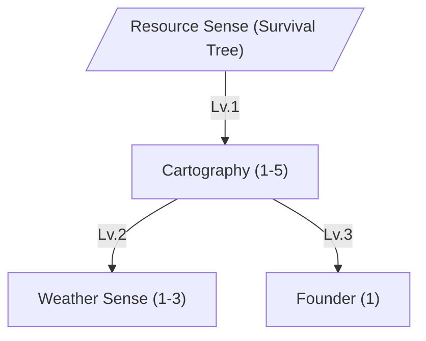

<br>

Each level reduces the difficulty of surveying unexplored land by `10`. The minigame on that page is a draft; its details
are still to be decided.



Level 1 shows you the current wind direction and speed. See [Weather](/docs/mechanics/environment/#weather) for what each
front does to the world.

It also reads the [mana in the land](/docs/mechanics/environment/#mana-concentration). Level 1 shows the mana
concentration where you stand. Higher levels point to the nearest stronger and weaker mana fields.



| Lv. | Forecast Range | Mana Field Range |
| --- | -------------- | ---------------- |
| 1   | 5 min          | Where you stand  |
| 2   | 10 min         | 1km              |
| 3   | 15 min         | 2km              |





A Prospector charts the land first and then claims it. This skill only starts a settlement. It does not grow one - a
town grows because players keep building inside it, and no further skill gates that.

Only one settlement can be active at any time. You must destroy the settlement before you can place a new one. Only
inactive settlements can be destroyed, which means no functional building (post office, trade post, etc.) may be left
inside the settlement's sphere of influence.





### Miner

If it's buried, a Miner will find a way to it. Equal parts pickaxe and stubbornness, this path turns raw earth - literally - into opportunity.



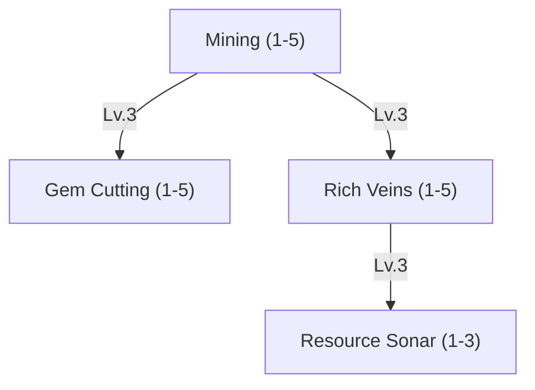

<br>


Anyone with a [pickaxe](/docs/mechanics/items/#weapon-type) can mine, but an untrained miner only gets resources up to
level 10. Level 1 lets you craft a pickaxe and build a Mining Shaft from a kit. Bestias can work the shaft while you are
away.

| Lv. | Mining Time Reduction | Max Resource Level |
| --- | --------------------- | ------------------ |
| 1   | 10%                   | 20                 |
| 2   | 20%                   | 40                 |
| 3   | 30%                   | 60                 |
| 4   | 40%                   | 80                 |
| 5   | 50%                   | 100+               |





Level 1 allows you to place a Gem Cut Station. The cast only places the station or opens its recipes. The cutting itself
takes the [craft duration](/docs/mechanics/items/#craft-duration) of the gem's item level. A failed cut shatters the gem.

| Lv. | Success Chance | Reliable Gem Level |
| --- | -------------- | ------------------ |
| 1   | +8%            | 20                 |
| 2   | +16%           | 40                 |
| 3   | +24%           | 60                 |
| 4   | +32%           | 80                 |
| 5   | +40%           | 100+               |

Same rule as [Forge Weapon](#skill-forge-weapon): no hard cap, but every gem level above the reliable one costs another
`5%` success chance.





Each ore or gem block the master mines has a chance to drop a second piece.

| Lv. | Second Piece Chance |
| --- | ------------------- |
| 1   | 10%                 |
| 2   | 20%                 |
| 3   | 30%                 |
| 4   | 40%                 |
| 5   | 50%                 |




Can sense ore and gem deposits through solid rock.

| Lv. | Sense Range |
| --- | ----------- |
| 1   | 5m          |
| 2   | 10m         |
| 3   | 15m         |



## Scholar Tree

The Scholar tree contains skills which help with sensing mana, hidden things and the world's events. Priests keep a party alive, Traders keep the gears of commerce turning, and Sages chase magic to its source - inscribing, discovering, and eventually bending distance itself.

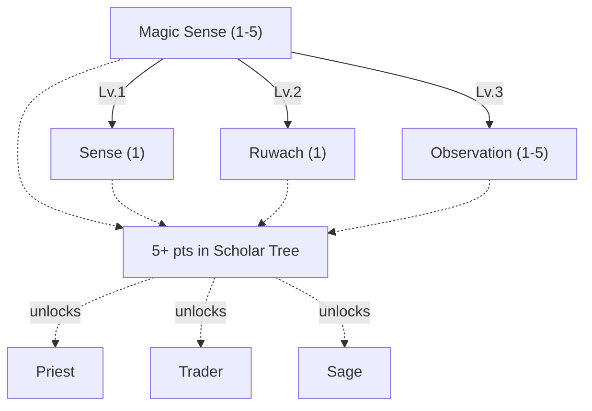

<br>


Sweeps the area around the caster once per cast. What comes back gets sharper with rank: first that something is there,
then where it is, and finally what it actually does. Local [mana concentration](/docs/mechanics/environment/#mana-concentration)
adds to the range in a mana-rich region and eats into it in a drained one. A target hidden under
[Suppress Aura](#skill-suppress-aura) stays silent.

| Lv. | Range | What It Reveals                                                                       |
| --- | ----- | ------------------------------------------------------------------------------------- |
| 1   | 10m   | That something nearby carries mana                                                    |
| 2   | 20m   | Direction and rough strength of each source                                           |
| 3   | 30m   | The element the mana belongs to                                                       |
| 4   | 40m   | The exact spell bound to an item or place                                             |
| 5   | 50m   | Who bound it, and what trigger a [Spell Binding](#skill-spell-binding) is waiting for |




Reveals the monster status values, element, HP and Mana.




While it is active, everything hidden within 10m of the caster is revealed. Detection resistance, such as that of
[Hide](#skill-hide), does not help against it.





Detects nearby world events like mana rifts which open, spawned bosses or other world changing events. It reads
**events**, not things: a [Resource Sense](#skill-resource-sense) finds the ore vein, a [Scry](#skill-scry) looks at a
place you are not standing in, and a [Magic Sense](#skill-magic-sense) picks apart a single spell. Observation is the
only one that notices something is about to happen.

It only works at an Observation Outpost, and the distance counts from the outpost. An outpost is built in the wild from
an outpost kit, which is made with [Carpentry](#skill-carpentry). Level 1 is needed to build it. A Bestia can keep watch
there while you are away.

| Lv. | Detection Distance |
| --- | ------------------ |
| 1   | 1km                |
| 2   | 2km                |
| 3   | 3km                |
| 4   | 4km                |
| 5   | 5km                |



### Priest

Priests channel mana into blessings that keep a party alive - restoring health, lifting curses, and bolstering the vitality of Bestia out in the field.



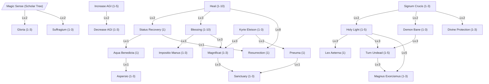

<br>


Heals a target's HP for `[(BaseLV+INT)/8]*(4+8*SkillLV)`. When used against Undead property monsters, it is a holy attack that ignores SMDEF and INT, but deals only half damage - that is,
`HealValue * ElementModifier / 2`. Targeting a monster with a healing spell has to be deliberate, so the client asks
for a modifier key rather than a plain click.

| Lv. | Mana Cost |
| --- | --------- |
| 1   | 13        |
| 2   | 16        |
| 3   | 19        |
| 4   | 22        |
| 5   | 25        |
| 6   | 28        |
| 7   | 31        |
| 8   | 34        |
| 9   | 37        |
| 10  | 40        |




Applies to the next spell cast by the target ally within `30s`.

| Lv. | Cast Time Reduction |
| --- | ------------------- |
| 1   | 10%                 |
| 2   | 20%                 |
| 3   | 30%                 |





The bonus is added to the chance of every [random stat](/docs/mechanics/items/#forging-and-random-stats) slot and socket of the item.

| Lv. | Random Stat Chance | Duration |
| --- | ------------------ | -------- |
| 1   | +5%                | 30s      |
| 2   | +10%               | 60s      |
| 3   | +15%               | 90s      |








On an Undead or Demon target it turns into a curse: it halves DEX and INT instead.

| Lv. | STR/INT/DEX | HIT | Duration |
| --- | ----------- | --- | -------- |
| 1   | +1          | +2  | 60s      |
| 2   | +2          | +4  | 80s      |
| 3   | +3          | +6  | 100s     |
| 4   | +4          | +8  | 120s     |
| 5   | +5          | +10 | 140s     |
| 6   | +6          | +12 | 160s     |
| 7   | +7          | +14 | 180s     |
| 8   | +8          | +16 | 200s     |
| 9   | +9          | +18 | 220s     |
| 10  | +10         | +20 | 240s     |




Grants a flat `+15%` Movement Speed at any level, plus the table below. The bonus only lasts while the buff holds, and
it **stacks** with the permanent [Quick Travel](#skill-quick-travel), so a well-buffed traveller adds both.

| Lv. | AGI | ASPD | Duration |
| --- | --- | ---- | -------- |
| 1   | +4  | +1%  | 80s      |
| 2   | +5  | +2%  | 100s     |
| 3   | +6  | +3%  | 120s     |
| 4   | +7  | +4%  | 140s     |
| 5   | +8  | +5%  | 160s     |





| Lv. | Movement/Attack Speed Reduction |
| --- | ------------------------------- |
| 1   | 4%                              |
| 2   | 8%                              |
| 3   | 12%                             |





| Lv. | Hits Absorbed | Damage Absorbed per Hit |
| --- | ------------- | ----------------------- |
| 1   | 1             | +10% of HP              |
| 2   | 2             | +20% of HP              |
| 3   | 3             | +30% of HP              |





The veil covers a radius of 3m.





| Lv. | DEF Reduction | Extra vs Demon/Undead | Duration |
| --- | ------------- | --------------------- | -------- |
| 1   | 10%           | 10%                   | 30s      |
| 2   | 20%           | 20%                   | 45s      |
| 3   | 30%           | 30%                   | 60s      |





| Lv. | MATK |
| --- | ---- |
| 1   | +10% |
| 2   | +20% |
| 3   | +30% |
| 4   | +40% |
| 5   | +50% |





| Lv. | Damage vs Demon/Undead |
| --- | ---------------------- |
| 1   | +8%                    |
| 2   | +16%                   |
| 3   | +24%                   |





| Lv. | Damage Taken Reduction from Demon/Undead |
| --- | ---------------------------------------- |
| 1   | 10%                                      |
| 2   | 20%                                      |
| 3   | 30%                                      |





| Lv. | ATK and MATK |
| --- | ------------ |
| 1   | +5           |
| 2   | +10          |
| 3   | +15          |











| Lv. | Duration |
| --- | -------- |
| 1   | 60s      |
| 2   | 120s     |
| 3   | 180s     |




Higher levels raise the chance of an instant kill against sufficiently weak undead.

Inflicts single target Holy, armor piercing damage. If the target is an Undead property monster, this spell has a chance of immediately ending its existence.

| Lv. | Base Chance of Effect |
| --- | --------------------- |
| 1   | 8%                    |
| 2   | 16%                   |
| 3   | 24%                   |
| 4   | 32%                   |
| 5   | 40%                   |

```text
Chance of Effect = [Base_Chance_of_Effect + (BaseLv ÷ 10) + (INT ÷ 10) + (WIL ÷ 10) + {1 − (Target_HP ÷ Target_MaxHP)} × 20]%
Damage = Holy Light damage of the same skill level
```








| Lv. | HP/Mana Regeneration |
| --- | -------------------- |
| 1   | +10%                 |
| 2   | +20%                 |
| 3   | +30%                 |





| Lv. | MATK | Bonus Damage vs Demon/Undead |
| --- | ---- | ---------------------------- |
| 1   | +15% | +10%                         |
| 2   | +30% | +20%                         |
| 3   | +45% | +30%                         |




Every second it heals the allies standing within, and deals the same amount as holy damage to undead and demon-type
enemies.

| Lv. | Max HP Healed per Second |
| --- | ------------------------ |
| 1   | +5%                      |
| 2   | +10%                     |
| 3   | +15%                     |






### Trader

Coin has its own kind of magic. Traders read markets instead of mana flows, linking auction houses together, minting the coin everyone else trades in, and looking out for goods that might otherwise walk off on their own.



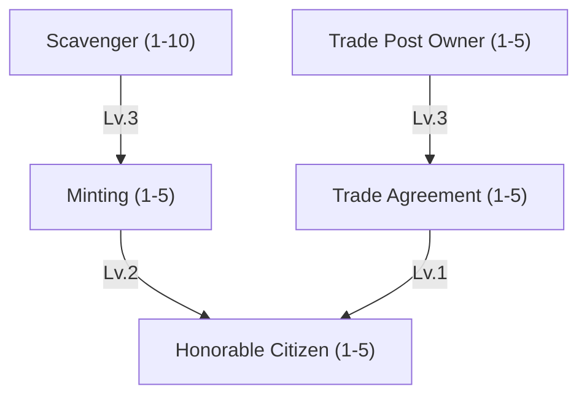

<br>


| Lv. | Recycle Chance |
| --- | -------------- |
| 1   | +5%            |
| 2   | +10%           |
| 3   | +15%           |
| 4   | +20%           |
| 5   | +25%           |
| 6   | +30%           |
| 7   | +35%           |
| 8   | +40%           |
| 9   | +45%           |
| 10  | +50%           |





Level 1 allows you to place a Mint. The cast only places the mint or opens its recipes. The minting itself takes the
[craft duration](/docs/mechanics/items/#craft-duration) of the bar.

A mint never creates gold. It recovers a share of the gold in a bar as coin, and the rest goes back to the world
reserve. See [Minting yield is a recovery rate](/docs/server/money-supply/#minting-yield-is-a-recovery-rate-not-a-bonus).

| Lv. | Gold Recovered as Coin |
| --- | ---------------------- |
| 1   | 60%                    |
| 2   | 70%                    |
| 3   | 80%                    |
| 4   | 90%                    |
| 5   | 100%                   |





Only one auction house can stand inside a settlement, and none within 5km of another. See
[Building an Auction House](/docs/mechanics/economy-trade/#building-an-auction-house).

| Lv. | Auction Houses | Max Owner Fee |
| --- | -------------- | ------------- |
| 1   | 1              | 5%            |
| 2   | 2              | 10%           |
| 3   | 3              | 15%           |
| 4   | 4              | 20%           |
| 5   | 5              | 25%           |




To be linked by other players, at least level 1 in this skill is required.

| Lv. | Linked Players |
| --- | -------------- |
| 1   | 1              |
| 2   | 2              |
| 3   | 3              |
| 4   | 4              |
| 5   | 5              |





| Lv. | Honor Penalty for Robbers |
| --- | ------------------------- |
| 1   | +20%                      |
| 2   | +40%                      |
| 3   | +60%                      |
| 4   | +80%                      |
| 5   | +100%                     |



### Sage

Books, wards and long nights spent staring into scrying bowls. Sages study magic itself - discovering it, inscribing it, binding it, and eventually learning to fold distance in on itself with teleportation and portals.



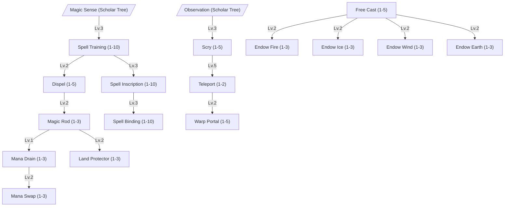

<br>



Consumes the scroll, also when the training fails. The base chance depends on the level of the spell and uses the same
table as [Spell Inscription](#skill-spell-inscription). Each level adds to it.

| Lv. | Success Chance |
| --- | -------------- |
| 1   | +5%            |
| 2   | +10%           |
| 3   | +15%           |
| 4   | +20%           |
| 5   | +25%           |
| 6   | +30%           |
| 7   | +35%           |
| 8   | +40%           |
| 9   | +45%           |
| 10  | +50%           |





| Lv. | Movement Speed While Casting | Interrupt Resistance |
| --- | ---------------------------- | -------------------- |
| 1   | 20%                          | +10%                 |
| 2   | 40%                          | +20%                 |
| 3   | 60%                          | +30%                 |
| 4   | 80%                          | +40%                 |
| 5   | 100%                         | +50%                 |





The Sage sees the chosen spot for 20s. Only [charted](#skill-cartography) land can be scried.

| Lv. | View Radius |
| --- | ----------- |
| 1   | 20m         |
| 2   | 40m         |
| 3   | 60m         |
| 4   | 80m         |
| 5   | 100m        |





Success chance is based on skill level and the target's SMDEF, with a base chance of `(50 + 10 * SkillLv)%`. Requires 1 [Yellow Mana Crystal](/docs/mechanics/item-list/#yellow-mana-crystal) per cast.



| Lv. | Base Success Chance |
| --- | ------------------- |
| 1   | 60%                 |
| 2   | 70%                 |
| 3   | 80%                 |
| 4   | 90%                 |
| 5   | 100%                |




Catches a single incoming spell while the ward holds.

| Lv. | Mana Recovered (of spell cost) | Ward Duration |
| --- | ------------------------------ | ------------- |
| 1   | 50%                            | 10s           |
| 2   | 75%                            | 15s           |
| 3   | 100%                           | 20s           |





Each second drains a share of each target's max mana.

| Lv. | Range | Max Mana Drained per Second | Duration |
| --- | ----- | --------------------------- | -------- |
| 1   | 2m    | 1%                          | 10s      |
| 2   | 4m    | 2%                          | 20s      |
| 3   | 6m    | 3%                          | 30s      |





| Lv. | Swap Success Chance |
| --- | ------------------- |
| 1   | 33%                 |
| 2   | 66%                 |
| 3   | 100%                |





| Lv. | Radius | Duration |
| --- | ------ | -------- |
| 1   | 3m     | 15s      |
| 2   | 4m     | 25s      |
| 3   | 5m     | 35s      |




The base success chance depends on the level of the attack being inscribed and is further modified by skill level, equipment and intelligence (`INT / 2 + WIL / 4`):

| Attack Level | Base Success |
| ------------ | ------------ |
| 1–20         | 80%          |
| 21–40        | 70%          |
| 41–60        | 60%          |
| 61–80        | 50%          |
| 81–90        | 10%          |
| 91–100       | -20%         |
| 101+         | -40%         |

A negative base means the extraction is impossible on raw talent alone and only becomes viable with strong bonuses from intelligence, skill level and equipment.










Every cast consumes a Teleport Rune. A teleported entity cannot teleport again for 5 minutes.

| Lv. | Destination                  |
| --- | ---------------------------- |
| 1   | A random spot within 150m    |
| 2   | The master's home settlement |





Every cast consumes a Portal Rune, which costs more than a Teleport Rune.



| Lv. | Simultaneous Users |
| --- | ------------------ |
| 1   | 2                  |
| 2   | 4                  |
| 3   | 6                  |
| 4   | 8                  |
| 5   | 10                 |





The weapon takes on the element, so the [element table](/docs/mechanics/bestia-design/#7-element-size-and-defences) applies. The bonus damage comes on top.

| Lv. | Duration | Bonus Fire Damage |
| --- | -------- | ----------------- |
| 1   | 60s      | +5%               |
| 2   | 120s     | +10%              |
| 3   | 180s     | +15%              |





The weapon takes on the element, so the [element table](/docs/mechanics/bestia-design/#7-element-size-and-defences) applies. The bonus damage comes on top.

| Lv. | Duration | Bonus Water Damage |
| --- | -------- | ------------------ |
| 1   | 60s      | +5%                |
| 2   | 120s     | +10%               |
| 3   | 180s     | +15%               |





The weapon takes on the element, so the [element table](/docs/mechanics/bestia-design/#7-element-size-and-defences) applies. The bonus damage comes on top.

| Lv. | Duration | Bonus Wind Damage |
| --- | -------- | ----------------- |
| 1   | 60s      | +5%               |
| 2   | 120s     | +10%              |
| 3   | 180s     | +15%              |





The weapon takes on the element, so the [element table](/docs/mechanics/bestia-design/#7-element-size-and-defences) applies. The bonus damage comes on top.

| Lv. | Duration | Bonus Earth Damage |
| --- | -------- | ------------------ |
| 1   | 60s      | +5%                |
| 2   | 120s     | +10%               |
| 3   | 180s     | +15%               |



## Warrior Tree

Where the other trees build, gather and study, the Warrior tree is built to fight. Wizards burn the battlefield down with elemental and arcane fury, Assassins strike from hiding with poisoned blades, and Knights hold the front line in plate.



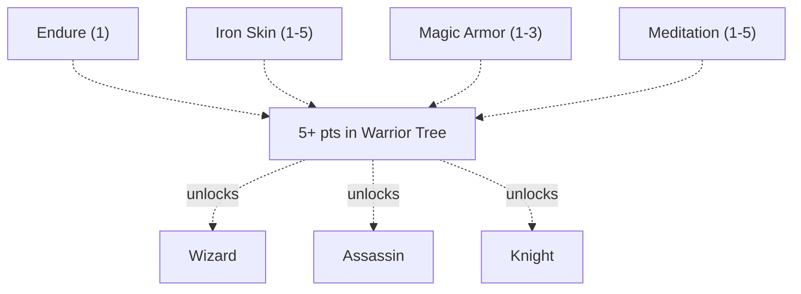

<br>

HP and Mana regeneration is not stopped during combat.




| Lv. | Physical Damage Taken |
| --- | --------------------- |
| 1   | -3%                   |
| 2   | -6%                   |
| 3   | -9%                   |
| 4   | -12%                  |
| 5   | -15%                  |





When active, each hit costs 2% of the owner's current mana. When the mana drops below 20% the buff is cancelled.

| Lv. | Damage Reduction |
| --- | ---------------- |
| 1   | 10%              |
| 2   | 20%              |
| 3   | 30%              |





| Lv. | HP/Mana Regeneration |
| --- | -------------------- |
| 1   | +6%                  |
| 2   | +12%                 |
| 3   | +18%                 |
| 4   | +24%                 |
| 5   | +30%                 |



### Wizard

Fire, water, wind, earth, and the deeper currents of holy and dark magic - Wizards bend all of it into a weapon, at the cost of the armor most masters would rather keep.



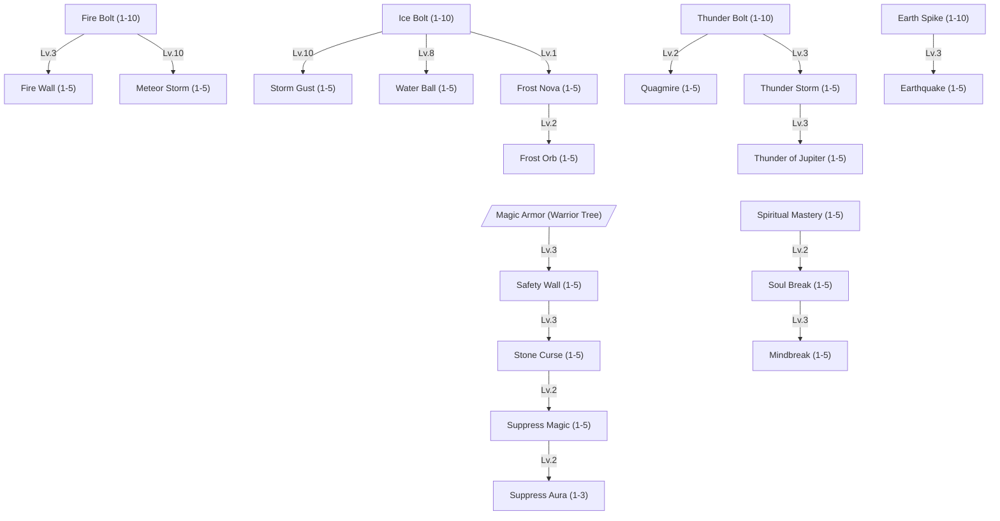

<br>



| Lv. | MATK  | Cast Time Reduction |
| --- | ----- | ------------------- |
| 1   | +10%  | 0.1s                |
| 2   | +20%  | 0.2s                |
| 3   | +30%  | 0.3s                |
| 4   | +40%  | 0.4s                |
| 5   | +50%  | 0.5s                |
| 6   | +60%  | 0.6s                |
| 7   | +70%  | 0.7s                |
| 8   | +80%  | 0.8s                |
| 9   | +90%  | 0.9s                |
| 10  | +100% | 1.0s                |





| Lv. | MATK  | Cast Time Reduction |
| --- | ----- | ------------------- |
| 1   | +10%  | 0.1s                |
| 2   | +20%  | 0.2s                |
| 3   | +30%  | 0.3s                |
| 4   | +40%  | 0.4s                |
| 5   | +50%  | 0.5s                |
| 6   | +60%  | 0.6s                |
| 7   | +70%  | 0.7s                |
| 8   | +80%  | 0.8s                |
| 9   | +90%  | 0.9s                |
| 10  | +100% | 1.0s                |





| Lv. | MATK  | Cast Time Reduction |
| --- | ----- | ------------------- |
| 1   | +10%  | 0.1s                |
| 2   | +20%  | 0.2s                |
| 3   | +30%  | 0.3s                |
| 4   | +40%  | 0.4s                |
| 5   | +50%  | 0.5s                |
| 6   | +60%  | 0.6s                |
| 7   | +70%  | 0.7s                |
| 8   | +80%  | 0.8s                |
| 9   | +90%  | 0.9s                |
| 10  | +100% | 1.0s                |





| Lv. | MATK  | Cast Time Reduction |
| --- | ----- | ------------------- |
| 1   | +10%  | 0.1s                |
| 2   | +20%  | 0.2s                |
| 3   | +30%  | 0.3s                |
| 4   | +40%  | 0.4s                |
| 5   | +50%  | 0.5s                |
| 6   | +60%  | 0.6s                |
| 7   | +70%  | 0.7s                |
| 8   | +80%  | 0.8s                |
| 9   | +90%  | 0.9s                |
| 10  | +100% | 1.0s                |





| Lv. | Damage/Healing |
| --- | -------------- |
| 1   | +5%            |
| 2   | +10%           |
| 3   | +15%           |
| 4   | +20%           |
| 5   | +25%           |





| Lv. | Hits Absorbed | Duration |
| --- | ------------- | -------- |
| 1   | 2             | 20s      |
| 2   | 4             | 28s      |
| 3   | 6             | 36s      |
| 4   | 8             | 44s      |
| 5   | 10            | 52s      |





| Lv. | Petrify Chance | Duration |
| --- | -------------- | -------- |
| 1   | 20%            | 5s       |
| 2   | 30%            | 8s       |
| 3   | 40%            | 11s      |
| 4   | 50%            | 14s      |
| 5   | 60%            | 17s      |





| Lv. | Interrupt Chance | Silence Duration |
| --- | ---------------- | ---------------- |
| 1   | 20%              | 3s               |
| 2   | 30%              | 4s               |
| 3   | 40%              | 5s               |
| 4   | 50%              | 6s               |
| 5   | 60%              | 7s               |





| Lv. | Mana Suppression |
| --- | ---------------- |
| 1   | 40%              |
| 2   | 70%              |
| 3   | 100%             |





| Lv. | MATK (per tick) | Knockback |
| --- | --------------- | --------- |
| 1   | +10%            | 1 tile    |
| 2   | +20%            | 1 tile    |
| 3   | +30%            | 2 tiles   |
| 4   | +40%            | 2 tiles   |
| 5   | +50%            | 3 tiles   |





| Lv. | MATK (per meteor) | Meteor Count |
| --- | ----------------- | ------------ |
| 1   | +10%              | 3            |
| 2   | +20%              | 4            |
| 3   | +30%              | 5            |
| 4   | +40%              | 6            |
| 5   | +50%              | 7            |





| Lv. | MATK (per tick) | Freeze Chance (per tick) |
| --- | --------------- | ------------------------ |
| 1   | +8%             | 5%                       |
| 2   | +16%            | 10%                      |
| 3   | +24%            | 15%                      |
| 4   | +32%            | 20%                      |
| 5   | +40%            | 25%                      |





| Lv. | Hits per Cast |
| --- | ------------- |
| 1   | 5             |
| 2   | 10            |
| 3   | 15            |
| 4   | 20            |
| 5   | 25            |





| Lv. | Radius | Freeze Chance |
| --- | ------ | ------------- |
| 1   | 2m     | 15%           |
| 2   | 3m     | 25%           |
| 3   | 4m     | 35%           |
| 4   | 5m     | 45%           |
| 5   | 6m     | 55%           |




Regardless of level, the reduction is capped at `25%` against other Bestia Masters and `50%` against wild Bestia and monsters.

| Lv. | AGI/DEX Reduction (uncapped) |
| --- | ---------------------------- |
| 1   | 10%                          |
| 2   | 20%                          |
| 3   | 30%                          |
| 4   | 40%                          |
| 5   | 50%                          |





| Lv. | MATK (per strike) | Strike Count |
| --- | ----------------- | ------------ |
| 1   | +10%              | 3            |
| 2   | +20%              | 4            |
| 3   | +30%              | 5            |
| 4   | +40%              | 6            |
| 5   | +50%              | 7            |





| Lv. | MATK (per tick) | Radius |
| --- | --------------- | ------ |
| 1   | +10%            | 2m     |
| 2   | +20%            | 3m     |
| 3   | +30%            | 4m     |
| 4   | +40%            | 5m     |
| 5   | +50%            | 6m     |





| Lv. | MATK | Freeze Chance |
| --- | ---- | ------------- |
| 1   | +15% | 30%           |
| 2   | +30% | 40%           |
| 3   | +45% | 50%           |
| 4   | +60% | 60%           |
| 5   | +75% | 70%           |





| Lv. | MATK  | Target Mana Drained |
| --- | ----- | ------------------- |
| 1   | +20%  | 5%                  |
| 2   | +40%  | 10%                 |
| 3   | +60%  | 15%                 |
| 4   | +80%  | 20%                 |
| 5   | +100% | 25%                 |





| Lv. | Hits per Cast | MATK (per hit) |
| --- | ------------- | -------------- |
| 1   | 1             | +20%           |
| 2   | 2             | +20%           |
| 3   | 3             | +20%           |
| 4   | 4             | +20%           |
| 5   | 5             | +20%           |





| Lv. | MATK  | SMDEF Reduction |
| --- | ----- | --------------- |
| 1   | +20%  | 20%             |
| 2   | +40%  | 40%             |
| 3   | +60%  | 60%             |
| 4   | +80%  | 80%             |
| 5   | +100% | 100%            |



<!-- Parked
### Brawler

No fancy footwork, no elemental theatrics - just the kind of toughness that keeps going long after everyone else has called it quits.





| Lv. | Stamina Cost Reduction | Stamina Regeneration |
| --- | ----------------- | -------------------- |
| 1   | 10%              | +10%                 |
| 2   | 20%              | +20%                 |
| 3   | 30%              | +30%                 |
| 4   | 40%              | +40%                 |
| 5   | 50%              | +50%                 |




Once every few minutes, can trigger a burst that restores a portion of Stamina immediately.
The burst also restores a small portion of HP.
Cooldown between bursts is reduced.



Once per cooldown, an otherwise lethal hit instead leaves the Bestia at 1 HP.
Stagger and knockback effects are greatly reduced while above 50% HP.
Cooldown of the lethal-hit save is reduced.


### Hunter

Neither predator nor prey, exactly. Hunters move like the terrain isn't there and build the kind of bond with wild Bestia that makes taming look almost effortless.





| Lv. | Detection Range Reduction (wild Bestia) | Ambush Damage |
| --- | ----------------------------- | ------------- |
| 1   | 10%                          | +8%           |
| 2   | 20%                          | +16%          |
| 3   | 30%                          | +24%          |





| Lv. | Movement Reduction Negated |
| --- | -------------------------- |
| 1   | 20%                       |
| 2   | 40%                       |
| 3   | 60%                       |
| 4   | 80%                       |
| 5   | 100%                      |




Can follow the trail of any Bestia across long distances, even hours after it passed.
Gains a critical strike bonus against a tracked target.
Trail-tracking range and duration are both doubled.

-->

### Assassin

Masters of hidden infiltration. They can deal high amount of single target damage and know a lot about poisons to coat their weapons.



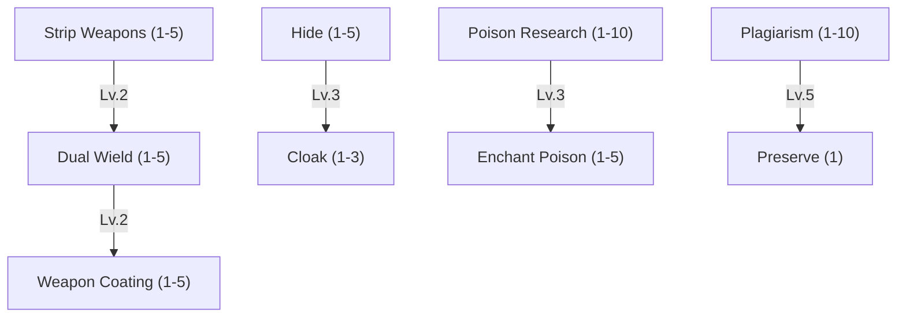

<br>


Fails outright against a target protected by [Weapon Coating](#skill-weapon-coating).

| Lv. | Strip Chance | Re-equip Blocked |
| --- | ------------ | ---------------- |
| 1   | 20%          | 5s               |
| 2   | 30%          | 10s              |
| 3   | 40%          | 15s              |
| 4   | 50%          | 20s              |
| 5   | 60%          | 25s              |





Without this skill no master can hold a weapon in the left hand, whatever their professions allow. The off-hand
weapon always swings for less than the main hand. Rank buys that gap back.

| Lv. | Off-Hand Damage | Attack Speed Penalty |
| --- | --------------- | -------------------- |
| 1   | 30%             | 25%                  |
| 2   | 40%             | 20%                  |
| 3   | 50%             | 15%                  |
| 4   | 60%             | 10%                  |
| 5   | 70%             | 5%                   |





Protects both hands at once. While it holds, [Strip Weapons](#skill-strip-weapons) cannot take either weapon.

| Lv. | Equipment Damage Reduction | Strip Resistance |
| --- | -------------------------- | ---------------- |
| 1   | 20%                        | 100%             |
| 2   | 40%                        | 100%             |
| 3   | 60%                        | 100%             |
| 4   | 80%                        | 100%             |
| 5   | 100%                       | 100%             |





Breaks the moment the Assassin moves or attacks. Detection resistance works against eyes, not against
[Ruwach](#skill-ruwach), which always reveals.

| Lv. | Mana Drain per Second | Detection Resistance |
| --- | --------------------- | -------------------- |
| 1   | 3                     | 10%                  |
| 2   | 2.5                   | 20%                  |
| 3   | 2                     | 30%                  |
| 4   | 1.5                   | 40%                  |
| 5   | 1                     | 50%                  |





Still breaks on attacking. [Ruwach](#skill-ruwach) strips it outright.

| Lv. | Movement Speed | Mana Drain per Second |
| --- | -------------- | --------------------- |
| 1   | 50%            | 6                     |
| 2   | 70%            | 5                     |
| 3   | 90%            | 4                     |





The poisons themselves are not made here - they are ordinary Alchemist goods, brewed with
[Alchemy](#skill-alchemy) and bought like any other reagent. This skill only governs what an Assassin gets out of them.

| Lv. | Poison Damage | Poison Resistance |
| --- | ------------- | ----------------- |
| 1   | +10%          | +5%               |
| 2   | +20%          | +10%              |
| 3   | +30%          | +15%              |
| 4   | +40%          | +20%              |
| 5   | +50%          | +25%              |
| 6   | +60%          | +30%              |
| 7   | +70%          | +35%              |
| 8   | +80%          | +40%              |
| 9   | +90%          | +45%              |
| 10  | +100%         | +50%              |





Applies the [Poison](/docs/mechanics/statusvalues/#status-effects) status effect on hit. The poison item decides how hard it
bites; this skill decides how often it lands.

| Lv. | Poison Chance per Hit |
| --- | --------------------- |
| 1   | 5%                    |
| 2   | 10%                   |
| 3   | 15%                   |
| 4   | 20%                   |
| 5   | 25%                   |





| Lv. | Copy Chance | Max Spell Level Copied |
| --- | ----------- | ---------------------- |
| 1   | 5%          | 10                     |
| 2   | 10%         | 20                     |
| 3   | 15%         | 30                     |
| 4   | 20%         | 40                     |
| 5   | 25%         | 50                     |
| 6   | 30%         | 60                     |
| 7   | 35%         | 70                     |
| 8   | 40%         | 80                     |
| 9   | 45%         | 90                     |
| 10  | 50%         | 100+                   |






### Knight

Where a Brawler trusts bare knuckles and a Wizard trusts raw mana, a Knight trusts steel - a lot of it, worn on the body and swung in the hand. This is the tree for masters who would rather stand at the front of a fight than avoid it.



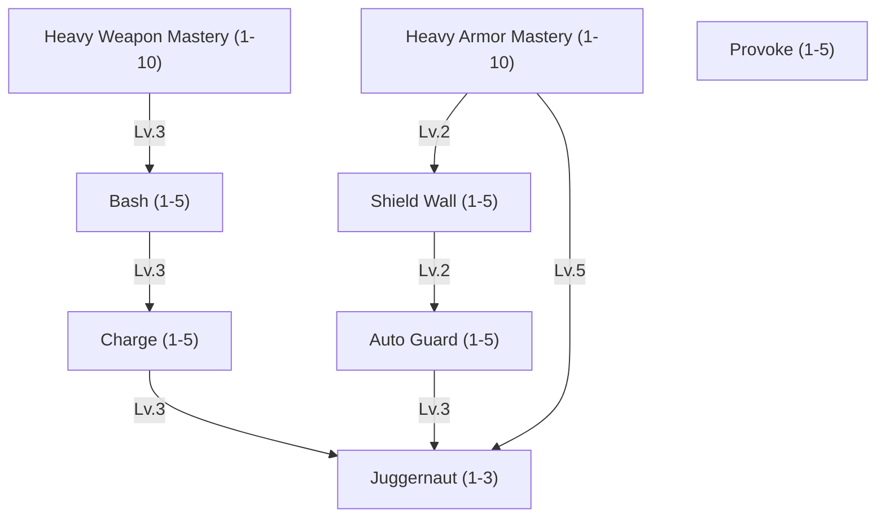

<br>


| Lv. | ATK (heavy melee weapons) | Accuracy Penalty Reduction |
| --- | ------------------------- | -------------------------- |
| 1   | +3                        | 10%                        |
| 2   | +6                        | 20%                        |
| 3   | +9                        | 30%                        |
| 4   | +12                       | 40%                        |
| 5   | +15                       | 50%                        |
| 6   | +18                       | 60%                        |
| 7   | +21                       | 70%                        |
| 8   | +24                       | 80%                        |
| 9   | +27                       | 90%                        |
| 10  | +30                       | 100%                       |





| Lv. | Hard DEF (heavy armor) | Speed Penalty Reduction |
| --- | ---------------------- | ----------------------- |
| 1   | +2                     | 5%                      |
| 2   | +4                     | 10%                     |
| 3   | +6                     | 15%                     |
| 4   | +8                     | 20%                     |
| 5   | +10                    | 25%                     |
| 6   | +12                    | 30%                     |
| 7   | +14                    | 35%                     |
| 8   | +16                    | 40%                     |
| 9   | +18                    | 45%                     |
| 10  | +20                    | 50%                     |




Higher levels extend the duration and the range at which enemies can be provoked.

| Lv. | Chance-to-Target Bonus |
| --- | ---------------------- |
| 1   | +10%                   |
| 2   | +20%                   |
| 3   | +30%                   |
| 4   | +40%                   |
| 5   | +50%                   |




Reduces incoming physical damage by `15%` and movement speed by `50%` while active.
Damage reduction improves to `25%` and the movement penalty eases to `30%`.
Damage reduction improves to `35%` and a portion of blocked damage is returned to the attacker.




| Lv. | Bonus Damage | Stagger Chance |
| --- | ------------ | -------------- |
| 1   | +20%         | +5%            |
| 2   | +40%         | +10%           |
| 3   | +60%         | +15%           |
| 4   | +80%         | +20%           |
| 5   | +100%        | +25%           |





| Lv. | Full Block Chance |
| --- | ----------------- |
| 1   | +4%               |
| 2   | +8%               |
| 3   | +12%              |
| 4   | +16%              |
| 5   | +20%              |




Deals damage and applies a short [Provoke](#skill-provoke) effect on impact.

| Lv. | Cooldown Reduction |
| --- | ------------------ |
| 1   | 0.5s               |
| 2   | 1.0s               |
| 3   | 1.5s               |
| 4   | 2.0s               |
| 5   | 2.5s               |




Once activated, gains `+20%` DEF and `+20%` ATK for a short duration.
Duration is extended and the Knight becomes immune to stagger and knockback while active.
Cooldown is reduced and a fully blocked hit (via [Auto Guard](#skill-auto-guard)) refreshes the remaining duration.


<!-- Parked
### Bard

Where a Sage studies magic to bend it, a Bard studies it to sing along with it. Every note carried on the wind can steady an ally's arm or unstring an enemy's nerve. A Bard alone can hearten a party; a Bard standing next to a [Dancer](#dancer) can do quite a lot more.





| Lv. | ATK (instrument equipped) | Song Range/Effect |
| --- | ------------------------- | ----------------- |
| 1   | +2                        | +3%               |
| 2   | +4                        | +6%               |
| 3   | +6                        | +9%               |
| 4   | +8                        | +12%              |
| 5   | +10                       | +15%              |
| 6   | +12                       | +18%              |
| 7   | +14                       | +21%              |
| 8   | +16                       | +24%              |
| 9   | +18                       | +27%              |
| 10  | +20                       | +30%              |





| Lv. | Song AoE | Song Duration |
| --- | -------- | ------------- |
| 1   | +1 tile  | +10%          |
| 2   | +2 tiles | +20%          |
| 3   | +3 tiles | +30%          |
| 4   | +4 tiles | +40%          |
| 5   | +5 tiles | +50%          |





| Lv. | ATK and MATK (party, while playing) |
| --- | ----------------------------------- |
| 1   | +2%                                 |
| 2   | +4%                                 |
| 3   | +6%                                 |
| 4   | +8%                                 |
| 5   | +10%                                |





| Lv. | Movement/Attack Speed (party, while playing) |
| --- | -------------------------------------------- |
| 1   | +2%                                          |
| 2   | +4%                                          |
| 3   | +6%                                          |
| 4   | +8%                                          |
| 5   | +10%                                         |





| Lv. | HIT and ASPD Reduction (enemies, while playing) |
| --- | ------------------------------------- |
| 1   | 3%                                   |
| 2   | 6%                                   |
| 3   | 9%                                   |
| 4   | 12%                                  |
| 5   | 15%                                  |





| Lv. | Mana Drain per Tick (enemies, while playing) |
| --- | -------------------------------------------- |
| 1   | +2%                                          |
| 2   | +4%                                          |
| 3   | +6%                                          |
| 4   | +8%                                          |
| 5   | +10%                                         |




Small chance per tick to put an enemy in range to sleep.
Sleep chance and range are increased.
Sleep chance is increased further and the effect ignores a portion of the target's status resistance.




| Lv. | Proc Chance per Tick |
| --- | -------------------- |
| 1   | +3%                  |
| 2   | +6%                  |
| 3   | +9%                  |
| 4   | +12%                 |
| 5   | +15%                 |




While performing near a master with Dancer skills active, active songs and dances gain `+15%` effect strength for both performers' parties.
The bonus increases to `+25%` and the combined range is extended.
The bonus increases to `+40%` and a single additional song or dance from each performer can be active at the same time.


### Dancer

Where a Bard leans on breath and instrument, a Dancer leans on footwork and nerve - closing the distance, reading an enemy's weak step, and turning a whip into an argument nobody wins. A Dancer alone can unravel a fight from the inside; a Dancer standing next to a [Bard](#bard) can do quite a lot more.





| Lv. | ATK (whip equipped) | Effective Reach |
| --- | ------------------- | --------------- |
| 1   | +2                  | +3%             |
| 2   | +4                  | +6%             |
| 3   | +6                  | +9%             |
| 4   | +8                  | +12%            |
| 5   | +10                 | +15%            |
| 6   | +12                 | +18%            |
| 7   | +14                 | +21%            |
| 8   | +16                 | +24%            |
| 9   | +18                 | +27%            |
| 10  | +20                 | +30%            |





| Lv. | FLEE (light/no armor) |
| --- | --------------------- |
| 1   | +2%                   |
| 2   | +4%                   |
| 3   | +6%                   |
| 4   | +8%                   |
| 5   | +10%                  |





| Lv. | Movement/Attack Speed Reduction (target) |
| --- | ------------------------------ |
| 1   | 3%                            |
| 2   | 6%                            |
| 3   | 9%                            |
| 4   | 12%                           |
| 5   | 15%                           |





| Lv. | Hard DEF and SDEF Reduction (target) |
| --- | --------------------- |
| 1   | 3%                   |
| 2   | 6%                   |
| 3   | 9%                   |
| 4   | 12%                  |
| 5   | 15%                  |





| Lv. | Poison Chance per Hit |
| --- | --------------------- |
| 1   | +2%                   |
| 2   | +4%                   |
| 3   | +6%                   |
| 4   | +8%                   |
| 5   | +10%                  |





| Lv. | FLEE (party, while dancing) |
| --- | --------------------------- |
| 1   | +2%                         |
| 2   | +4%                         |
| 3   | +6%                         |
| 4   | +8%                         |
| 5   | +10%                        |





| Lv. | Movement Speed (party, while dancing) | Stamina Drain Reduction (party, while dancing) |
| --- | ------------------------------------- | ------------------------------------ |
| 1   | +2%                                   | 2%                                  |
| 2   | +4%                                   | 4%                                  |
| 3   | +6%                                   | 6%                                  |
| 4   | +8%                                   | 8%                                  |
| 5   | +10%                                  | 10%                                 |




Small chance to force the target to attack a random nearby enemy instead of the Dancer's party for a short duration.
Chance and duration are increased.
Chance is increased further and the effect ignores a portion of the target's status resistance.



While performing near a master with Bard skills active, active songs and dances gain `+15%` effect strength for both performers' parties.
The bonus increases to `+25%` and the combined range is extended.
The bonus increases to `+40%` and a single additional song or dance from each performer can be active at the same time.

-->
