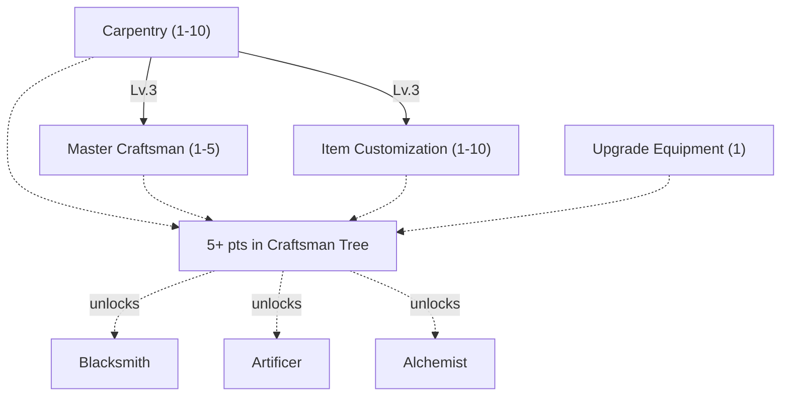
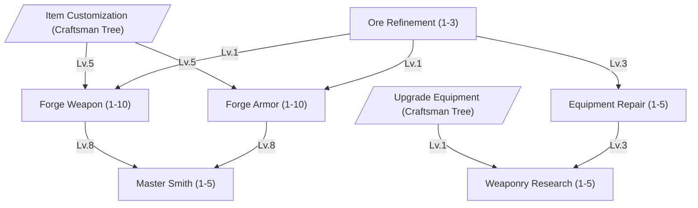
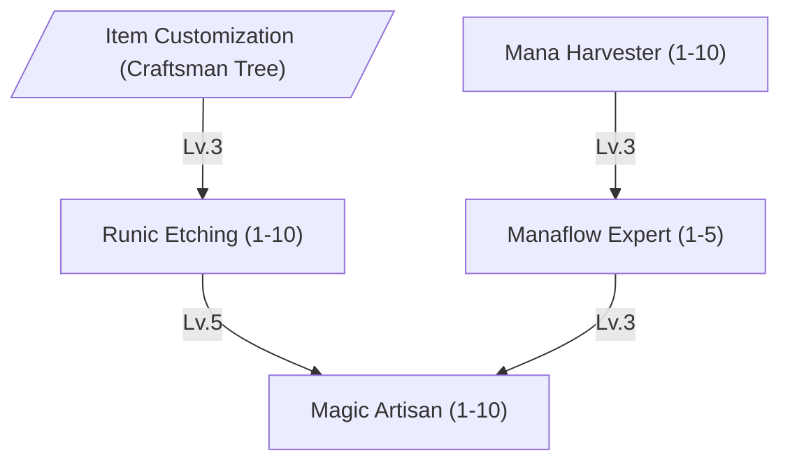
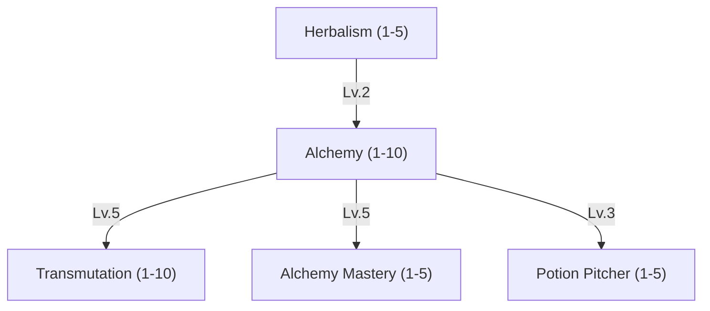

The workbenches, forges and cauldrons of the tradesfolk turn raw ambition into things a player can actually use. Every blade, trinket and bottled miracle a master ever relies on started out as somebody's Craftsman skill paying off.

Crafting always runs in two phases: a Craftsman first **discovers a blueprint** by experimenting with raw materials, then **produces** that item from it as often as they like. The skills below govern how reliably a Craftsman discovers, produces and refines within their trade — see [Item Crafting](/docs/mechanics/items-crafting/crafting/#item-crafting) for the full system.



 


Lv. 1 allows you to build a [workbench](/docs/mechanics/items-crafting/item-list/#workbench), which you can use for crafting. The time it needs to craft an item depends on the item level you want to craft.

Carpentry also makes the kits for the buildings in the wild: the Observation Outpost, the Mining Shaft and the
Lumberjack Cabin. To build one, the master needs level 1 of the skill that uses it.

| Lv. | Success Chance | Max Item Level |
| --- | -------------- | -------------- |
| 1   | +5%            | 10             |
| 2   | +10%           | 20             |
| 3   | +15%           | 30             |
| 4   | +20%           | 40             |
| 5   | +25%           | 50             |
| 6   | +30%           | 60             |
| 7   | +35%           | 70             |
| 8   | +40%           | 80             |
| 9   | +45%           | 90             |
| 10  | +50%           | 100+           |

This bonus is added on top of the item-level base chance and the crafter's DEX/WIL — see
[Construction Crafting Success Chance](/docs/mechanics/items-crafting/crafting/#construction-crafting-success-chance) for the full formula.





| Lv. | Construction Time Reduction | Success Chance |
| --- | --------------------------- | -------------- |
| 1   | 10%                         | +2%            |
| 2   | 20%                         | +4%            |
| 3   | 30%                         | +6%            |
| 4   | 40%                         | +8%            |
| 5   | 50%                         | +10%           |

This bonus is added on top of the item-level base chance and the crafter's DEX/WIL — see
[Construction Crafting Success Chance](/docs/mechanics/items-crafting/crafting/#construction-crafting-success-chance) for the full formula.





Allows you to perform upgrades of armor and weapons. There is a chance this fails and potentially destroys your equipment.

See [Weapon Refinement](/docs/mechanics/items-crafting/items/#weapon-refinement) and [Armor Refinement](/docs/mechanics/items-crafting/items/#armor-refinement) for the upgrade chances and effects.





Requires an [Engraving Set](/docs/mechanics/items-crafting/item-list/#engraving-set) which will be consumed in the process. You can choose how many slots you want to put into an item. But every slot makes it harder to succeed. Every extra slot above 1 reduces the success chance by 40%.

The Success Chance below is added on top of a **base chance that drops as the item's own level rises**. See [Item Customization](/docs/mechanics/items-crafting/items/#item-customization) for the full formula and worked examples.

| Lv. | Success Chance | Destroy Chance On Failure | Max Slots |
| --- | -------------- | ------------------------- | --------- |
| 1   | +10%           | 30%                       | 1         |
| 2   | +20%           | 28%                       | 1         |
| 3   | +30%           | 26%                       | 1         |
| 4   | +40%           | 24%                       | 2         |
| 5   | +50%           | 22%                       | 2         |
| 6   | +60%           | 20%                       | 2         |
| 7   | +70%           | 18%                       | 3         |
| 8   | +80%           | 16%                       | 3         |
| 9   | +90%           | 14%                       | 3         |
| 10  | +100%          | 12%                       | 3         |



# Blacksmith

Steel remembers who beat it into shape. Blacksmiths turn raw ore into the finest weaponry and armor, which protects its wearer even in the midst of the harshest environments and hottest battles.



The Blacksmith has two routes. The **Forger** smelts ore and forges weapons and armor. The **Refiner** repairs and upgrades what already exists.

 


Lv. 1 allows you to place a [Furnace](/docs/mechanics/items-crafting/item-list/#furnace). Every batch burns fuel:
[Coal](/docs/mechanics/items-crafting/item-list/#coal). A failed smelt loses both the ore and the fuel.

| Lv. | Ore Refinement Success |
| --- | ---------------------- |
| 1   | +30%                   |
| 2   | +60%                   |
| 3   | +90%                   |

There is **no ore level cap** - the bonus is added on top of an ore-level base chance that starts at `30%` for
[Tin](/docs/mechanics/items-crafting/item-list/#tin-ore) and [Copper](/docs/mechanics/items-crafting/item-list/#copper-ore) and keeps falling by 1%
per ore level above 10, plus the smith's STR and WIL. Even a maxed smith loses roughly every second batch of
[Adamantium Ore](/docs/mechanics/items-crafting/item-list/#adamantium-ore). See
[Ore Refinement Success Chance](/docs/mechanics/items-crafting/crafting/#ore-refinement-success-chance) for the full formula and
[Refining](/docs/mechanics/items-crafting/natural-resources/#refining) for the level of every ore.





Lv. 1 allows you to place a Forge.

| Lv. | Success Chance | Reliable Item Level |
| --- | -------------- | ------------------- |
| 1   | +5%            | 10                  |
| 2   | +10%           | 20                  |
| 3   | +15%           | 30                  |
| 4   | +20%           | 40                  |
| 5   | +25%           | 50                  |
| 6   | +30%           | 60                  |
| 7   | +35%           | 70                  |
| 8   | +40%           | 80                  |
| 9   | +45%           | 90                  |
| 10  | +50%           | 100+                |

There is **no hard cap**. A blueprint above the reliable item level can still be attempted - every item level above it
costs another `5%` success chance. A Lv. 5 smith reaching for a level 80 weapon is working at a deep penalty, not
against a locked door. See [Item Crafting](/docs/mechanics/items-crafting/crafting/#item-crafting) for the full roll.

The reliable item level also caps the random stats a forged copy can roll, see [The Cap](/docs/mechanics/items-crafting/crafting/#the-cap).





Lv. 1 allows you to place a Forge.

| Lv. | Success Chance | Reliable Item Level |
| --- | -------------- | ------------------- |
| 1   | +5%            | 10                  |
| 2   | +10%           | 20                  |
| 3   | +15%           | 30                  |
| 4   | +20%           | 40                  |
| 5   | +25%           | 50                  |
| 6   | +30%           | 60                  |
| 7   | +35%           | 70                  |
| 8   | +40%           | 80                  |
| 9   | +45%           | 90                  |
| 10  | +50%           | 100+                |

Same rule as [Forge Weapon](#skill-forge-weapon): no hard cap, but every item level above the reliable one costs another
`5%` success chance. Alchemy also brews the cures for body effects, such as an Antidote against
[Poison](/docs/mechanics/combat/status-effects/#all-status-effects). Status Recovery only clears the mind. The reliable item level caps random stats the same way.





| Lv. | Upgrade Success | Forging Success |
| --- | --------------- | --------------- |
| 1   | +8%             | +2%             |
| 2   | +16%            | +4%             |
| 3   | +24%            | +6%             |
| 4   | +32%            | +8%             |
| 5   | +40%            | +10%            |





Restores the [durability](/docs/mechanics/items-crafting/items/#damaging-of-items) of weapons and armor alike. Those are the only
things in the world that wear out and can be repaired. A [light source](/docs/mechanics/world/environment/#light-sources) burns
down as well, but burnt time is gone: no repair gives it back.

| Lv. | Max Item Level |
| --- | -------------- |
| 1   | 20             |
| 2   | 40             |
| 3   | 60             |
| 4   | 80             |
| 5   | 100+           |





| Lv. | Forging Chance | Upgrade Chance |
| --- | -------------- | -------------- |
| 1   | +5%            | +5%            |
| 2   | +10%           | +10%           |
| 3   | +15%           | +15%           |
| 4   | +20%           | +20%           |
| 5   | +25%           | +25%           |



# Artificer

Where Blacksmiths hammer steel, Artificers coax it into remembering spells. This path inscribes magic onto items, binds it to triggers, and crystallizes raw mana into shards other professions can build on.



 


Level 1 enables you to place a Mana Harvester.

| Lv. | Harvesting Time Reduction | Crystal Yield | Total Active Harvesters |
| --- | ------------------------- | ------------- | ----------------------- |
| 1   | 5%                        | +3%           | 1                       |
| 2   | 10%                       | +6%           | 1                       |
| 3   | 15%                       | +9%           | 1                       |
| 4   | 20%                       | +12%          | 2                       |
| 5   | 25%                       | +15%          | 2                       |
| 6   | 30%                       | +18%          | 2                       |
| 7   | 35%                       | +21%          | 3                       |
| 8   | 40%                       | +24%          | 3                       |
| 9   | 45%                       | +27%          | 3                       |
| 10  | 50%                       | +30%          | 4                       |




Level 1 enables you to place a Crystal Lathe. The cast only places the lathe or opens its recipes. The refining itself
takes the [craft duration](/docs/mechanics/items-crafting/crafting/#craft-duration) of the crystal's item level.

| Lv. | Success Chance | Max Crystal Level |
| --- | -------------- | ----------------- |
| 1   | +4%            | 20                |
| 2   | +8%            | 40                |
| 3   | +12%           | 60                |
| 4   | +16%           | 80                |
| 5   | +20%           | 100+              |

A crystal above your max crystal level cannot be refined.





Level 1 allows you to place a Carving Table. The Bestia to convert must stand next to the table, and the etching uses up
a cut gem. The gem limits the Bestia level, see [Sockets and Essences](/docs/mechanics/items-crafting/crafting/#sockets-and-essences). A
failed etching shatters the gem too. The cast only places
the table or opens its recipes. The etching itself takes the [craft duration](/docs/mechanics/items-crafting/crafting/#craft-duration) of
the Bestia's level.

| Lv. | Success Chance | Reliable Bestia Level |
| --- | -------------- | --------------------- |
| 1   | +5%            | 10                    |
| 2   | +10%           | 20                    |
| 3   | +15%           | 30                    |
| 4   | +20%           | 40                    |
| 5   | +25%           | 50                    |
| 6   | +30%           | 60                    |
| 7   | +35%           | 70                    |
| 8   | +40%           | 80                    |
| 9   | +45%           | 90                    |
| 10  | +50%           | 100+                  |

Same rule as [Forge Weapon](#skill-forge-weapon): no hard cap, but every Bestia level above the reliable one costs another
`5%` success chance.





Level 1 allows you to place an Enchantment Altar. Every binding needs refined mana crystals. The cast only places the
altar or opens its recipes. The binding itself takes the [craft duration](/docs/mechanics/items-crafting/crafting/#craft-duration) of the
item level.

| Lv. | Enchantment Chance | Destroy Chance on Failed Bind |
| --- | ------------------ | ----------------------------- |
| 1   | +4%                | 40%                           |
| 2   | +8%                | 37%                           |
| 3   | +12%               | 34%                           |
| 4   | +16%               | 31%                           |
| 5   | +20%               | 28%                           |
| 6   | +24%               | 25%                           |
| 7   | +28%               | 22%                           |
| 8   | +32%               | 19%                           |
| 9   | +36%               | 16%                           |
| 10  | +40%               | 13%                           |



# Alchemist

Equal parts kitchen and laboratory. Alchemists turn raw ingredients - mundane or mana-soaked - into tonics and reagents nobody else can make. Some carry the first bandages they ever learned to wrap as a Novice all the way into a healer's toolkit.



The Alchemist has two routes. The **Brewer** gathers herbs, brews potions and cures and throws them to whoever needs them. The **Transmuter** turns ordinary matter into rare resources.

 


| Lv. | Max Herb Level |
| --- | -------------- |
| 1   | 20             |
| 2   | 40             |
| 3   | 60             |
| 4   | 80             |
| 5   | 100+           |

The herb level is the herb's [item level](/docs/mechanics/items-crafting/items/#item-level). A herb above your max level cannot be
gathered.





Lv. 1 allows you to place an Alchemy Laboratory. Higher levels let you reliably discover and craft stronger potions
and elixirs.

| Lv. | Success Chance | Reliable Item Level |
| --- | -------------- | ------------------- |
| 1   | +5%            | 10                  |
| 2   | +10%           | 20                  |
| 3   | +15%           | 30                  |
| 4   | +20%           | 40                  |
| 5   | +25%           | 50                  |
| 6   | +30%           | 60                  |
| 7   | +35%           | 70                  |
| 8   | +40%           | 80                  |
| 9   | +45%           | 90                  |
| 10  | +50%           | 100+                |

Same rule as [Forge Weapon](#skill-forge-weapon): no hard cap, but every item level above the reliable one costs another
`5%` success chance. Alchemy also brews the cures for body effects, such as an Antidote against
[Poison](/docs/mechanics/combat/status-effects/#all-status-effects). Status Recovery only clears the mind. The cast only places the laboratory or opens its recipes. The brew itself takes the
[craft duration](/docs/mechanics/items-crafting/crafting/#craft-duration) of the potion's item level.





Lv. 1 allows you to place a Transmutation Workbench. Higher levels unlock transmuting higher-grade infused resources.

| Lv. | Success Chance | Reliable Item Level |
| --- | -------------- | ------------------- |
| 1   | +5%            | 10                  |
| 2   | +10%           | 20                  |
| 3   | +15%           | 30                  |
| 4   | +20%           | 40                  |
| 5   | +25%           | 50                  |
| 6   | +30%           | 60                  |
| 7   | +35%           | 70                  |
| 8   | +40%           | 80                  |
| 9   | +45%           | 90                  |
| 10  | +50%           | 100+                |

Same rule as [Alchemy](#skill-alchemy): no hard cap, but every item level above the reliable one costs another `5%`
success chance. The transmutation itself takes the [craft duration](/docs/mechanics/items-crafting/crafting/#craft-duration) of the
resource's item level.





| Lv. | Success Chance | Crafting Speed |
| --- | -------------- | -------------- |
| 1   | +5%            | +10%           |
| 2   | +10%           | +20%           |
| 3   | +15%           | +30%           |
| 4   | +20%           | +40%           |
| 5   | +25%           | +50%           |





Throws a potion from the bag onto an ally up to `7` tiles away. It works as if the ally had drunk it, and the
Alchemist's hand makes it work better.

| Lv. | Potion Effect |
| --- | ------------- |
| 1   | +10%          |
| 2   | +20%          |
| 3   | +30%          |
| 4   | +40%          |
| 5   | +50%          |


