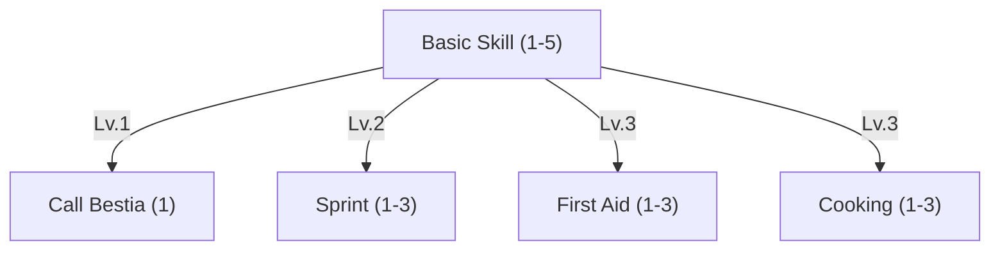

In order to learn how to interact with other players you need to invest your first skill points in this skill tree. It is expected that every user learns at least **Basic Skill Lv. 5**, since this is the threshold which unlocks all the other skill trees.



 

Allows to trade with other players.
Allows to chat with other players via public and whisper chat.
Allows to list and buy at trade posts. Browsing them needs no rank.
Sitting doubles HP & Mana recovery, for the master and for the master's Bestias when they sit.
Allows to create parties and invite players into them. Joining a party needs no rank. Unlocks all the other skill trees.




Every Bestia the master owns that is out in the world, and not in storage, appears next to the master when the channel
ends. Taking damage breaks the channel. A Bestia that is fighting does not answer, so the skill cannot
pull one out of a lost fight.





Costs stamina instead of mana. Ends early when the master attacks or casts a skill.

| Lv. | Movement Speed | Stamina Cost |
| --- | -------------- | ------------ |
| 1   | +30%           | 20           |
| 2   | +40%           | 20           |
| 3   | +50%           | 20           |





Needs a burning [campfire](/docs/mechanics/items-crafting/crafting-stations/#campfires) within about 3 m. Lv. 1 unlocks the campfire kit.

The three ranks only govern how well the Master handles a cooking place. What a Master can actually cook grows through
**recipes**, discovered the same way a Craftsman discovers a blueprint - by experimenting with ingredients. A Lv. 1 cook
with a long recipe book outperforms a Lv. 3 cook who never left the campfire.

| Lv. | Cooking Time Reduction | Success Chance | Stamina Cost |
| --- | ---------------------- | -------------- | ------------ |
| 1   | 0%                     | +0%            | 5            |
| 2   | 20%                    | +20%           | 8            |
| 3   | 40%                    | +40%           | 11           |





Uses one Bandage when the cast starts, then channels for 10s and heals in a pulse every 2s. A hit breaks the channel;
what was healed so far stays. A target can only receive a single First Aid every 60 secs. The pulses together heal the
smaller of the two amounts, so the flat value caps it.

| Lv. | Max HP Healed (% based) | Max HP Healed (flat) | Mana |
| --- | ----------------------- | -------------------- | ---- |
| 1   | +30%                    | +100 HP              | 12   |
| 2   | +60%                    | +200 HP              | 16   |
| 3   | +100%                   | +350 HP              | 20   |


