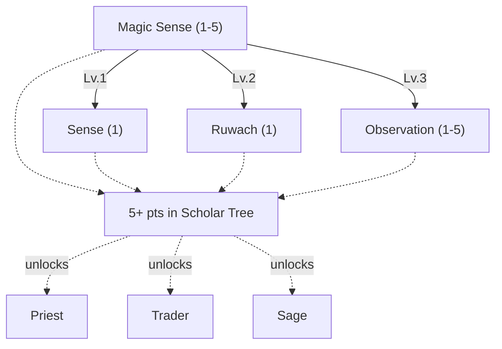
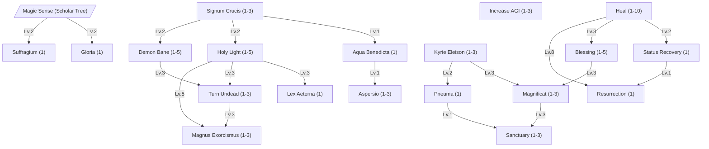
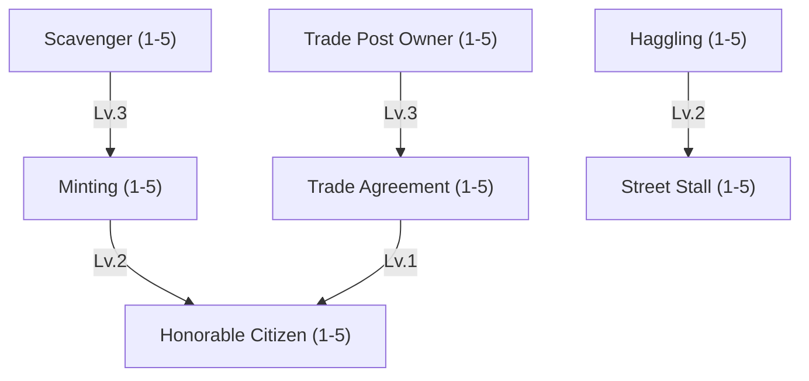
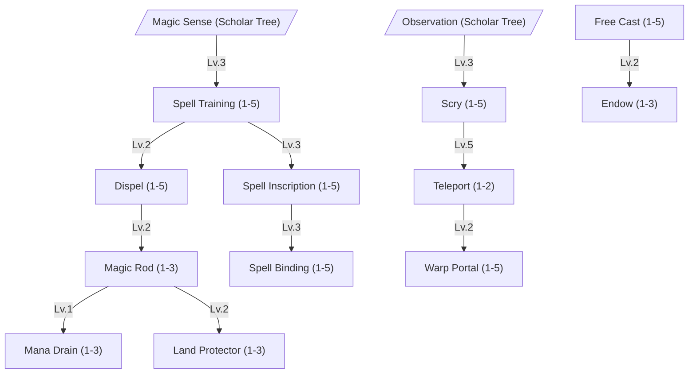

The Scholar tree contains skills which help with sensing mana, hidden things and the world's events. Priests keep a party alive, Traders keep the gears of commerce turning, and Sages chase magic to its source - inscribing, discovering, and eventually bending distance itself.



<br>


Sweeps the area around the caster once per cast. What comes back gets sharper with rank: first that something is there,
then where it is, and finally what it actually does. Local [mana concentration](/docs/mechanics/world/environment/#mana-concentration)
adds to the range in a mana-rich region and eats into it in a drained one.

| Lv. | Range | What It Reveals                                                                       |
| --- | ----- | ------------------------------------------------------------------------------------- |
| 1   | 10m   | That something nearby carries mana                                                    |
| 2   | 20m   | Direction and rough strength of each source                                           |
| 3   | 30m   | The element the mana belongs to                                                       |
| 4   | 40m   | The exact spell bound to an item or place                                             |
| 5   | 50m   | Who bound it, and what trigger a [Spell Binding](#skill-spell-binding) is waiting for |

Mana sources are spell fields on the ground (walls, zones, songs, Mana Circles), anything under a buff or debuff
(ward stones too), enchanted items lying on the ground, and mana crystals and aetherite. The marks show on the compass
for 15 seconds, with a line in the chat. Strength reads as faint below Potency 50, strong below 150, and overwhelming
above.






Reveals the monster status values, element, kind, size, HP and Mana in a small popup next to it.




While it is active, every second it ends [Hide](/docs/mechanics/master/warrior-tree/#skill-hide) and Cloak on
everyone within 10m of the caster, so they stand revealed for everybody. Detection resistance does not help against
it.





Detects nearby world events like mana rifts which open, spawned bosses or other world changing events. It reads
**events**, not things: a [Resource Sense](/docs/mechanics/master/survival-tree/#skill-resource-sense) finds the ore vein, a [Scry](#skill-scry) looks at a
place you are not standing in, and a [Magic Sense](#skill-magic-sense) picks apart a single spell. Observation is the
only one that notices something is about to happen.

It only works at an Observation Outpost, and the distance counts from the outpost. An outpost is built in the wild from
an outpost kit, which is made with [Carpentry](/docs/mechanics/master/craftsman-tree/#skill-carpentry). Level 1 is needed to build it. A Bestia can keep watch
there while you are away.

| Lv. | Detection Distance |
| --- | ------------------ |
| 1   | 1km                |
| 2   | 2km                |
| 3   | 3km                |
| 4   | 4km                |
| 5   | 5km                |



# Priest

Priests channel mana into blessings that keep a party alive - restoring health, lifting curses, and bolstering the vitality of Bestia out in the field.



The Priest has two routes. The **Cleric** is the full support of a party: heals, blessings and wards. The **Exorcist** hunts Demons and the Undead with holy light and holy water.



<br>


Heals a target's HP for `[(BaseLV+INT)/8]*(4+8*SkillLV)`. Against an Undead property foe, it is a holy attack that
ignores SMDEF and INT, but deals only half damage - that is, `HealValue * ElementModifier / 2`. An Undead that is no
foe, like an ally's Bestia, is neither healed nor hurt. Targeting a monster with a healing spell has to be deliberate,
so the client asks for Shift rather than a plain click.

| Lv. | Mana Cost |
| --- | --------- |
| 1   | 13        |
| 2   | 16        |
| 3   | 19        |
| 4   | 22        |
| 5   | 25        |
| 6   | 28        |
| 7   | 31        |
| 8   | 34        |
| 9   | 37        |
| 10  | 40        |




The next cast bar the target starts within `30s` is `30%` shorter. An instant spell does not use it up.




`+15` percentage points to the chance of every [random stat](/docs/mechanics/items-crafting/crafting/#forging-and-random-stats) slot and socket of the item.
It reaches the party members within 30m of the caster and their Bestias; without a party, the caster and its own
Bestias. What counts is the moment a craft starts: a station's queue rolls each item with the worker's blessing at
the time it is made.





Shallow water counts. Only the water the world was made with counts so far, not a dug pond or a flood. A Priest on dry
land is told so before the cast bar starts.





On an Undead or Demon foe it turns into a curse: it halves DEX and INT instead. The curse is harm, so it only lands
where a blow could: never on an ally's Undead Bestia or in a warded zone. Like Heal, Shift aims it at a monster.

| Lv. | STR/INT/DEX | HIT | ATK and MATK | Duration |
| --- | ----------- | --- | ------------ | -------- |
| 1   | +2          | +4  | +3           | 80s      |
| 2   | +4          | +8  | +6           | 120s     |
| 3   | +6          | +12 | +9           | 160s     |
| 4   | +8          | +16 | +12          | 200s     |
| 5   | +10         | +20 | +15          | 240s     |




Grants a flat `+15%` Movement Speed at any level, plus the table below. The bonus only lasts while the buff holds, and
it **stacks** with the permanent [Quick Travel](/docs/mechanics/master/survival-tree/#skill-quick-travel), so a well-buffed traveller adds both.

| Lv. | AGI | ASPD | Duration |
| --- | --- | ---- | -------- |
| 1   | +4  | +1%  | 80s      |
| 2   | +6  | +3%  | 120s     |
| 3   | +8  | +5%  | 160s     |





Each blow or spell that lands takes away up to the absorbed share of the target's max HP, and uses up one hit. A
burn or a poison tick is no hit and passes through. Casting it again brings back all of its hits.

| Lv. | Hits Absorbed | Damage Absorbed per Hit |
| --- | ------------- | ----------------------- |
| 1   | 1             | +10% of HP              |
| 2   | 2             | +20% of HP              |
| 3   | 3             | +30% of HP              |





The veil covers the 3x3 tiles around the spot. It shelters everyone inside, friend or foe: every ranged physical hit
at them misses, as inside a Wind Ward. Spells still land.





The sigil cuts physical DEF, both the soft DEF from VIT and the hard DEF of armour. MDEF stays. On a Demon or an
Undead the extra cut adds to it.

| Lv. | DEF Reduction | Extra vs Demon/Undead | Duration |
| --- | ------------- | --------------------- | -------- |
| 1   | 10%           | 10%                   | 30s      |
| 2   | 20%           | 20%                   | 45s      |
| 3   | 30%           | 30%                   | 60s      |





A holy bolt of `MATK * (100% + bonus)`, weighed by the element table, less MDEF.

| Lv. | MATK |
| --- | ---- |
| 1   | +10% |
| 2   | +20% |
| 3   | +30% |
| 4   | +40% |
| 5   | +50% |





A Demon or Undead is a Demon or Undead kind, or anything of the Undead element. Each column is one damage modifier
category, so an Undead of the Undead element counts once.

| Lv. | Damage vs Demon/Undead | Damage Taken from Demon/Undead |
| --- | ---------------------- | ------------------------------ |
| 1   | +5%                    | -6%                            |
| 2   | +10%                   | -12%                           |
| 3   | +15%                   | -18%                           |
| 4   | +20%                   | -24%                           |
| 5   | +25%                   | -30%                           |











Melee blows strike as Holy. A weapon holds one element: Aspersio replaces an Endow, and an Endow replaces it.

| Lv. | Duration |
| --- | -------- |
| 1   | 60s      |
| 2   | 120s     |
| 3   | 180s     |




Higher levels raise the chance of an instant kill against sufficiently weak undead.

Inflicts single target Holy damage that ignores MDEF. If the target is Undead, by kind or by element, this spell has
a chance of immediately ending its existence. A boss is never destroyed outright.

| Lv. | Base Chance of Effect |
| --- | --------------------- |
| 1   | 8%                    |
| 2   | 24%                   |
| 3   | 40%                   |

```text
Chance of Effect = [Base_Chance_of_Effect + (BaseLv ÷ 10) + (INT ÷ 10) + (WIL ÷ 10) + {1 − (Target_HP ÷ Target_MaxHP)} × 20]%
Damage = Holy Light damage of the same skill level, without MDEF
```





The next blow or spell that lands counts twice. A burn or a poison tick is no hit and leaves the mark alone.





It reaches the party members within 30m of the caster and their Bestias; without a party, the caster and its own
Bestias.

| Lv. | HP/Mana Regeneration |
| --- | -------------------- |
| 1   | +10%                 |
| 2   | +20%                 |
| 3   | +30%                 |





The pillar covers 7x7 tiles. Every 3s a holy wave hits each foe inside, five waves over its 15s, weighed by the
element table. Players and their Bestias are never hit.

| Lv. | MATK | Bonus Damage vs Demon/Undead |
| --- | ---- | ---------------------------- |
| 1   | +15% | +10%                         |
| 2   | +30% | +20%                         |
| 3   | +45% | +30%                         |




It covers 5x5 tiles. Every second it heals each ally standing within the table's share of their own max HP. A Demon or
Undead foe takes the same share of the Priest's max HP as holy damage instead, weighed by the element table. Other
foes are left alone.

| Lv. | Max HP Healed per Second |
| --- | ------------------------ |
| 1   | +5%                      |
| 2   | +10%                     |
| 3   | +15%                     |





The fallen stands up where it lies with `30%` of its HP. Nothing locks the body: two Priests may raise the same ally
at once. Only the caster's own cooldown limits the rite.



# Trader

Coin has its own kind of magic. Traders read markets instead of mana flows, linking auction houses together, minting the coin everyone else trades in, and looking out for goods that might otherwise walk off on their own.



The Trader has two routes. The **Merchant** buys cheap, sells dear and runs stalls and auction houses. The **Moneyer** recovers scrap and mints coin.



<br>


| Lv. | Recycle Chance |
| --- | -------------- |
| 1   | +10%           |
| 2   | +20%           |
| 3   | +30%           |
| 4   | +40%           |
| 5   | +50%           |





Level 1 allows you to place a Mint. The cast only places the mint or opens its recipes. The minting itself takes the
[craft duration](/docs/mechanics/items-crafting/crafting/#craft-duration) of the bar.

A mint never creates gold. It recovers a share of the gold in a bar as coin, and the rest goes back to the world
reserve. See [Minting yield is a recovery rate](/docs/server/money-supply/#minting-yield-is-a-recovery-rate-not-a-bonus).

| Lv. | Gold Recovered as Coin |
| --- | ---------------------- |
| 1   | 60%                    |
| 2   | 70%                    |
| 3   | 80%                    |
| 4   | 90%                    |
| 5   | 100%                   |





Casting it on the ground uses up an auction house kit from your bag and starts a construction site. It needs a
[player settlement](/docs/mechanics/towns-trade/player-settlements/) with a working post office. Only one auction house
can stand inside a settlement, and none within 5km of another. See
[Building an Auction House](/docs/mechanics/towns-trade/economy-trade/#building-an-auction-house).

| Lv. | Auction Houses | Max Owner Fee |
| --- | -------------- | ------------- |
| 1   | 1              | 5%            |
| 2   | 2              | 10%           |
| 3   | 3              | 15%           |
| 4   | 4              | 20%           |
| 5   | 5              | 25%           |





| Lv. | Buying from a Merchant | Selling to a Merchant |
| --- | ---------------------- | --------------------- |
| 1   | -2%                    | +2%                   |
| 2   | -4%                    | +4%                   |
| 3   | -6%                    | +6%                   |
| 4   | -8%                    | +8%                   |
| 5   | -10%                   | +10%                  |

Haggling adds to the price your [honor](/docs/mechanics/society/pvp/) gets you. A merchant always keeps a small
margin: you never pay less than 88% of the shop price or get more than 110% of what it pays.





Sets up a market stall where the Trader stands. The Trader puts goods from the bag on it, each lot at a price in coins.
Other players click the stall and buy a whole lot; they need [Basic Skill](/docs/mechanics/master/novice-tree/#skill-basic-skill)
Lv. 3, as for trade posts, and must stand at the stall. The Trader is paid into the bag at once.

The stall closes when the Trader walks more than 5 m away, leaves the world, or after `1h`. Unsold goods go back into
the bag. Unlike an [auction house](#skill-trade-post-owner) it needs no settlement, and it has no fee.

| Lv. | Listings |
| --- | -------- |
| 1   | 3        |
| 2   | 5        |
| 3   | 7        |
| 4   | 9        |
| 5   | 11       |




Cast it on another auction house owner. They are asked, and once they accept, all houses of both of you show each
other's listings. To be linked by other players, at least level 1 in this skill is required.

Links are direct: if you are linked to B and B to C, your houses do not show C's listings. Either side can cut a link at
one of their houses.

| Lv. | Linked Players |
| --- | -------------- |
| 1   | 1              |
| 2   | 2              |
| 3   | 3              |
| 4   | 4              |
| 5   | 5              |





| Lv. | Honor Penalty for Robbers |
| --- | ------------------------- |
| 1   | +20%                      |
| 2   | +40%                      |
| 3   | +60%                      |
| 4   | +80%                      |
| 5   | +100%                     |



# Sage

Books, wards and long nights spent staring into scrying bowls. Sages study magic itself - discovering it, inscribing it, binding it, and eventually learning to fold distance in on itself with teleportation and portals.



The Sage has two routes. The **Scribe** trains, inscribes and binds spells and opens the way with Teleport and Warp Portal. The **Battle Sage** fights magic itself: dispels, wards, mana drain and endowed weapons.





<br>



Consumes the scroll, also when the training fails. The base chance depends on the level of the spell and uses the same
table as [Spell Inscription](#skill-spell-inscription). Each level adds to it.

Any of your own bestias can learn any bestia attack from a scroll, as long as its level is at least the attack's level.
An attack's level is the lowest level at which any species learns it.
There is no limit to how many attacks a bestia knows.

| Lv. | Success Chance |
| --- | -------------- |
| 1   | +10%           |
| 2   | +20%           |
| 3   | +30%           |
| 4   | +40%           |
| 5   | +50%           |





| Lv. | Movement Speed While Casting | Interrupt Resistance |
| --- | ---------------------------- | -------------------- |
| 1   | 20%                          | +10%                 |
| 2   | 40%                          | +20%                 |
| 3   | 60%                          | +30%                 |
| 4   | 80%                          | +40%                 |
| 5   | 100%                         | +50%                 |





The Sage sees the chosen spot for 20s. The camera moves there, and the Sage sees the land and everyone on it as if they
stood there. Pick the spot in one of two ways:

- **A spot on the world map.** Only [charted](/docs/mechanics/master/survival-tree/#skill-cartography) land can be
  scried. A spot that is not charted fails, and the mana is spent.
- **A party member.** The sight opens where the member stands when the cast ends, and stays there. Their spot does not
  need to be charted. The member is not told.

**Distance makes it harder.** Scry is a [spell against the world](/docs/mechanics/combat/spell-potency/#against-the-world).
Its Edge against the Disturbance decides how close to the chosen spot the sight opens: up to `500 m × (1 - Edge)` off
target, in a random direction. The Disturbance grows by `5` per km between the Sage and the spot, so a far spot drifts
more. Close by, a strong Sage sees exactly the spot.

**The body stays behind.** It stands in a trance and can be attacked. Moving, attacking, casting, using an item or
taking damage ends the sight at once. "Return to body", or Escape, ends it early. The sight also ends when the Sage
logs out.

**What the Sage can do there.** Look around, turn and zoom the camera. Talk in public chat: the voice comes from the
far spot, so players there hear it, and the Sage hears what is said there. A Sage who knows
[Warp Portal](#skill-warp-portal) can mark the scried spot as a portal target. Nothing else: no skills, no items, no
walking.

**How others notice.** Everyone near the Sage sees the trance on the body. At the far spot a hidden eye floats while the
sight lasts. [Ruwach](#skill-ruwach) uncovers it like a hidden creature, and [Magic Sense](#skill-magic-sense) lists it
as a spell at work. A [Dispel](#skill-dispel) on the eye ends the sight. The eye carries the Potency of the cast, so a
strong Scry is harder to break.

| Lv. | View Radius |
| --- | ----------- |
| 1   | 20m         |
| 2   | 40m         |
| 3   | 60m         |
| 4   | 80m         |
| 5   | 100m        |





Success chance starts at a base chance of `(50 + 10 * SkillLv)%`. A target with a higher Potency than the Dispel lowers it, see [Dispel](/docs/mechanics/combat/spell-potency/#dispel). Requires 1 [Yellow Mana Crystal](/docs/mechanics/items-crafting/item-list/#yellow-mana-crystal) per cast.

| Lv. | Base Success Chance |
| --- | ------------------- |
| 1   | 60%                 |
| 2   | 70%                 |
| 3   | 80%                 |
| 4   | 90%                 |
| 5   | 100%                |




Catches a single incoming spell while the ward holds: its damage and its curses do nothing, its caster still pays, and
the ward is spent.

| Lv. | Mana Recovered (of spell cost) | Ward Duration |
| --- | ------------------------------ | ------------- |
| 1   | 50%                            | 10s           |
| 2   | 75%                            | 15s           |
| 3   | 100%                           | 20s           |





Each second drains a share of each foe's max mana into the Sage.

| Lv. | Range | Max Mana Drained per Second | Duration |
| --- | ----- | --------------------------- | -------- |
| 1   | 2m    | 1%                          | 10s      |
| 2   | 4m    | 2%                          | 20s      |
| 3   | 6m    | 3%                          | 30s      |





| Lv. | Radius | Duration |
| --- | ------ | -------- |
| 1   | 3m     | 15s      |
| 2   | 4m     | 25s      |
| 3   | 5m     | 35s      |

A ground spell with a higher [Potency](/docs/mechanics/combat/spell-potency/) than the protector can still take root.



The base success chance depends on the level of the attack being inscribed and is further modified by skill level, equipment and intelligence (`INT / 2 + WIL / 4`):

| Attack Level | Base Success |
| ------------ | ------------ |
| 1–20         | 80%          |
| 21–40        | 70%          |
| 41–60        | 60%          |
| 61–80        | 50%          |
| 81–90        | 10%          |
| 91–100       | -20%         |
| 101+         | -40%         |

A negative base means the extraction is impossible on raw talent alone and only becomes viable with strong bonuses from intelligence, skill level and equipment.

Each level of Spell Inscription adds `+10%`. It works on your own bestias only, and costs a blank spell scroll, also when
it fails. The bestia keeps the attack: the scroll is a copy. When the extraction fails, the bestia's mind breaks with a
50% chance, and the bestia is lost for good. Its bag goes to you. The picker shows both chances before you cast.

A finished scroll can teach its attack to a bestia through [Spell Training](#skill-spell-training), or anyone can use it
from the bag: it casts the attack once, at the inscribed level, with the user's own stats and no mana. The scroll is
then gone.










Every cast consumes a Teleport Rune. A teleported entity cannot teleport again for 5 minutes. The Sage's own bestias
within 10 m come along and land beside the Sage. "Home" is the Sage's save point in the home settlement.

| Lv. | Destination                  |
| --- | ---------------------------- |
| 1   | A random spot within 150m    |
| 2   | The master's home settlement |





Every cast consumes a Portal Rune, which costs more than a Teleport Rune.

A portal leads to the Sage's home or to a saved spot. Casting Warp Portal also offers "Mark this spot": it saves the
spot the Sage stands on at once, with no rune, mana or cooldown. The Sage keeps one spot per level; a new mark replaces
the oldest. The portal stands at the aimed spot and at its far end for 30 seconds, and its passages are shared by
both ends.

| Lv. | Passages |
| --- | ------------------ |
| 1   | 2                  |
| 2   | 4                  |
| 3   | 6                  |
| 4   | 8                  |
| 5   | 10                 |





The caster picks the element when casting: fire, water, wind or earth. The weapon takes on the element, so the
[element table](/docs/mechanics/bestias/bestia-design/#7-element-size-and-defences) applies. The bonus damage comes on top.

| Lv. | Duration | Bonus Attack |
| --- | -------- | --------------------------- |
| 1   | 60s      | +5%                         |
| 2   | 120s     | +10%                        |
| 3   | 180s     | +15%                        |


