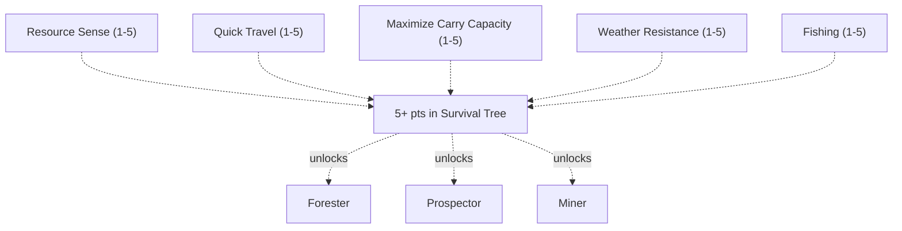
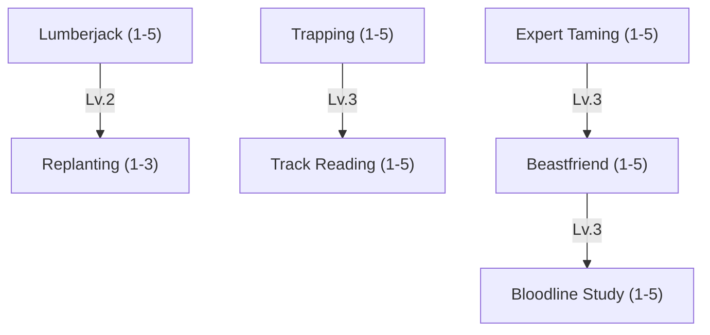
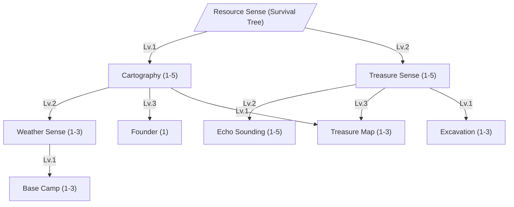
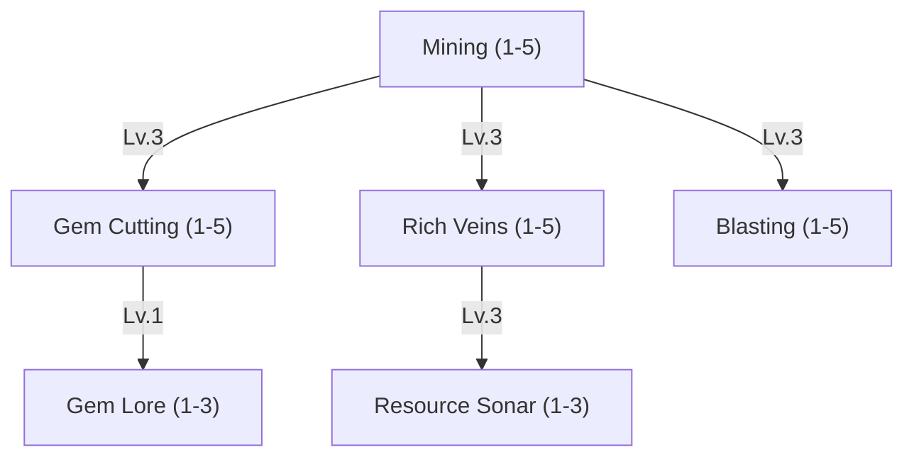

Skills which allow the player to keep exploring the world and stay active longer far away from settlements are placed in this skill tree. Foresters live off the land, Prospectors chart what nobody has mapped yet and found towns on it, and Miners dig for what the land is hiding.

 


| Lv. | Movement Speed |
| --- | -------------- |
| 1   | +3%            |
| 2   | +6%            |
| 3   | +9%            |
| 4   | +12%           |
| 5   | +15%           |





Raises the [weight limit](/docs/mechanics/items-crafting/items/#weight-limit) of the Master and of every Bestia under their command by
the same amount. It sits in the trunk because every gathering profession - Forester, Prospector and Miner alike - lives
off what it can carry home.

| Lv. | Weight Limit (Master and Bestia) |
| --- | -------------------------------- |
| 1   | +15%                             |
| 2   | +30%                             |
| 3   | +45%                             |
| 4   | +60%                             |
| 5   | +75%                             |





| Lv. | Temperature Tolerance |
| --- | --------------------- |
| 1   | ±3 °C                 |
| 2   | ±6 °C                 |
| 3   | ±9 °C                 |
| 4   | ±12 °C                |
| 5   | ±15 °C                |





Each cast points to the nearest thing of each kind within the detection distance: an ore deposit, ground where rare
[herbs](/docs/mechanics/items-crafting/natural-resources/#herbs) grow, a forest, and a wild bestia. The marks show on
the compass for 60 seconds, with a line in the chat. Nothing is put on the map.

Without accuracy a shown spot can be off by up to 40% of its distance. The accuracy takes that share away: at level 5
a spot 1 km away is off by at most 200 m.

| Lv. | Detection Distance | Detection Accuracy |
| --- | ------------------ | ------------------ |
| 1   | 1km                | +10%               |
| 2   | 2km                | +20%               |
| 3   | 3km                | +30%               |
| 4   | 4km                | +40%               |
| 5   | 5km                | +50%               |





Anyone with a [fishing rod](/docs/mechanics/items-crafting/fishing/#fishing-rods) can fish, but an untrained angler
mostly catches fish and loot up to level 10. Each rank raises that catch level cap. Above the cap, a catch gets rarer
the further over it is: its odds halve for every 5 levels. See [Fishing](/docs/mechanics/items-crafting/fishing/).

| Lv. | Catch Level Cap |
| --- | --------------- |
| 1   | 20              |
| 2   | 40              |
| 3   | 60              |
| 4   | 80              |
| 5   | 100             |



# Forester

At home wherever the trees outnumber the people. Foresters live off the land - felling timber, landing the catch of the day, and striking up a bond with Bestia most masters would call unapproachable. The ones who stay at it long enough stop merely catching Bestia and start shaping the bloodlines they come from.



The Forester has two routes. The **Woodsman** fells and replants the forest, sets traps and reads tracks. The **Beastmaster** tames Bestia and breeds better bloodlines.

 


A tree falls only to an axe, a greataxe or a felling tool such as a hatchet. Lumberjack makes each blow count for more
of the trunk, and every stack of logs a felled tree drops may come twice.

Level 1 lets you build a Lumberjack Cabin from a kit. Bestias can work the cabin while you are away.

| Lv. | Gathering Time Reduction | Resource Drop Chance |
| --- | ------------------------ | -------------------- |
| 1   | 10%                      | +20%                 |
| 2   | 20%                      | +40%                 |
| 3   | 30%                      | +60%                 |
| 4   | 40%                      | +80%                 |
| 5   | 50%                      | +100%                |





Plants a sapling in a tree stump and consumes a log. The new tree grows back faster than one left to nature, and it
does not wait for a grown tree nearby the way a stump left alone does.

| Lv. | Regrowth Time | Extra                             |
| --- | ------------- | --------------------------------- |
| 1   | -25%          |                                   |
| 2   | -50%          |                                   |
| 3   | -75%          | The grown tree gives one more log |





Raises the catch chance of every [Bestia trap](/docs/mechanics/bestias/bestia/#catching-bestias) the master throws. Anyone can
throw a Bestia trap; this skill only makes it hold better. The traps themselves are made with
[Carpentry](/docs/mechanics/master/craftsman-tree/#skill-carpentry).

| Lv. | Catch Chance |
| --- | ------------ |
| 1   | +6%          |
| 2   | +12%         |
| 3   | +18%         |
| 4   | +24%         |
| 5   | +30%         |





Reads what has walked over a patch of ground: how many passed, and how fresh the trail is. Ground that takes no print -
rock, paving, ice - keeps no tracks at all, at any rank. Each rank searches a wider patch and tells more about the
trail.

| Lv. | Search Radius | Also Reads                  |
| --- | ------------- | --------------------------- |
| 1   | 3 tiles       | -                           |
| 2   | 6 tiles       | Which way the trail led     |
| 3   | 9 tiles       | What made it, and its level |
| 4   | 12 tiles      | The name of another master  |
| 5   | 15 tiles      | -                           |





Counts for the master's Bestias only: they learn faster, and lose less stamina both to the weather and to their own
skills.

| Lv. | EXP Gain | Stamina Loss Reduction |
| --- | -------- | ---------------------- |
| 1   | +5%      | 2%                     |
| 2   | +10%     | 4%                     |
| 3   | +15%     | 6%                     |
| 4   | +20%     | 8%                     |
| 5   | +25%     | 10%                    |





| Lv. | Tame Chance |
| --- | ----------- |
| 1   | +5%         |
| 2   | +10%        |
| 3   | +15%        |
| 4   | +20%        |
| 5   | +25%        |





Applies to every [Breeding Farm and Incubator](/docs/mechanics/bestias/bestia/#breeding) the master owns.

The time reduction stacks with planned upgrades, feed and buffs, and counts against the same **50% floor** - it lets a
modest setup reach the cap instead of raising it. The dominant-IV column is the part that cannot be bought: at Lv. 4 a
clutch draws a fourth dominant individual value, so a bloodline improves on four stats per generation rather than three.

From Lv. 1 the master reads a Bestia's or an egg's [individual values](/docs/mechanics/bestias/bestia/#individual-values)
as exact numbers instead of grades.

| Lv. | Breeding and Hatch Time Reduction | Dominant IVs per Clutch |
| --- | --------------------------------- | ----------------------- |
| 1   | 5%                                | 3                       |
| 2   | 10%                               | 3                       |
| 3   | 15%                               | 3                       |
| 4   | 20%                               | 4                       |
| 5   | 25%                               | 4                       |



# Prospector

Half surveyor, half treasure hunter. Prospectors chart unclaimed land, found settlements on it, feel out resources long before anyone else arrives, and travel further than sense would recommend.



The Prospector has two routes. The **Cartographer** charts the land, reads the weather, founds settlements and keeps a party alive in the wild. The **Treasure Hunter** finds what is buried and hollow, and digs it up or sells the map.

 

Each try spends one Empty Paper and one Ink. Each level reduces the difficulty of a survey by `10`. Level 3 opens the
3 km survey and level 5 the 5 km survey.



Everyone sees the wind on the compass. Weather Sense shows the next change of weather before it arrives, 5 minutes
ahead per level. See [Weather](/docs/mechanics/world/environment/#weather) for what each front does to the world.

It also reads the [mana in the land](/docs/mechanics/world/environment/#mana-concentration). Level 1 shows the mana
concentration where you stand. Levels 2 and 3 put two marks on the compass: towards the nearest place where the mana
is at least 10% stronger, and towards the nearest place where it is at least 10% weaker, each with its distance.



| Lv. | Forecast Range | Mana Field Range |
| --- | -------------- | ---------------- |
| 1   | 5 min          | Where you stand  |
| 2   | 10 min         | 1km              |
| 3   | 15 min         | 2km              |





A Prospector charts the land first and then claims it. This skill only starts a settlement. It does not grow one - a
town grows because players keep building inside it, and no further skill gates that.

The cast plants a sign site under a name chosen before casting. Anyone can help build it, and the town exists once the
sign is finished. The spot must be at least `5 km` from every other settlement and outside every ward field.

Only one settlement can be active at any time. You must tear down or hand over the settlement before you can place a new
one. Only inactive settlements can be torn down, which means no post office or auction house may be left inside the
settlement's sphere of influence.

See [Player Settlements](/docs/mechanics/towns-trade/player-settlements/) for the sphere, the sign and what happens when
it falls.





Turns a campfire, such as the one [Cooking](/docs/mechanics/master/novice-tree/#skill-cooking) places, into a camp. Party members and their Bestias within
`5m` bear the weather better: `±5 °C` [temperature tolerance](/docs/mechanics/world/environment/#temperature), in both
directions. Only one camp per master can stand.

| Lv. | Duration | Extra                                                                                                                       |
| --- | -------- | --------------------------------------------------------------------------------------------------------------------------- |
| 1   | 30 min   |                                                                                                                             |
| 2   | 60 min   | +50% HP and stamina regeneration. Storms and [mana storms](/docs/mechanics/world/doomsday/#mana-storms) do not reach inside |
| 3   | 90 min   | As Lv. 2. Party members who die respawn at the camp                                                                         |

The campfire must be burning and must be the master's own or a party member's. "Storms do not reach inside" means
the weather does no harm inside a camp of Lv. 2 or higher. At Lv. 3 a party master who dies anywhere respawns at the
camp while it stands.





Senses [treasure caches](/docs/mechanics/world/treasure-caches/) nearby. For 60 s you see a faint shimmer on the
ground above each cache in range. A chat line says how many there are and the direction and distance to the nearest.
Caches already dug up are not sensed.

| Lv. | Radius | Also Reveals            |
| --- | ------ | ----------------------- |
| 1   | 20m    |                         |
| 2   | 40m    |                         |
| 3   | 60m    | How deep the cache lies |
| 4   | 80m    | How deep the cache lies |
| 5   | 100m   | How deep and how rich   |





A sound pulse that marks hollow spaces nearby on the compass, for 20 seconds and with a line in the chat: caves,
hollows and buried chambers. A hollow is a pocket of air under the ground; the open sky is not one. Where
[Resource Sonar](#skill-resource-sonar) finds ore in the rock, Echo Sounding finds the empty space in it. It becomes more
useful as the world generator digs more caves.

| Lv. | Radius | Also Reveals                       |
| --- | ------ | ---------------------------------- |
| 1   | 10m    |                                    |
| 2   | 15m    |                                    |
| 3   | 20m    | How deep and how large a hollow is |
| 4   | 25m    | How deep and how large             |
| 5   | 30m    | How deep and how large             |





Charts the nearest treasure cache you sensed in the last 10 minutes onto a sheet of empty paper. You can cast it
anywhere, so you do not need to walk back to the spot. The map is an item that can be traded or sold. Its holder sees
a circle on their map, and the cache lies somewhere inside it. The circle is rolled once when the map is drawn.

When anyone digs the cache up, the map crumbles into a crumbled treasure map.

| Lv. | Circle Radius |
| --- | ------------- |
| 1   | 50m           |
| 2   | 25m           |
| 3   | Exact spot    |





Digs [treasure caches](/docs/mechanics/world/treasure-caches/#digging) faster, and raises the chance for the cache's
[top item](/docs/mechanics/world/treasure-caches/#the-top-item) above its base 25%.

| Lv. | Dig Time | Chance for the Best Item |
| --- | -------- | ------------------------ |
| 1   | -20%     | +5%                      |
| 2   | -40%     | +10%                     |
| 3   | -60%     | +15%                     |



# Miner

If it's buried, a Miner will find a way to it. Equal parts pickaxe and stubbornness, this path turns raw earth - literally - into opportunity.



The Miner has two routes. The **Digger** gets more ore out of the rock, faster. The **Gem Cutter** turns rough stones into cut gems.

 


Anyone with a [pickaxe](/docs/mechanics/items-crafting/items/#weapon-type) can mine, but an untrained miner only gets resources up to
level 10. Level 1 lets you craft a pickaxe and build a Mining Shaft from a kit. Bestias can work the shaft while you are
away.

| Lv. | Mining Time Reduction | Max Resource Level |
| --- | --------------------- | ------------------ |
| 1   | 10%                   | 20                 |
| 2   | 20%                   | 40                 |
| 3   | 30%                   | 60                 |
| 4   | 40%                   | 80                 |
| 5   | 50%                   | 100+               |





Level 1 allows you to place a Gem Cut Station. The cast only places the station or opens its recipes. The cutting itself
takes the [craft duration](/docs/mechanics/items-crafting/crafting/#craft-duration) of the gem's item level. A failed cut shatters the gem.
The five gems and what they hold are listed under [Sockets and Essences](/docs/mechanics/items-crafting/crafting/#sockets-and-essences).

| Lv. | Success Chance | Reliable Gem Level |
| --- | -------------- | ------------------ |
| 1   | +8%            | 20                 |
| 2   | +16%           | 40                 |
| 3   | +24%           | 60                 |
| 4   | +32%           | 80                 |
| 5   | +40%           | 100+               |

Same rule as [Forge Weapon](/docs/mechanics/master/craftsman-tree/#skill-forge-weapon): no hard cap, but every gem level above the reliable one costs another
`5%` success chance.





Each ore or gem block the master mines has a chance to drop a second piece.

| Lv. | Second Piece Chance |
| --- | ------------------- |
| 1   | 10%                 |
| 2   | 20%                 |
| 3   | 30%                 |
| 4   | 40%                 |
| 5   | 50%                 |




Can sense ore and gem deposits through solid rock.

| Lv. | Sense Range |
| --- | ----------- |
| 1   | 5m          |
| 2   | 10m         |
| 3   | 15m         |





Sets a blasting charge that breaks every block around it `3s` later, and hurts whoever stands too close. Consumes a
Blasting Charge, brewed with [Alchemy](/docs/mechanics/master/craftsman-tree/#skill-alchemy).

| Lv. | Radius |
| --- | ------ |
| 1   | 1m     |
| 2   | 2m     |
| 3   | 3m     |
| 4   | 4m     |
| 5   | 5m     |





Shows which gem an unknown [Rough Gemstone](/docs/mechanics/items-crafting/item-list/#rough-gemstone) is, before the cut.

| Lv. | Gem Cutting Success |
| --- | ------------------- |
| 1   | +5%                 |
| 2   | +10%                |
| 3   | +15%                |


