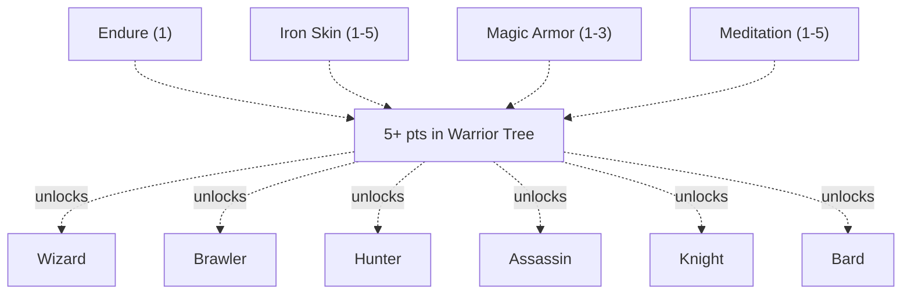
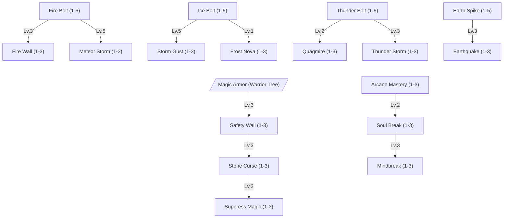
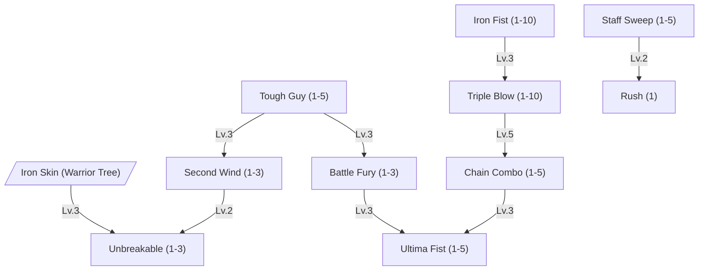
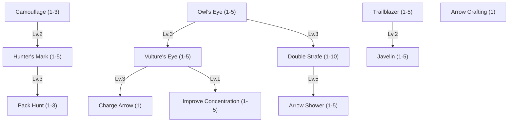
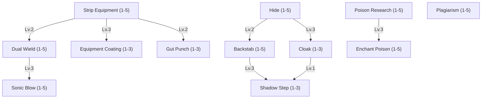
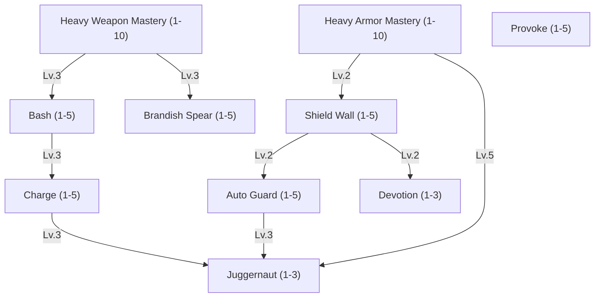
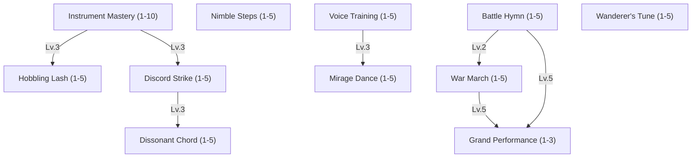

Where the other trees build, gather and study, the Warrior tree is built to fight. Wizards burn the battlefield down with elemental and arcane fury, Brawlers fight with fist and staff, Hunters shoot from afar, Assassins strike from hiding with poisoned blades, Knights hold the front line in plate, and Bards fight or play their allies to victory.

 

HP and Mana regeneration is not stopped during combat.




It cuts every physical blow, melee and ranged, after defence. It adds up with other cuts to physical damage.

| Lv. | Physical Damage Taken |
| --- | --------------------- |
| 1   | -3%                   |
| 2   | -6%                   |
| 3   | -9%                   |
| 4   | -12%                  |
| 5   | -15%                  |





When active, each hit costs 2% of the owner's current mana, at least one point. A burn or a poison tick is no hit and
costs nothing. When the mana drops below 20% the ward breaks. The reduction cuts blows and spells alike. It is its own
damage modifier, so it multiplies with Iron Skin instead of adding to it: Iron Skin 5 and Magic Armor 3 let `0.85 x 0.7`
of a blow through.

| Lv. | Damage Reduction |
| --- | ---------------- |
| 1   | 10%              |
| 2   | 20%              |
| 3   | 30%              |





| Lv. | HP/Mana Regeneration |
| --- | -------------------- |
| 1   | +6%                  |
| 2   | +12%                 |
| 3   | +18%                 |
| 4   | +24%                 |
| 5   | +30%                 |



# Wizard

Fire, water, wind, earth, and the deeper currents of holy and dark magic - Wizards bend all of it into a weapon, at the cost of the armor most masters would rather keep.



The Wizard has two routes. The **Elementalist** casts the bolts and the great area spells of the elements they choose. The **Arcanist** controls the field with walls, curses and raw mana.

 



A bolt of `MATK * (100% + bonus)` of its element, weighed by the element table and the target's resistance to the
element, less MDEF. The cast time is 2.0s less the reduction.

| Lv. | MATK  | Cast Time Reduction |
| --- | ----- | ------------------- |
| 1   | +20%  | 0.2s                |
| 2   | +40%  | 0.4s                |
| 3   | +60%  | 0.6s                |
| 4   | +80%  | 0.8s                |
| 5   | +100% | 1.0s                |





A bolt of `MATK * (100% + bonus)` of its element, weighed by the element table and the target's resistance to the
element, less MDEF. The cast time is 2.0s less the reduction.

| Lv. | MATK  | Cast Time Reduction |
| --- | ----- | ------------------- |
| 1   | +20%  | 0.2s                |
| 2   | +40%  | 0.4s                |
| 3   | +60%  | 0.6s                |
| 4   | +80%  | 0.8s                |
| 5   | +100% | 1.0s                |





A bolt of `MATK * (100% + bonus)` of its element, weighed by the element table and the target's resistance to the
element, less MDEF. The cast time is 2.0s less the reduction.

| Lv. | MATK  | Cast Time Reduction |
| --- | ----- | ------------------- |
| 1   | +20%  | 0.2s                |
| 2   | +40%  | 0.4s                |
| 3   | +60%  | 0.6s                |
| 4   | +80%  | 0.8s                |
| 5   | +100% | 1.0s                |





A bolt of `MATK * (100% + bonus)` of its element, weighed by the element table and the target's resistance to the
element, less MDEF. The cast time is 2.0s less the reduction.

| Lv. | MATK  | Cast Time Reduction |
| --- | ----- | ------------------- |
| 1   | +20%  | 0.2s                |
| 2   | +40%  | 0.4s                |
| 3   | +60%  | 0.6s                |
| 4   | +80%  | 0.8s                |
| 5   | +100% | 1.0s                |





It raises Soul Break's damage and the MATK Mindbreak gives by the table's percent. Mindbreak 3 with Arcane Mastery 3
gives `100% x 1.25 = 125%` more MATK.

| Lv. | Raw-Mana Spell Damage |
| --- | --------------------- |
| 1   | +5%                   |
| 2   | +15%                  |
| 3   | +25%                  |





The wall covers one tile. Every ally standing on it is shielded: each melee blow or projectile at them is stopped whole
and spends one of the wall's hits. Everyone on the tile shares the count, and the last hit breaks the wall. Spells
pass through. Foes standing on it get nothing.

| Lv. | Hits Absorbed | Duration |
| --- | ------------- | -------- |
| 1   | 2             | 20s      |
| 2   | 6             | 36s      |
| 3   | 10            | 52s      |





Stoning is a 10s warning; the Stone that follows lasts as long as the table says. The target's resistance cuts the
chance, as for any status. The crystal is spent whether the roll wins or not.

| Lv. | Stoning Chance | Stone Duration |
| --- | -------------- | -------------- |
| 1   | 20%            | 15s            |
| 2   | 40%            | 30s            |
| 3   | 60%            | 45s            |





One roll decides it. On a win it breaks the running cast, if there is one, and silences the target. On a loss nothing
happens. The target's resistance cuts the chance and the silence, as for any status.

| Lv. | Chance | Silence Duration |
| --- | ------ | ---------------- |
| 1   | 20%              | 3s               |
| 2   | 40%              | 5s               |
| 3   | 60%              | 7s               |





The wall is three tiles long and runs across the line from the caster to the target tile, diagonals included. Twice a
second each tile burns the foe standing on it for `MATK * (100% + bonus)` of fire, weighed like a bolt, and throws it
back against its facing. Allies walk through unharmed.

| Lv. | MATK (per tick) | Knockback |
| --- | --------------- | --------- |
| 1   | +10%            | 1m        |
| 2   | +30%            | 2m        |
| 3   | +50%            | 3m        |





The area is 7x7 tiles. The meteors fall one after another, evenly spread over the 10s, each on a random tile of the
area. A meteor hits every foe within 3 tiles of where it lands (a 7x7 splash, as in Ragnarok Online) for
`MATK * (100% + bonus)` of fire, weighed like a bolt.

| Lv. | MATK (per meteor) | Meteor Count |
| --- | ----------------- | ------------ |
| 1   | +10%              | 3            |
| 2   | +30%              | 5            |
| 3   | +50%              | 7            |





The area is 9x9 tiles. A wave hits every foe in it each second, ten in all, for `MATK * (100% + bonus)` of water,
weighed like a bolt, and rolls the freeze chance. The next wave breaks a freeze, as any blow does.

| Lv. | MATK (per wave) | Freeze Chance (per wave) |
| --- | --------------- | ------------------------ |
| 1   | +8%             | 5%                       |
| 2   | +24%            | 15%                      |
| 3   | +40%            | 25%                      |





One burst around where the caster stands, half a second after the cast. It deals no damage. Each foe in reach rolls
the freeze chance, cut by its resistance as for any status. The radius counts tiles in every direction, so 2m covers
5x5 tiles.

| Lv. | Radius | Freeze Chance |
| --- | ------ | ------------- |
| 1   | 2m     | 15%           |
| 2   | 4m     | 35%           |
| 3   | 6m     | 55%           |





The mud covers 5x5 tiles and holds only foes. It strips Increase AGI when it takes hold and keeps stripping it, so a
recast inside the mud does not last. Regardless of level, the reduction is capped at `25%` against Bestia Masters and
their Bestias and `50%` against wild Bestias and monsters. It ends shortly after the target wades out, and it cannot be
dispelled.

| Lv. | AGI/DEX Reduction (uncapped) |
| --- | ---------------------------- |
| 1   | 10%                          |
| 2   | 30%                          |
| 3   | 50%                          |





The area is 5x5 tiles. The strikes fall one after another, evenly spread over the 8s, each on a random tile of the
area. A strike hits every foe within 1 tile of it (3x3) for `MATK * (100% + bonus)` of wind, weighed like a bolt.

| Lv. | MATK (per strike) | Strike Count |
| --- | ----------------- | ------------ |
| 1   | +10%              | 3            |
| 2   | +30%              | 5            |
| 3   | +50%              | 7            |





The split ground stays where the caster stood when the spell resolved. Each second it hits every foe on it for
`MATK * (100% + bonus)` of earth, weighed like a bolt: eight shocks in all. Allies are not hurt. The radius counts
tiles in every direction, so 2m covers 5x5 tiles.

| Lv. | MATK (per tick) | Radius |
| --- | --------------- | ------ |
| 1   | +10%            | 2m     |
| 2   | +30%            | 4m     |
| 3   | +50%            | 6m     |





Raw mana of `MATK * (100% + bonus)`, raised by Arcane Mastery, less MDEF. It has no element, so neither the element
table nor a resistance weighs it. The target loses the table's share of its current mana; the caster gains none of it.

| Lv. | MATK  | Target Mana Drained |
| --- | ----- | ------------------- |
| 1   | +20%  | 5%                  |
| 2   | +60%  | 15%                 |
| 3   | +100% | 25%                 |





Only the caster's own Bestias; any other target is refused before the cast bar. Arcane Mastery raises the MATK it
gives. The reduction takes the soft MDEF only.

| Lv. | MATK  | SMDEF Reduction |
| --- | ----- | --------------- |
| 1   | +20%  | 20%             |
| 2   | +60%  | 60%             |
| 3   | +100% | 100%            |



# Brawler

No fancy footwork, no elemental theatrics - just fists, a staff, and the kind of toughness that keeps going long after everyone else has called it quits.



 


| Lv. | Stamina Cost Reduction | Stamina Regeneration |
| --- | ---------------------- | -------------------- |
| 1   | 10%                    | +10%                 |
| 2   | 20%                    | +20%                 |
| 3   | 30%                    | +30%                 |
| 4   | 40%                    | +40%                 |
| 5   | 50%                    | +50%                 |





| Lv. | Stamina Restored | HP Restored | Cooldown |
| --- | ---------------- | ----------- | -------- |
| 1   | 50%              | -           | 180s     |
| 2   | 50%              | 20%         | 180s     |
| 3   | 50%              | 20%         | 120s     |





Once per cooldown, an otherwise lethal hit leaves the master at 1 HP instead.

| Lv. | Cooldown | Extra                                             |
| --- | -------- | ------------------------------------------------- |
| 1   | 10 min   |                                                   |
| 2   | 10 min   | Stun and knockback last half as long above 50% HP |
| 3   | 6 min    | Stun and knockback last half as long above 50% HP |





| Lv. | ATK with Fist Weapons |
| --- | --------------------- |
| 1   | +3                    |
| 2   | +6                    |
| 3   | +9                    |
| 4   | +12                   |
| 5   | +15                   |
| 6   | +18                   |
| 7   | +21                   |
| 8   | +24                   |
| 9   | +27                   |
| 10  | +30                   |





A basic attack that triggers strikes three times for `200%` ATK in all.

| Lv. | Chance per Basic Attack |
| --- | ----------------------- |
| 1   | 3%                      |
| 2   | 6%                      |
| 3   | 9%                      |
| 4   | 12%                     |
| 5   | 15%                     |
| 6   | 18%                     |
| 7   | 21%                     |
| 8   | 24%                     |
| 9   | 27%                     |
| 10  | 30%                     |





Can only be used right after a [Triple Blow](#skill-triple-blow).

| Lv. | ATK over Four Hits |
| --- | ------------------ |
| 1   | 300%               |
| 2   | 350%               |
| 3   | 400%               |
| 4   | 450%               |
| 5   | 500%               |





Applies [Berserk](/docs/mechanics/combat/status-effects/#all-status-effects): `+60%` ATK and `+30%` attack speed, but no DEF.

| Lv. | Duration |
| --- | -------- |
| 1   | 10s      |
| 2   | 20s      |
| 3   | 30s      |





Only while Berserk and with at least half the mana. Deals `ATK * (4 + mana spent / 10)` and spends all mana. Afterwards
the Berserk ends and [Mana Sealed](/docs/mechanics/combat/status-effects/#all-status-effects) stops mana regeneration for
`5 min`.

| Lv. | Damage Bonus |
| --- | ------------ |
| 1   | +10%         |
| 2   | +20%         |
| 3   | +30%         |
| 4   | +40%         |
| 5   | +50%         |





Needs a staff. Hits every enemy within `2m` and knocks them back `1m`.

| Lv. | ATK  |
| --- | ---- |
| 1   | 120% |
| 2   | 140% |
| 3   | 160% |
| 4   | 180% |
| 5   | 200% |





Dashes up to `6m` to the target.



# Hunter

Neither predator nor prey, exactly. Hunters move through the wild like the terrain isn't there, see their quarry long before it sees them, and finish the job from further away than most can aim.



The Hunter has two routes. The **Archer** fights with the bow from as far away as the eye reaches. The **Tracker** marks the prey, hunts it down with spear and Bestias, and moves fast through the wild.

 


Wild Bestia notice the master later. Camouflage does not hide the master, so [Ruwach](/docs/mechanics/master/scholar-tree/#skill-ruwach) has nothing to
reveal.

| Lv. | Notice Range of Wild Bestia |
| --- | --------------------------- |
| 1   | -10%                        |
| 2   | -20%                        |
| 3   | -30%                        |





The master walks faster on any ground that is not a made road or paving.

| Lv. | Walk Speed off Roads |
| --- | -------------------- |
| 1   | +3%                  |
| 2   | +6%                  |
| 3   | +9%                  |
| 4   | +12%                 |
| 5   | +15%                 |





Marks one target. While the mark lasts, the target shows on the master's map, and its [Hide](#skill-hide) and
[Cloak](#skill-cloak) do not work against the master. A new mark ends the old one.

| Lv. | Critical Rate against the Target |
| --- | -------------------------------- |
| 1   | +3%                              |
| 2   | +6%                              |
| 3   | +9%                              |
| 4   | +12%                             |
| 5   | +15%                             |





Needs a spear or a thrown weapon. Hurls it at a target up to `7` tiles away for `150% + 30%/Lv.` ATK. A spear comes back
to hand; a thrown weapon is used up like ammunition.





The master's Bestias deal more damage to the target of Hunter's Mark.

| Lv. | Bestia Damage vs Marked Target |
| --- | ------------------------------ |
| 1   | +10%                           |
| 2   | +20%                           |
| 3   | +30%                           |





`+1 DEX` per level.





Works with every ranged weapon: bow, crossbow and thrown weapons, so [Javelin](#skill-javelin) gains from it too.

| Lv. | Range    | HIT |
| --- | -------- | --- |
| 1   | +1 tile  | +2  |
| 2   | +2 tiles | +4  |
| 3   | +3 tiles | +6  |
| 4   | +4 tiles | +8  |
| 5   | +5 tiles | +10 |





Needs a bow. Shoots two arrows at the target for `100% + 10%/Lv.` ATK each, but takes only one arrow out of the
quiver.





Needs a bow. Hits every enemy in a 3×3 area for `80% + 10%/Lv.` ATK and knocks them back `1m`. Takes one arrow out of
the quiver.





Needs a bow. One shot for `150%` ATK that knocks the target back `6m`. Useful to keep a melee fighter at a distance.





When cast, it reveals everything hidden within `3m` of the master.

| Lv. | AGI | DEX |
| --- | --- | --- |
| 1   | +2  | +2  |
| 2   | +4  | +4  |
| 3   | +6  | +6  |
| 4   | +8  | +8  |
| 5   | +10 | +10 |





Opens the crafting window with the arrow recipes. It needs no station: two
Reed Stalks and a [Feather](/docs/mechanics/items-crafting/item-list/#feather) make 20
[regular arrows](/docs/mechanics/combat/ranged-combat/#novice-bow). Special arrows come later.



# Assassin

Masters of hidden infiltration. They can deal high amount of single target damage and know a lot about poisons to coat their weapons.



The Assassin has two routes. The **Shadow** strikes from hiding with Hide, Cloak, Backstab and Shadow Step. The **Duelist** fights in the open with two blades and poison. Strip Equipment and Plagiarism serve both.

 


The slot is chosen at random. Accessories cannot be stripped. Stripping the weapon takes the weapon hand, not a shield.
Stripping the shield takes the shield hand. On a dual wielder both take the two weapons. Each slot stays empty while its
[stripped status effect](/docs/mechanics/combat/status-effects/#all-status-effects) lasts. Fails outright against a piece
protected by [Equipment Coating](#skill-equipment-coating).

| Lv. | Strip Chance | Slot Blocked |
| --- | ------------ | ------------ |
| 1   | 20%          | 5s           |
| 2   | 30%          | 10s          |
| 3   | 40%          | 15s          |
| 4   | 50%          | 20s          |
| 5   | 60%          | 25s          |





Without this skill no master can hold a weapon in the left hand, whatever their professions allow. The off-hand
weapon always swings for less than the main hand. Rank buys that gap back.

| Lv. | Off-Hand Damage | Attack Speed Penalty |
| --- | --------------- | -------------------- |
| 1   | 30%             | 25%                  |
| 2   | 40%             | 20%                  |
| 3   | 50%             | 15%                  |
| 4   | 60%             | 10%                  |
| 5   | 70%             | 5%                   |





Coats every piece the Assassin wears. While it holds, [Strip Equipment](#skill-strip-equipment) cannot take any of them.

| Lv. | Durability Wear |
| --- | --------------- |
| 1   | -20%            |
| 2   | -60%            |
| 3   | -100%           |





Applies [Stun](/docs/mechanics/combat/status-effects/#all-status-effects). A boss recovers twice as fast.

| Lv. | Stun Duration |
| --- | ------------- |
| 1   | 4s            |
| 2   | 5s            |
| 3   | 6s            |





The damage is shared evenly between the eight hits.

| Lv. | ATK over All Hits |
| --- | ----------------- |
| 1   | 340%              |
| 2   | 380%              |
| 3   | 420%              |
| 4   | 460%              |
| 5   | 500%              |





Breaks the moment the Assassin moves or attacks. Detection resistance works against eyes, not against
[Ruwach](/docs/mechanics/master/scholar-tree/#skill-ruwach), which always reveals.

| Lv. | Mana Drain per Second | Detection Resistance |
| --- | --------------------- | -------------------- |
| 1   | 3                     | 10%                  |
| 2   | 2.5                   | 20%                  |
| 3   | 2                     | 30%                  |
| 4   | 1.5                   | 40%                  |
| 5   | 1                     | 50%                  |





Still breaks on attacking. [Ruwach](/docs/mechanics/master/scholar-tree/#skill-ruwach) strips it outright.

| Lv. | Movement Speed | Mana Drain per Second |
| --- | -------------- | --------------------- |
| 1   | 50%            | 6                     |
| 2   | 70%            | 5                     |
| 3   | 90%            | 4                     |





Only works from [Hide](#skill-hide) or [Cloak](#skill-cloak), and only from behind the target. The strike ends the hiding.

| Lv. | ATK  |
| --- | ---- |
| 1   | 200% |
| 2   | 250% |
| 3   | 300% |
| 4   | 350% |
| 5   | 400% |





| Lv. | Range |
| --- | ----- |
| 1   | 4m    |
| 2   | 6m    |
| 3   | 8m    |





The poisons themselves are not made here - they are ordinary Alchemist goods, brewed with
[Alchemy](/docs/mechanics/master/craftsman-tree/#skill-alchemy) and bought like any other reagent. This skill only governs what an Assassin gets out of them.

| Lv. | Poison Damage | Poison Resistance |
| --- | ------------- | ----------------- |
| 1   | +20%          | +10%              |
| 2   | +40%          | +20%              |
| 3   | +60%          | +30%              |
| 4   | +80%          | +40%              |
| 5   | +100%         | +50%              |





Applies the [Poison](/docs/mechanics/combat/statusvalues/#status-effects) status effect on hit. The poison item decides how hard it
bites; this skill decides how often it lands.

| Lv. | Poison Chance per Hit |
| --- | --------------------- |
| 1   | 5%                    |
| 2   | 10%                   |
| 3   | 15%                   |
| 4   | 20%                   |
| 5   | 25%                   |





Bestia attacks can be copied too. The cap is the attack level, as for [Spell Inscription](/docs/mechanics/master/scholar-tree/#skill-spell-inscription). A
master's spell counts 10 attack levels per skill level, so Plagiarism Lv. 2 copies a Fire Bolt up to Lv. 4.

At Lv. 5 the Assassin keeps what they stole: a new spell no longer overwrites the copy, which is only lost when it is
cast.

| Lv. | Copy Chance | Max Attack Level Copied |
| --- | ----------- | ----------------------- |
| 1   | 10%         | 20                      |
| 2   | 20%         | 40                      |
| 3   | 30%         | 60                      |
| 4   | 40%         | 80                      |
| 5   | 50%         | 100+                    |



# Knight

Where a Brawler trusts bare knuckles and a Wizard trusts raw mana, a Knight trusts steel - a lot of it, worn on the body and swung in the hand. This is the tree for masters who would rather stand at the front of a fight than avoid it.



The Knight has two routes. The **Vanguard** hits hard with heavy weapons and charges in. The **Guardian** holds the line with plate and shield and takes the blows meant for others.

 


Counts for every weapon type the Knight may use: Sword, Greatsword, Axe, Greataxe, Mace, Hammer, Spear and Polearm.

| Lv. | ATK |
| --- | --- |
| 1   | +3  |
| 2   | +6  |
| 3   | +9  |
| 4   | +12 |
| 5   | +15 |
| 6   | +18 |
| 7   | +21 |
| 8   | +24 |
| 9   | +27 |
| 10  | +30 |





| Lv. | Hard DEF (heavy armor) |
| --- | ---------------------- |
| 1   | +2                     |
| 2   | +4                     |
| 3   | +6                     |
| 4   | +8                     |
| 5   | +10                    |
| 6   | +12                    |
| 7   | +14                    |
| 8   | +16                    |
| 9   | +18                    |
| 10  | +20                    |





Works on monsters and wild Bestias only. A master cannot be forced to fight.

| Lv. | Duration |
| --- | -------- |
| 1   | 4s       |
| 2   | 5s       |
| 3   | 6s       |
| 4   | 7s       |
| 5   | 8s       |





Needs a shield. At Lv. 5 it also returns `10%` of the blocked damage to the attacker.

| Lv. | Physical Damage Taken | Movement Speed |
| --- | --------------------- | -------------- |
| 1   | -15%                  | -50%           |
| 2   | -20%                  | -40%           |
| 3   | -25%                  | -30%           |
| 4   | -30%                  | -30%           |
| 5   | -35%                  | -30%           |





| Lv. | Bonus Damage | Stun Chance |
| --- | ------------ | ----------- |
| 1   | +20%         | +5%         |
| 2   | +40%         | +10%        |
| 3   | +60%         | +15%        |
| 4   | +80%         | +20%        |
| 5   | +100%        | +25%        |





Needs a spear or a polearm. Hits every enemy in a 3×3 area in front of the Knight for `120% + 40%/Lv.` ATK.





Needs a shield.

| Lv. | Full Block Chance |
| --- | ----------------- |
| 1   | +4%               |
| 2   | +8%               |
| 3   | +12%              |
| 4   | +16%              |
| 5   | +20%              |





While it lasts, all damage the ally takes goes to the Knight instead. It ends early when the ally moves more than `7m`
away.

| Lv. | Duration |
| --- | -------- |
| 1   | 15s      |
| 2   | 30s      |
| 3   | 45s      |





Deals `150%` ATK and applies a `3s` [Provoke](#skill-provoke) effect on impact.

| Lv. | Cooldown |
| --- | -------- |
| 1   | 14.5s    |
| 2   | 14s      |
| 3   | 13.5s    |
| 4   | 13s      |
| 5   | 12.5s    |





Gains `+20%` DEF and `+20%` ATK while active.

| Lv. | Duration | Cooldown | Extra                                                                         |
| --- | -------- | -------- | ----------------------------------------------------------------------------- |
| 1   | 10s      | 120s     |                                                                               |
| 2   | 15s      | 120s     | Immune to Stun and knockback                                                  |
| 3   | 15s      | 90s      | A hit fully blocked by [Auto Guard](#skill-auto-guard) refreshes the duration |



# Bard

Bards fight and perform with the same hands. Some lash out with whip and lute and leave their enemies stumbling; others
stay at the back and play until everyone around them, Bestia included, hits harder, moves faster and walks further.
Most do a bit of both.



The Bard has two routes. The **fighter** route fights with whip and instrument and weakens enemies. The **support**
route plays songs.

A **song** needs an instrument in hand. It buffs every party member and their Bestias within `3` tiles for `60s`.
Different songs stack, and playing the same song again refreshes it.

 


`+2 ATK` per level with an instrument or a whip.





`+2 FLEE` per level in light armor, cloth or no armor.





Needs a whip. Hits for `120% + 20%/Lv.` ATK and leaves the target
[Slowed](/docs/mechanics/combat/status-effects/#all-status-effects) (`-20%` move speed).

| Lv. | Slowed |
| --- | ------ |
| 1   | 4s     |
| 2   | 5s     |
| 3   | 6s     |
| 4   | 7s     |
| 5   | 8s     |





Needs an instrument. A sound wave that hits the target for `150% + 30%/Lv.` ATK.





Needs an instrument. Every enemy within `3` tiles gets [ASPD Down](/docs/mechanics/combat/status-effects/#all-status-effects)
and loses HIT.

| Lv. | HIT  |
| --- | ---- |
| 1   | -3%  |
| 2   | -6%  |
| 3   | -9%  |
| 4   | -12% |
| 5   | -15% |





| Lv. | Song Radius | Song Duration |
| --- | ----------- | ------------- |
| 1   | +1 tile     | +10%          |
| 2   | +2 tiles    | +20%          |
| 3   | +3 tiles    | +30%          |
| 4   | +4 tiles    | +40%          |
| 5   | +5 tiles    | +50%          |





A song. `+3% ATK and MATK` per level.





A song. `+2% movement and attack speed` per level.





A song. `+3 FLEE` per level.





A song that lasts `10 min` instead of `60s`. `-10%` stamina drain per level. Made for long journeys with a Bestia team.





`+10%` per level to the effect of every song the master plays.


