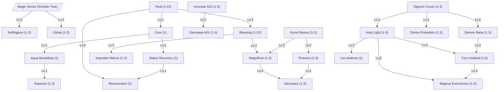

These sub-trees were cut from the [Bestia Master](/docs/mechanics/master/) page to reduce the scope of the initial
release. This page is never rendered. Each section below is the original text, unchanged, so it can be pasted back as is.

To unpark a sub-tree:

1. Paste its section back into `master.md` at the place given in the table.
2. Un-comment its node and its `Gate -.->|unlocks|` arrow in the parent tree diagram (marked `%% parked`).
3. Restore its mention in the parent tree's intro text.

| Sub-tree  | Parent tree    | Paste after   |
| --------- | -------------- | ------------- |
| Priest    | Scholar Tree   | the Scholar base skills, before `### Trader` |

Anchors inside these sections (`#skill-...`, `#craftsman-tree`, ...) point into `master.md` and only resolve once the
section is back there.

### Priest

Priests channel mana into blessings that keep a party alive - restoring health, lifting curses, and bolstering the vitality of Bestia out in the field.





<br>


Heals a target's HP for `[(BaseLV+INT)/8]*(4+8*SkillLV)`. When used against Undead property monsters, it is a holy attack that ignores SMDEF and INT, but deals only half damage - that is,
`HealValue * ElementModifier / 2`. Targeting a monster with a healing spell has to be deliberate, so the client asks
for a modifier key rather than a plain click.

| Lv. | Mana Cost |
| --- | --------- |
| 1   | 13        |
| 2   | 16        |
| 3   | 19        |
| 4   | 22        |
| 5   | 25        |
| 6   | 28        |
| 7   | 31        |
| 8   | 34        |
| 9   | 37        |
| 10  | 40        |




Applies to the next spell cast by the target ally within `30s`.

| Lv. | Cast Time Reduction |
| --- | ------------------- |
| 1   | 10%                 |
| 2   | 20%                 |
| 3   | 30%                 |





| Lv. | WIL Bonus | Duration |
| --- | --------- | -------- |
| 1   | +5        | 30s      |
| 2   | +10       | 60s      |
| 3   | +15       | 90s      |











| Lv. | STR/INT/DEX | Duration |
| --- | ----------- | -------- |
| 1   | +1          | 80s      |
| 2   | +2          | 100s     |
| 3   | +3          | 120s     |
| 4   | +4          | 140s     |
| 5   | +5          | 160s     |
| 6   | +6          | 180s     |
| 7   | +7          | 200s     |
| 8   | +8          | 220s     |
| 9   | +9          | 240s     |
| 10  | +10         | 260s     |




Grants a flat `+15%` Movement Speed at any level, plus the table below. The movement bonus **stacks** with a
Prospector's [Quick Travel](#skill-quick-travel), so a well-buffed traveller adds both.

| Lv. | AGI | ASPD | Duration |
| --- | --- | ---- | -------- |
| 1   | +4  | +1%  | 80s      |
| 2   | +5  | +2%  | 100s     |
| 3   | +6  | +3%  | 120s     |
| 4   | +7  | +4%  | 140s     |
| 5   | +8  | +5%  | 160s     |





| Lv. | Movement/Attack Speed Reduction |
| --- | ------------------------------- |
| 1   | 4%                              |
| 2   | 8%                              |
| 3   | 12%                             |





| Lv. | Hits Absorbed | Damage Absorbed per Hit |
| --- | ------------- | ----------------------- |
| 1   | 1             | +10% of HP              |
| 2   | 2             | +20% of HP              |
| 3   | 3             | +30% of HP              |




Higher levels extend how long the veil holds.

| Lv. | Radius |
| --- | ------ |
| 1   | +1m    |
| 2   | +2m    |
| 3   | +3m    |





| Lv. | DEF Reduction | Extra vs Demon/Undead | Duration |
| --- | ------------- | --------------------- | -------- |
| 1   | 10%           | 10%                   | 30s      |
| 2   | 20%           | 20%                   | 45s      |
| 3   | 30%           | 30%                   | 60s      |





| Lv. | MATK |
| --- | ---- |
| 1   | +10% |
| 2   | +20% |
| 3   | +30% |
| 4   | +40% |
| 5   | +50% |





| Lv. | Damage vs Demon/Undead |
| --- | ---------------------- |
| 1   | +8%                    |
| 2   | +16%                   |
| 3   | +24%                   |





| Lv. | Damage Taken Reduction from Demon/Undead |
| --- | ---------------------------------------- |
| 1   | 10%                                      |
| 2   | 20%                                      |
| 3   | 30%                                      |





| Lv. | ATK and MATK |
| --- | ------------ |
| 1   | +5           |
| 2   | +10          |
| 3   | +15          |







Higher levels extend the duration and allow higher-grade Holy Water to be used for a stronger imbue.



Higher levels raise the chance of an instant kill against sufficiently weak undead.

Inflicts single target Holy, armor piercing damage. If the target is an Undead property monster, this spell has a chance of immediately ending its existence.

| Lv. | Base Chance of Effect |
| --- | --------------------- |
| 1   | 8%                    |
| 2   | 16%                   |
| 3   | 24%                   |
| 4   | 32%                   |
| 5   | 40%                   |

```text
Chance of Effect = [Base_Chance_of_Effect + (Lv ÷ 10) + (INT ÷ 10) + (WIL ÷ 10) + {1 − (Target_HP ÷ Target_MaxHP)} × 20]%
Damage = Base_Damage + Base_Lv + INT
```








| Lv. | HP/Mana Regeneration |
| --- | -------------------- |
| 1   | +10%                 |
| 2   | +20%                 |
| 3   | +30%                 |





| Lv. | MATK | Bonus Damage vs Demon/Undead |
| --- | ---- | ---------------------------- |
| 1   | +15% | +10%                         |
| 2   | +30% | +20%                         |
| 3   | +45% | +30%                         |




Deals equivalent holy damage per tick to undead and demon-type enemies standing within.

| Lv. | Max HP Healed per Tick |
| --- | ---------------------- |
| 1   | +5%                    |
| 2   | +10%                   |
| 3   | +15%                   |





