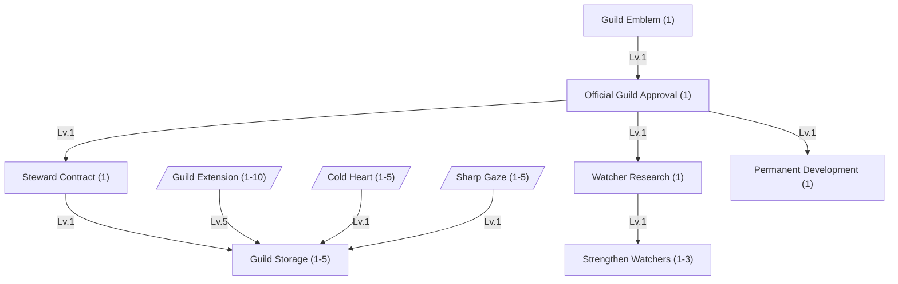
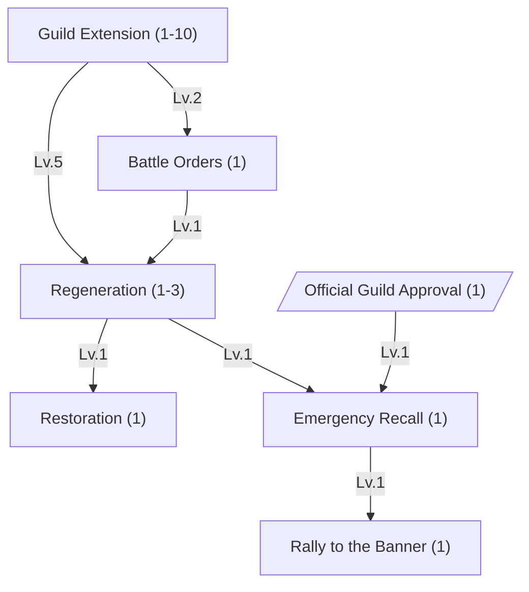
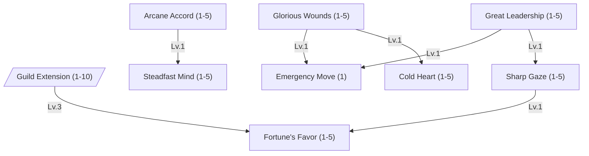

Masters band together in two ways. A **party** is a handful of players hunting side by side, and lasts as long as
its owner keeps it. A **guild** is a lasting community with a name, ranks and a level of its own, founded with a rare
item. A master can be in one party and one guild at the same time.

Both belong to the **master**, not to the account: a player who switches to another of their masters leaves that
master's party and guild behind until they switch back.

# Parties

Founding a party, and inviting players into it, needs [Basic Skill](/docs/mechanics/master/#skill-basic-skill)
Lv. 5. Joining one needs nothing. Whoever founds a party **owns** it:

| Rule              | Value                                                                                  |
| :---------------- | :------------------------------------------------------------------------------------- |
| Seats             | `12`, the owner's included. An invitation waiting for an answer holds a seat too.      |
| Party name        | Unique, up to `20` plain letters, digits and single spaces.                            |
| Invitations       | By master name, to a master that is being played. Unanswered, one lapses after `60` s. |
| Inviting, kicking | The owner only.                                                                        |
| Leaving           | Anyone. There is no new owner: when the owner leaves, the party ends for everyone.     |

The party window (`Alt+P`) lists every member with their master's health and mana, and beneath it the Bestia they
are playing, if they play one. These bars are live wherever the members stand.

Party members talk with `/p`; only the party hears it.

## Sharing Experience

The owner picks how the party shares what a kill is worth. Each attacker's part of a kill's experience - see
[Killing Enemies](/docs/mechanics/bestia/#killing-enemies) - then goes:

| Mode           | Where an attacker's part goes                                                                                        |
| :------------- | :------------------------------------------------------------------------------------------------------------------- |
| **Each take**  | To the attacker, as outside a party.                                                                                 |
| **Even share** | `+30%`, then split evenly between every member **within 100 m of the kill**. Each share goes to the member's master. |

A member counts as near the kill when their master or the Bestia they play stands within `100 m` of it, measured flat
on the map. The attacker's own master always shares, wherever it stands - its damage earned the experience.

The `+30%` is for sharing, not for being in a party: with nobody else near the kill the attacker keeps its part with
no bonus. It also comes on top of the bonus several players already earn by fighting together.



## Loot

Loot is not shared yet: the account that dealt the most damage gets a few seconds' claim on every drop, and then
anybody may pick it up. Options under consideration:

1. **Party pickup** - the claim belongs to the whole party, so any member may pick up during it.
2. **Round robin** - each drop is claimed for the next member near the kill, in turn.
3. **Random** - each drop is claimed for a random member near the kill.
4. **Need or greed** - members roll for drops above a rarity, the rest go by one of the above.

# Guilds

A guild is founded with a **Founder's Seal**, a rare item of level 45, spent in the founding. The
master who uses it names the guild and leads it. A guild name is unique, up to `24` plain letters, digits and single
spaces; a name that is taken is refused and the seal is kept.

| Rule        | Value                                                                                                     |
| :---------- | :-------------------------------------------------------------------------------------------------------- |
| Seats       | `16`, plus `4` for each level of Guild Extension, up to `56`.                                             |
| Invitations | By master name, as for parties. Each one waiting for an answer holds a seat.                              |
| Kicking     | Expels the member, with a reason of up to `60` characters. It cannot be invited again until it is lifted. |
| Leader      | Can never be kicked and cannot leave. Hands the guild to another member, or ends it by disbanding it.     |
| Disbanding  | The leader only, confirmed by typing the guild's name. The seal is not given back.                        |

Handing the guild over makes the other member the leader, on the leader's rank; the old leader takes the rank the
new one had. A master leading a guild cannot be deleted; the guild has to be handed over or disbanded first.

The guild keeps its newest `32` expelled masters, with their reasons, on the Members tab. A rank that may kick lifts
an expulsion there.

Guild members talk with `/g`. The guild window (`Alt+G`) is only offered inside a guild.

## Ranks and Permissions

A guild has up to `10` ranks. Founding makes two: **Guild Master**, the leader's, and **Member**, which newcomers
join. Each rank has a name, a tax and five permissions. The name is the member's title: it shows under the master's
name, after the guild's, for everyone who points at the master or one of its Bestia.

| Permission             | Allows                                                                                               |
| :--------------------- | :--------------------------------------------------------------------------------------------------- |
| **Invite**             | Inviting players into the guild.                                                                     |
| **Kick**               | Removing members of a lower rank, and lifting expulsions.                                            |
| **Manage ranks**       | Adding, editing and deleting the ranks below one's own, and moving members of lower ranks onto them. |
| **Use guild skills**   | Casting the guild's active skills, and planting its War Banner. The leader always may.               |
| **Message of the day** | Writing the guild's [message of the day](#message-of-the-day). The leader always may.                |

The leader's rank holds every permission and only the leader may rename it or change its tax; nobody else can be put
on it. Everyone else acts only **below their own rank**, so no rank can grant itself more or remove those above it.
A rank that still has members cannot be deleted, and neither can the last rank below the leader's.

## Tax and Guild Experience

Every rank pays a tax of `1%` to `50%` - `5%` for both founding ranks. That share of the kill experience each member
receives goes to the guild instead, after any party sharing, rounded down. It is taken from what a member's master
and Bestia earn alike.

A guild levels like a master does, on the curve of Ragnarok Online's guilds scaled down to Bestia's experience. From
one level to the next, the experience needed rises by `4,000`, then `6,000`, then `8,000`, and so on.

<!-- prettier-ignore -->

exp_{guild}(L) = 2000 \cdot \left(\frac{L (L + 1)}{2} + 1\right)


| Guild Lv. | EXP to the next level | EXP from founding |
| --------: | --------------------: | ----------------: |
|         1 |                 4,000 |                 0 |
|         2 |                 8,000 |             4,000 |
|         3 |                14,000 |            12,000 |
|         5 |                32,000 |            48,000 |
|        10 |               112,000 |           348,000 |
|        20 |               422,000 |         2,698,000 |
|        30 |               932,000 |         9,048,000 |
|        50 |                     - |        41,748,000 |

Level `50` is the highest. The guild window shows how much each member has paid in.

## Message of the Day

The leader, or a rank allowed to, writes a message of the day: a headline of up to `60` characters and a text of up
to `240`. Every member reads it in the chat, in yellow, after each loading screen - when they log in, and after every
teleport - as in Ragnarok Online. It is plain text in any script; markup is shown as typed.

## Members, the Map and the Log

The Members tab lists every member, online or not. For an online member it shows where they are and their master's
health and mana; for an offline one, the area their master left the world in and how long ago.

Every other member being played is a violet dot on the map and the minimap, wherever they stand. The dot follows the
entity they play, their master or a Bestia, and moves in steps of a few metres.

The Log tab tells what happened in the guild, newest first: who joined, left or was kicked and why, rank changes,
skills learned, a new message of the day or emblem, a new leader. A guild keeps its newest `200` entries.

## Emblem

A guild that learned [Guild Emblem](#skill-guild-emblem) carries an emblem: a picture of `32 × 32` pixels, which its
leader picks in the guild window. Any picture will do; its middle square is shrunk to that size. It shows in the
guild window, beside the name of every member and their Bestia, and in the companion app.

An emblem is drawn only at whole-number sizes - `32`, `64` or `96` pixels - with every pixel kept square, so a picture
drawn at `32 × 32` stays crisp everywhere.

## Guild Skills

A guild gains one **skill point** per level, the founding level included, and the leader spends them on the guild's
skill tree. The tree follows the guild skills of Ragnarok Online Renewal. All its skills together cost `66` points
and a guild reaches at most level `50`, so every guild has to choose.

Some skills are **active**: a member whose rank may use guild skills casts them like any other skill, from the
shortcut bar. Their cooldown belongs to the whole guild, so a cast by one member blocks the skill for all of them.

The skills under [Recognition and the Stronghold](#recognition-and-the-stronghold), and Emergency Recall, work only
once the guild holds a [Guild Stronghold](#guild-strongholds). A guild can learn them now, but they do nothing yet.



### Recognition and the Stronghold

 






















### Members, Commands and Summons

 




Guild Extension Lv. 10 needs at least guild Lv. 10: `348,000` guild experience, which at a `5%` tax is about seven
million experience earned by its members.

The commands land on the members around the caster - their master and their Bestia.










The two summons move what each member plays right now. Members who are down stay where they fell. The two skills
have separate cooldowns.







A **War Banner** is an item forged at a forge from planks, cloth, dye and an iron ingot. A member whose guild knows
Rally to the Banner, and whose rank may use guild skills, plants it within `5` tiles. A guild has one banner: a new
one takes the old one down.

The banner stands for `300 s` and has `1,500` HP. Enemies can cut it down; the guild's own members and their Bestia
cannot, and a [ward stone](/docs/mechanics/pvp/#protected-zones) protects it like anything else a player owns. Every
member online hears when it is planted, cut down or fades.

### Auras

 

The six auras raise a status value of every member near the **guild leader**: their master and their Bestia, within
`15 m` of the master or Bestia the leader plays, measured flat on the map. They work only while the leader is online.






















Emergency Move needs two auras, but it is a command: it lands on the members around the caster.




# Guild Strongholds



A **Guild Stronghold** is a guild's own place in the open world. Only a guild with Official Guild Approval can found
one, and from then on the guild may attack other guilds' Strongholds - and its own may be attacked. The steward,
the guild storage, the watchers and Emergency Recall all live in the Stronghold.
