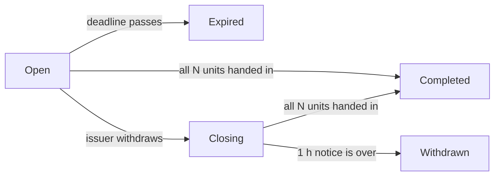

Questing in **Bestia** is primarily **player-driven**. Players post rewards for tasks they need done — gathering
resources, transporting goods from A to B, hunting a troublesome Bestia — and other players pick those tasks up.
Alongside those, NPCs hand out work of their own, and very rarely the world itself intervenes when the simulation
produces a genuine emergency such as a [mana rift](/docs/mechanics/world/world-events/#rifts) tearing open next to
a settlement.

Whether a quest is written by a player, offered by an NPC or born from the world, it is always the same underlying
thing: a **contract**. Nothing marks your objective on the map and nothing teleports you to it. A quest is an agreement
in the world, and you complete it by acting in the world. Your [quest log](/docs/mechanics/towns-trade/blackboard/#the-quest-log)
only remembers what you agreed to. This keeps questing aligned with the
[consistent fantasy simulation](/docs/mechanics/overview/#consistent-fantasy-simulation) principle.



# Player Commissions

The vast majority of quests are **commissions** written by players. A player posts one at a
[city blackboard](/docs/mechanics/towns-trade/blackboard/), and other players sign it and do the work. Its life looks
like this:



## Funding and Escrow

The issuer pays **everything up front**, at the moment of posting:

- the **pot**: the amount times the coins offered per unit, and
- the **posting fee**: a share of the pot that depends on how long the commission runs.

The board holds the pot until it is paid out for hand-ins or sent back. This single rule is the backbone of trust in
the system: **every commission a player sees on a board is already paid for.**

| Duration | Posting fee   |
| -------- | ------------- |
| 1 day    | `3%` of the pot |
| 3 days   | `5%` of the pot |
| 7 days   | `8%` of the pot |

The fee is paid in gold and rounded up to the next whole gold, like every fee on the
[economy page](/docs/mechanics/towns-trade/economy-trade/). It goes to the
[world reserve](/docs/server/money-supply/#nothing-is-burned), the same as
[auction listing fees](/docs/mechanics/towns-trade/economy-trade/#how-auctions-work). **The fee is never refunded**: not
when the issuer withdraws, not when the commission expires, and not when nobody delivers. The board did its work by
showing the commission.

A longer commission pays a higher fee because it holds its place on every board for longer. The fee is small for a
serious order, but papering the boards with dozens of trivial ones has a running cost.



The issuer chooses the coins per unit freely. The reward is **gold only**; items as a reward are not built. A
server-wide bound on rewards, watched by the [World Treasury Director](/docs/server/economy/), is not built either.

## Objective Types

Every objective is verifiable from **physical world state** — never from self-reporting. Gather commissions ask for
[natural resources](/docs/mechanics/items-crafting/natural-resources/) or crafted
[items](/docs/mechanics/items-crafting/items/).

| Type          | Description                                                                                         | Status    |
| ------------- | --------------------------------------------------------------------------------------------------- | --------- |
| **Gather**    | Hand in _N_ units of one item at any blackboard. Any copy of the item counts.                       | Built     |
| **Transport** | Move a sealed cargo item from A to B. Weight and the deadline make this a genuine logistics puzzle. | Not built |
| **Bounty**    | Deactivate a specific Bestia guardian or clear a named threat.                                      | Not built |
| **Escort**    | Accompany an NPC or player-Bestia safely to a destination.                                          | Not built |

For a Gather commission, **any copy of the item** counts. Its stats, its sockets and its
[level](/docs/mechanics/items-crafting/items/#item-level) are ignored. An issuer who wants a better copy buys it at the
[auction house](/docs/mechanics/towns-trade/economy-trade/#how-auctions-work) instead.

Transport commissions will be bounded by the carrier's
[weight limit](/docs/mechanics/items-crafting/items/#weight-limit).

## Difficulty and Level Range

Every commission shows a **suggested level**. The server works it out; the issuer cannot set it. It is **only a
suggestion**: a master of any level may sign any commission. A Gather commission asks for an item, not for a fight,
and buying the item at an auction house is fair play.

For a Gather commission the suggested level is:

1. the lowest **minimum level** of all Bestia species whose loot holds the item, or
2. the item's [base level](/docs/mechanics/items-crafting/items/#item-level), when no species drops it (ores, herbs).

The level is fixed when the commission is posted. The board and the quest log colour it against the reader's own level,
from grey (far below you) to red (far above you), as in other MMOs. The board shows a
["!" marker](/docs/mechanics/towns-trade/blackboard/#the-board-marker) when at least one open commission fits your level.

### Danger and effort for later types



The later types derive their level from the world, along two separate axes:

- **Danger** is expressed as a **Contract Danger Level (CDL)**, on the same scale as player levels. It is the suggested
  level of the commission.
- **Effort** measures how much work the task is. It decides how large the experience may be.

Every region carries a **threat level** — the average level of the hostile Bestia the simulation currently sustains
there, which rises with the region's [mana concentration](/docs/mechanics/world/environment/#mana-concentration) because
that is what [Bestia spawn from](/docs/mechanics/bestias/bestia/):

```text
CDL(bounty)    = target_level + 5 (if boss) + 2 per elemental level of the target
CDL(gather)    = threat_level of the region holding the nearest viable deposit
CDL(transport) = highest threat_level along the shortest viable route
CDL(escort)    = highest threat_level along the route, +5 if the escortee is more
                 than 10 levels below that threat level
```

The `+5 / +2` terms on a bounty mirror the boss and elemental modifiers used in the
[experience calculation](/docs/mechanics/bestias/bestia/#killing-enemies), so a contract's danger and the experience the fight
actually yields cannot drift apart.

```text
effort(gather)    = N * resource_level
effort(transport) = distance_km * weight_kg   (the same term as the postal freight fee)
effort(escort)    = distance_km
effort(bounty)    = 4 * target_level + 5      (the base experience of the kill)
```

A commission never stops a master from signing. The post's
[route boards](/docs/mechanics/towns-trade/postal/#taking-a-sack) reuse the same danger level, and they do keep masters
below `CDL - 5` off a route.

## Open vs. Assigned

You **sign** a commission at a board before your work counts. A Gather commission is **open**:

- **Many players may sign it.** Each signer hands in units at any board and is **paid per unit at once**, from the pot,
  at the price the issuer set.
- You hand in what you carry, up to what is still missing. Five players who each haul a fifth of the order each earn a
  fifth of the pot. Nobody who did real work goes home with nothing because somebody else arrived first.
- When _N_ units are in, the commission is **completed for everybody** and leaves every board.
- A signer may **abandon** it at any time, from the quest log. Nothing is at stake, and what was already paid stays paid.



**Assigned commissions** (used for **Transport** and **Escort**) **lock to a single accepter** on signing, with a
deadline, and the accepter posts [collateral](#collateral). Sealed cargo and a named escortee cannot be split across
several couriers, and time-critical deliveries must not be blocked by someone who signs and then stalls.

**Bounty** commissions may be posted either way. An assigned bounty pays its single accepter. An **open bounty splits the
pot in proportion to damage dealt** to the target, exactly as [kill experience](/docs/mechanics/bestias/bestia/#killing-enemies)
is already distributed among damage dealers, and the kill itself is credited to whoever dealt the most damage. Because
both the experience and the gold follow the same proportional rule, there is nothing for a last-hit thief to steal.

## Collateral



An assigned contract is a promise to be somewhere with something. To make that promise cost something, the accepter
posts **collateral** in gold when they sign:

```text
collateral = max(20 * subject_level, 25% of the reward's value)
```

where `subject_level` is the [item level](/docs/mechanics/items-crafting/items/#item-level) of the cargo for a **Transport**, the level
of the escortee for an **Escort**, and the resource level for an assigned **Gather**. Hauling a Legendary crate is
therefore a serious financial commitment, and the stake is meant to be felt: walking away from the job must be the
expensive option, not the convenient one.

This does mean a fresh player cannot immediately take the high-value hauls, and that is intended. Those contracts are
trusted work, and the trust is bought with gold you already have.

On settlement:

- **Completed on time** — collateral is returned in full, on top of the reward.
- **Failed after a genuine attempt** (the courier was killed en route, the escortee died to something that outmatched
  the team) — **half** the collateral goes to the issuer as compensation, half returns to the accepter. This mirrors the
  [post's couriers](/docs/mechanics/towns-trade/postal/#the-deadline), where being killed on the road is a real outcome of the world
  rather than cheating.
- **Abandoned** — the accepter drops the contract, lets it expire without a serious attempt, or dumps the cargo — the
  **full** collateral goes to the issuer, **and the accepter loses honor**. Brokers keep a ledger and they talk: an
  abandoned contract costs `-5` global honor and `-20` local honor with the broker who held it, on the same scale as the
  other breaches of trust in the [honor system](/docs/mechanics/society/pvp/#negative-honor). Repeat offenders find the boards
  of a whole town closed to them long before their gold runs out.

## Withdrawing a Commission

The issuer withdraws a commission **at a board**, in the *My postings* tab. Escrow-as-trust would be worthless if the
issuer could pull a commission out from under people mid-haul, so a withdrawal gives notice:

- The commission is flagged as **closing** on every board for **1 real hour**.
- During that hour **hand-ins are still paid** from the pot. Work already in flight is always paid for.
- When the hour is over, the commission is **withdrawn**. The unspent pot is in the issuer's mailbox at once, like
  [auction mail](/docs/mechanics/towns-trade/postal/#auction-mail).
- The posting fee is **not** refunded.

A commission whose deadline passes **expires** the same way, without the notice hour: it leaves the boards, and the
unspent pot goes back to the issuer's mailbox the same way.



## Rewards, Experience and Settlement

You hand in a Gather commission at **any blackboard**. You do not report back to a magical quest-giver, and you do not
travel back to the board where it was posted.

- The **coins** for the units you hand in go straight into your bag.
- The **goods** are in the issuer's mailbox **at once**, like
  [auction mail](/docs/mechanics/towns-trade/postal/#auction-mail). They need no coach and no freight, the issuer
  collects them at any post office, and the issuer does not need to be online.



Experience deserves special care. Player commissions **do not let issuers mint experience**. The server decides the
whole experience reward from the derived difficulty of the task, and it is drawn from a **capped NPC/world pool**:

- The **accepter** earns experience scaled to the contract's CDL and effort, in the same order of magnitude as doing the
  equivalent work uncommissioned — a haul is worth roughly what
  [gathering that resource](/docs/mechanics/bestias/bestia/#environment-interaction) is worth, a bounty roughly what
  [the kill](/docs/mechanics/bestias/bestia/#killing-enemies) is worth.
- The **issuer** earns a flat `5` experience for posting a funded commission, plus `10%` of the experience paid to the
  accepter once the contract settles successfully. Writing good work into the world is worth rewarding — but a flat
  posting bonus is insignificant to anyone past the first few levels, and the completion share only ever arrives if a
  real player really did the job.



### Why Big Contracts Beat Many Small Ones

Gold and items only ever move between players, so trading favours back and forth costs both sides the posting fee and
gains nobody anything. Experience is the part worth protecting, because it comes from the world pool rather than from a
player's pocket. Three rules make a wall of tiny contracts strictly worse than one real one:

1. **Experience follows the objective, not the paperwork.** Splitting a 500-unit order into ten 50-unit orders yields
   the same total effort and therefore the same total experience, minus ten posting fees instead of one.
2. **Diminishing returns per role, per day.** For the `n`-th contract a player settles within a
   [Bestia day](/docs/mechanics/world/environment/#in-game-time), counted separately as issuer and as accepter, the world-pool
   experience is multiplied by `1 / (1 + 0.5 * n)`. The first contract of the day pays full, the third about half, the
   tenth barely registers. Gold and items are untouched — a dedicated hauler can run all day for pay, they simply cannot
   grind levels off the contract board.
3. **The same two names, again and again, stop paying.** Contracts between the same issuer–accepter pair decay much
   harder: `1 / (1 + n_pair)` over a rolling 7 Bestia days. A guild's regular courier is mildly affected. Two accounts
   cycling ten-metre escort contracts at each other are earning nothing within minutes.

On top of that, a contract whose CDL and effort both fall below the trivial floor pays **no** world experience at all —
only the gold its issuer chose to attach. Work has to be work.



## The Text of a Commission

The issuer writes **no text of their own**. The board builds the text from a template and the commission's data: the
item, the amount, the coins per unit and the deadline. So every commission reads the same way, in every language the
game is played in, and the boards carry no spam and no insults.

## Limits

| Limit                                  | Value |
| -------------------------------------- | ----- |
| Open commissions one master has posted | `10`  |
| Quests in one master's quest log       | `25`  |

An ended quest stays in the log, and counts, until the player clears it or 3 days pass. Both limits are server settings.

## Discovery

Commissions are found at the **[city blackboards](/docs/mechanics/towns-trade/blackboard/)**. All boards form **one
network**: every board shows every open commission in the world, and every board takes signatures and hand-ins for any
of them. A board in a small player town is as useful as the one in a start town.

Finding work still means going somewhere. You read the list only while you stand at a board; there is no
world-spanning quest finder in a menu. A ["!" marker](/docs/mechanics/towns-trade/blackboard/#the-board-marker) above a board
tells you from a distance that it holds work for your level.



# NPC Commissions

NPCs also generate work of their own: a farmer who cannot bring in a harvest before it spoils, a merchant who needs an
escort, a village that wants a guardian Bestia dealt with. These will be quest records like player commissions,
funded from the NPC side rather than from a player's purse, and they are the reason a quiet corner of the world still has
something to do in it.



What is settled for quests the world makes:

- **Real causes only.** A town asks for timber because a storm really damaged its temple, or for grain because its
  stores are really low. When the cause is gone, the quest is gone.
- **Local quests are shared.** Many players add to one goal, like a blackboard Gather.
- **Global quests have one prize.** There is one lost book on one battlefield. Everybody who found the lead may
  try. The first one takes it. For the others the quest does not just fail: it turns into a new lead, such as where
  the book is now.
- **Chains with a choice.** A quest is a few steps: ask somebody, read an old stone, dig at a spot, and then decide,
  for example to keep a relic or to return it. Each ending changes the world in its own way.
- **Who offers them.** Townsfolk in conversation, things you find and read, and the blackboard.
- **What they pay.** Coins from the town, the thing you found, knowledge (a lead, a hint, a weakness) and
  experience.

The world's history is meant to be one source of these quests: heirlooms that descendants want back, offerings and
deeds for the gods, and once-per-world quests such as returning a unique artifact to its temple. See
[Quests from History](/docs/mechanics/world/world-history/#quests-from-history) and
[Quests for the Gods](/docs/mechanics/world/pantheon/#quests-for-the-gods).

# World Events

Occasionally the world itself produces a quest. These are **rare and emergent**, never on a fixed timer. A regional
**Director** watches the world, above all the [mana density](/docs/mechanics/world/environment/#mana-concentration),
and when an event such as a [rift](/docs/mechanics/world/world-events/#rifts) becomes real, it posts a **public
contract** on the blackboards nearby. Everyone may help, and nobody has to sign first.

- **Rewards are loot and honor, never coin.** No treasury pays for a world event, so a poor and empty region can
  still have one, and an event is a reason to go there.
- **Contribution is scored on three lines:** fighting, work (rituals, crystal nodes, wards) and holding the area. A
  Scholar, a ritualist and a fighter are each paid for what they did, and nobody has to out-damage anyone.
- **Events cannot be farmed** because they are rare: each province can afford one only now and then and rests after
  it. There is no shrinking payout.
- **The Orders contest them:** Eternity seals, Chaos feeds, the Circle holds the rift in stasis, and the outcome moves
  their [influence](/docs/mechanics/society/factions/#sphere-of-influence).

What world events there are, how a rift runs and how players learn of them is on
[World Events](/docs/mechanics/world/world-events/).

# How Completion Is Verified

Player commissions, NPC commissions and world events all run on the same machinery, which fits the event-based
[server architecture](/docs/server/architecture/):

1. A quest is a small **state machine**: `Open → Closing → Completed | Expired | Withdrawn`.
2. Its objectives come from a small set of kinds with parameters — "hand in _N_ of an item", "kill _N_ of a species in
   an area" — and each kind is checked against facts the world already reports: a hand-in at a board, a kill that pays
   experience. A player never reports their own progress.
3. A **shared** objective, such as an open Gather, keeps one counter on the quest, and the log of each signer shows what
   they delivered themselves. A **personal** objective keeps a counter per master. Pro-rata pay is bookkeeping over
   those counters, not a separate system.
4. World events will reuse the same records. They differ from a commission in two ways: anyone may contribute without
   signing, and they pay loot and honor instead of coin.

How the server stores and tracks quests, and how it tells the clients, is on the [Questing](/docs/server/quests/)
server page.
