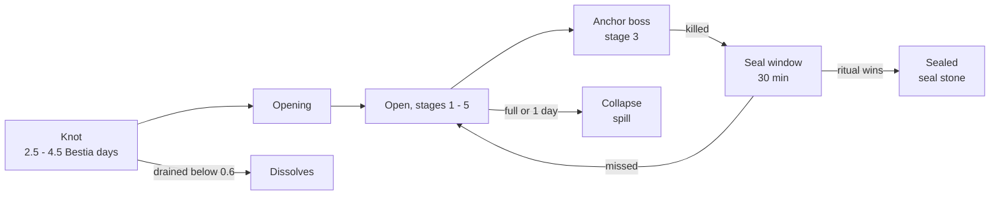



The world is not quiet. Mana seeps out of the Wounds, it gathers where people fight and cast, and when too much of it
sits in one place, the land starts to change. Strange plants grow, stones rise, bestia grow restless and stronger,
and at last a rift tears open. Other things happen too: a pack grows an alpha, bandits eye a rich town, an old seal
cracks.

A **World Event Director** watches each region and decides when such an event begins. It never runs on a timer, and
it never announces itself. Players only see what the world shows them.

# Mana You Can Feel

Every place has a **mana density**. It starts low almost everywhere. Only the land around the Wounds and the
richest mana provinces starts high. How it starts and how it moves is described under
[Mana Concentration](/docs/mechanics/world/environment/#mana-concentration).

The higher the density, the stranger the place. The effects come in steps:

| Step     | Density | What happens                                                                                                  |
| -------- | ------- | ------------------------------------------------------------------------------------------------------------- |
| Calm     | < 0.35  | Nothing unusual                                                                                               |
| Stirring | 0.35    | Faint motes of light at night, a low hum                                                                      |
| Uneasy   | 0.45    | Strange plants, sounds at night, restless bestia, small critters flee. Townsfolk start to talk                |
| Ominous  | 0.55    | Stone formations rise, the night sky glows, compasses jitter. Bestia nearby grow stronger, apex bestia arrive |
| Storms   | 0.60    | [Mana storms](/docs/mechanics/world/doomsday/#mana-storms) become common weather                              |
| Event    | 0.70    | A rift can begin to form                                                                                      |
| Sickness | 0.80    | Bestia Masters fall ill from the mana. Bestia do not, because they are born from it                           |
| Burn     | 0.90    | [Mana Burn](/docs/mechanics/world/doomsday/#mana-burn) can ignite                                             |

A step starts at its value and only ends a little below it, so effects do not flicker at the border.

Below the start level a place is **drained**. Spells there are weaker, plants look grey and bestia drift away.
Draining is not free either.

## Omens by Land

The same step looks different in different land:

| Land             | Uneasy                                  | Ominous                                 |
| ---------------- | --------------------------------------- | --------------------------------------- |
| Forest           | Glowing fungus rings, whispering leaves | Trees twist, wisps drift between trunks |
| Mountains        | Humming rock, small rockslides          | Floating stones, standing-stone rings   |
| Swamp and bog    | Will-o'-wisps                           | Bubbling, glowing pools                 |
| Desert and waste | Mirages                                 | Sand fuses to glass                     |
| Coast and sea    | Glowing tide                            | Fish beach themselves, water spouts     |
| Grassland        | Flowers bloom out of season             | Crop circles, herds stampede at night   |

Plants, lights and sounds fade when the mana falls. **Stones, glass and twisted trees stay.** They are scars, and
later they are clues: "the stones on the ridge rose the year the rift opened".

## Drawn by Mana

Mana is a poison that attracts what is dangerous:

- Dens in an Ominous place breed **mana-touched** bestia. They are a few levels higher and glow faintly.
- **Apex bestia** come from far away and roam toward the strongest mana in the region.
- A hunting ground used every day slowly fills with mana from the bestia killed there. In a week it can reach Uneasy.

# Where Mana Comes From and Where It Goes

Mana changes only when something changes it. Left alone, it stays, and only very slowly sinks back to how the world
began. So everything players do with it counts for weeks.

**Mana rises from:**

- **The Wounds.** They pour mana into the world, more with every stage of the [doomsday](/docs/mechanics/world/doomsday/).
- **Spells.** Every spell spends mana, and a small part of it stays where it was cast. This counts for wild bestia too.
- **Kills.** A dying bestia gives back a little of the mana it was born from, more for a strong one and much more for
  a boss. A **caught** bestia gives back nothing.
- **Chaos rituals.** The [Order of Chaos](/docs/mechanics/society/factions/#the-order-of-chaos) raises mana on purpose.
- **Broken stores.** A shattered mana crystal, a broken ward or seal stone and a collapsing rift release everything
  they held, at once and on the spot.

**Mana falls through:**

- **Mana Harvesters.** They turn the mana around them into crystals. The more mana, the more crystals. See
  [Mana Harvester](/docs/mechanics/master/craftsman-tree/#skill-mana-harvester).
- **Wards.** An [Eternity](/docs/mechanics/society/factions/#the-order-of-eternity) ward soaks up mana into its charge. A full ward must be emptied into crystals, or it breaks
  and spills.
- **Seal rituals.** They bind mana into a **seal stone**.
- **Crafting.** A crystal used in a recipe takes its mana out of the world for good.
- **The start lands.** The land around the start towns slowly draws mana away, so a new player sees a restless
  world but is not killed by it.

A stored crystal keeps its mana and does not leak. A warehouse full of crystals is a sink, but also something to
defend: if it burns, the mana is free again.

# Rifts

A rift is what happens when the pressure has to go somewhere. It sucks in the mana around it, turns it into bestia,
and either gets sealed or bursts.

1. **Knot.** Where the mana stays at Event level for a while, a knot forms. It slowly pulls the mana around it into
   itself. Close to it the omens fade: an eerie calm in the middle of an uneasy land. A knot lasts 2.5 to 4.5 Bestia
   days. If players drain the area below 0.6 in that time, it dissolves, and the rift never comes.
2. **Opening.** A gate tears open, the sky above it changes colour and a sound carries far. A public call goes out
   to the towns nearby.
3. **Open.** The rift grows through five stages. With each stage it pulls from further away, up to 1.5 km. Every 20
   to 30 minutes a wave of bestia comes out and marches on the nearest town. The waves are local bestia, touched by
   the mana, and they grow stronger with each stage. Still planned: crystal nodes that grow around the gate.
4. **Anchor.** At stage 3 an anchor boss, a creature from beyond the rift, takes its place at the gate. While it
   lives, the rift cannot be sealed. No weapon ever harms the gate.
5. **Seal.** When the anchor falls, the gate can be sealed for 30 real minutes. A
   [Dispel](/docs/mechanics/master/scholar-tree/#skill-dispel) at the gate is a contest against the rift's
   [Potency](/docs/mechanics/combat/spell-potency/), which grows with every stage. A weak Dispel has no chance, so in
   practice it takes the charge of a [ritual](/docs/mechanics/combat/spell-potency/#rituals). If the Dispel wins, the
   rift closes and leaves a **seal stone** that holds all the mana the rift gathered. If the window passes, the anchor
   rises again at the next stage.

**Collapse.** A rift that is full, or that stays open for about a real day, collapses. All its mana spills out in a
few hundred metres, which can start mana storms or a Mana Burn, and sometimes a new knot forms nearby. Still planned:
a last burst of bestia and a scar in the ground. Two rifts that pull from the same land merge into one. In a world
whose doomsday is [The Void Tear](/docs/mechanics/world/doomsday/#the-void-tear), this is how it begins.

**When nobody comes.** The waves still reach the town, but they are weaker than with players around. A town survives
one rift. It does not fall. Still planned: the damage it takes, such as burnt fields, broken buildings and news that
travels.

At most one rift is open in a province at a time, and none ever forms in a start province.

## Rifts and the Orders

The same rift means something different to each Order:

- **Eternity** wants it sealed. A knot drained in time counts for them as much as a sealed rift.
- **Chaos** wants it fed. A feeding ritual at the gate adds mana and moves it to its next stage.
- **The Circle** wants it held. A stasis ritual freezes the stage and stops the waves, but only as long as the Circle
  keeps it up. When they stop, the clock runs again.

How a rift ends moves the Orders' influence in its province, see [Factions](/docs/mechanics/society/factions/).
Feeding, stasis and the influence wait for the factions. Today anyone can seal a rift.

# Other World Events

Not every event comes from mana. The Director also watches the weather, the moon and the seasons, how much is hunted
and where, how rich and how well defended the towns are, and what the history remembers. The first events built
after the rifts are these:

## Rare Bestia Under the Right Sky

Some named bestia only show up when everything fits: a weather, a time of day, a moon phase, a season and a place.
_The Storm Heron hunts the marsh in a storm at dusk._ Three of them live in the world so far: the Storm Heron in
wetlands, the Silver Hart in forests and the Whiteveil Lynx in the cold north. Townsfolk near their land drop hints
about the sky each one waits for, and a hunter who reads the forecast can be there when it happens. A sighting is
news in the next village.

The bestia stays near where it came down and leaves when its sky moves on, after half a Bestia day at most. Killing it
ends the event and pays everyone who helped.

## An Alpha Rises

A den that nobody hunts for a week of Bestia days, a little over two real days, grows. Near a road or a town, its pack
produces an **alpha**: the pack's own kind, much stronger, that prowls the road or the fields near the town.
Townsfolk talk of torn sheep and attacked travellers. Killing it ends the event. Otherwise it leaves after three
Bestia days. Hunting the den's bestia starts the count again, and so does the rise of an alpha. This is the other
side of the hunting ground that fills with mana: too much hunting is a problem, and so is too little.

## An Old Seal Weakens

The world bosses of the history sleep in seal crystals, and every sealed rift leaves a seal stone. Strong mana and
age wear them down: the seal under the strongest mana of a region cracks, once that mana is Uneasy or worse. A seal
stone must be a Bestia month old first. A cracking seal hums and is talked about. A ritual held beside it within two
Bestia days reinforces it, and Eternity will want to be the one who holds it. If nobody does, it breaks: the world
boss wakes, or the stone spills the mana it held.

## A Raid on a Rich Town

A town or city with old enemies in its history draws raiders when it is the richest of its region, its purse is at
least as full as usual and fewer than three masters stand in it. First travellers are robbed on the road, and the
band's tracks lead to a camp on the high ground outside the town. Players who follow the tracks have a Bestia day to
clear the camp before the raid comes. Otherwise the brigands march on the town, plunder it for three Bestia hours and
leave. Killing the chief and the whole band ends the raid, in the camp or in the town. For now the raiders take no
coin and break nothing.

## Ideas for Later

These fit the same pattern and use systems the game already has. They come after the first events.

| Event                       | What starts it                                       | The first signs                            | What players do                                                                                   | What it leaves                                                                                |
| --------------------------- | ---------------------------------------------------- | ------------------------------------------ | ------------------------------------------------------------------------------------------------- | --------------------------------------------------------------------------------------------- |
| **Starfall**                | A clear night, very rarely                           | A falling star seen across the province    | Race to the crater and mine star iron and crystals before the bestia drawn by its mana arrive     | A crater and a local mana spike                                                               |
| **Lightning wildfire**      | A thunderstorm in a dry season, over grass or forest | Dry wind, smoke on the horizon             | Put the fire out, cut firebreaks                                                                  | Scorched land that grows back, or burnt fields and houses                                     |
| **Flood**                   | Days of rain and a swollen river                     | Rivers rise, drowned bestia wash up        | Sandbags, rescue townsfolk, repair the bridge                                                     | A lost bridge or a flooded quarter, until rebuilt                                             |
| **Blood moon**              | A full moon over Ominous land                        | A red rim on the moon at dusk              | Hunt or hide: night bestia are stronger and rare night species appear                             | Night-only loot                                                                               |
| **Migration**               | The change of a season                               | Herds gather at the edge of a biome        | Follow the route to hunt and tame rare members. Careless attacks start a stampede over the fields | A small [Great Stampede](/docs/mechanics/world/doomsday/#the-great-stampede) if it goes wrong |
| **A predator moves in**     | A region hunted empty                                | "The woods went quiet"                     | Deal with the newcomer, or let the prey recover                                                   | A changed region until the prey comes back                                                    |
| **War effort**              | A doomsday stage or a long shortage                  | A call from the capital                    | Bring materials for a province-wide build                                                         | A seawall, a ward ring or a siege device that stays on the map                                |
| **Battlefield anniversary** | The date of a battle in the history                  | Mist over the old field the evening before | Fight the dead who rise for one night                                                             | Relics of that war                                                                            |
| **Tremor**                  | Quakes near a fault, or heavy blasting in a mine     | Rumbling, cracks in the ground             | Explore what opened                                                                               | A new vein, cave or buried ruin                                                               |

## What We Do Not Want

- **Boss respawns on a fixed timer.** A timer is exactly what makes an event something to farm.
- **Coin as a reward.** Events must not print money or drain a town's treasury.
- **Festivals picked by the Director.** Feasts and customs follow the calendar of the
  [history](/docs/mechanics/world/history-in-play/#customs-and-festivals). The Director only keeps a province quiet
  around them.

# Rewards

World events pay **no coin**. They pay with:

- **Loot.** Rift waves and the anchor boss drop their own loot, and every event shares a pile among those who ended
  it. Still planned: crystal nodes with their own loot.
- **Honor.** Ending an event raises a master's honor everywhere and with the town nearest it, see
  [Positive Honor](/docs/mechanics/society/pvp/#positive-honor). Raiders caught in their camp count as outlaws.
- **What did not happen.** A sealed rift does not spill, and a town that was defended does not burn.

Who gets how much is decided by **contribution** along three lines, so nobody has to out-damage anyone:

- **Fighting:** killing the event's creatures, such as the waves and the anchor
- **Work:** each ritual held at a rift or a cracking seal. Still planned: crystal nodes harvested or shattered, wards
  raised
- **Holding:** being on the event's ground while it is active, such as the rift's reach

Nobody needs to accept anything first. Being there and helping is enough.

## Why Events Cannot Be Farmed

Events are rare on purpose. Each province can only afford an event now and then, and after an event it rests for a
few days. A sealed rift also binds the mana around it, so the land has to fill up again before the next one. Chaos can
push it back up, but that is real work that the other Orders can see and fight.

# How Players Learn of Events

Nothing announces an event before it is real. The world shows signs, and some players can read them better:

- **Everyone** sees the omens and hears what the townsfolk say. Talk is vague, a day late and sometimes wrong.
- **Weather Sense** (Survival) shows the mana where the player stands, which way it rises and falls, and mana storms
  in the forecast. See [Weather Sense](/docs/mechanics/master/survival-tree/#skill-weather-sense).
- **Augury** (Scholar) tells whether the region the player stands in is calm, uneasy or ominous. A running event
  makes its region read ominous. See [Augury](/docs/mechanics/master/scholar-tree/#skill-augury).
- **Observation** (Scholar) at an outpost senses what is about to happen in the land around it: its direction, how
  far, what kind and how soon. Bigger events are sensed from further away. From level 3 the findings go on the
  player's own map. A bestia can keep watch at the outpost and send word when something new stirs, in its diary and
  through the companion app. See [Observation](/docs/mechanics/master/scholar-tree/#skill-observation).
- **The [Circle](/docs/mechanics/society/factions/#the-order-of-the-circle)'s instruments** measure the mana at one
  spot.

An omen means danger, not a date. Players who act in time can stop an event before it starts.

Once an event is real, the townsfolk nearby talk about it: a rift opened, a road was robbed, a seal cracks. Still
planned: posting events on the blackboards of the towns nearby, and the Orders calling their members through the
[companion app](/docs/mechanics/companion-app/). Only very large events, such as a doomsday stage or a world boss
waking, will reach the whole world, and then only as something people feel: _the ground trembles far to the east_.
That is planned too.
