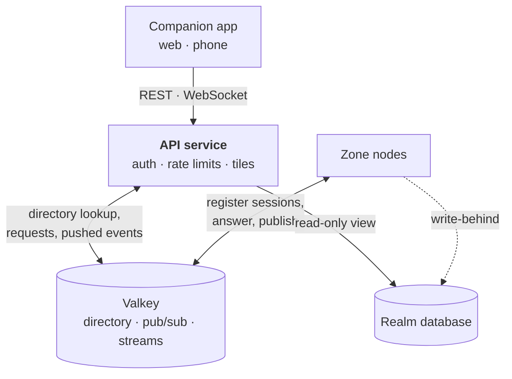



# Why a separate service

The companion app needs a REST API and a live channel for chat. Both could live inside zone-server. They should
not, for three reasons:

- **A web fault must not stop the game.** A crash, a slow client or an attack on the API then touches no tick.
- **There will be several zone nodes.** A web client cannot know which node holds its account. One service can
  look that up. If every node did it, the same code would run many times.
- **The zone loses its HTTP port.** It keeps only the management port on loopback (metrics and health). The map
  tiles and the kick endpoint leave. The zone then talks to game clients, to the bus and to its database.

This service is not the [gateway role](/docs/server/spatial-cells#the-gateway-role). That role owns the game
socket. The API service owns HTTP and WebSocket for the app. They share no process.

# Shape

The directory and the bus are one Valkey deployment. The cluster design plans the same two parts
([Path to a Cluster](/docs/server/cluster-path)), so the API service is a second client of them, not a second
system.

# Five kinds of call

| Kind           | Example                                   | Path                                                                                       |
| -------------- | ----------------------------------------- | ------------------------------------------------------------------------------------------ |
| Static data    | Item and bestia catalogues                | Served by the API service. No zone is asked.                                               |
| Map tiles      | The map window                            | Rendered by the API service. No zone is asked. See [Map tiles](#map-tiles).                |
| Persisted data | The post, crafts and auctions of a Master | Read from the realm database.                                                              |
| Live data      | Position, who is online                   | A request to the node of the account, with a timeout. See [Which zone](#which-zone).       |
| Writes         | An order to buy grain                     | An instruction, answered at once. See [Writes are instructions](#writes-are-instructions). |

Most companion app reads are for a Master who is logged off. Their data is in the database, so most calls never
reach a zone.

# Which zone

The API service does not choose a zone per request. It looks the account up.

1. It reads the account's entry in the session directory. The cluster design already has this directory. It maps
   an account to its gateway node and to the node that owns its master
   ([gateway role](/docs/server/spatial-cells#the-gateway-role)).
2. The gateway role receives every message addressed to that account. So the request goes to the request channel
   of that node.
3. The request carries a correlation id, the reply channel of the calling API instance and a timeout. The zone
   answers on that channel. The API service then completes the waiting HTTP call, or answers `504` when the
   timeout runs out.
4. If there is no entry, the account is not connected. The API service answers from the database.

An entry has a TTL, and the node renews it while the account is connected. A node that dies stops renewing, so
its accounts count as offline after the TTL.

A request about a place, not an account, goes to the node that owns the region. The region table stays in etcd
([Transport](/docs/server/spatial-cells#transport)).

Waiting costs little: on virtual threads, a blocked request holds no platform thread. A request that nobody
answers ends as a timeout, and the caller may retry a read.

# Live push

Chat is the first push. A zone publishes a line to a channel, for example `chat:guild:{id}`. It does not know or
care whether a web client is listening. Every API instance subscribes and forwards the line to its WebSocket
sessions. The other direction is the same path reversed: the API service publishes, and the zones deliver the
line to the in-game clients of that guild.

Rules for this path:

- **The client never names a channel.** After the sign-in, the API service derives the channels from the
  account's memberships (guild, party, whispers) and subscribes for that session. A user cannot ask for the
  guild chat of someone else.
- **The gates stay on the game side.** A chat line from the app passes the same check as one from the client.
  [Basic Skill](/docs/mechanics/master/#skill-basic-skill) Lv. 2 for chat and Lv. 5 for parties hold. The API
  service does not copy the rule.
- **Pub/sub can lose a message.** A client that was away misses lines. History is stored in the database, and a
  reconnecting client asks for what it missed.
- **Guild and party chat do not exist in the zone yet.** Public and whisper chat work in one process today.

# Writes are instructions

The [Companion App](/docs/mechanics/companion-app/#five-rules-that-keep-it-honest) never acts directly. It writes
an instruction. The instruction travels at courier pace, is carried out on arrival, and the answer comes back the
same way. So a write is not a request that waits for a reply.

1. The API service checks the instruction and stores it with an idempotency key from the client.
2. It answers `202 Accepted` with the instruction id.
3. The world picks the instruction up when it is due. The result arrives as a push and in the ledger.

A stream with a consumer group and acknowledgements carries the instruction to the nodes. Delivery is
at-least-once, so a node treats a repeated instruction id as already done. Where the instruction is kept safe
is an [open problem](#open-problems).

# Map tiles

The map API moves out of the zone with the REST API. It can, because a tile needs only two inputs, and neither
needs a live zone:

- **The world.** `MapTileService` reads the generated world and does not touch the ECS. The API service needs the
  `worldgen` module and the world store. Terrain edits must first be in a shared durable store, which the
  [cluster path](/docs/server/cluster-path#order-of-work) needs anyway.
- **The charts a Master holds.** A partly charted tile depends on which ground the asker has surveyed, and a chart
  is an item in the inventory. The API service therefore needs the chart coverage of the account.

For the coverage, start with a read-only database view that holds only the chart items, inside one realm. This
is a deliberate exception to "no shared database between servers": the API service reads, and never writes. The
zone already raises a `ChartsChangedEvent` when charts change. Published on the bus, it can feed a read model
later, and the view can go.

A fully charted tile is the same bytes for everyone, so it can stay `public` and `immutable` and sit behind a
CDN. The bounded render pool moves with the code, so a burst of tile requests cannot become a burst of renders.

# Stores and technology

| Job                                                           | Store                                                                   |
| ------------------------------------------------------------- | ----------------------------------------------------------------------- |
| Session directory, account to node                            | Valkey. TTL keys, renewed by the node.                                  |
| Live requests and replies                                     | Valkey pub/sub. A small helper maps a correlation id to a waiting call. |
| Chat and other pushes                                         | Valkey pub/sub                                                          |
| Instructions, kicks and bans, trade escrow and economy events | Valkey Streams with consumer groups and acknowledgements                |
| Region table and node ids                                     | etcd, as in [Spatial Cells](/docs/server/spatial-cells#transport)       |

**Why Valkey and no broker.** The directory needs a key-value store with TTLs, and that store can also carry the
messages. The rate is low. One system is less to run, secure and keep available than two. The code talks to two
small interfaces, `Directory` and `NodeBus` in `shared`, so the transport can change. A broker such as RabbitMQ
becomes the better choice if the stream code grows, or if the web side wants Spring's STOMP relay for browsers.

**What must not use pub/sub.** Pub/sub drops a message when the listener is away. A lost kick leaves a banned
player connected. Kicks, bans, instructions and escrow use streams.

**The kick moves first.** Today the login server posts the kick over HTTP to every zone, because it cannot see
where the player is. With the directory, one stream entry for the account's node replaces that call. It removes
the internal HTTP endpoint of the zone and the zone list of the login server, and it is the first real use of the
bus.

**Sign-in and access.** The app signs in with a passkey, like the client. The login server issues a token with an
audience of its own for the API service, and no existing token can stand in for it
([Authentication](/docs/server/authentication)). Each service gets its own Valkey user (ACL), limited to the
channels and streams it needs.

# Keeping the game safe

The API service must never be a way to slow the game down.

- **The tick never waits for Valkey.** The zone publishes through a bounded outbox on another thread. A full outbox
  drops pushes and fails stream writes loudly.
- **A bus request never touches the world on the listener thread.** It goes through the inbox of the account, and
  the rules of [Threads and the Tick](/docs/server/threading) apply: take a short lease, return values and not
  components.
- **The API service limits itself.** It has a rate limit per account, a circuit breaker towards the zones and a
  cap on requests in flight per node.
- **If Valkey is down, one node plays on.** Nothing in the game of a single node depends on it. With cells, the
  directory also routes game messages between nodes, so its loss then hurts the game. That is why it needs
  failover.

# Availability

Valkey has the same failover system as Redis, called **Sentinel**. It gives high availability and does not shard
data. The directory is small, so sharding is not needed.

- Run one primary, one or two replicas and three Sentinel processes. When a majority of the Sentinels agree that
  the primary is down, they elect a leader. The leader promotes a replica, repoints the others and tells the
  clients the new address.
- Replication is asynchronous, so a failover can lose the newest writes. Nodes re-register their sessions on the
  next heartbeat, so the directory heals itself. Anything that must never be lost must not live only here.
- Development needs a single instance. Add Sentinel before production.

# Licence

The stack keeps to open source licences. That rules out Redis 7.4 to 7.8, which is released under RSALv2 and
SSPLv1. Neither is an open source licence. Redis 8 added AGPLv3 as a third option, which is open source, but it
is copyleft with a network clause.

**Valkey** is a fork of Redis 7.2.4 under BSD-3-Clause, run by the Linux Foundation. It has no terms to track,
and it is the choice here. Everything this page uses is part of the Redis 7.2 baseline: TTL keys, `SET NX PX`,
`INCR`, Lua, pub/sub and streams. The Lettuce client of Spring Data Redis should connect to it unchanged. A test
against Valkey must show that before the design relies on it.

See the [Redis licences](https://redis.io/legal/licenses/) and the
[history of Valkey](https://valkey.io/topics/history/).

# Order of work

Each step can ship on its own.

1. Run Valkey in development. Add `Directory` and `NodeBus` to `shared`, with a Valkey implementation.
2. Move the kick from HTTP to a stream. Remove the internal endpoint of the zone.
3. Build the API service with the static data and the map tiles. Move `MapTileController` out of the zone.
4. Add reads of persisted data from the read-only view.
5. Add live reads over the bus, once the directory exists.
6. Add chat push, once guild and party chat exist in the zone.
7. Add instructions.

# Open problems

- **Where an instruction is kept safe.** A stream is simple, but a failover can lose the newest entries, and an
  instruction that moves gold must not vanish after a `202`. Two ways: a table in the database of the API
  service with the stream as the wake-up, or a stream with persistence that waits for its replicas.
- **The session epoch after a failover.** The epoch lives in the directory. After a failover it can count back,
  and a stale gateway could pass the check. It may be seeded from the clock, or kept in the database.
- **Chart coverage.** The read-only view is the cheap start. The event-fed read model is cleaner and costs more.
- **The weight of `worldgen` in the API service.** Rendering tiles needs the world. How large that dependency is,
  and how long it takes to start, is not measured.
- **Notifications while the app is closed.** A WebSocket lives only while the app is open. A finished craft or
  egg needs a mobile push provider. The [Companion App](/docs/mechanics/companion-app/#limits) page leaves the
  budget for notifications open, and this page does not cover them.
