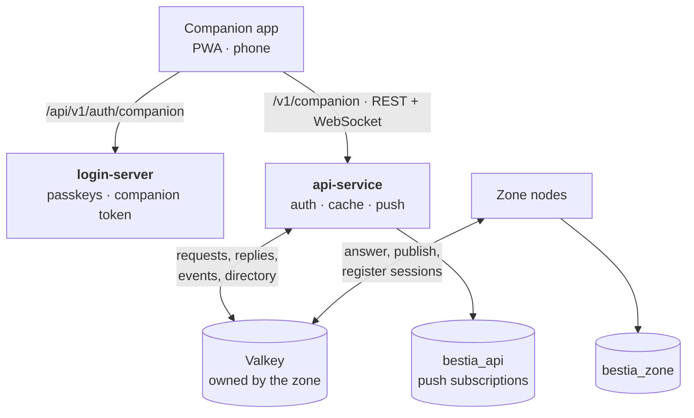

The [Companion App](/docs/mechanics/companion-app/) talks to one service: `api-service`, a Spring Boot module of its
own next to `login-server` and `zone-server`. It serves a REST API (JSON) and a WebSocket, and it never touches the
game's database. Every question about the world goes to the zone over a message bus, and the zone answers it.



# Why a separate service

- **A web fault must not stop the game.** A crash, a slow phone or an attack on the API touches no tick.
- **There will be several zone nodes.** One service looks up which node holds an account; the nodes do not each
  run the same web code.
- **The game owns its data.** The api-service has no read access to the zone's tables. A web tier that reads a
  game's tables breaks quietly with every update of the game, so it asks instead, and the zone answers from its
  repositories and its live world.

This service is not the [gateway role](/docs/server/spatial-cells#the-gateway-role). That role owns the game
socket. The api-service owns HTTP and WebSocket for the app. They share no process.

# Shape

A reverse proxy puts the app, `/api/v1/auth/companion` (login-server) and `/v1/companion` (api-service) on one
origin, so nothing is cross-origin and the refresh cookie is first-party. The dev server of `companion-app/`
plays that proxy on `localhost:5173`.

Every API path starts with its version: `/v1/companion/...`.

# The bus

Valkey belongs to the zone: `zone-server/compose.yaml` runs it, and `zone-server/valkey/users.acl` gives each
service a user that reaches only its own keys and channels. A cluster of zone nodes needs it anyway; the
api-service is one of its clients. The contract both sides speak lives in the `bus` module: Kotlin classes for
every request, answer and event, serialized as JSON, with a map tile's PNG framed beside the JSON rather than in
base64.

| What                  | Valkey                                        | Written by  | Read by                       |
| --------------------- | --------------------------------------------- | ----------- | ----------------------------- |
| Who is in the world   | `dir:account:{id}`, a key with a 30 s TTL     | zone        | api-service                   |
| Questions             | pub/sub channel `zone:{node}:requests`        | api-service | that zone node                |
| Answers               | pub/sub channel `api:{instance}:replies`      | zone        | the asking api-service        |
| Events                | stream `events`, the newest 10 000 kept       | zone        | api-service, twice (see below) |
| Writes already done   | `bus:idem:{account}:{key}`, 10 minutes        | zone        | zone                          |

**The tick never waits for Valkey.** The zone appends events from a bounded outbox on its own thread; a full
outbox drops and counts. Requests are answered on virtual threads, at most 64 at a time per node; one more is
answered "busy" at once rather than queued.

# A question to the zone

1. The api-service looks the account up in the directory. No entry means the account is not in the world, and
   the question goes to the realm's default node (one node today).
2. It publishes `{correlationId, replyTo, deadline, accountId, idempotencyKey?, query}`. The account is the one
   the api-service authenticated; nothing in the query can name another.
3. The zone checks every master in the query against `master.account_id`. Absent and not yours read the same:
   `NOT_FOUND`.
4. It answers on `replyTo`. A question nobody listens to fails at once (`503`); one with no answer in five
   seconds is a `504`.

| Reply          | HTTP                    |
| -------------- | ----------------------- |
| `OK`           | 200                     |
| `NOT_MODIFIED` | 304                     |
| `NOT_FOUND`    | 404                     |
| `INVALID`      | 400                     |
| `BUSY`         | 503 with `Retry-After`  |

A Master being played is read where it stands in the world; any other from its row, with the time of its last
save as `asOf`. Bestia stay in the world when their Master leaves, so they are mostly read live.

# Writes

A write carries an `Idempotency-Key`. The zone stores its reply under that key for ten minutes, and a repeat gets
the same reply without running again, so an app can safely resend after a `504`.

The one write today is a Bestia's standing order. It takes effect at once, as in the game: the zone stores it and
rebuilds the creature's agent, through the same service the game's own handler uses, in the account's inbox so
it is ordered with whatever the game client sends at the same moment.

# Events

The zone appends to the `events` stream:

| Event            | When                                                                 |
| ---------------- | -------------------------------------------------------------------- |
| `HomeFell`       | A Master's home town fell and it was given a new one                  |
| `BestiaDiedAway` | An owned Bestia died while nobody played its Master                   |
| `ConstructionDone` | A player's construction site became a structure                     |
| `StanceChanged`  | A Bestia was given a new standing order, from the game or the app     |
| `Presence`       | An account entered or left the world (from the directory heartbeat)  |
| `ChartsChanged`  | What a Master can see of the map may have changed                     |

The api-service reads the stream twice:

- **Every instance follows it** and sends each event to the account's open sockets, and drops the account's
  cached answers. A socket that reconnects sends the last event id it saw and gets what it missed, as far as the
  stream still holds.
- **One consumer group, `webpush`,** turns events into notifications for accounts that are not in the world and
  have no socket open. An event is acknowledged once handled, so each is notified once however many instances
  run.

# The WebSocket

`/v1/companion/ws`. A browser cannot put a header on a WebSocket handshake, so the first frame authenticates:
`{"type":"auth","token":...,"lastEventId":...}`. The app never names what it wants to hear; it hears its own
account's events. A socket lives as long as its token and is then closed with code 4001, and the app reconnects
with a fresh token.

# Push notifications

Web Push, with the payload encrypted to the browser's keys (RFC 8291) and the sender proven by VAPID (RFC 8292),
both in the api-service itself on the JDK's own cryptography. Subscriptions and preferences are the only data the
api-service stores, in `bestia_api`.

- A subscription may only point at a known push service (FCM, Mozilla, Apple, Windows). It is a URL this service
  will POST to, so without that list any player could aim it at an internal address.
- Each account chooses its categories and quiet hours, in its own time zone.
- At most six notifications an hour per account; the rest of the hour's events are dropped.
- A push service that answers 404 or 410 has forgotten the subscription, and it is deleted.

On iPhone and iPad a web app receives notifications only once it is on the Home Screen. The app says so.

# The map

The map is asked of the zone, because the world is not static: the zone renders tiles from the live world and the
Master's charts, with the same rules as the game client's map. A fully charted tile is the same bytes for everyone
and immutable; a partly charted one revalidates against an ETag that carries the coverage digest; a 404 is ground
the Master has not charted.

The api-service keeps tile bytes by ETag. A repeat request goes to the zone as a conditional one, and a 304 from
the zone is enough to answer from the cache, so a PNG crosses the bus once. A `ChartsChanged` event drops the
Master's cached ETags.

The game client still fetches its own tiles from the zone's HTTP port. Moving it onto the api-service is the next
step, and then the zone's HTTP port is left with the internal kick only.

# Sign-in

The companion app signs in like the game: PKCE, the login server's own passkey page, a single-use code. See
[Authentication](/docs/server/authentication#the-companion-app). What comes out is a companion token, audience
`companion`, signed with a key of its own (`jwt.companion-secret`) that only the login server and the api-service
hold. The api-service therefore cannot mint a zone token.

# Stores and ports

| Service     | HTTP | Database                 | Valkey user |
| ----------- | ---- | ------------------------ | ----------- |
| login-server | 8080 | `bestia_login`, 3307    | none        |
| zone-server | 8091 | `bestia_zone`, 3306      | `zone`      |
| api-service | 8095 | `bestia_api`, 3308       | `api`       |
| Valkey      | 6379 | from `zone-server/compose.yaml` | |

The api-service needs the zone's Valkey, so in development the zone starts first.

# Availability

Valkey has the same failover as Redis, **Sentinel**: one primary, one or two replicas and three Sentinels. When a
majority agree the primary is down, they promote a replica. Replication is asynchronous, so a failover can lose the
newest writes: directory entries heal on the next heartbeat, a lost question times out, and a lost write is safe
to resend because of its idempotency key. Development runs a single instance.

# Licence

The stack keeps to open source licences. That rules out Redis 7.4 to 7.8 (RSALv2 and SSPLv1). Redis 8 added AGPLv3,
which is open source but copyleft with a network clause. **Valkey** is the fork of Redis 7.2.4 under BSD-3-Clause,
run by the Linux Foundation, and everything the bus uses - TTL keys, pub/sub, streams, consumer groups, ACL users -
is part of that baseline. Lettuce talks to it unchanged.

See the [Redis licences](https://redis.io/legal/licenses/) and the [history of Valkey](https://valkey.io/topics/history/).

# Next

1. Serve the game client's map through the api-service and take the tile port off the zone.
2. Move the kick from HTTP to the bus, which removes the zone's last HTTP endpoint.
3. Chat over the socket, once guild and party chat exist in the zone.
4. A read model fed by the events, if questions to the zone ever grow heavy.

# Open problems

- **Notifications across instances.** Whether an account has a socket open is known per instance, so with several
  api-service instances an account connected to another one can still be notified.
- **A refresh lost in flight.** Refresh tokens rotate on every use and a spent one ends the session. An app killed
  between the server's rotation and storing the new cookie is signed out and signs in again with its passkey.
- **The session epoch after a failover.** The epoch of the cluster design lives in the directory, and a failover
  can count it back.
