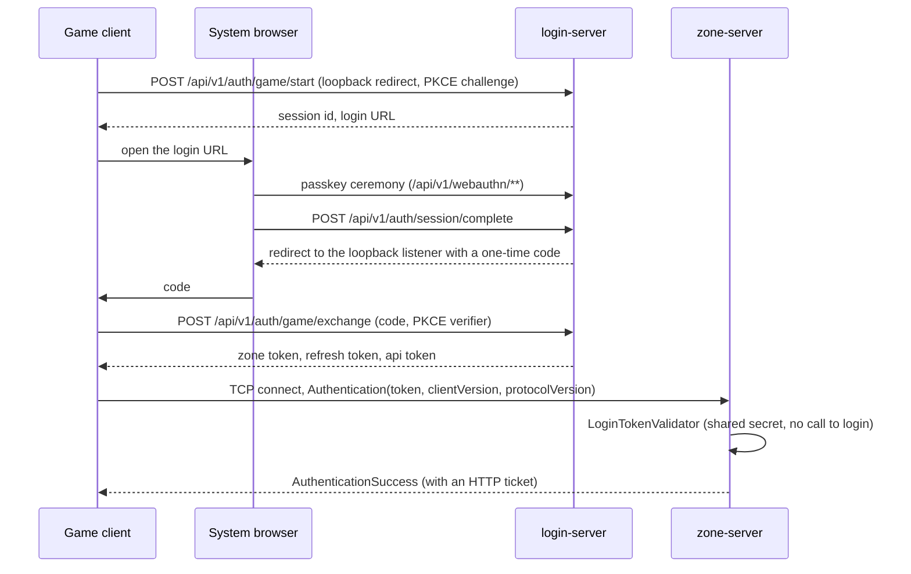

`login-server` and `zone-server` share no database and no service discovery. A login is trusted through a signed
JWT that the client carries from one to the other, and the zone checks it without asking the login server. The one
message between the servers goes from login to zone over the zone's Valkey, to kick an account: see
[Kicking an account](#kicking-an-account).

# Signing in: a passkey in the system browser

Passkeys (WebAuthn) are the only way to sign in, and the game client never touches them. It starts a login session,
opens the returned URL with the operating system's browser, and waits on a loopback listener for the code that
comes back. Everything WebAuthn needs is the browser's problem: there is no native passkey code on any platform and
no custom URI scheme, which RFC 8252 advises against and Safari and Firefox refuse anyway.

| Endpoint                                      | Called by | Purpose                                                                       |
| --------------------------------------------- | --------- | ----------------------------------------------------------------------------- |
| `POST /api/v1/auth/game/start`                | game      | Opens a login session: loopback `redirect_uri`, PKCE challenge, state nonce    |
| `GET /game-login`                             | browser   | The login page the game opens                                                  |
| `POST /api/v1/webauthn/assert/{options,verify}`    | browser   | Signs in with an existing passkey                                         |
| `POST /api/v1/webauthn/register/{options,verify}`  | browser   | Creates an account and its first passkey; answers its recovery codes      |
| `POST /api/v1/webauthn/credentials/{options,verify}` | browser | Adds another passkey to the account that just signed in                   |
| `POST /api/v1/webauthn/recover/options`       | browser   | Redeems a recovery code and starts the ceremony for a replacement passkey     |
| `POST /api/v1/auth/session/complete`          | browser   | Mints the one-time code once the player is ready to return to the game        |
| `POST /api/v1/auth/game/exchange`             | game      | Trades the code and the PKCE verifier for tokens                              |
| `POST /api/v1/auth/game/refresh`              | game      | Trades a refresh token for new tokens, without the browser                    |
| `POST /api/v1/auth/game/revoke`               | game      | Signs this client out: ends the chain its refresh token belongs to            |

The client is untrusted throughout. It chooses the redirect target, which must be a loopback literal
(`RedirectUriValidator`), the PKCE challenge, which it must later open, and the state nonce, which is only echoed
back. Nothing it sends decides which account signs in.

**The browser half** (`BrowserLoginService`) is bound to the browser that opens the link first, by a cookie the
login server mints itself and never takes from the request, so a cookie planted in someone else's browser cannot
claim their login. A login method checks the session before its ceremony and hands the account it proved to
`BrowserLoginService.authenticate` afterwards; binding, account checks and the code stay shared, so a new method
only has to prove an account. A login session lives `game-login.session-ttl-seconds` (300).

**The code** is minted by `/api/v1/auth/session/complete`, not at the end of the ceremony: it lives
`game-login.authorization-code-ttl-seconds` (60), and the page in between may still show recovery codes to write
down or offer a second passkey. One ceremony gives one code, and a code is redeemed once.

**Accounts and passkeys.** An account may hold any number of passkeys. They are joined to it by one WebAuthn user
handle, which is why a synced passkey made on one machine signs into the same account on another: the server has
no idea of a device. A new account gets `game-login.recovery-code-count` (10) recovery codes, shown once: six
groups of four characters from an alphabet without I, L, O and U, 120 bits each. Redeeming one signs nobody in. It
opens a ceremony for a replacement passkey, and the account is reachable again only once that passkey exists, so a
leaked code is worth nothing without a real authenticator.

The sign-in endpoints are rate limited per client address (`RateLimiter`), behind the TLS proxy by the forwarded
address, which Tomcat takes from `X-Forwarded-For` only when the proxy sent it.

# Tokens

Four tokens, each with an audience that is matched exactly, so none stands in for another. All but the companion
token are signed with `jwt.secret`, which the zone holds as `zone.jwt-auth-secret-key`.

| Token           | Audience       | Lifetime                                | Used for                                                     |
| --------------- | -------------- | --------------------------------------- | ------------------------------------------------------------ |
| zone token      | `zone`         | `jwt.login-token-minutes` (2)           | the socket handshake, once (`jti`)                           |
| refresh token   | none: opaque, stored as a digest | `game-login.refresh-token-days` (30), sliding | `/refresh`, rotated on every use            |
| api token       | `login-api`    | `jwt.api-token-minutes` (15)            | the game client's calls to `/api/v1/admin/**`                |
| companion token | `companion`    | `jwt.companion-token-minutes` (15)      | the companion app's calls to the [API Service](/docs/server/api-service/), signed with `jwt.companion-secret` |

The zone token only has to survive the walk from the login server to the socket: the socket checks it once at the
handshake, and the game's HTTP calls carry the session's own ticket (below). The api token names an account and
nothing else; what the account may do is read from the database on every call, so a ban or a demotion applies at
once.

## Refresh: rotation and replay

`/refresh` spends the presented token and returns a successor with a full lifetime, so a player who keeps playing
is never sent back to the passkey ceremony (`RefreshTokenService`). The bound on a stolen token is not its age but
the replay check: as soon as the real client refreshes, one of the two presents a spent token. Which of them is the
thief cannot be known, so the whole chain (the token's family) is revoked and both sign in again.

Because nothing of the ceremony is repeated, `LoginGrants.refresh` re-examines what could have changed since: the
token may have been revoked and the account may have been banned. A banned account presenting a refresh token ends
all its sessions, as a ban does. A refused grant tells the client only `INVALID_GRANT`; whether the token was
unknown, expired or spent stays in the log.

# zone-server: checking the token on its own

The zone never contacts the login server. On a connection's first message,
`ClientMessageHandler.authenticateChannel` runs these checks in order:

1. **Protocol version.** The message's `protocol_version` must equal `ProtocolVersion.PROTOCOL_VERSION_CURRENT` in
   `authentication.proto`, the one value both sides compile against. Any other version, including a client built
   before the field existed (which sends 0), is refused with `PROTOCOL_MISMATCH` and the client shows "client
   outdated". Nothing is released yet, so it stays put while the game is in development: messages change in
   place, and the version is raised only after the first release.
2. **The token.** `LoginTokenValidator` checks the signature, issuer `login` and audience exactly `zone`, and takes
   the account from the subject and the role from its claim. A token is accepted once, by its `jti`
   (`SingleUseTokenIds`). `KickedAccounts` refuses a token issued before the account's last kick.
3. **Readiness.** A login that arrives before world generation and the entity reload have finished is refused with
   `SERVER_NOT_READY` (`ZoneReadinessService`), not let into a half-loaded world.

On success the channel is registered in `ChannelRegistry` by account, and `AuthenticationSuccess` carries an HTTP
ticket (`HttpTicketService`): an opaque value bound to this socket and forgotten when it closes, which the game
sends as `Authorization: Ticket <ticket>` when it fetches its map from the
[API Service](/docs/server/api-service/). An `AccountConnectedEvent` registers the account's authorities in
`ConnectionInfoService`. No game entity is spawned yet: that happens once the client sends `SelectMasterCMSG`. See
[Networking](/docs/server/networking) for what happens to messages after this.

`Role` and `Authority` (`shared/.../account/`) are the one piece of account code both servers share. Everything else
about an account is kept apart: each server has its own `Account` entity, linked only by the account id.

# Bans, recovery and GM actions

`AccountLoginGuard` decides whether an account may have tokens at all: an active account may, a permanently banned
one may not, and one banned until a date may not before that date. It is checked for every login method and every
refresh.

`AccountSessionTerminator` ends every way into an account that does not need a new passkey ceremony: its refresh
tokens, a browser login that already passed its ceremony, a code waiting to be exchanged, and an unfinished passkey
enrolment. It runs on

- an **account recovery** (`KickReason.RECOVERED`): the owner lost their passkeys, so whoever is still signed in may
  hold a stolen one;
- a **ban** (`BANNED`), by a GM or found on refresh;
- a **GM kick** (`GM_KICK`): the player may sign in again.

and then kicks the account from the zones.

A GM acts from the game client: `POST /api/v1/admin/accounts/{id}/kick` or `.../ban` with the api token (a ban
takes a note and a duration in hours, none for good). `GmActionService` reads the actor from the database on every
call, needs the action's `Authority`, needs the actor to outrank the target (`Role.outranks`), checks the actor
before looking up the target so nobody without the authority can probe for ids, and writes a `gm_action` row.

# Kicking an account

Once the termination has been committed, `ZoneKickListener` appends a `KickOrder` (account, reason, kick time) to
the `kicks` stream in the zone's Valkey. After the commit, because a kick the database then rolled back would leave
the player kicked with their tokens still valid. The login server connects as the Valkey user `login`, which may
append to that stream and do nothing else (`zone-server/valkey/users.acl`), and waits at most
`bus.command-timeout-millis` (2 s) inside the request that caused the kick. It is best effort: when Valkey cannot
take the order, it is logged and lost, and the player keeps playing until they disconnect, but cannot sign in
again, because their tokens are already gone.

Every zone node reads the stream in a consumer group of its own, `kicks-<node id>`, because the login server cannot
see which node a player is on and every node has to see every kick. A node that was down works through the orders
appended meanwhile. `KickOrderListener` then:

- remembers the kick in `KickedAccounts` for `zone.kick-memory-seconds` (300, longer than a zone token lives), even
  when the account does not play here: it may be on its way with a token issued before the kick. The kick time is
  the login server's, as a token's issue time is, so the two compare on one clock.
- closes the account's connection (`ConnectionTerminator`), with the reason. Only for a kick made after the node
  started: an older one is being read on catching up, and any connection here is younger, so it belongs to a player
  who signed in again.

# The companion app

The [Companion App](/docs/mechanics/companion-app/) signs in through the same passkey page as the game, under
`/api/v1/auth/companion/{start,exchange,refresh,logout}`. Every login session and every refresh token records which
client it is for, `GAME` or `COMPANION` (`login_session.client`, `refresh_token.client`), and a grant is refused for
the other client: a companion code cannot be exchanged for a zone token, and a game refresh token cannot open a
companion session.

| Step     | Game                                        | Companion app                                                   |
| -------- | ------------------------------------------- | --------------------------------------------------------------- |
| Redirect | a loopback literal (`RedirectUriValidator`) | exactly one of `companion-login.redirect-uris`                  |
| Token    | zone token, `jwt.secret`                    | companion token, audience `companion`, `jwt.companion-secret`   |
| Refresh  | the client stores the refresh token         | an httpOnly, SameSite=Strict cookie on `/api/v1/auth/companion` |

The companion token is checked by the [API Service](/docs/server/api-service/), which holds the companion key and
not the zone's, so it cannot mint a zone token. The app keeps its access token in memory only, and refreshes in one
tab at a time (the Web Locks API), because two tabs presenting the same cookie would look like a stolen copy and
end the session.

`LoginGrants` holds the checks both clients share: claiming the code, PKCE, the account, bans.

# Deployment guard

`LoginDeploymentGuard` refuses to boot outside the `dev` and `test` profiles with settings that are only safe on a
developer's machine: a sign-up role above `USER`, the committed `jwt.secret` or one shorter than 32 bytes, relaxed
WebAuthn origin ports, the committed Valkey password, and, with companion login on, a companion key that is the
committed one, shorter than 32 bytes or the same as `jwt.secret`. A server started without a profile runs as `dev`.

# Known gaps

- The zone token is signed with a secret both servers hold. It is meant to move to a key pair, the login server
  signing and the zones only verifying, before production.
- Rate limits and `KickedAccounts` are kept per process, so a second login server or zone node keeps its own.
- A kick that Valkey cannot take is lost rather than retried (see above).
- `AuthenticationSuccess.permissions` is defined in the protobuf schema but never filled
  (`// TODO Send the available permissions to the client` in `ClientMessageHandler`).
