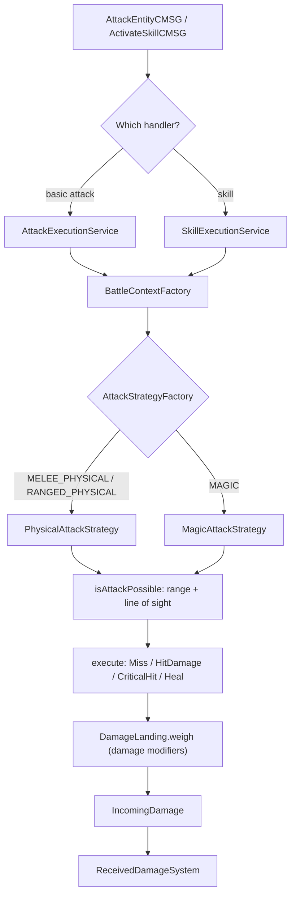

Every way to hurt something - a swing, a shot, a spell, a burning patch - ends the same way: the server works out
what the blow does, stages it on the target, and `ReceivedDamageSystem` drains it into health. The formulas follow
Ragnarok Online pre-renewal, with the player-facing numbers on [Status Values](/docs/mechanics/combat/statusvalues/).

# The flow



`BattleContextFactory` projects both sides out of the ECS into a `BattleContext`: attributes, derived stats, soft and
hard defence, element (an effect's override first, then the species'), size (masters are medium), the weapon in hand
with its `WeaponType`, and the attack. A skill script builds the same context and either asks a strategy (a physical
skill, through `SkillStrikes`) or computes its documented power and lands it through `ElementalSpell`.

# Physical attacks

`PhysicalAttackStrategy` serves melee and ranged alike; the calculator decides which attribute powers the blow.

1. **Hit roll.** `(HIT - FLEE) %`, clamped to 5..100. HIT starts 75 above FLEE, so equals land about three swings in
   four at any level. A wind ward (SHELTERED) turns every shot aside.
2. **Element heal.** If the element table has a negative entry for this element against the target's, the blow
   heals instead (see below) and nothing else applies.
3. **Critical.** `(CRIT + bonus - target CRIT / 5) %`, clamped to 1..95. A crit adds 40 % and skips both defences.
4. **Damage** (`BaseDamageCalculator`):

```
baseAtk = 2 * statusAtk * variance + weaponAtk * weaponVariance * sizeMod + ammoAtk + bonusAtk
baseAtk = max(1, baseAtk * elementWeight * (1 - resistance))
damage  = floor(baseAtk * atkMod * hardDefMod * critMod) - softDef      (at least 1)
```

`statusAtk` is ATK for melee and ranged ATK for a shot. `sizeMod` is the weapon-type against target-size table
(below) and weighs the weapon's attack only. `hardDefMod` is `(100 - hard DEF) / 100`; soft DEF is subtracted last, and
a shot meets more of it (VIT/2 + STR/6 on top).

# Magic attacks

`MagicAttackStrategy` never misses and never crits: FLEE, a wind ward and Pneuma do nothing to a spell, and size does
not weigh on it. Every spell lands through `ElementalSpell`, whatever computed its power:

```
damage = max(1, power * elementWeight * (1 - resistance) * (100 - hard MDEF) / 100 - soft MDEF)
```

A magic basic attack takes its power from MATK (`MagicDamageCalculator`); a script brings its own documented formula
(Master Bolt `MATK * (100 % + 20 %/lv)`, a bestia bolt's archetype). A defence-piercing spell skips both MDEF terms.

# Element heals

Twenty-four entries of the element table are negative: poison and shadow on the undead, holy on holy, each element on
its own higher levels. As in RO, such a hit **restores** the target by the entry's share of the damage instead of
hurting it. A physical hit still rolls to hit first; a spell always lands. An elemental spell's burning patch heals a
body its element restores the same way. The client shows it as a heal.

# Line of sight

Every ranged shot, every skill with `needsLineOfSight`, every target of an area spell and every jump of a chain bolt
asks `LineOfSightService`. It walks a 3D voxel ray (Amanatides & Woo) from the attacker's eyes (1.5 m) to the target's
chest (1 m) over the chunk's `SightMask`: one bit per voxel that is solid and at least half full, so the partly filled
surface voxel an entity stands in never blocks. A structure wall on a border the ray crosses blocks too.

It runs on every attack, so it is built to be cheap:

- Neighbouring tiles see each other without a walk, so a melee swing costs nothing.
- The mask is built with the chunk's walkable tile in the same `DerivedStore` job, mostly on chunk workers, and is
  replaced when the chunk is edited. An attack never builds one: a chunk without a mask yet counts as clear.
- The walk allocates nothing per step and fetches a chunk's mask once per chunk crossed; a twelve-tile shot reads
  about twenty bits. 32 KB per tracked chunk.

# Size

A weapon's attack is weighed against the target's body size, RO's pre-renewal table. Bare hands (and so every wild
mob's natural attack) hit all sizes alike; spells ignore size. The table is on
[Status Values](/docs/mechanics/combat/statusvalues/#size).

# Ammunition

A shot draws its ammunition from the quiver only once it is in range. The ammo's `attack` adds to the shot and its
`element` becomes the shot's. An ammo item's `script` names an `AmmoEffect` bean: `beforeHit` changes the roll
(`SharpArrow` adds crit chance), `onHit` acts on a hit (`PoisonArrow`, `StunArrow` roll their effect against the
target's resistance). The arrows are on [Ranged Combat](/docs/mechanics/combat/ranged-combat/#special-ammunition).

# Damage modifiers

After the formula, `DamageLanding.weigh` applies both sides' card-style modifiers (`DamageModifiers`, rAthena's
`battle_calc_cardfix`): bonuses against a kind, an element, a boss, the unholy, one marked target; reductions from a
kind, a boss, the unholy, a hit form (physical or magic), a reach (melee or ranged) and any hit. Within one category
they add, across categories they multiply: Iron Skin 15 % and Shield Wall 35 % are both physical reductions and make
50 %; Magic Armor 30 % is its own category, so the three together leave `0.5 * 0.7 = 35 %` of a sword.

# Natural armour

A bestia's body is armour of its own: `NaturalArmor` gives every species hard DEF and MDEF by kind and level (a dragon
3 / 2 percent per ten levels, an elemental 1 / 3, a beast 1 / 0), half again for a boss, at most 60 %. Mobs get it at
spawn and every status recalc adds it from `Nature`, so an owned bestia's hide grows as it levels. Worn armour adds on
top.

# Status effects

A separate, working system from damage. `StatusEffectService.applyEffect()` resolves a `StatusEffectDefinition`
(`status_effects.yml`) and its `StatusEffectScript`. It applies the effect to the `StatusEffects` ECS component and
flags the entity for a status-value recalc. This mirrors the skill-script pattern one level down; see
[Scripting](/docs/server/scripting) for the registry and boot validation both use. What each effect does is on the
[Status Effects](/docs/mechanics/combat/status-effects/) page.

A script changes status values in `apply()`, which runs on every recalc. For everything else it has hooks:

- **`onApply`** runs once when the effect lands, not on a refresh. STUN cancels a cast or a channel here.
- **`onRemove`** runs when the effect ends, with the `RemovalReason`. ENRAGED hands over to FATIGUE here.
- **`onDamageTaken`** returns how much of a hit reaches the bearer's health. BARRIER absorbs here, FROZEN breaks.
- **`onActed`** runs when the bearer walks a tile, attacks, casts or uses an item. BLEEDING hurts here, and HIDDEN and
  CLOAKED end.

Around the scripts:

- **`tryInflict`** in `StatusEffectService` is the entry point for a skill that only sometimes lands an effect. It
  checks `status-immunities`, rolls the chance against the target's resist and shortens the duration. See
  [Resist](/docs/mechanics/combat/status-effects/#resist).
- **`ActionGuard`** refuses a move, attack, cast or item request that an effect's `actionLocks` forbid (STUN, FROZEN,
  FEARED, ...). It is silent: the client already shows the effect.
- **`Healing`** is where every heal from a skill, an item or an effect meets health. SICK halves the heal there,
  and any heal ends BLEEDING. Natural regeneration does not go through it.
