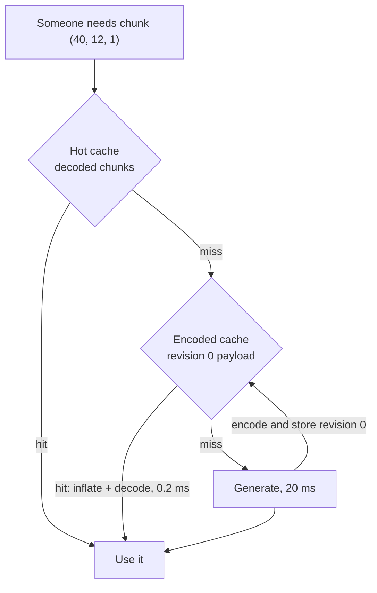

The world is cut into chunks. A chunk is 32 × 32 × 256 voxels, one slab of a column of terrain. The server
never stores a chunk's generated terrain for good: it can always make it again from the world seed (see
[World Generation](/docs/server/world-generation)). But making a chunk costs about 20 ms on the dev world,
and the tick has only 50 ms in total. So zone-server keeps chunks it has made in memory, in two caches.

This page explains how the two caches work together, with examples.

# Three forms of one chunk

A chunk exists in three forms. Each one is much smaller than the one before it.

| Form        | What it is                                      | One surface chunk | Used for                                      |
| ----------- | ----------------------------------------------- | ----------------- | --------------------------------------------- |
| Decoded     | 262 144 voxels, 2 bytes each (material, fill)   | 512 KB            | the server's own questions: walking, digging  |
| RLE encoded | runs of equal voxels: "200 × granite, 56 × air" | about 6 to 15 kB  | a step between the two others                 |
| Deflated    | the RLE bytes, compressed once more             | 100 B to a few kB | the network, and the cache behind the hot one |

A chunk that is all air or all rock is tiny in every encoded form: 13 bytes. Deflate would make it bigger, so
such a chunk stays plain RLE. Most of the world is chunks like that.

Turning one form into another has a cost. Measured on 242 surface chunks of a small test world:

| Step                    | Time per chunk                                        |
| ----------------------- | ----------------------------------------------------- |
| Generate from the world | about 20 ms on the dev world (1.7 ms on the test one) |
| RLE encode              | 0.5 ms                                                |
| RLE decode              | 0.2 ms                                                |
| Deflate (level 9)       | 0.06 ms                                               |
| Inflate                 | 0.01 ms                                               |
| Look it up in a cache   | a hash map lookup                                     |

So decoding a stored chunk is about a hundred times cheaper than generating it again. That is the whole
idea of this page.

# The two caches



**The hot cache** (`ChunkCache` in `worldgen`) holds decoded chunks. Reading one costs nothing, but each
takes half a megabyte, so it holds only `chunk-stream.hot-chunk-capacity` of them: 128 by default, about
64 MB. When it is full, it drops the chunk that nobody has read for the longest time.

**The encoded cache** (`EncodedChunkCache` in zone-server) holds the payloads the server sends to clients:
one per chunk and revision, deflated when that makes them smaller. It is bounded in bytes,
`chunk-stream.encoded-cache-size`, 64 MB by default. That is at least twenty thousand surface chunks, and far
more of the small ones. When it is full, it also drops the payload read longest ago.

**Generation** is the last resort. It is a pure function of the seed, the world settings and the chunk
position. The same chunk always comes out the same, so a cache can never hold a wrong chunk.

# Why one cache can do two jobs

A chunk's _revision_ goes up each time players change it. Revision 0 means nobody has touched it yet.
So the revision-0 payload is exactly the chunk as the generator made it: its _base_.

The base never changes while the world exists. Player edits do not change it either: an edit is stored as a
small delta on top of the base (see [Storage](/docs/server/world-generation#storage-voxels-chunks-player-edits-and-regeneration)).
That gives the revision-0 payload two readers:

- **The network** sends it to every client that asks for an untouched chunk.
- **The hot cache** decodes it when it has to rebuild a chunk it dropped.

Before this was the case, the two caches held the same bytes for different reasons, and a miss in the hot
cache always generated the chunk again. In one test run, with a hot cache of 32 chunks, 786 different
chunks were generated 2,229 times.

Because nothing in the encoded cache ever goes stale, nothing has to invalidate it. A payload is either the
right one or it was dropped to make room.

# A day in the life of a chunk

The examples follow one chunk, `(40, 12, 1)`, in a valley nobody has visited yet.

### Alice walks into the valley

1. The server tells Alice's client which chunks are around her, with their revisions. Her client has none of
   them, so it asks for all of them, `(40, 12, 1)` among them.
2. Neither cache has the chunk. The tick hands it to a chunk worker thread. The worker generates it (20 ms),
   encodes and deflates it, and hashes the base. None of this runs on the tick.
3. On a later tick the result comes back. The tick stores the payload as revision 0 in the encoded cache and
   the decoded chunk in the hot cache. Then it sends the payload to Alice.

### Bob arrives ten minutes later

Bob asks for the same chunk, still at revision 0. The encoded cache has it, so the tick sends the same bytes
at once. There is no worker job, no generation and no encoding. Thirty players walking into the valley cost
one generation between them.

### An NPC walks through an hour later

The NPC's pathfinding needs to know where the ground can be walked on. That needs decoded voxels. By now the
hot cache has dropped the chunk: only 128 fit, and many players were busy elsewhere.

The encoded cache still has revision 0. A worker inflates and decodes it: 0.2 ms instead of 20 ms.

### Carol digs a hole

1. Carol's pickaxe removes a few voxels. The chunk becomes revision 1. The removed voxels are a delta in
   `ChunkStore`, on top of the unchanged base.
2. Clients that already hold the chunk get a small patch with just the changed voxels, not the whole chunk.
3. A client that asks for the chunk from now on gets revision 1. The tick encodes it right away and stores it
   next to revision 0.
4. Revision 0 stays in the encoded cache. The network never sends it again, because a client always asks for
   the current revision. But it is still the correct base: the hot cache can rebuild from it, and the base
   hash that travels with revision 1 is read from it.

### The server restarts

Both caches live in memory only. After a restart, each chunk is generated again the first time somebody
needs it. Carol's hole is not lost: edits are saved in the `chunk_edit` table and laid on top of the
regenerated base at boot.

### The world is regenerated

When somebody retunes the generator, the world gets a new pipeline version, and on boot the old world is
thrown away (see the `world-versioning` skill in the code repository). The caches are empty after a restart
anyway, so no chunk of the old world can ever be served.

# What runs on the tick

The goal is that streaming terrain costs the tick almost nothing. This is where it stands:

| What happens                                            | Cost on the tick                          |
| ------------------------------------------------------- | ----------------------------------------- |
| A client asks for an untouched chunk that is cached     | one lookup                                |
| A client asks for an untouched chunk that is not cached | none: a worker makes it                   |
| A client asks for an edited chunk                       | merge the edits and encode, 0.6 ms+       |
| The chunk under a player's feet, not cached             | generate, about 20 ms, so nobody falls    |
| A server query, chunk in the hot cache                  | none                                      |
| A server query, chunk only in the encoded cache         | inflate and decode, about 0.2 ms          |
| A server query, chunk in no cache                       | generate, about 20 ms, plus 1 ms to store |

The last two rows are server queries such as a carve or a ground-height check. They need the answer in the
same tick, so they cannot wait for a worker. The walkable-tile builds that pathfinding uses are not in this
list: they already run on workers, and take the stored payload with them.

# Sizing the caches

Two settings in `chunk-stream`:

| Setting              | Default | Unit                    | Raise it when                                    |
| -------------------- | ------- | ----------------------- | ------------------------------------------------ |
| `hot-chunk-capacity` | 128     | chunks, 512 KB each     | server queries often read from the encoded cache |
| `encoded-cache-size` | 64MB    | bytes, as `64MB`, `1GB` | chunks are often generated a second time         |

An example for the encoded cache. One player's view is 121 chunks. A hundred players in a hundred different
places need about 12,100 chunks. Even if every one of them were a large 3 kB surface chunk, that is 36 MB, so
64 MB holds them all. Each entry also counts 160 bytes for the map entry around it, because most payloads
are smaller than that.

# Watching the caches

The zone exports these meters (see [Metrics and Logs](/docs/server/observability)):

| Prometheus series                                      | What it says                                           |
| ------------------------------------------------------ | ------------------------------------------------------ |
| `zone_chunk_base_lookups_total{source="hot"}`          | base chunks read from the hot cache                    |
| `zone_chunk_base_lookups_total{source="stored"}`       | ... decoded from the encoded cache                     |
| `zone_chunk_base_lookups_total{source="generated"}`    | ... that no cache had, so they were generated          |
| `zone_chunk_cached{cache="hot"}` / `{cache="encoded"}` | how many chunks or payloads each cache holds right now |
| `zone_chunk_encoded_size_bytes`                        | heap the encoded cache takes, against its size         |
| `zone_chunk_encoded_evictions_total`                   | payloads dropped to make room                          |
| `zone_chunk_encoded_cache_total{result="hit"\|"miss"}` | wire lookups at a chunk's current revision             |

Share of base reads that had to generate:

```promql
sum(rate(zone_chunk_base_lookups_total{source="generated"}[5m]))
  / sum(rate(zone_chunk_base_lookups_total[5m]))
```

A world that players keep exploring always generates some chunks: nobody has been there before. A warning
sign is generation going up together with evictions. Then chunks are dropped and made again, and the
encoded cache is too small.

# Not done yet

- **A disk cache.** Chunks could survive a restart in a file store on the zone's disk. The worldgen side
  is ready for it: `ChunkCache` can chain more blob stores, and its keys already include the seed and
  pipeline version, so a stored chunk can never belong to the wrong world. It needs a file store in
  zone-server that never writes on the tick.
- **Server queries off the tick.** The last two rows of the tick table still decode or generate on the tick.
- **Client-side generation.** The client could generate a base itself and receive only the edits. The wire
  format allows it, but it is not turned on (see
  [Chunk materialization and streaming](/docs/server/world-generation#chunk-materialization-and-streaming)).

# Where the code is

- `zone-server/.../world/stream/ChunkService.kt`: `loadBase` (what the hot cache calls on a miss),
  `storeBase`, `readyDataMessage` (the wire path with workers), `buildDerivedOnWorker` (walkable tiles).
- `zone-server/.../world/stream/EncodedChunkCache.kt`: the encoded cache.
- `worldgen/.../store/ChunkCache.kt`: the hot cache.
