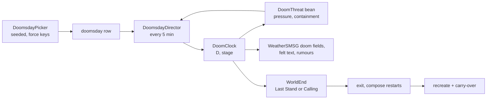



The doomsday sits on top of the [World Events](/docs/server/world-events/) work. The mana field, provinces, the
director, rifts, seals, rumours and Observation all exist. The doomsday adds four things:

- a **doom clock** that is chosen with the world and runs in real time,
- **threats** as Spring beans, one per kind,
- a **world end** that records the outcome and restarts the zone,
- a **rebirth** that generates the next world and applies the carry-over.



# Doom Clock

## Choosing the Threat

`DoomsdayPicker` runs once per world, on the first boot that finds no `doomsday` row. It does not touch the worldgen
pipeline, so no stage or `pipelineVersion` changes. It reads the generated world:

- Every `DoomThreat` bean answers `fits(world)` and `origin(world)`.
- The pick is weighted and seeded from the world seed, so a regenerated world with the same seed picks the same.
- `doomsday.force-kind`, `doomsday.force-foreshadow` and `doomsday.force-origin` override the pick for alpha tests.
  A forced kind whose `fits` is false is logged and replaced by a seeded pick.

The picker also rolls the times. All are real days, all are config:

| Value         | Default                                                          |
| ------------- | ---------------------------------------------------------------- |
| Onset         | `onset-min-days` 180 + rand(0..`onset-spread-days` 90)           |
| Unfold `U`    | rand(`unfold-min-days` 180 .. `unfold-max-days` 365)             |
| Life span `L` | onset + U                                                        |
| Foreshadowing | rand(`foreshadow-at-min` 0.4 .. `foreshadow-at-max` 0.6) × onset |
| Saved cap     | `saved-at-t` 150, so world age = 1.5 × L                         |
| Time scale    | `time-scale` 1                                                   |

World age comes from `PersistedWorld.createdAt`, the same anchor `WoundSources` and `BestiaClock` use. `time-scale`
multiplies real time for every doomsday reading, so `30` runs a whole world in about two weeks on a test server.

## The Clock

`DoomClock` is pure and has no Spring parts, so `DoomClockTest` runs a whole world in memory.

```text
baseRate = 1 / U                       per real day
pace     = clamp(1 + pressure - containment, 0.25, 3.0)
D       += baseRate * pace * days       after onset, clamped to 0..1
T        = worldAge / L * 100
```

- `push(delta)` moves `D` directly. Threats use it for big deeds, the Foreshadowing for its outcome on the onset, and
  the Last Stand for its win.
- Stages: Omens 0.00, Onset 0.15, Escalation 0.40, Cataclysm 0.90. A stage changes only once `D` is 0.02 past the
  threshold, so it does not flicker. Stages can go back down.
- `D = 1` opens the Last Stand. `T >= saved-at-t` opens the Calling.
- A GM pace override replaces the computed pace until it is set back to `auto`.

## DoomsdayDirector

`DoomsdayDirector` runs like `WorldEventDirector`: `@Scheduled` every 5 minutes, `@Transactional`, off the tick.
World actions go through `WorldView`.

1. Ask the threat for `pressure()` and `containment()`, and step the clock.
2. Run the Foreshadowing (`ForeshadowRunner`). Its outcome moves the onset.
3. On a stage change: `threat.onStage(from, to)` and a `DoomStageChanged` event, which `DoomStageNotices` turns into
   felt text and a rumour.
4. Run `threat.step(fate, seconds)` after onset. It answers how far the players' deeds pushed the clock, and the
   director applies the push.
5. Save the row. `DoomsdaySigns` keeps a copy for the tick: the sky, and Observation at `feltFrom = 10`.

`WorldEnd` polls the director every 10 seconds for the endings.

## DoomThreat

```kotlin
interface DoomThreat {
  val kind: DoomKind
  val shape: DoomShape // ACTOR, FRONT, PULSE
  fun fits(): Boolean
  fun origin(random: Random): Vec2d
  fun pressure(): Double    // 0..1
  fun containment(): Double // 0..1
  fun onStage(from: DoomStage, to: DoomStage)
  fun step(fate: DoomFate, realSeconds: Double): Double // the push of the players' deeds
  fun onLastStand(fate: DoomFate)                        // raise the Avatar
}
```

How strongly a place feels the doomsday comes from `DoomPresence`, the same for every threat: its reach grows with
the clock, and in the Cataclysm it is felt everywhere.

## Foreshadowing

A `Foreshadowing` bean of its own, apart from the threats. `ForeshadowRunner` starts it on its day in a random
province outside the sanctuaries, steps it until it runs out after 7 to 14 days, and then asks whether the players
held more than they lost. Held back, the onset moves 14 days later; run its course, 14 days sooner. Its state is the
`foreshadowing` row: province, heart, end day, and the counts of what was held and lost.

- **Mana Storm Season:** floods its province with mana (400k motes a day over 5 km), so rifts rise there by
  themselves. Sealed or dissolved rifts count as held, collapsed ones as lost. Not contained, it raises six omen scars
  around its heart.

# Threats of the First Wave

## Void Tear

Built. A rift that never collapses, so the rift system brings the gate, the hordes on the nearest town, the anchor and
the seal window.

- `fits`: a Wound outside the sanctuary provinces. `origin`: the Wound where the mana is thickest.
- **Onset:** a `rift` row at the origin, opened at once, with its collapse years away. The `void_tear` row holds its
  id.
- **Stage:** on each run the threat sets the rift's open time, so its rift stage follows the clock: 1 at onset, 5 in
  the Cataclysm.
- **Mana:** it pours 100k to 600k motes a day over 3 km (`WoundFootprint`).
- **Knots:** 0.5 to 4 a day within 4 to 30 km. It skips sanctuaries, water and provinces with a rift, and lends the
  ground the mana a knot needs to hold.
- **The Void Sovereign** anchors it instead of the Rift Warden, from rift stage 3 on (`StoredRift.anchorSpecies`).
  - Each one that falls pushes −0.03 and opens the seal window.
  - When the window passes unused, the next one rises at once.
- **Sealed:** −0.15. It tears open again after 3 days.
- **Swallowed knots:** +0.01 each.
- **Pressure:** open rifts within its reach. **Containment:** rifts sealed within its reach in the last 7 days.
- **Avatar:** the Sovereign at level 99 at the Tear. Its fall wins the Last Stand. A Last Stand that outlives a
  restart raises a new one.

## Withering

- `fits`: land with blight history outside the sanctuaries.
  `origin`: the cell with the highest `CORRUPTION` near a `BLIGHT_SPREAD` or `SETTLEMENT_FORSAKEN` place.
- **CorruptionField:** 128 m cells in 4 km tiles, intensity 0..1, only changed tiles stored.
  - It is the `ManaField` layout with its own lock.
  - Persistence follows `ManaJournal`: `corruption_tile` rows stamped with the shape and pipeline version, flushed every
    5 minutes and at shutdown.
  - It is wiped by `WorldScopedData`.
- **Corruption crystals:** a new breakable prop kind with health, served by a `WorldObjectSource` like `SealStones`.
  - Rows: `corruption_crystal`.
  - Each crystal raises the cells within its radius every step.
  - New crystals sprout at the edge of cells above 0.6 while the corrupted area is below `A(D)`.
  - A broken crystal stops and drops shards.
- **Plants die:** a batch job walks the columns of cells above 0.7 and removes vegetation props with `GONE_FOR_GOOD`.
  It covers resident and unseen props, like `SettlementFateService.raze`.
- **Exposure:** `WITHERING` through `EnvironmentalExposureSystem`, the `MANA_SICKNESS` pattern.
- **Corrupted spawns:** event spawns in corrupted cells carry the `CORRUPTED` status. Capture refuses any target with
  it.
- **Cleansing:** a `RitualObserver` lowers the cells within 300 m and wards them for 7 real days.
- **Client:**
  - A `CORRUPTED` ground layer through `GroundOverlayService`, the scorch path.
  - The client gets a second ground-marks texture, because `GroundLayer.CHANNELS = 4` is full.
  - Terrain slot 11 is the creep material with a flowing UV animation. Grass blades wither where the layer is high.

## The Destroyer

- `fits`: a sealed world boss outside the sanctuaries (`WorldBossSealService.all()`).
- **Onset:** `OldSeal.freeBoss` frees it. A `destroyer` row holds the entity id, the stack, the target town and the
  state.
- **Status:** `DESTROYER` with stacked multipliers on HP, attack, defence and regeneration (config). Capture refuses
  any target with it.
- **March:** the home position is the next standing town (`StandingSettlements`). On arrival the town falls through
  `SettlementFateService.raze`, the Destroyer heals fully, its stack grows, and `D` is pushed +0.08.
- **Defeat:** −0.10 and a 3 real-day return timer. A ritual at the lair within the window re-seals it (the
  `CrackingSeals` pattern).

## Flood: Study First

Flood is not built in this wave. Step 12 is a study over many seeds that answers whether a flood can be fair:

- At least one start town must never be flooded, ideally a high one, so a late player can always start.
- The flood has a maximum height, so a real landmass remains.
- Temples and cult sanctuaries may be flooded.

The study measures, per world, the floor height of every start town and home village, and the share of land and
towns above `seaLevel + h` for `h` from 2 to 20 m. It evaluates:

- a per-world cap `maxRise = min(config, highestStartTownFloor - margin)`, with Flood unfit below a minimum rise;
- spawn safety: candidates under the line are dropped, the highest start town is never a target, and a drowned home
  is re-homed there;
- a landmass floor;
- a worldgen guarantee only if the numbers need one.

If the answer is go, Flood gets its own plan. The starting sketch:

- Water at or below a flood line inside a flood zone counts as a fixed source in `WaterChunk`.
- A `FloodRaiser` fills the zone from the sea with `ChunkService.editFluid`.
- `GeneratedWaterSource` adds the line.
- Ground items take `Element.WATER` damage through `GroundItemDamage`.
- Dikes are a structure kit that the fill treats as solid.

# Presentation

- **`WeatherSMSG`** gets `doom_kind` and `doom_level` (0 to 4) per player. The weather asks the `DoomSkies` port,
  which `DoomsdaySigns` answers from its copy, so the tick never reads the database. Nothing shows before onset.
- **Client:** `DoomLook` maps the level to a mood strength. `environment.gd` takes the stronger of the mana mood and
  the doom mood. Moods: `doom_void` (Void Tear), `doom_blight` (Withering), and the red `doomsday` for every other
  kind.
- **Felt text:** `ANNOUNCEMENT_DOOM_ONSET`, `_ESCALATION`, `_CATACLYSM` and `_RECEDES`, sent to every master online
  with the compass direction from where they stand. The Foreshadowing has `ANNOUNCEMENT_FORESHADOW_BEGINS`, `_HELD`
  and `_FAILED`.
- **Rumours:** `DOOM_GROWS` around the origin on every stage that goes up.
- **Observation:** feels the doomsday at `feltFrom = 10`, family `doom`.
- **Chronicle:** not yet. A new fact kind lives in `worldgen` and changes the world version.

# World End

A world can only be loaded at boot. `WorldService.loaded` is set once, and many services cache the world `by lazy`.
So the world end is a controlled restart, not a live swap.

`WorldEnd` runs the sequence:

1. **Window.** It is stored in `world_end`, so a restart keeps the countdown.
   - Lost: the Last Stand opens for 24 real hours. The threat raises its Avatar at the core (from the first threat on,
     step 07). If the Avatar falls, `WorldEnd.beatBack()` pushes `D` to 0.85 and closes the window.
   - Saved: the Calling counts down 24 real hours. It cannot be beaten back.
2. **Countdown.** `AnnouncementSMSG` when the window opens, then at 1 h and 10 min: `LAST_STAND` and `CALLING` count
   in hours, `LAST_STAND_SOON` and `CALLING_SOON` in minutes. `LAST_STAND_WON` tells everyone the doom was beaten back.
3. **Final sequence.** 90 s before the kick, `WorldEndSMSG` goes to every connection, and to anyone who logs in during
   those 90 s. It holds:
   - the outcome
   - the summary: world name, threat, days lived, `T` and towns lost
   - the seconds until the kick

   The top deeds come with the chronicle (step 06), the victorious Order with factions.

4. **Record.** `world.ended_at` is set. A `world_legacy` row is written: name, seed, threat, outcome, days lived, `T`,
   towns lost, birth and end. `world_legacy` is never wiped. Top contributors who opted in come later.
5. **State.** The zone sets the Valkey key `world:state` to `REBIRTH` through the `bus` module (step 05).
6. **Kick.** New logins are refused, and `Disconnected{reason = "WORLD_ENDED"}` goes to every connection.
7. **Exit.** `PersistOnShutdown` flushes everything, then the zone exits with code 75 (`EX_TEMPFAIL`).
   `deploy/compose.yaml` restarts it (`restart: unless-stopped`). In development the zone has to be started again by
   hand.

## The Client Sequence

`Game/UI/WorldEnd/` is a full-screen overlay that takes all input.

- **Lost:**
  - A burn-dissolve shader creeps in from the screen edges, with embers, and fades to black.
  - Red title "The world has ended".
  - The summary line by line.
  - "A new world is about to be born".
- **Saved:**
  - A music slot (no file yet).
  - A slow white fade.
  - A dissolve shader with rising light motes on every visible master and bestia.
  - White title "The world is saved".
  - The same summary.

After the disconnect the overlay stays and then hands over to the rebirth screen.

# Rebirth

## Boot After an End

- `WorldService.load` sees `ended_at != null` and calls `WorldProvisioning.recreate(freshSeed = true)`, whatever
  `on-mismatch` says.
- The new world is the next `incarnation` and draws its own seed. The configured `worldgen.seed` names the first world
  only, so it is no drift for a later one.
- `WorldRecreatedEvent` has a `cause`: `WORLD_ENDED` or `MISMATCH`. The carry-over listeners act only on
  `WORLD_ENDED`, so a development regeneration keeps today's behaviour.
- The new world stays `carry_over_pending` until every listener has run. A boot that fails midway does the carry-over
  again.
- `recreate()` already reads `winningFaction` off the discarded row. It stays null until factions exist.

## Carry-Over

Each slice that owns the data has a `WorldRecreatedEvent` listener (`CARRY_OVER`). The item sweep runs after them
(`CARRY_OVER_ITEMS`), so it also takes the items of every owner that is gone. Both run before `MASTER_HOMES`.

| Data                                                             | On a world end                                        |
| ---------------------------------------------------------------- | ----------------------------------------------------- |
| Master level, skills, recipes, compendium, global honor          | Kept                                                  |
| `player_bestia`, stored ones included                            | Kept; stored ones stay stored, `deposited_at` cleared |
| `item_container` MASTER and BESTIA                               | Every slot emptied except `equippedIn` slots          |
| Item instances that no slot holds any more                       | Deleted, with the rows keyed by them                  |
| Guild level, exp, skills, members, ranks, emblem                 | Kept                                                  |
| `guild_storage`                                                  | Emptied                                               |
| `player_structure` with storage, farms, incubators, etching jobs | Deleted                                               |
| `player_settlement`, `order_place`                               | Deleted                                               |
| `stronghold`, seeds                                              | Dropped by their version check (the seed is new)      |
| `letter`, `parcel`, auctions and pickups, street stalls          | Deleted, their items with them                        |
| `quest`, quest log, blackboard postings                          | Deleted                                               |
| Notebook marks and routes, warp marks, home post office          | Cleared                                               |
| `status_effect`, loot and mob entities, spell bindings           | Deleted                                               |
| Bestia journeys, quivers                                         | Cleared                                               |

`MasterWorldResetListener` then re-homes masters and bestia as it does today.

## Login Gate

- `bus` owns the key `world:state` (`REBIRTH` or absent), behind the `WorldRebirth` port. The zone sets it when the
  world ends and clears it in `ZoneReadyBootRunner`. The `login` Valkey user may only read it.
- The login server checks it on `/start` and `/refresh`, before a browser opens or a refresh token is spent, and
  answers `503` with `WORLD_REBIRTH`. A finished browser login (`/exchange`) is not refused.
- When Valkey cannot say, the login server lets the player in. The zone refuses them itself while it is not ready.
- The client shows a rebirth screen for `WORLD_REBIRTH`, for the zone's `SERVER_NOT_READY` and `WORLD_ENDED`, and
  after the final sequence. It keeps the stored session and resumes it every 20 seconds.
- The api server will read the same key, so the companion app shows the Interregnum page with the last
  `world_legacy` row (step 13).

# GM Tools

All under `Authority.WORLD_EVENTS`, following the `/event` pattern:

- `/doom`: kind, origin, stage, `D`, pace, pressure, containment, `T` now and the projected end day
- `/doom set <D>`, `/doom push <delta>`, `/doom pace <x|auto>`
- `/doom kind <kind>`, `/doom foreshadow <kind|now>`, `/doom foreshadow end contained|failed`
- `/doom end lost|saved [minutes]` (5 minutes by default), `/doom end cancel` (a Last Stand counts as won)
- `/doom sequence lost|saved`: plays the client sequence for the GM only, without ending anything

# Persistence

| Table                | Holds                                                                                 | Wiped on recreate |
| -------------------- | ------------------------------------------------------------------------------------- | ----------------- |
| `doomsday`           | kind, origin, onset, `L`, `U`, `D`, stage, pace override, foreshadow state, last step | yes               |
| `world`              | new `ended_at`                                                                        | replaced          |
| `world_end`          | the open Last Stand or Calling and its countdown                                      | yes               |
| `world_legacy`       | one row per ended world                                                               | never             |
| `void_tear`          | the rift that is the Tear, when it re-forms, recent seals in its reach                | yes               |
| `foreshadowing`      | the Foreshadowing once it struck                                                      | yes               |
| `destroyer`          | threat state                                                                          | yes               |
| `corruption_tile`    | the Withering field                                                                   | yes               |
| `corruption_crystal` | crystals                                                                              | yes               |

The zone's schema comes from its entities (`ddl-auto: update`), so new columns and tables need no migration.

# Build Order

There is one branch and one draft PR per step in bestia-behemoth, stacked on the one before.

| Step | What                                                                                                     |
| ---- | -------------------------------------------------------------------------------------------------------- |
| 01   | Doom clock: `DoomThreat`, picker with force keys, `DoomClock`, stages, `doomsday` row, director, `/doom` |
| 02   | End sequence on the server: windows, countdown, `WorldEndSMSG`, record, `world_legacy`, kick, exit       |
| 03   | End sequence on the client: overlay, Lost fire, Saved light, summary, music slot, `/doom sequence`       |
| 04   | Rebirth: recreate with a cause, carry-over listeners                                                     |
| 05   | Login gate: `world:state`, login refusal, client rebirth screen                                          |
| 06   | Presentation: `WeatherSMSG` doom fields, `DoomLook`, moods, felt text, rumours, Observation, chronicle   |
| 07   | Void Tear, the Foreshadowing frame and Mana Storm Season                                                 |
| 08   | Withering 1: `CorruptionField`, crystals, persistence, GM layer                                          |
| 09   | Withering 2: plants die, exposure, corrupted spawns, cleansing, Blight Bloom                             |
| 10   | Withering 3 on the client: second ground-marks texture, creep material, withering grass                  |
| 11   | Destroyer and the Harbinger                                                                              |
| 12   | Flood study                                                                                              |
| 13   | Companion app: stage, Interregnum page, last-world summary                                               |

## Numbers to Start From

All are configuration and are judged in play.

| Area                       | Value                                                                |
| -------------------------- | -------------------------------------------------------------------- |
| Director cadence           | 5 minutes                                                            |
| Pace clamp                 | 0.25 .. 3.0                                                          |
| Stage hysteresis           | 0.02                                                                 |
| Foreshadowing on the onset | ±14 real days                                                        |
| Last Stand / Calling       | 24 real hours                                                        |
| Last Stand win             | `D` back to 0.85                                                     |
| Final sequence             | 90 s before the kick                                                 |
| Void Tear                  | merge +0.01, Sovereign −0.03, seal −0.15                             |
| Destroyer                  | town +0.08, defeat −0.10, return 3 days                              |
| Withering                  | plants die above 0.7, sickness above 0.5, ward 7 days, cleanse 300 m |
