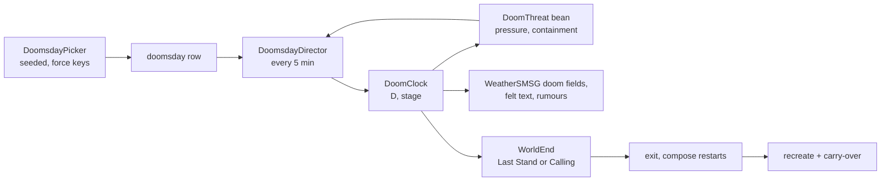



The doomsday sits on top of the [World Events](/docs/server/world-events/) work. The mana field, provinces, the
director, rifts, seals, rumours and Observation all exist. The doomsday adds four things:

- a **doom clock** that is chosen with the world and runs in real time,
- **threats** as Spring beans, one per kind,
- a **world end** that records the outcome and restarts the zone,
- a **rebirth** that generates the next world and applies the carry-over.



# Doom Clock

## Choosing the Threat

`DoomsdayPicker` runs once per world, on the first boot that finds no `doomsday` row. It does not touch the worldgen
pipeline, so no stage or `pipelineVersion` changes. It reads the generated world:

- Every `DoomThreat` bean answers `fits(world)` and `origin(world)`.
- The pick is weighted and seeded from the world seed, so a regenerated world with the same seed picks the same.
- `doomsday.force-kind`, `doomsday.force-foreshadow` and `doomsday.force-origin` override the pick for alpha tests.
  A forced kind whose `fits` is false is logged and replaced by a seeded pick.

The picker also rolls the times. All are real days, all are config:

| Value         | Default                                                          |
| ------------- | ---------------------------------------------------------------- |
| Onset         | `onset-min-days` 180 + rand(0..`onset-spread-days` 90)           |
| Unfold `U`    | rand(`unfold-min-days` 180 .. `unfold-max-days` 365)             |
| Life span `L` | onset + U                                                        |
| Foreshadowing | rand(`foreshadow-at-min` 0.4 .. `foreshadow-at-max` 0.6) × onset |
| Saved cap     | `saved-at-t` 150, so world age = 1.5 × L                         |
| Time scale    | `time-scale` 1                                                   |

World age comes from `PersistedWorld.createdAt`, the same anchor `WoundSources` and `BestiaClock` use. `time-scale`
multiplies real time for every doomsday reading, so `30` runs a whole world in about two weeks on a test server.

## The Clock

`DoomClock` is pure and has no Spring parts, so `DoomClockTest` runs a whole world in memory.

```text
baseRate = 1 / U                       per real day
pace     = clamp(1 + pressure - containment, 0.25, 3.0)
D       += baseRate * pace * days       after onset, clamped to 0..1
T        = worldAge / L * 100
```

- `push(delta)` moves `D` directly. Threats use it for big deeds, the Foreshadowing for its outcome on the onset, and
  the Last Stand for its win.
- Stages: Omens 0.00, Onset 0.15, Escalation 0.40, Cataclysm 0.90. A stage changes only once `D` is 0.02 past the
  threshold, so it does not flicker. Stages can go back down.
- `D = 1` opens the Last Stand. `T >= saved-at-t` opens the Calling.
- A GM pace override replaces the computed pace until it is set back to `auto`.

## DoomsdayDirector

`DoomsdayDirector` runs like `WorldEventDirector`: `@Scheduled` every 5 minutes, `@Transactional`, off the tick.
World actions go through `WorldView`.

1. Ask the threat for `pressure()` and `containment()`, and step the clock.
2. Run the Foreshadowing (`ForeshadowRunner`). Its outcome moves the onset.
3. On a stage change: `threat.onStage(from, to)` and a `DoomStageChanged` event, which `DoomStageNotices` turns into
   felt text and a rumour.
4. Run `threat.step(fate, seconds)` after onset. It answers how far the players' deeds pushed the clock, and the
   director applies the push.
5. Save the row. `DoomsdaySigns` keeps a copy for the tick: the sky, and Observation at `feltFrom = 10`.

`WorldEnd` polls the director every 10 seconds for the endings.

## DoomThreat

```kotlin
interface DoomThreat {
  val kind: DoomKind
  val shape: DoomShape // ACTOR, FRONT, PULSE
  fun fits(): Boolean
  fun origin(random: Random): Vec2d
  fun pressure(): Double    // 0..1
  fun containment(): Double // 0..1
  fun onStage(from: DoomStage, to: DoomStage)
  fun step(fate: DoomFate, realSeconds: Double): Double // the push of the players' deeds
  fun onLastStand(fate: DoomFate)                        // raise the Avatar
}
```

How strongly a place feels the doomsday comes from `DoomPresence`, the same for every threat: its reach grows with
the clock, and in the Cataclysm it is felt everywhere.

## Foreshadowing

A `Foreshadowing` bean of its own, apart from the threats. `ForeshadowRunner` starts it on its day in a random
province outside the sanctuaries, steps it until it runs out after 7 to 14 days, and then asks whether the players
held more than they lost. Held back, the onset moves 14 days later; run its course, 14 days sooner. Its state is the
`foreshadowing` row: province, heart, end day, and the counts of what was held and lost.

- **Mana Storm Season:** floods its province with mana (400k motes a day over 5 km), so rifts rise there by
  themselves. Sealed or dissolved rifts count as held, collapsed ones as lost. Not contained, it raises six omen scars
  around its heart.
- **Blight Bloom:** see [Withering](#withering).
- **Harbinger:** a lesser boss (a `boss` species, not a world boss) walks out 1.5 km from the province's heart with
  `DESTROYER` at level 1 and marches once on the nearest town, like the [Destroyer](#destroyer). Brought down, it
  counts as held. Razing the town, or still walking at the end, counts as lost: the Harbinger is gone, and the
  Foreshadowing is not contained.

# Threats of the First Wave

## Void Tear

Built. A rift that never collapses, so the rift system brings the gate, the hordes on the nearest town, the anchor and
the seal window.

- `fits`: a Wound outside the sanctuary provinces. `origin`: the Wound where the mana is thickest.
- **Onset:** a `rift` row at the origin, opened at once, with its collapse years away. The `void_tear` row holds its
  id.
- **Stage:** on each run the threat sets the rift's open time, so its rift stage follows the clock: 1 at onset, 5 in
  the Cataclysm.
- **Mana:** it pours 100k to 600k motes a day over 3 km (`WoundFootprint`).
- **Knots:** 0.5 to 4 a day within 4 to 30 km. It skips sanctuaries, water and provinces with a rift, and lends the
  ground the mana a knot needs to hold.
- **The Void Sovereign** anchors it instead of the Rift Warden, from rift stage 3 on (`StoredRift.anchorSpecies`).
  - Each one that falls pushes −0.03 and opens the seal window.
  - When the window passes unused, the next one rises at once.
- **Sealed:** −0.15. It tears open again after 3 days.
- **Swallowed knots:** +0.01 each.
- **Pressure:** open rifts within its reach. **Containment:** rifts sealed within its reach in the last 7 days.
- **Avatar:** the Sovereign at level 99 at the Tear. Its fall wins the Last Stand. A Last Stand that outlives a
  restart raises a new one.

## Withering

Part 1 is built: the field and the crystals.

- `fits`: dry land with any `CORRUPTION` outside the sanctuaries. `origin`: the most corrupted dry cell there.
- **CorruptionField:** 128 m cells in 4 km tiles, intensity 0..1, only touched tiles kept.
  - It uses the `ManaField` layout and helpers, with its own lock.
  - `CorruptionJournal` writes changed tiles after each run as `corruption_tile` rows, stamped with the shape and
    pipeline version, and loads them at boot.
  - It is wiped by `WorldScopedData`.
- **Corruption crystals:** a mob species, `corruption_crystal`, like the rift crystals: no AI, breakable, loot. This
  keeps a new prop kind out of the world generator.
  - Rows: `corruption_crystal` (position). `CorruptionCrystals` keeps an entity standing for each row, and grows them
    again after a restart.
  - The first one grows at the origin at onset. New ones sprout 1.2 to 2 km from a random standing one, outside the
    sanctuaries and on dry ground, until there are as many as the clock asks (up to 300, a curve that is slow at first)
    and at most 6 a day.
  - Each crystal corrupts the land within 2 km, strongest at its foot: 0.25 a day. Land with no crystal any more heals
    at 0.05 a day.
  - A broken crystal is deleted and drops `corrupted_shard`.
- **Containment:** `1 − standing crystals / crystals the clock asks for`.
- **GM layer:** `/mana layer on` shows the corruption of each cell as a grey-green wash.

Part 2 is built: its effects.

- **Plants die:** trees, shrubs, herbs and reeds on cells rotted past 0.7 are removed `GONE_FOR_GOOD`, resident or not,
  like a razed town's buildings (`WitheringBlight`). Finding a cell's plants means generating its 16 columns, so that runs
  off the tick, 20 cells per run; the removals run on the tick. Done cells are stored in `withered_cell`. Grass is
  terrain, not props, so it withers in the client look (part 3).
- **Exposure:** `WITHERING` (261) through `EnvironmentalExposureSystem`, read through the `CorruptionExposure` port.
  Masters and their bestia past 0.5 catch it: a slow drain that stops at 1 HP, no natural healing, −10% attack; past 0.8
  twice as much. Renewed while they stay, gone 20 s after.
- **Corrupted spawns:** dens and ambient sites past 0.5 breed bestia with `CORRUPTED` (262): +20% attack and a grey
  cast with an olive rim on the client. Traps ignore them, as they ignore a wary bestia. The wild spawns read the
  corruption through the `SpawnCorruption` port.
- **Cleansing:** a ritual completed on rotten land heals it by 0.6 within 300 m and wards those cells for 7 real days
  (`warded_cell`). The observer runs on the tick, so the wards are stored by the next Withering run.
- **Kills:** each bestia masters kill on rotten land eases its cell by 0.03.
- **Blight Bloom:** a Foreshadowing. Five crystals (`bloom = true`) grow 2.5 km around its heart; each broken one counts
  as held, each standing one as lost. Contained, the land heals; otherwise the rot stays as a scar.

Part 3 is built: the client look.

- **Layer:** `CORRUPTED` (wire id 5, channel 4) is a ground layer like `SCORCHED`, sent through
  `GroundOverlayService` as nibbles. `CorruptionLayerSource` turns the 128 m cells into one level per metre: it blends
  the four nearest cells and adds fixed noise, so the edge is ragged and moves a few metres at a time. It shows from 0.2
  and covers fully from 0.45, near where the `WITHERING` status catches.
- **Changes:** `CorruptionField` keeps the cells changed since it was last asked. Every 30 s the layer source marks
  the columns those cells reach as dirty, so the Withering and the Blight Bloom need no hook of their own.
- **Client:** `GroundMarkTexture` holds two `RGBA8` pages, eight channels. Corrupted is red on the second page
  (`ground_marks_2`); three channels stay free for later fronts.
- **Creep:** terrain slot 12 (`corrupted`), grey slime made by `tools/client/generate_creep_slot.py`. It is drawn as
  a fourth mark kind. Two noise layers slide against each other and a slow swell runs through it, wetter at its crest.
- **Grass:** blades on rotten ground grey from the tip down, droop to a side and shrink, and are gone where the rot is
  full. The wilted ring runs ahead of the creep's edge.
- **Check:** GrassBench `--creep=metres` lays a ragged disc of rot around the meadow's centre.

## Destroyer

Built: `DestroyerThreat`, an actor.

- `fits`: a sealed world boss outside the sanctuaries (`WorldBossSealService`). `origin`: one of their seals.
- **Onset:** the seal nearest the origin breaks, resident or not, and its boss walks out. It is spawned by the threat,
  not stored as a mob: the `destroyer` row keeps its species, lair, last position, stack, target and the towns it razed,
  and after a restart it walks on from where it last stood.
- **DESTROYER (263):** level = 1 + towns razed. +100% attack and defence, +25% for each town; +200% HP regeneration,
  +50% for each town, also in combat. Its health is set by the threat, because a mob's maximum health does not come
  from status values: 20× the boss's, +5× for each town. No trap holds it.
- **March:** a `SimulationAnchor` at `TRAVELLER` keeps the world around it simulated with nobody near. It walks to the
  nearest target (`HOME_POSITION`, 16 voxels of wander): a settlement still standing, or a standing player town. Towns
  in a sanctuary province, so the start towns, are spared.
- **Raze:** within 80 m of the centre, a settlement is razed (`SettlementFateService.raze`). A player town falls
  through its broken city sign, or through `TownService.fall` when the sign is not resident. It heals fully, its stack
  grows, and the clock is pushed by +0.08.
- **Defeat:** the clock is pushed by −0.10, and it rises again at its lair 3 days later, one town stronger. A ritual
  within 60 m of the lair while it is down (`DestroyerSeal`) keeps it down 14 days from then.
- **Pressure:** towns razed against towns razed and left. **Containment:** full while it is down, then fading over the
  14 days after its last defeat.
- **Avatar:** the Destroyer itself, at its stack. A fallen one rises at once for the Last Stand.
