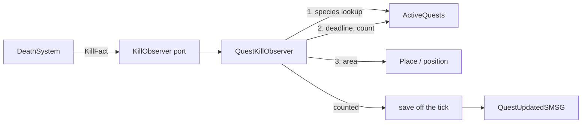



The game will be more or less an Open World game. But the declared goal will be to try out new ways of storytelling in
order to present a credible world with developing history to the players. You have to say goodbye to the idea that every
game can live through every part of the story/quest. This contradicts the persistent and inner logical structure of the
game world. Quests must rather result dynamically from what happens within the game world.



A rich harvest is imminent, but the farmer Wilhelm cannot bring in the whole harvest due to his short time before it
spoils on the fields. He asks passing players if they could help him. This is rewarded with an EXP bonus, gold and
if necessary an item.


Due to high rift activity and mana flooding, many high-level Bestias make the surroundings of a large city unsafe.
Players are encouraged to fight the Bestias, rise in the city's favor, and gain access to better items, experience
and gold.


A NPC has gotten lost in a dangerous area and is now hiding. If a player finds the NPC he can help him to find his
way back and will be rewarded with EXP and gold.



Quests in Bestia are generated via two mechanics:

1. **Automatically generated quests**, spawned in cities or villages where NPCs are present.
2. **Player generated quests**: these challenges are handed to an NPC who then announces them so that other players can
   pick them up. Players must follow a template for the rewards.

Both end up as the same kind of **contract**, and the rare world events driven by the simulation use that machinery too.
The player-facing rules for all three live on the [Questing](/docs/mechanics/world/questing/) page.

# The Quest Core

The player-facing rules are on the [Questing](/docs/mechanics/world/questing/) and
[City Blackboard](/docs/mechanics/towns-trade/blackboard/) pages. This section is about how the zone server keeps
quests. The code lives in the `quest` slice of zone-server.

## Quests are runtime records

A quest is **data that a source makes at runtime**. There is no static list of quests, and no quest definition the
client could cache by id. Today the only source is the blackboard. Later sources fill in the same records: the post,
the [world history](/docs/mechanics/world/world-history/#quests-from-history), and generated world quests such as "kill
5 wolves near town Y". A new source adds no code per quest.

A `Quest` row holds:

| Field                | Meaning                                                                                                                 |
| -------------------- | ----------------------------------------------------------------------------------------------------------------------- |
| `origin`             | Which source made it (`BLACKBOARD`)                                                                                     |
| `titleKey`, `textArgs` | A text template key and typed arguments: item, species, number, place. The client translates them, like [dialog](/docs/server/dialog/) arguments |
| `suggestedLevel`     | A hint for players, never enforced                                                                                      |
| `deadline`           | When it expires                                                                                                         |
| `status`             | `OPEN`, `CLOSING`, `COMPLETED`, `EXPIRED` or `WITHDRAWN`                                                                |
| `objectives`         | The list of objectives, see below                                                                                       |
| `rewards`            | What a player gets                                                                                                      |
| `posterMasterId`     | The master who posted it; empty for a quest the world made                                                              |

A source keeps only what is its own. The blackboard keeps the coins per unit, the pot that is left, the fee it took
and the end of the notice hour in its own `BlackboardPosting` row.

## Objectives and their scope

An objective is one of a **small closed set of kinds**, with parameters. Adding a kind means one enum value and the
check that matches it; a single quest never needs code of its own.

| Kind            | Parameters                                   | Status                                   |
| --------------- | -------------------------------------------- | ---------------------------------------- |
| `DELIVER_ITEM`  | item, amount                                 | Built, used by the blackboard            |
| `KILL`          | species, amount, optional area               | Built; no source makes one yet           |
| `EXAMINE`, `TALK`, `BRING`, `DECIDE` | see [Quest Manager](/docs/server/quest-manager/#changes-to-the-quest-core) | Planned |

Each objective has a **scope**:

- **Shared**: everybody who accepted works towards one counter, kept on the quest row. A blackboard Gather is shared.
- **Personal**: each master counts on their own, in their own log entry. A kill quest is personal.

An area is either a **place** (a named place such as a town) or a **spot and a radius** (a place with no name, such as a
battlefield).

## The quest log entry

A `QuestLogEntry` links a master to a quest. It holds when the master accepted it and **one counter per objective**:
the master's own progress for a personal objective, and "delivered by you" for a shared one.

The entries **are** the list of a quest's subscribers. No source keeps its own list of signers.

`QuestService` is the one way in for sources: create, accept, abandon, advance a shared counter, record a personal
count, close, end. Accepting is refused at 25 entries (`quest.log-capacity`). Ended entries are deleted after 3 days
(`quest.ended-kept-for`), so a player who was offline still sees how a quest ended. When a quest ends, its source can
react: the blackboard mails the unspent pot back.

# Tracking Personal Progress

Personal progress is counted **on the tick, event by event**. The code that reports a fact knows nothing about quests.

1. **The fact.** `DeathSystem` calls every `KillObserver` for each kill that pays experience, with a
   `KillFact(speciesId, position, creditedMasters)`. The port lives in the low `entity/observe` package, so any slice
   can implement it. Achievements or statistics can listen the same way later, without touching the monster code.
2. **Only involved players.** `creditedMasters` are the masters who earned experience from the kill, party shares
   included. Nobody else's state is touched.
3. **Fail fast.** For each credited master, `QuestKillObserver` does one map lookup by species in the master's
   `ActiveQuests`. No entry, nothing to do. A hit checks the deadline and whether the count is already full.
4. **Area last.** Only then the area check, one compare each:
   - a **place** is compared with the `Place` component the zone already keeps per entity. `PlaceSystem` updates it
     only when the position changes, so no geometry runs at kill time;
   - a **spot and radius** is one squared-distance compare with the position of the death.
5. **Count and save.** The counter goes up in memory. A job per master saves it off the tick, and the save sends the
   update to the client.

`ActiveQuests` is a server-only component on the played master entity. It is **never synced**. It holds the personal
objectives the master is counting, indexed by what triggers them. It is built from the objective data when the master
spawns and when they accept a quest, not from code. It holds no text, levels or rewards; those are built when a view is
sent. `LiveQuests` mirrors every committed change of the log into the `ActiveQuests` of masters being played.

An "obtain" and a "talk to" observer will follow the same shape, with their first source.

# Reaching the Clients

Quest changes travel as **explicit messages**, not as a synced component:

- **Log in or master select**: the full `QuestLogSMSG`.
- **After every committed change**: a `QuestChangedEvent`. `QuestPushListener` reads the entries and the poster of that
  quest, keeps the masters being played, and sends each a `QuestUpdatedSMSG` with one view, or "removed".
- **Abandon**: `AbandonQuestCMSG`. It works from the log anywhere, for any source.

There is no notice message. The client raises the "completed, expired, withdrawn" notice itself when a status changes.

Why not a synced component? A shared change happens on the quest, not on any master, so no master component would get
dirty by itself; the server would still need to find the subscribers and who of them is online. And since quests have
no static definition, every view carries its full data anyway. Other MMOs send per-quest updates for the same reason.

# The Blackboard Source

The `blackboard` slice is the first quest source. It sits above `quest`, `item`, the economy, the post and the
settlements.

- **The board** is an ordinary entity drawn from the prop catalogue as a structure, like the town sign. Finished
  structures normally travel in the static chunk batch, which carries no components, and the board needs one (below).
  The start-town boards are spawned when the zone starts; a player builds one from a kit, one per town.
- **Board actions** reuse `InteractEntityCMSG` with a `ScriptArgs` bag: `action` (`post`, `sign`, `handIn`,
  `withdraw`; none means "open the window"), `questId`, `itemId`, `amount`, `coinsEach`, `days`. The bag is parsed into
  a typed request or a refusal. The reach check runs on the tick; the request then runs off the tick, because it writes
  the database. Withdrawing is therefore only possible at a board.
- **Posting** checks the limits, takes the pot and the fee from the bag, charges the fee to the world reserve, and
  creates a quest with one shared `DELIVER_ITEM` objective. The suggested level comes from the mob loot tables (lowest
  minimum level of a species that drops the item), else from the item's base level.
- **Hand-in** puts the copies into an instant parcel for the issuer, pays `amount × coins each` from the pot, advances
  the shared counter, and ends the quest when it is full.
- **Withdraw and expiry** run on a schedule. The unspent pot goes back by instant parcel.
- **`BlackboardSMSG`** carries the global open list for the window.
- **The marker** is a `BlackboardOffer` component on every board: a bitmask of the suggested levels of all open
  quests, levels 1 to 128 in two `fixed64`. It is rewritten on every board when a blackboard quest opens or ends. A
  min/max range would light up for a level-40 player when only level-5 and level-80 quests are open; the bitmask does
  not. The component is the same for every viewer, so the marker cannot leave out the viewer's own quests.
- **Settings** (`BlackboardConfig`): the fee per duration, the posting limit, the notice time and the band in which a
  quest fits a level.

# Automatic Quest Generation

The world makes quests of its own through the [Quest Manager](/docs/server/quest-manager/). It is a second source next
to the blackboard:

- **Sources** watch the open threads of the world history and real events of the live world: a town that lacks
  food, a damaged building, a rumour.
- A **planner** builds a short chain of steps with a choice, starting from the payoff. Quest shapes are data in a
  catalogue, so no quest has code of its own.
- A **director** offers the plans through townsfolk, found things and the blackboard.
- **Endings** write back into the world: a new event in the chronicle, the thing itself, and how people see the
  player.

For this the quest core gets stages, the objective kinds `EXAMINE`, `TALK`, `BRING` and `DECIDE`, and rewards
other than coins per unit. Generated text for quests is described under [Dynamic Text](/docs/server/dynamic-text/).

# Player Quests

Players post tasks with a reward, and other players take them. Today that is the
[city blackboard](/docs/mechanics/towns-trade/blackboard/), described [above](#the-blackboard-source). The board holds
the reward in trust: the issuer pays the pot and a posting fee up front, and the board pays each signer per unit
handed in.

Issuers can never mint experience. When commissions pay experience, the server will derive the whole reward from the
difficulty of the objective and pay it from a capped world pool. See
[Rewards, Experience and Settlement](/docs/mechanics/world/questing/#rewards-experience-and-settlement) for the
player-facing rules and the anti-farming measures that go with them. Commissions pay no experience yet.

## Reward Calculation

The issuer chooses the coins per unit. The posting fee depends on the duration: `3%` of the pot for 1 day, `5%` for 3
days, `8%` for 7 days. It goes to the [world reserve](/docs/server/money-supply/#nothing-is-burned) and is never
refunded. The rates are server settings. A server-wide bound on rewards, and payouts on NPC-issued quests budgeted by
the [World Treasury Director](/docs/server/economy/), are not built.

The level of a quest is only a suggestion, see
[Difficulty and Level Range](/docs/mechanics/world/questing/#difficulty-and-level-range). Any master may accept any
quest.

# References

- <https://www.rockpapershotgun.com/2016/09/02/how-to-procedurally-generate-culture/>
- <http://www.gdcvault.com/play/1024143/Procedural-Narrative>
- <http://pcg.wikidot.com/pcg-algorithm:procedural-puzzles-and-plot-generation>
- <http://ieeexplore.ieee.org/abstract/document/5740836/>
- <https://nil.cs.uno.edu/projects/glaive/>
