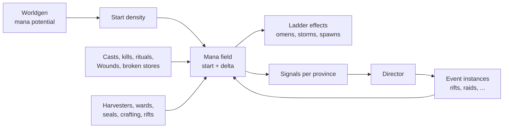



The zone has four parts: a **mana field** that changes with play, **provinces** to group the land, a **World Event
Director** that decides when something happens, and the **events** themselves: rifts, and five events that the
[other events](#other-events) section describes.



The split that keeps it small: **everything on the ladder is physics**. Omens, storm odds, den levels and drawn apex
bestia follow the density directly, all the time. The director only decides **discrete events**, and only those cost
budget.

# Mana Field

## Potential and Start Density

World generation keeps its layer, renamed `MANA_POTENTIAL` (`mana_potential`). It is a percentile rank over the land
(`ManaStage.rankAgainstLand`), which keeps every worldgen threshold stable across seeds. Those thresholds stay rank
cuts: crystals, herbs, weather regions, blight, wounds, corruption.

The zone derives the start density from it:

```text
d0 = 0.10 + 0.55 × potential⁴
```

`ManaConcentrationService` gets `potentialAt` (for geology readers like herbs) and `densityAt` (for everything that
asks how much mana is in the air: Potency, ritual factor, Magic Sense range, Weather Sense, theodolite). The
`ManaConcentration` bands move to density units: ordinary `0.08 .. 0.45`, thick above, drained below. A fresh world
changes no spell anywhere outside the cores of the Wounds.

## The Overlay

```text
density = d0 + delta
```

- **Cells** are 128 m (4 × 4 chunks). **Tiles** hold 32 × 32 cells (4 km). Only tiles with a delta exist.
- **Unit:** 1 mote = +0.001 on one cell.
- `ManaField` holds `Map<tileKey, FloatArray>` of delta, with `deltaAt`, `add(x, y, motes, radius)` and `densityAt`.

## Field Rule

`ManaFieldSystem` runs every 60 s on the tick and walks only active tiles. Like `ScorchRegrowthSystem` it declares no
fake reads or writes. Instead all mana state shares one lock on the field: casts, kills, ground fire and item decay
release mana from systems that run in parallel within one tick wave.

- **Leak on delta.** The delta decays with a half-life of one real month. Because only the delta is stored, this one
  rule is also "natural sources hold the base": no separate hotspot emitter is needed.
- **Start provinces** pull the density toward 0.3 with a half-life of 3 Bestia days.
- **Creep.** A slow diffusion, a few hundred metres per week. It must stay slow: with fast diffusion and a one-month
  leak, a spot's mana smears over about 8 km and the 128 m cells buy nothing.
- **Long range** only through visible things: mana storms carry mana with the wind and drop part of it, rifts spill,
  players carry crystals.

## Emitters and Sinks

| Hook                              | Where                                                          | Effect                                                                              |
| --------------------------------- | -------------------------------------------------------------- | ----------------------------------------------------------------------------------- |
| Cast                              | `SkillExecutionService` after `payCasterCost`                  | `+ manaCost × k_cast` at the caster                                                 |
| Kill                              | a `KillObserver` on `DeathSystem` (`KillFact` needs the level) | `+ level × k_kill`, × 10 for a boss. A capture does not go through it               |
| Crystal                           | `mana.emission.stored-motes`, by item identifier               | A stack destroyed or decayed on the ground releases it. Crafting with it removes it |
| Wound                             | `SpecialSites` wounds                                          | Area source, grows with world age, later with the doomsday stage                    |
| Harvester, ward, seal stone, rift | their own entities                                             | Pull into their store; a broken store releases all of it                            |

The constants are not picked. A calibration test replays the targets and solves for them:

| Situation                     | Target                                   |
| ----------------------------- | ---------------------------------------- |
| One caster for a day          | +0.03                                    |
| Grind spot, daily for a week  | +0.15                                    |
| Chaos group of 5, one evening | +0.10 over ~1 km                         |
| One harvester for a day       | cancels one grind day                    |
| Late Wound, no harvesting     | province at storm level in ~2 real weeks |
| Rift spill                    | storm or burn level within ~300 m        |

## Persistence

Copied from the scorch and water overlays:

- A `StoredManaTile` row per tile: tile key, the cells as a `@Lob` blob, `world_shape_version`, `pipeline_version`.
- Loaded at boot (`ScorchRegistry.loadAll` pattern). Stale versions are deleted.
- Changed tiles are written every five minutes and at shutdown through `AsyncJobExecutor` (`WaterJournal.flush`
  pattern).
- A `WorldScopedData` wipe for `WorldProvisioning.recreate`.

## Ladder

`ManaTiers` gives each cell a tier, with a hysteresis of 0.03 and a dwell of one Bestia hour. Only cells whose tier
differs from their start density's remember it. After a restart the saved field takes its tiers at once, so nothing is
announced twice.

| Tier     | Density | Server effect                                                        |
| -------- | ------- | -------------------------------------------------------------------- |
| Stirring | 0.35    | Client ambience                                                      |
| Uneasy   | 0.45    | Rumours, aggro radius, omen plants                                   |
| Ominous  | 0.55    | Dens restock +3 levels with `MANA_TOUCHED`, omen props, apex roamers |
| Storms   | 0.60    | Mana storm odds                                                      |
| Event    | 0.70    | Knots may form                                                       |
| Sickness | 0.80    | `MANA_SICKNESS` on masters through `EnvironmentalExposureSystem`     |
| Burn     | 0.90    | Mana Burn may ignite                                                 |

- **Spawns.** The level bonus grows with the tier: +3 at Ominous and Storms, +5 at Event, +7 at Sickness, +10 at Burn.
- **Sickness.** A fifth less health, a tenth less attack and no natural healing, lasting a minute after the master
  leaves. Bestia do not fall ill, and no roof or camp helps.
- **Weather.** `WeatherModel` reads a `ManaReading`. The zone gives it each weather region's 95th percentile of the
  density, **frozen once per Bestia hour**, so a forecast inside the hour stays true. The start density curve lives in
  worldgen, so a fresh world's weather regions summarise the same density. `manaThreshold` and `manaStormFloor` are in
  density units (0.45 and 0.60).
- **Client.** `WeatherSMSG` gets a `mana_tier` per player. The client never receives the density itself, except the
  number Weather Sense grants. Omen props are ordinary props from a `WorldObjectSource`.
- **Rumours.** A rise to Uneasy posts `STRANGE_LIGHTS`, to Ominous `RESTLESS_BEASTS` and to Storms `STONES_RISEN`,
  through `RumourService.post`. Each kind is posted once per 4 km tile while the news lives, so a whole Wound rising
  makes one rumour.

# Provinces

A province groups the place regions (`PlaceRegions`, about 6 km, named) around a capital.

- **Seeds:** every standing town and city, and every home settlement a new master may pick, even a village, so each
  start town has a province of its own. Where no seed is within 30 km, a wild seed: a Wound or a lair first, then the
  land farthest from any seed.
- **Growth:** each place region joins the seed that is cheapest to reach over the region graph, with the same travel
  cost the place regions use. `PlaceRegions.neighboursOf` becomes public for this.
- **Water** joins the land province it touches. Deep ocean belongs to none.
- **Sanctuary:** the provinces of the start towns. No knots and no big events there.
- **Name:** the capital's ("the Ashford lands") or the landmark's.

Provinces are a pure function of the world, like the place regions. `worldgen/place/Provinces` builds them,
`ProvinceService` in the zone holds them lazily and rebuilds them on `WorldRecreatedEvent`.

**Partition version.** `PlaceRegions` is deliberately not a stage, so a change to `RegionParams` does not invalidate a
stored world. Rows keyed by a region or province index would then silently point at other land. So every such row
stores a **partition version**, a digest of `RegionParams` and `ProvinceParams`, and rows with another version are
dropped at boot.

# World Event Director

`WorldEventDirector` runs like `QuestDirector`: `@Scheduled` every 5 minutes, `@Transactional`, off the tick. World
actions go through `WorldView`.

**1. Signals.** A `ProvinceSignals` snapshot per province: the peak mana cell and its density, the changed cells per
tier, and the masters standing there. An event that needs more facts reads them itself in `WorldEvent.fits`: the
alpha reads the hunted dens, the rare bestia the sky, the raid the town purses. Still planned as signals: the 3-day
trend, kill pressure, settlement damage, weather, moon and season.

**2. Catalogue.** `world_events.yml`. Each entry names the `WorldEvent` bean that runs it (the boot fails on a gap),
its cost, weight, minimum tier and how many cells must be at it, a cooldown and a duration in Bestia days, and the
loot its contributors split. For [Observation](#observation) it also names its `family` (mana, beasts, earth, sky or
people) and `felt-from`: how many times further than a small event it is felt.

**3. Choice.**

- **Budget:** each province gains 1 point per Bestia day, up to 5. The apex, the rare bestia and the alpha cost 1. A
  rift, an old seal and a raid cost 3.
- **Quiet:** after an event ends the province rests for 3 Bestia days. Together with the budget this is the anti-farm
  rule.
- A ready province - no sanctuary, no running event, not resting - starts an event it can afford with a chance of a
  quarter per run, weighted among those that fit. The roll is seeded by world, province and time window.
- Still planned: a world layer that caps concurrent big events, paces the doomsday and sends the rare world-wide text.

**4. Instances.** A `WorldEventInstance` row holds the event, the province, where it started and its subject: an
entity id (the apex, a rare bestia, an alpha, a raid's chief), a row id (a rift, a seal stone) or a prop id (a seal
crystal). It ends as `DEFEATED` when players ended it, `EXPIRED` when it ran its course or out of time, and
`CANCELLED` by a GM. `OMEN` is reserved for events with a warning phase. An `EventProvince` row holds the budget and
the quiet, with the partition version.

**The apex roamer** is the strongest non-boss species of the province's own dens, born 5 levels above its highest roll
and mana-touched. It spawns on the province's land farthest from the peak and has its home on the peak, so it roams
toward the thickest mana. Killing it ends the event; otherwise it leaves after 2 Bestia days.

# Rifts

A `rift` row holds position, phase, stage, reservoir, the anchor and timestamps, so a rift survives a restart.
`RiftSystem` moves every rift once a minute under the field's lock; `RiftLifecycle` and `RiftField` are the pure
mechanics, so `RiftLifecycleTest` runs a whole rift on a test field.

- **Knot** (2.5 to 4.5 Bestia days): pulls slowly within 300 m into the reservoir and leaves an eerie calm. If the ring
  around it falls below 0.6 it dissolves and lets its mana go: the players' win.
- **Open** (stages 1 to 5 over a real day): the pull radius grows to 1.5 km and a `RIFT_GATE` entity stands at the
  centre. Every 20 to 30 real minutes a wave of the province's own den species, 5 levels per stage above their kin
  and mana-touched, walks toward the nearest town: five while masters stand within 1.5 km, two otherwise.
- **Anchor** at stage 3: the Rift Warden, an `event-only` boss ten levels above the province's strongest den. The rift
  remembers its fall for the seal.
- **Collapse:** the reservoir spills within 300 m, heaviest at the centre, which leaves storms or worse.
- **Merge:** touching rifts merge into the older one.
- Towns hear `RIFT_OPENED`, `RIFT_SEALED` and `RIFT_COLLAPSED`.

Still planned: feeding and stasis, which wait for factions; crystal nodes; a scar where a rift collapsed; town damage
from waves; chronicle facts for rifts.

## Sealing

The gate is a target a Dispel can aim at, but nothing can break it: it has `CombatStats`, `Health` and `INVULNERABLE`.
`RiftSeals` runs in the rift system's deferred block.

- **Window.** When the anchor falls, the gate gets the status `RIFT_SEAL_WINDOW` (id 259) for 30 real minutes. It
  carries the rift's Potency, `100 + 30 × stage`, and has a dispel threshold of `80`. A weaker Dispel has no chance,
  see [Fixed Potency](/docs/mechanics/combat/spell-potency/#fixed-potency). Only the strongest
  [single casters](/docs/mechanics/combat/spell-potency/#example-casters) reach `80`, so in practice it takes a
  [ritual](/docs/mechanics/combat/spell-potency/#rituals)'s charge.
- **Sealed.** A Dispel that lifts the status in time seals the rift. Its phase becomes `SEALED`, which the director
  counts as the players' win. Its reservoir goes into a **seal stone** at the gate.
- **Missed.** If the window passes, the status goes, and the anchor comes again at the next stage
  (`next_anchor_stage`).

A seal stone is a `SEAL_STONE` prop. A `seal_stone` row holds its position, its motes, the Bestia second it was sealed
and the world versions. `SealStones` serves the stones per chunk as a `WorldObjectSource`, loads them at boot and
drops the stones of another world. No blow breaks a stone. Only an [old seal](#old-seal-weakens) can break it.

**Ritual work.** `RitualService` tells every `RitualObserver` when a ritual runs its full time: where its circle stood
and who stayed. `RitualWorkCredit` credits each master `30` on the work axis when the circle stood on a rift's ground:
1.5 km around an open rift, 600 m around a knot. That is worth three kills of a level-10 bestia.

## Contribution

Contributors do not sign. A `ContributionLedger` counts per event, master and axis, keyed by the tag every event
creature carries (`EventCreature`, which `KillFact` passes on). The director saves it every run.

- **Fighting:** a kill of an event creature credits everyone who earned it, by its level, a boss five times over.
- **Holding:** each run, every master standing on a running event's ground. Each event names its ground: 300 m around
  the apex, all a rift pulls from, or the ground the [other events](#other-events) name. One run is worth a level-10
  kill.
- **Work:** `30` for each ritual that runs its full time on a rift's ground or beside a cracking seal. Still planned:
  crystal nodes harvested or shattered.

When players end an event, its loot is split by share among everyone with at least a twentieth of the work. It lands at
the feet of each contributor who is online, kept for them alone. They also earn the honor act the event names in
`WorldEvent.honorAct`, globally while online and with the town nearest the event either way. Most events pay
`DEFEND_SETTLEMENT`. A raid ended in its camp pays `KILL_OUTLAW`. An event that ran out pays nothing. No coin is paid.
Still planned: posting the event on the blackboards nearby.

# Other Events

Each of these is one `WorldEvent` bean and one catalogue entry. None needs mana except the old seal. Their creatures
carry `EventCreature`, so their kills count for the contract.

## Rare Bestia Under the Right Sky

`rare_bestia.yml` lists named species that only come when land and sky fit: biomes, weather kinds, the part of the day
(`DayPart`: dawn, day, dusk, night), the moon (`MoonPhase`: new, waxing, full, waning) and seasons. An empty list
allows anything. The moon goes round once per Bestia month. It follows the same world age as the client's sky, so
both agree. About four Bestia days of each month count as full, and four as new.

| Rare           | Species, level                   | Land                                   | Sky                                                  |
| -------------- | -------------------------------- | -------------------------------------- | ---------------------------------------------------- |
| storm-heron    | Storm Heron (117), Lv 46 - 50    | Swamp, bog, riverside                  | Thunderstorm or mana storm, at dusk                  |
| silver-hart    | Silver Hart (118), Lv 34 - 38    | Temperate forest and rainforest, taiga | Clear, at night, full moon                           |
| whiteveil-lynx | Whiteveil Lynx (119), Lv 56 - 60 | Tundra, taiga, alpine                  | Snow or blizzard, at night or dawn, new moon, winter |

The species are `event-only`: no den places them, and the compendium leaves them out.

- **Start.** `RareBestiaEvent` checks the centre of each land place region in the province. It fits where a rare's
  time fits, the region's main biome is its land, and the weather at the centre is its weather. It brings the rare to
  that spot, with its home there, and posts `RARE_BESTIA_SEEN` nearby.
- **End.** Killing it ends the event. It leaves when the weather or the time at its spot stops fitting, or after half
  a Bestia day. Its ground is 150 m around it.
- **Hints.** `RareBestiaHints` runs every 6 real hours. For each rare it posts `RARE_BESTIA_HINT` at a random region
  centre of its land. The hint names its sky.

## Alpha Rises

- **Hunted dens.** `DenHunting` keeps when each den was last hunted, in a `hunted_den` row by den feature id.
  `KillFact` now carries the den. `DenHuntObserver` marks a den hunted when masters earned the kill of one of its
  bestia. A den nobody was seen hunting counts from when it was first asked about, so a new world does not raise alphas
  everywhere at once.
- **Alpha dens.** `AlphaDens` finds, once per world, the dens of an ordinary species whose AI attacks on sight (no boss,
  world boss, corrupted or event species). The den needs a road or street within 400 m, or else a town within 1 km.
  Its alpha prowls the nearest point of the road, or else a spot 60 % of the way to the town.
- **Start.** `AlphaRisesEvent` picks the den of the province left alone longest, once that is at least 7 Bestia days.
  The alpha is the den's own species at its highest level + 8. It steps out of the den with its home on the prowl
  spot. The den counts as hunted again. Towns hear `ALPHA_PROWLS`.
- **End.** Killing the alpha ends the event. Otherwise it leaves after 3 Bestia days. Its ground is 200 m around it.

## Old Seal Weakens

- **Seals.** `OldSeals` lists every seal still standing: the world boss
  [seal crystals](/docs/mechanics/world/world-history/#world-bosses) nobody broke, and the seal stones.
- **Start.** `OldSealEvent` needs one cell at Uneasy. It picks the seal of the province under the highest tier, at
  least Uneasy. A seal stone counts only once it is 30 Bestia days old. The seal cracks, and towns hear
  `SEAL_CRACKING`.
- **Reinforce.** `CrackingSeals` is a second `RitualObserver`. A ritual that runs its full time within 60 m of a
  cracking seal reinforces it and credits each master `30` work. At its next run the director counts the event as the
  players' win, and towns hear `SEAL_REINFORCED`.
- **Break.** Without a ritual the seal breaks after 2 Bestia days, and towns hear `SEAL_BROKEN`. A crystal dies as if
  struck down, which frees its world boss. A seal stone is taken away and spills its motes within 300 m, like a rift
  that collapses.
- Its ground is 60 m around the seal. A GM cancel leaves the seal as it was.

## A Raid on a Rich Town

`raid/` holds the event. `RaidTowns` finds, once per world, the towns and cities whose chronicle holds a grudge: a
war, a battle, a siege, a sack, a conquest, a revolt, a feud, a vengeance sworn, a betrayal or a plundered artifact.

- **Target.** Of those in the province, a town fits when fewer than 3 masters stand within 1 km and its treasury is at
  least its reference: a [treasury](/docs/server/economy/#treasuries) players have not emptied. The richest one
  draws the band.
- **Camp.** The highest dry ground 1.5 km out, of 16 bearings, outside any town and nearer this town than any other.
  The band first robs the road: the nearest road within 600 m of the midway point. Towns hear `ROAD_ROBBED`.
- **Band.** `RaidBand` musters a chief and five Brigands (id 120, `event-only`) at the ambush, with their home in the
  camp, so their tracks lead there. The band has the mean top level of the province's den species, and the chief is
  8 levels above. Only the chief survives a restart. A new band gathers around it.
- **March.** After 1 Bestia day the band's home becomes the town, and towns hear `RAIDERS_MARCH`. It plunders for 3
  Bestia hours and leaves, and towns hear `TOWN_RAIDED`. It takes no coin, and the town takes no damage yet.
- **End.** Killing the chief and the whole band ends the raid, and towns hear `RAIDERS_ROUTED`. In the camp it pays
  `KILL_OUTLAW`, once the band marches `DEFEND_SETTLEMENT`. The ground is 150 m around the camp, then 300 m around the
  town.

# Senses

Each director run hands `RunningEvents` the running events as the senses feel them (`BrewingEvents`): where, the
family, the catalogue id, how far it is felt, its stage and the real seconds until it moves on. How far comes from
the catalogue: a rift is felt three times as far, an old seal and a raid twice. A knot, a cracking seal and a band in
camp are `GATHERING`. An open rift, a marching band and the other events are `BREAKING`. The next change is when a
knot opens, a rift collapses, a seal breaks, or a band marches or leaves.

## Augury

Skill 169, after Observation Lv. 2, three levels. `OmenReading` reads place regions. A region reads by the density
that nine in ten of its samples stay below, one sample every 512 m: calm, uneasy from 0.45 or ominous from 0.55. A
running event in the region makes it read ominous.

- Lv. 1 reads the caster's own region.
- Lv. 2 also adds a `WORSE_NEARBY` mark when a neighbouring land region reads worse.
- Lv. 3 reads every neighbour with its name, at its centre.

The readings go out as `SENSE_OMEN` marks in `SenseMarksSMSG` for 60 seconds. The caster's own region never carries a
direction.

## Observation

Skill 48 is cast within 5 m of a finished `OBSERVATION_OUTPOST`. Without one the cast is refused before its bar with
`OBSERVATION_NO_OUTPOST`. The outpost comes from a kit (item 644, a Carpentry Lv. 1 recipe) and takes 120 seconds to
build. Only a master with Observation Lv. 1 may build it (`OBSERVATION_OUTPOST_NEEDS_SKILL`). Anybody may cast at it.

`EventObservation` lists the running events within `level × 1 km × felt-from` of the outpost. It sends them as
`SENSE_EVENT` marks for 120 seconds. The mark's precision travels as `size_metres`, the stage as `ref_id` and the hours
as `depth_metres`.

| Lv. | Tells                                             |
| --- | ------------------------------------------------- |
| 1   | The direction                                     |
| 2   | Also near or far: nearer than half the range      |
| 3   | The distance within 500 m, and the family         |
| 4   | Also the stage                                    |
| 5   | The catalogue id, and the hours until it moves on |

**Map.** From Lv. 3 a reading also goes on the master's own map, through the `ObservedMarks` port. In the zone
`NotebookObservedMarks` writes up to 10 marks into the notebook's marks collection. Each reading replaces the marks
of the last one. Below Lv. 5 a mark is named after the family, as in "Something of the beasts". Lv. 4 adds the
stage. Lv. 5 adds the event's name and "within N hours".

**Watch.** `OutpostWatchSystem` runs every 60 seconds. An owned bestia within 20 m of an outpost keeps watch over
`3 km × felt-from`, as far as Observation Lv. 3, whatever its master knows. For each new event it writes an
`EVENT_SENSED` line with the family into its master's diary, which also reaches the companion app. It tells each event
once per watcher.

# GM Tools

A new authority `WORLD_EVENTS`, granted to GMs.

- `/mana get`, `/mana set <density> [radius]`, `/mana add <motes> [radius]`
- `/event` (running events and the budget where you stand), `/event force <id>` in your province, `/event cancel <id>`
- `/mana layer on|off`: a GM-only map layer with the tiers, the densities and the director state per province. It is
  sent as its own message only to a connection whose authorities hold `WORLD_EVENTS`. It never goes over the bus or to
  the companion app.

`GmManaLayer` sends `GmManaLayerSMSG` every 5 seconds to each GM who turned the layer on. It holds the 41 × 41 cells
around the GM, about 2.5 km each way: density, tier and province of each. It adds each province on the grid with its
name, budget, quiet and sanctuary flag, and every running event in the world. The authority is checked before each
send, so a GM who lost it or logged out drops out. `off` sends an empty grid, which clears the layer. The client's map
and minimap tint each cell by its tier, draw the province borders and the events, and list each province's budget
and quiet. Once a cell is big enough on screen, it shows its density as a number.

# Build Order

Each step is one branch and one draft PR in bestia-behemoth, stacked on the one before.

| Step    | What                                                                                | Notes                                |
| ------- | ----------------------------------------------------------------------------------- | ------------------------------------ |
| 01      | Rename to `MANA_POTENTIAL`, start density, readers on density                       | Runs the worldgen suite              |
| 02      | Mana field, persistence, `/mana`                                                    |                                      |
| 03      | Emitters and sinks, calibration test                                                |                                      |
| 04      | Provinces, partition version                                                        | Runs the worldgen suite              |
| 05      | Ladder on the server: tiers, live mana storms, spawns, sickness, rumours            |                                      |
| 06      | Ladder on the client: tier in `WeatherSMSG`, sky moods, motes, sound                |                                      |
| 07      | Omen props and scars                                                                |                                      |
| 08      | Director, catalogue, `/event`, the apex roamer as the first event                   |                                      |
| 09      | Rifts                                                                               |                                      |
| 10      | Contribution ledger, loot, honor, blackboard post                                   | No blackboard post yet               |
| 11      | Ritual kinds: seal, feed, stasis                                                    | Seal only, rest waits for factions   |
| 12      | Observation and Augury                                                              | 12a Augury, 12b Observation, 12c map |
| 13      | GM map layer                                                                        |                                      |
| 14 - 17 | Rare bestia under the right sky, alpha rises, old seal weakens, raid on a rich town | One step each                        |

## Numbers to Start From

All are configuration and are judged in play.

| Area                    | Value                                                                |
| ----------------------- | -------------------------------------------------------------------- |
| Cell / tile             | 128 m / 32 × 32 cells                                                |
| Leak half-life          | 1 real month                                                         |
| Start-province sink     | toward 0.3, half-life 3 Bestia days                                  |
| Creep                   | about 300 m per real week                                            |
| Field step              | every 60 s, active tiles only                                        |
| Tier hysteresis / dwell | 0.03 / 1 Bestia hour                                                 |
| Director cadence        | 5 minutes                                                            |
| Province budget         | +1 per Bestia day, up to 5; costs 1 or 3                             |
| Relax phase             | 3 Bestia days                                                        |
| Knot                    | 2.5 to 4.5 Bestia days, pull 300 m                                   |
| Rift open               | about 1 real day; pull 300 m to 1.5 km; waves every 20 to 30 minutes |
| Wave / anchor level     | den level + 5 × stage / province den ceiling + 10 to 20              |
| Seal window             | 30 real minutes; Potency 100 + 30 × stage, threshold 80              |
| Spill radius            | about 300 m                                                          |
| Ritual work             | 30 per ritual, three level-10 kills                                  |
| Rare bestia hints       | every 6 real hours                                                   |
| Alpha                   | 7 Bestia days unhunted; road 400 m or town 1 km; den top level + 8   |
| Old seal                | stone 30 Bestia days old; ritual within 60 m; breaks after 2 days    |
| Raid target             | fewer than 3 masters within 1 km                                     |
| Raid camp / plunder     | 1.5 km out for 1 Bestia day / 3 Bestia hours                         |
| Raid band               | 5 brigands, a chief 8 levels above them                              |
