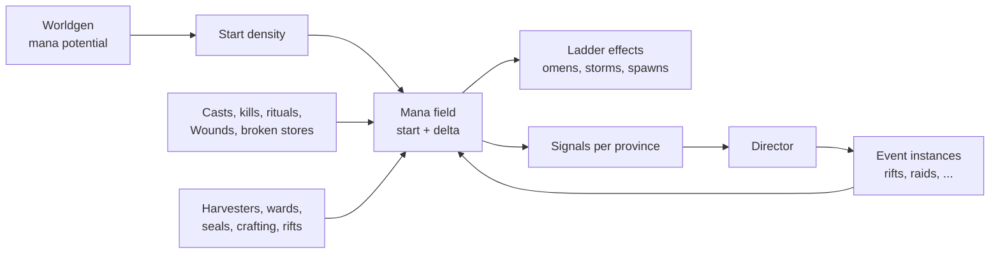



The zone gets four new parts: a **mana field** that changes with play, **provinces** to group the land, a **World
Event Director** that decides when something happens, and the **events** themselves, rifts first.



The split that keeps it small: **everything on the ladder is physics**. Omens, storm odds, den levels and drawn apex
bestia follow the density directly, all the time. The director only decides **discrete events**, and only those cost
budget.

# Mana Field

## Potential and Start Density

World generation keeps its layer, renamed `MANA_POTENTIAL` (`mana_potential`). It is a percentile rank over the land
(`ManaStage.rankAgainstLand`), which keeps every worldgen threshold stable across seeds. Those thresholds stay rank
cuts: crystals, herbs, weather regions, blight, wounds, corruption.

The zone derives the start density from it:

```text
d0 = 0.10 + 0.55 × potential⁴
```

`ManaConcentrationService` gets `potentialAt` (for geology readers like herbs) and `densityAt` (for everything that
asks how much mana is in the air: Potency, ritual factor, Magic Sense range, Weather Sense, theodolite). The
`ManaConcentration` bands move to density units: ordinary `0.08 .. 0.45`, thick above, drained below. A fresh world
changes no spell anywhere outside the cores of the Wounds.

## The Overlay

```text
density = d0 + delta
```

- **Cells** are 128 m (4 × 4 chunks). **Tiles** hold 32 × 32 cells (4 km). Only tiles with a delta exist.
- **Unit:** 1 mote = +0.001 on one cell.
- `ManaField` holds `Map<tileKey, FloatArray>` of delta, with `deltaAt`, `add(x, y, motes, radius)` and `densityAt`.

## Field Rule

`ManaFieldSystem` runs every 60 s on the tick and walks only active tiles. Like `ScorchRegrowthSystem` it declares no
fake reads or writes.

- **Leak on delta.** The delta decays with a half-life of one real month. Because only the delta is stored, this one
  rule is also "natural sources hold the base": no separate hotspot emitter is needed.
- **Start provinces** pull the density toward 0.3 with a half-life of 3 Bestia days.
- **Creep.** A slow diffusion, a few hundred metres per week. It must stay slow: with fast diffusion and a one-month
  leak, a spot's mana smears over about 8 km and the 128 m cells buy nothing.
- **Long range** only through visible things: mana storms carry mana with the wind and drop part of it, rifts spill,
  players carry crystals.

## Emitters and Sinks

| Hook                              | Where                                                          | Effect                                                                |
| --------------------------------- | -------------------------------------------------------------- | --------------------------------------------------------------------- |
| Cast                              | `SkillExecutionService` after `payCasterCost`                  | `+ manaCost × k_cast` at the caster                                   |
| Kill                              | a `KillObserver` on `DeathSystem` (`KillFact` needs the level) | `+ level × k_kill`, × 10 for a boss. A capture does not go through it |
| Crystal                           | `mana-content` on crystal items                                | Break or destruction releases it. Crafting with it removes it         |
| Wound                             | `SpecialSites` wounds                                          | Area source, grows with world age, later with the doomsday stage      |
| Harvester, ward, seal stone, rift | their own entities                                             | Pull into their store; a broken store releases all of it              |

The constants are not picked. A calibration test replays the targets and solves for them:

| Situation                     | Target                                   |
| ----------------------------- | ---------------------------------------- |
| One caster for a day          | +0.03                                    |
| Grind spot, daily for a week  | +0.15                                    |
| Chaos group of 5, one evening | +0.10 over ~1 km                         |
| One harvester for a day       | cancels one grind day                    |
| Late Wound, no harvesting     | province at storm level in ~2 real weeks |
| Rift spill                    | storm or burn level within ~300 m        |

## Persistence

Copied from the scorch and water overlays:

- A `ManaTile` row per tile: tile key, the cells as a `@Lob` blob, `world_shape_version`, `pipeline_version`.
- Loaded at boot (`ScorchRegistry.loadAll` pattern). Stale versions are deleted.
- Dirty tiles are written in batches through `AsyncJobExecutor` (`WaterJournal.flush` pattern).
- A `WorldScopedData` wipe for `WorldProvisioning.recreate`.

## Ladder

The tier of a cell is computed on read from its density, with a hysteresis of 0.03 and a dwell of one Bestia hour.

| Tier     | Density | Server effect                                                                  |
| -------- | ------- | ------------------------------------------------------------------------------ |
| Stirring | 0.35    | Client ambience                                                                |
| Uneasy   | 0.45    | Rumours, aggro radius, omen plants                                             |
| Ominous  | 0.55    | `Spawner.levelBonus` at restock, mana-touched visual, omen props, apex roamers |
| Storms   | 0.60    | Mana storm odds                                                                |
| Event    | 0.70    | Knots may form                                                                 |
| Sickness | 0.80    | Status effect through `EnvironmentalExposureSystem`                            |
| Burn     | 0.90    | Mana Burn may ignite                                                           |

- **Weather.** `WeatherModel.manaFor(region)` reads a `ManaProvider`. The zone gives it each weather region's mean and
  95th percentile of the density, **snapshotted once per Bestia hour**, so a forecast inside the hour stays true.
  `manaThreshold` and `manaStormFloor` move to density units (0.45 and 0.60).
- **Client.** `WeatherSMSG` gets a `mana_tier` per player. The client never receives the density itself, except the
  number Weather Sense grants. Omen props are ordinary props from a `WorldObjectSource`.
- **Rumours.** New kinds such as `STRANGE_LIGHTS`, `RESTLESS_BEASTS` and `STONES_RISEN`, posted through
  `RumourService.post` when a cell rises a tier near a settlement.

# Provinces

A province groups the place regions (`PlaceRegions`, about 6 km, named) around a capital.

- **Seeds:** every `SettlementSite` of tier TOWN or CITY. Where no town is within about 30 km, a wild seed, placed on
  a landmark first: a Wound, a world-boss lair, deep corruption.
- **Growth:** each place region joins the seed that is cheapest to reach over the region graph, with the same travel
  cost the place regions use. `PlaceRegions.neighboursOf` becomes public for this.
- **Water** joins the land province it touches. Deep ocean belongs to none.
- **Sanctuary:** the provinces of the start towns. No knots and no big events there.
- **Name:** the capital's ("the Ashford lands") or the landmark's.

Provinces are a pure function of the world, like the place regions. `worldgen/place/Provinces` builds them,
`ProvinceService` in the zone holds them lazily and rebuilds them on `WorldRecreatedEvent`.

**Partition version.** `PlaceRegions` is deliberately not a stage, so a change to `RegionParams` does not invalidate a
stored world. Rows keyed by a region or province index would then silently point at other land. So every such row
stores a **partition version**, a digest of `RegionParams` and `ProvinceParams`, and rows with another version are
dropped at boot.

# World Event Director

`WorldEventDirector` runs like `QuestDirector`: `@Scheduled` every 5 minutes, `@Transactional`, off the tick. It never
touches the ECS world directly. Anything that has to happen in the world goes through `WorldView.post`.

**1. Signals.** A `ProvinceSignals` snapshot per province:

- density mean, peak and 3-day trend, cells per tier
- players present (rolling over 3 Bestia days), kill pressure, hunted-out and neglected dens
- settlement fates and damage
- weather, moon, season, time of day
- the province's recent events and its tension phase

**2. Catalogue.** `world_events.yml`, checked by a boot validator. Each entry has:

- preconditions over the signals, for example `density.peak >= 0.70 for 1 day` or
  `moon == FULL and weather == MANA_STORM and night`
- scale (place region, province, world), weight, budget cost, cooldown
- the omen phase, a script for the behaviour, the contribution axes and the outcomes

**3. Choice.**

- **Budget:** each province gains 1 point per Bestia day, up to 5. A small event costs 1, a rift 3, a big event 5.
- **Tension:** build-up → peak → relax. After an event the province rests for 3 Bestia days and only small events
  can start there. This is the anti-farm rule.
- A weighted random pick among the entries whose preconditions hold, from a seeded RNG so tests can repeat it.
- A **world layer** on top caps concurrent big events, paces the doomsday and sends the rare world-wide text.

**4. Instances.** A `WorldEventInstance` row is a state machine `OMEN → ACTIVE → RESOLVED`, like `StoredQuestPlan`.
It owns its entities and writes the outcome back: mana, influence, damage, honor, loot, a
[chronicle](/docs/server/history-to-quests/) fact, rumours. An `EventProvince` row holds the budget, the tension phase
and the last events.

# Rifts

A `Rift` row holds position, phase, stage, reservoir, Potency and timestamps, so a rift survives a restart. A
`RiftSystem` on the tick runs it:

- **Knot** (2.5 to 4.5 Bestia days): pulls slowly from 300 m into the reservoir. Dissolves if the density around it
  falls below 0.6. Its intake becomes the reservoir at stage 1.
- **Open** (stages 1 to 5): the pull radius grows to 1.5 km. Waves every 20 to 30 minutes, level = den level + 5 ×
  stage, scaled by players present. They are spawned with `homePosition` = the nearest settlement, which makes the
  existing return-home goal walk them there. Long marches need `TravelTo` waypoints.
- **Anchor** at stage 3: a species with the new `rift-only` mob flag, which works like `corrupted-only`. Its kill is
  recorded like `WorldBossSlainSystem` does.
- **Seal window** (30 minutes): a ritual of kind `SEAL` at the gate. `RitualService.complete` gets ritual kinds and a
  result hook for this, and for `FEED` (Chaos) and `STASIS` (Circle).
- **Collapse:** the reservoir spills into the field within about 300 m, a scar prop is placed, a new knot may form.
- New `StaticEntityKind`s: `RIFT_GATE`, `RIFT_CRYSTAL_NODE`, `SEAL_STONE`. The gate is an entity drawn as a
  structure, like an Empyrite. A seal stone holds motes and releases them when it breaks.

**Town damage** from waves that reach a town goes through what `SettlementDamage` already derives from: scorch and
destroyed building props.

## Contribution

Contributors do not sign. An `EventContribution` ledger counts per event, master and axis:

- **Fighting:** damage to event bestia. `KillFact` gets the event id of the mob.
- **Work:** ritual channel time, crystal nodes harvested or shattered, wards raised.
- **Holding:** time in the pull radius while a stage is active.

Loot rolls and the honor acts `SEAL_RIFT`, `DEFEND_SETTLEMENT` and `REINFORCE_SEAL` are shared out by it. No coin is
paid. The contract itself is posted as a `WORLD` quest on the blackboards nearby so players can find it.

# GM Tools

A new authority `WORLD_EVENTS`, granted to GMs.

- `/mana get`, `/mana set <density> [radius]`, `/mana add <motes> [radius]`
- `/event list`, `/event force <id> <place>`, `/event cancel <id>`
- `/mana layer on|off`: a GM-only map layer with the tiers, the densities and the director state per province. It is
  sent as its own message only to a connection whose authorities hold `WORLD_EVENTS`. It never goes over the bus or to
  the companion app.

# Build Order

Each step is one branch and one draft PR in bestia-behemoth, stacked on the one before.

| Step    | What                                                                                | Notes                                |
| ------- | ----------------------------------------------------------------------------------- | ------------------------------------ |
| 01      | Rename to `MANA_POTENTIAL`, start density, readers on density                       | Runs the worldgen suite              |
| 02      | Mana field, persistence, `/mana`                                                    |                                      |
| 03      | Emitters and sinks, calibration test                                                |                                      |
| 04      | Provinces, partition version                                                        | Runs the worldgen suite              |
| 05      | Ladder on the server: tiers, live mana storms, spawns, sickness, rumours            |                                      |
| 06      | Ladder on the client: tier in `WeatherSMSG`, sky moods, motes, sound                |                                      |
| 07      | Omen props and scars                                                                |                                      |
| 08      | Director, catalogue, `/event`, the apex roamer as the first event                   |                                      |
| 09      | Rifts                                                                               |                                      |
| 10      | Contribution ledger, loot, honor, blackboard post                                   |                                      |
| 11      | Ritual kinds: seal, feed, stasis                                                    | Faction influence waits for factions |
| 12      | Observation and Augury                                                              |                                      |
| 13      | GM map layer                                                                        |                                      |
| 14 - 17 | Rare bestia under the right sky, alpha rises, old seal weakens, raid on a rich town | One step each                        |

## Numbers to Start From

All are configuration and are judged in play.

| Area                    | Value                                                                |
| ----------------------- | -------------------------------------------------------------------- |
| Cell / tile             | 128 m / 32 × 32 cells                                                |
| Leak half-life          | 1 real month                                                         |
| Start-province sink     | toward 0.3, half-life 3 Bestia days                                  |
| Creep                   | about 300 m per real week                                            |
| Field step              | every 60 s, active tiles only                                        |
| Tier hysteresis / dwell | 0.03 / 1 Bestia hour                                                 |
| Director cadence        | 5 minutes                                                            |
| Province budget         | +1 per Bestia day, up to 5; costs 1 / 3 / 5                          |
| Relax phase             | 3 Bestia days                                                        |
| Knot                    | 2.5 to 4.5 Bestia days, pull 300 m                                   |
| Rift open               | about 1 real day; pull 300 m to 1.5 km; waves every 20 to 30 minutes |
| Wave / anchor level     | den level + 5 × stage / province den ceiling + 10 to 20              |
| Seal window             | 30 minutes                                                           |
| Spill radius            | about 300 m                                                          |
