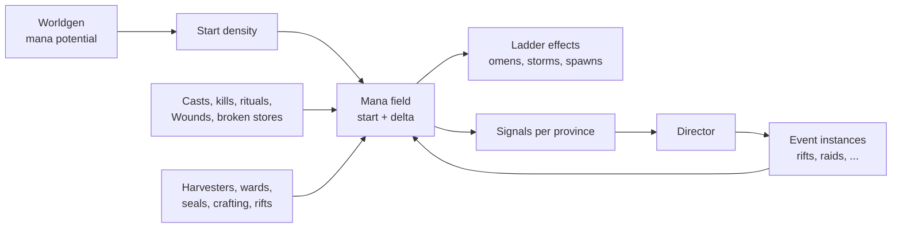



The zone gets four new parts: a **mana field** that changes with play, **provinces** to group the land, a **World
Event Director** that decides when something happens, and the **events** themselves, rifts first.



The split that keeps it small: **everything on the ladder is physics**. Omens, storm odds, den levels and drawn apex
bestia follow the density directly, all the time. The director only decides **discrete events**, and only those cost
budget.

# Mana Field

## Potential and Start Density

World generation keeps its layer, renamed `MANA_POTENTIAL` (`mana_potential`). It is a percentile rank over the land
(`ManaStage.rankAgainstLand`), which keeps every worldgen threshold stable across seeds. Those thresholds stay rank
cuts: crystals, herbs, weather regions, blight, wounds, corruption.

The zone derives the start density from it:

```text
d0 = 0.10 + 0.55 × potential⁴
```

`ManaConcentrationService` gets `potentialAt` (for geology readers like herbs) and `densityAt` (for everything that
asks how much mana is in the air: Potency, ritual factor, Magic Sense range, Weather Sense, theodolite). The
`ManaConcentration` bands move to density units: ordinary `0.08 .. 0.45`, thick above, drained below. A fresh world
changes no spell anywhere outside the cores of the Wounds.

## The Overlay

```text
density = d0 + delta
```

- **Cells** are 128 m (4 × 4 chunks). **Tiles** hold 32 × 32 cells (4 km). Only tiles with a delta exist.
- **Unit:** 1 mote = +0.001 on one cell.
- `ManaField` holds `Map<tileKey, FloatArray>` of delta, with `deltaAt`, `add(x, y, motes, radius)` and `densityAt`.

## Field Rule

`ManaFieldSystem` runs every 60 s on the tick and walks only active tiles. Like `ScorchRegrowthSystem` it declares no
fake reads or writes. Instead all mana state shares one lock on the field: casts, kills, ground fire and item decay
release mana from systems that run in parallel within one tick wave.

- **Leak on delta.** The delta decays with a half-life of one real month. Because only the delta is stored, this one
  rule is also "natural sources hold the base": no separate hotspot emitter is needed.
- **Start provinces** pull the density toward 0.3 with a half-life of 3 Bestia days.
- **Creep.** A slow diffusion, a few hundred metres per week. It must stay slow: with fast diffusion and a one-month
  leak, a spot's mana smears over about 8 km and the 128 m cells buy nothing.
- **Long range** only through visible things: mana storms carry mana with the wind and drop part of it, rifts spill,
  players carry crystals.

## Emitters and Sinks

| Hook                              | Where                                                          | Effect                                                                              |
| --------------------------------- | -------------------------------------------------------------- | ----------------------------------------------------------------------------------- |
| Cast                              | `SkillExecutionService` after `payCasterCost`                  | `+ manaCost × k_cast` at the caster                                                 |
| Kill                              | a `KillObserver` on `DeathSystem` (`KillFact` needs the level) | `+ level × k_kill`, × 10 for a boss. A capture does not go through it               |
| Crystal                           | `mana.emission.stored-motes`, by item identifier               | A stack destroyed or decayed on the ground releases it. Crafting with it removes it |
| Wound                             | `SpecialSites` wounds                                          | Area source, grows with world age, later with the doomsday stage                    |
| Harvester, ward, seal stone, rift | their own entities                                             | Pull into their store; a broken store releases all of it                            |

The constants are not picked. A calibration test replays the targets and solves for them:

| Situation                     | Target                                   |
| ----------------------------- | ---------------------------------------- |
| One caster for a day          | +0.03                                    |
| Grind spot, daily for a week  | +0.15                                    |
| Chaos group of 5, one evening | +0.10 over ~1 km                         |
| One harvester for a day       | cancels one grind day                    |
| Late Wound, no harvesting     | province at storm level in ~2 real weeks |
| Rift spill                    | storm or burn level within ~300 m        |

## Persistence

Copied from the scorch and water overlays:

- A `StoredManaTile` row per tile: tile key, the cells as a `@Lob` blob, `world_shape_version`, `pipeline_version`.
- Loaded at boot (`ScorchRegistry.loadAll` pattern). Stale versions are deleted.
- Changed tiles are written every five minutes and at shutdown through `AsyncJobExecutor` (`WaterJournal.flush`
  pattern).
- A `WorldScopedData` wipe for `WorldProvisioning.recreate`.

## Ladder

`ManaTiers` gives each cell a tier, with a hysteresis of 0.03 and a dwell of one Bestia hour. Only cells whose tier
differs from their start density's remember it. After a restart the saved field takes its tiers at once, so nothing is
announced twice.

| Tier     | Density | Server effect                                                        |
| -------- | ------- | -------------------------------------------------------------------- |
| Stirring | 0.35    | Client ambience                                                      |
| Uneasy   | 0.45    | Rumours, aggro radius, omen plants                                   |
| Ominous  | 0.55    | Dens restock +3 levels with `MANA_TOUCHED`, omen props, apex roamers |
| Storms   | 0.60    | Mana storm odds                                                      |
| Event    | 0.70    | Knots may form                                                       |
| Sickness | 0.80    | `MANA_SICKNESS` on masters through `EnvironmentalExposureSystem`     |
| Burn     | 0.90    | Mana Burn may ignite                                                 |

- **Spawns.** The level bonus grows with the tier: +3 at Ominous and Storms, +5 at Event, +7 at Sickness, +10 at Burn.
- **Sickness.** A fifth less health, a tenth less attack and no natural healing, lasting a minute after the master
  leaves. Bestia do not fall ill, and no roof or camp helps.
- **Weather.** `WeatherModel` reads a `ManaReading`. The zone gives it each weather region's 95th percentile of the
  density, **frozen once per Bestia hour**, so a forecast inside the hour stays true. The start density curve lives in
  worldgen, so a fresh world's weather regions summarise the same density. `manaThreshold` and `manaStormFloor` are in
  density units (0.45 and 0.60).
- **Client.** `WeatherSMSG` gets a `mana_tier` per player. The client never receives the density itself, except the
  number Weather Sense grants. Omen props are ordinary props from a `WorldObjectSource`.
- **Rumours.** A rise to Uneasy posts `STRANGE_LIGHTS`, to Ominous `RESTLESS_BEASTS` and to Storms `STONES_RISEN`,
  through `RumourService.post`. Each kind is posted once per 4 km tile while the news lives, so a whole Wound rising
  makes one rumour.

# Provinces

A province groups the place regions (`PlaceRegions`, about 6 km, named) around a capital.

- **Seeds:** every standing town and city, and every home settlement a new master may pick, even a village, so each
  start town has a province of its own. Where no seed is within 30 km, a wild seed: a Wound or a lair first, then the
  land farthest from any seed.
- **Growth:** each place region joins the seed that is cheapest to reach over the region graph, with the same travel
  cost the place regions use. `PlaceRegions.neighboursOf` becomes public for this.
- **Water** joins the land province it touches. Deep ocean belongs to none.
- **Sanctuary:** the provinces of the start towns. No knots and no big events there.
- **Name:** the capital's ("the Ashford lands") or the landmark's.

Provinces are a pure function of the world, like the place regions. `worldgen/place/Provinces` builds them,
`ProvinceService` in the zone holds them lazily and rebuilds them on `WorldRecreatedEvent`.

**Partition version.** `PlaceRegions` is deliberately not a stage, so a change to `RegionParams` does not invalidate a
stored world. Rows keyed by a region or province index would then silently point at other land. So every such row
stores a **partition version**, a digest of `RegionParams` and `ProvinceParams`, and rows with another version are
dropped at boot.

# World Event Director

`WorldEventDirector` runs like `QuestDirector`: `@Scheduled` every 5 minutes, `@Transactional`, off the tick. World
actions go through `WorldView`.

**1. Signals.** A `ProvinceSignals` snapshot per province: the peak mana cell and its density, the changed cells per
tier, and the masters standing there. Still planned, for the events that need them: the 3-day trend, kill pressure,
neglected dens, settlement damage, weather, moon and season.

**2. Catalogue.** `world_events.yml`. Each entry names the `WorldEvent` bean that runs it (the boot fails on a gap),
its cost, weight, minimum tier and how many cells must be at it, a cooldown and a duration in Bestia days, and the
loot its contributors split.

**3. Choice.**

- **Budget:** each province gains 1 point per Bestia day, up to 5. The apex costs 1, a rift 3.
- **Quiet:** after an event ends the province rests for 3 Bestia days. Together with the budget this is the anti-farm
  rule.
- A ready province - no sanctuary, no running event, not resting - starts an event it can afford with a chance of a
  quarter per run, weighted among those that fit. The roll is seeded by world, province and time window.
- Planned: a world layer that caps concurrent big events, paces the doomsday and sends the rare world-wide text.

**4. Instances.** A `WorldEventInstance` row holds the event, the province, where it started and its subject: an
entity id (the apex) or a row id (a rift). It ends as `DEFEATED` when players ended it, `EXPIRED` when it ran its
course or out of time, and `CANCELLED` by a GM. `OMEN` is reserved for events with a warning phase. An
`EventProvince` row holds the budget and the quiet, with the partition version.

**The apex roamer** is the strongest non-boss species of the province's own dens, born 5 levels above its highest roll
and mana-touched. It spawns on the province's land farthest from the peak and has its home on the peak, so it roams
toward the thickest mana. Killing it ends the event; otherwise it leaves after 2 Bestia days.

# Rifts

A `rift` row holds position, phase, stage, reservoir, the anchor and timestamps, so a rift survives a restart.
`RiftSystem` moves every rift once a minute under the field's lock; `RiftLifecycle` and `RiftField` are the pure
mechanics, so `RiftLifecycleTest` runs a whole rift on a test field.

- **Knot** (2.5 to 4.5 Bestia days): pulls slowly within 300 m into the reservoir and leaves an eerie calm. If the ring
  around it falls below 0.6 it dissolves and lets its mana go: the players' win.
- **Open** (stages 1 to 5 over a real day): the pull radius grows to 1.5 km and a `RIFT_GATE` entity stands at the
  centre. Every 20 to 30 real minutes a wave of the province's own den species, 5 levels per stage above their kin
  and mana-touched, walks toward the nearest town: five while masters stand within 1.5 km, two otherwise.
- **Anchor** at stage 3: the Rift Warden, an `event-only` boss ten levels above the province's strongest den. The rift
  remembers its fall for the seal.
- **Collapse:** the reservoir spills within 300 m, heaviest at the centre, which leaves storms or worse.
- **Merge:** touching rifts merge into the older one.
- Towns hear `RIFT_OPENED` and `RIFT_COLLAPSED`.

Still planned: the seal window and the seal stone, feeding and stasis (step 11); crystal nodes (step 11, as part of the
work axis); a scar where a rift collapsed; town damage from waves; chronicle facts for rifts.

## Contribution

Contributors do not sign. A `ContributionLedger` counts per event, master and axis, keyed by the tag every event
creature carries (`EventCreature`, which `KillFact` passes on). The director saves it every run.

- **Fighting:** a kill of an event creature credits everyone who earned it, by its level, a boss five times over.
- **Holding:** each run, every master standing on a running event's ground: 300 m around the apex, or all a rift pulls
  from. One run is worth a level-10 kill.
- **Work** (step 11): ritual channel time, crystal nodes harvested or shattered.

When players end an event, its loot is split by share among everyone with at least a twentieth of the work. It lands at
the feet of each contributor who is online, kept for them alone. They also earn the `DEFEND_SETTLEMENT` honor act,
globally while online and with the town nearest the event either way. An event that ran out pays nothing. No coin is
paid. Still planned: posting the event on the blackboards nearby.

# GM Tools

A new authority `WORLD_EVENTS`, granted to GMs.

- `/mana get`, `/mana set <density> [radius]`, `/mana add <motes> [radius]`
- `/event` (running events and the budget where you stand), `/event force <id>` in your province, `/event cancel <id>`
- `/mana layer on|off`: a GM-only map layer with the tiers, the densities and the director state per province. It is
  sent as its own message only to a connection whose authorities hold `WORLD_EVENTS`. It never goes over the bus or to
  the companion app.

# Build Order

Each step is one branch and one draft PR in bestia-behemoth, stacked on the one before.

| Step    | What                                                                                | Notes                                |
| ------- | ----------------------------------------------------------------------------------- | ------------------------------------ |
| 01      | Rename to `MANA_POTENTIAL`, start density, readers on density                       | Runs the worldgen suite              |
| 02      | Mana field, persistence, `/mana`                                                    |                                      |
| 03      | Emitters and sinks, calibration test                                                |                                      |
| 04      | Provinces, partition version                                                        | Runs the worldgen suite              |
| 05      | Ladder on the server: tiers, live mana storms, spawns, sickness, rumours            |                                      |
| 06      | Ladder on the client: tier in `WeatherSMSG`, sky moods, motes, sound                |                                      |
| 07      | Omen props and scars                                                                |                                      |
| 08      | Director, catalogue, `/event`, the apex roamer as the first event                   |                                      |
| 09      | Rifts                                                                               |                                      |
| 10      | Contribution ledger, loot, honor, blackboard post                                   |                                      |
| 11      | Ritual kinds: seal, feed, stasis                                                    | Faction influence waits for factions |
| 12      | Observation and Augury                                                              |                                      |
| 13      | GM map layer                                                                        |                                      |
| 14 - 17 | Rare bestia under the right sky, alpha rises, old seal weakens, raid on a rich town | One step each                        |

## Numbers to Start From

All are configuration and are judged in play.

| Area                    | Value                                                                |
| ----------------------- | -------------------------------------------------------------------- |
| Cell / tile             | 128 m / 32 × 32 cells                                                |
| Leak half-life          | 1 real month                                                         |
| Start-province sink     | toward 0.3, half-life 3 Bestia days                                  |
| Creep                   | about 300 m per real week                                            |
| Field step              | every 60 s, active tiles only                                        |
| Tier hysteresis / dwell | 0.03 / 1 Bestia hour                                                 |
| Director cadence        | 5 minutes                                                            |
| Province budget         | +1 per Bestia day, up to 5; costs 1 / 3 / 5                          |
| Relax phase             | 3 Bestia days                                                        |
| Knot                    | 2.5 to 4.5 Bestia days, pull 300 m                                   |
| Rift open               | about 1 real day; pull 300 m to 1.5 km; waves every 20 to 30 minutes |
| Wave / anchor level     | den level + 5 × stage / province den ceiling + 10 to 20              |
| Seal window             | 30 minutes                                                           |
| Spill radius            | about 300 m                                                          |
